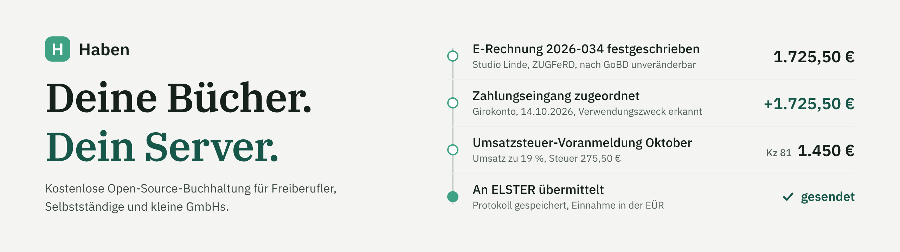

<div align="center">

<h1>Haben: Open-Source-Buchhaltung, selbst gehostet</h1>

<picture>
  <source media="(prefers-color-scheme: dark)" srcset="docs/hero-dunkel.png">
  
</picture>

**Die Buchhaltungssoftware für Freiberufler, Selbstständige, Kleinunternehmer und kleine GmbHs, die du selbst betreibst.**<br>
Rechnungen mit E-Rechnung (ZUGFeRD, XRechnung), Belege, Bankabgleich, EÜR oder Bilanz mit E-Bilanz und die Steuern
direkt an ELSTER. Für die GoBD gebaut, auf deinem Server, ohne Datenabfluss.


[](https://github.com/firsttris/haben/actions/workflows/ci.yml)
[](https://github.com/firsttris/haben/releases/latest)
[](LICENSE)
[](https://haben.app/)
[](https://haben.app/rechnungen.html)
[](https://haben.app/umsatzsteuer.html)
[](https://www.typescriptlang.org/)
[](https://tanstack.com/start)
[](https://www.postgresql.org/)
[](https://hub.docker.com/r/tristanteu/haben)
[](https://hub.docker.com/r/tristanteu/haben)
[](https://hub.docker.com/r/tristanteu/haben/tags)
[](https://haben.app/installation.html)

[Warum?](#warum-haben) •
[Funktionen](#funktionen) •
[Schnellstart](#schnellstart) •
[FAQ](#faq) •
[Dokumentation](https://haben.app/) •
[Entwicklung](#entwicklung)

<sub>English: self-hosted open-source bookkeeping for German freelancers, small businesses and small limited companies (GmbH, UG), with e-invoicing (ZUGFeRD, XRechnung), bank reconciliation, EÜR or balance sheet with E-Bilanz, and VAT, corporate and trade tax returns via ELSTER. The app and its [documentation](https://haben.app/) are in German.</sub>


</div>

> [!WARNING]
> **Beta:** Haben wird noch stark weiterentwickelt. Datenmodell und Abläufe können sich von Version zu Version
> ändern, und Migrationen lassen sich nicht zurückspielen. Vor jedem Update ein Backup machen
> (`docker compose exec backup backup.sh`, siehe [Backup und Wiederherstellen](https://haben.app/installation.html#backup-und-wiederherstellen))
> und Auswertungen und Meldungen ans Finanzamt vor dem Absenden prüfen.

## Warum Haben?

In der Buchhaltung gibt es Soll und Haben. Haben ist, was dir gehört.

Rechnungen schreiben, Belege sammeln, Konto abgleichen, Voranmeldung schicken: Dafür braucht es kein Abo bei
Lexware Office (früher lexoffice) oder sevDesk und keinen fremden Dienst, der jede Rechnung sieht. Haben ist die
Open-Source-Alternative dazu: eine Web-App für Buchhaltung, Steuern und Rechnungen, die du mit Docker oder Podman
auf deinem eigenen Server betreibst.

**🇩🇪 Open Source made in Germany**

- **Ein Weg vom Beleg bis zum Finanzamt**: festschreiben, Zahlung zuordnen, Voranmeldung prüfen und senden
- **Nachprüfbar statt „vertrau uns“**: Beim Umzug rechnet Haben deine alten Jahre nach, zum Vergleich mit deinen
  Voranmeldungen und dem Abschluss der Steuerberatung; danach führt jede Kennzahl zu den Rechnungen, Belegen und
  Zahlungen dahinter, siehe [Woher weiß ich, dass die Zahlen stimmen?](#faq)
- **Für die GoBD gebaut**: Festschreibung per Postgres-Trigger, Audit-Log, Korrekturen nur über Storno
- **Deine Daten bleiben bei dir**: eigener Server, Schlüssel verschlüsselt, Jahresarchiv mit Prüfsummen; KI nur auf Wunsch, auch mit eigenem Modell auf deinem Server
- **Umzug ohne Datenverlust**: Rechnungen, Belege, Buchungen ohne Beleg und Kontakte aus Lexware Office oder sevDesk übernehmen, DATEV-Export archivieren
- **Für Freiberufler und Kleingewerbe**: Einnahmen-Überschuss-Rechnung (EÜR), Ist- oder Soll-Versteuerung,
  Kleinunternehmerregelung nach § 19 UStG, Kontenrahmen SKR03 oder SKR04
- **Für GmbH und UG**: Bilanz und GuV, E-Bilanz, Körperschaft- und Gewerbesteuer, Gewinnausschüttung mit
  Kapitalertragsteuer-Anmeldung und Steuerbescheinigung für die Gesellschafter, Pflichtangaben nach § 35a GmbHG auf
  Rechnungen und Geschäftsbriefen, siehe [GmbH und UG](https://haben.app/gmbh.html)

## Funktionen

Kurz je Bereich; die Details stehen auf der verlinkten Seite der [Dokumentation](https://haben.app/).

| Bereich | Was Haben kann |
|---|---|
| 🧾 [Rechnungen](https://haben.app/rechnungen.html) | Live-Vorschau, ZUGFeRD/XRechnung (KoSIT-geprüft), [eigene Layouts](https://haben.app/belegvorlagen.html) in Typst, Storno, Abschlags- und wiederkehrende Rechnungen, Mahnwesen mit Basiszinssatz von der Bundesbank, Versand per E-Mail |
| 📝 [Angebote](https://haben.app/angebote.html) | Optionale und alternative Positionen, Zahlungsplan mit Abschlagsrechnungen, mit einem Klick zur Rechnung |
| 📎 [Belege](https://haben.app/belege.html) | Hochladen per Drag-and-drop, Kamera oder E-Mail; E-Rechnungen direkt gelesen, sonst optional per KI (Claude, Ollama, OpenRouter …); Dauerbelege, SEPA-Überweisung |
| 🏦 [Bankabgleich](https://haben.app/bank.html) | Automatischer Abruf per PSD2 oder Import (DKB, N26, CAMT.053, PayPal, Stripe …), Vorschläge mit Begründung, Steuerzahlungen und Darlehen |
| 📤 [Voranmeldung](https://haben.app/umsatzsteuer.html) | Kennzahlen aus den Buchungen (Ist oder Soll) mit Herkunft jeder Zahl, Übermittlung per ERiC oder über Mein ELSTER, Zusammenfassende Meldung |
| 📮 [Abgabe an ELSTER](https://haben.app/elster-abgabe.html) | Direkt per ERiC oder ohne Hersteller-ID über Mein ELSTER: XML-Upload, Browser-Erweiterung [Haben für Mein ELSTER](https://haben.app/elster-mit-erweiterung.html) oder ein [KI-Assistent](https://haben.app/elster-mit-assistent.html) wie Claude in Chrome |
| 📑 [Jahreserklärungen](https://haben.app/jahreserklaerung.html) | USt-Erklärung, Anlage EÜR, Einkommensteuer; für GmbH und UG Körperschaft- und Gewerbesteuer |
| 🏛️ [Finanzamt](https://haben.app/finanzamt.html) | Bescheide und Nachrichten über ELSTER, Herabsetzung der Vorauszahlungen |
| 🏢 [GmbH und UG](https://haben.app/gmbh.html) | Bilanz und GuV, E-Bilanz per ERiC, Gesellschafter-Verrechnungskonto, Gewinnausschüttung mit Kapitalertragsteuer |
| 👥 [Lohn](https://haben.app/lohn.html) | Abrechnung nach dem Programmablaufplan des BMF, Minijob und Gesellschafter-Geschäftsführer, Lohnsteuer-Anmeldung über ELSTER, Lohnkonto |
| ⏰ [Fristen](https://haben.app/fristen.html) | Alle Steuertermine auf einer Seite, als Kalender-Feed (iCal) und per E-Mail |
| 🚗 [Pauschalen](https://haben.app/pauschalen.html) · [Kasse](https://haben.app/kasse.html) | Homeoffice, Kilometer, Verpflegungsmehraufwand; Kassenbuch für Barzahlungen |
| 🖥️ [Anlagen und AfA](https://haben.app/anlagen.html) | Anlagenverzeichnis, lineare und degressive AfA, GWG und Sammelposten |
| 📊 [Auswertungen](https://haben.app/auswertungen.html) | EÜR, offene Posten, Monatsverlauf, Jahresexport als ZIP mit SHA-256-Prüfsummen |
| 📚 [Buchhaltung](https://haben.app/buchhaltung.html) | Doppelte Buchführung nach SKR03/SKR04, Journal, Saldenliste, Kontenblätter, DATEV-Export |
| 📦 [Umzug aus Lexoffice](https://haben.app/lexoffice.html) · [sevDesk](https://haben.app/sevdesk.html) · [BuchhaltungsButler](https://haben.app/buchhaltungsbutler.html) · [Accountable](https://haben.app/accountable.html) · [JSON-Paket](https://haben.app/belegimport.html) | Rechnungen, Belege, Buchungen und Kontakte übernehmen, mit Abgleich je Jahr |
| 🔐 [Anmeldung](https://haben.app/einrichtung.html#konto-anlegen) · [App](https://haben.app/einrichtung.html#als-app-installieren) | Passkey oder ausschließlich OpenID Connect mit Rollen aus Gruppen, Lesezugang für die [Steuerberatung](https://haben.app/steuerberatung.html), installierbar als App auf Handy und Desktop, helles und dunkles Theme |
| 📥 [CSV-Import](https://haben.app/csv-import.html) | Kontakte, Artikel und Anlagen aus CSV, mit Spaltenzuordnung und Vorschau |
| 🔌 [REST-API](https://haben.app/api.html) | Versionierte Schnittstelle mit OpenAPI für Kontakte, Rechnungsentwürfe und Belege; Tokens mit Rechten je Bereich |
| 🤖 [KI-Assistenten (MCP)](https://haben.app/ki-assistenten.html) | Haben im Gespräch mit Claude oder einem lokalen Modell abfragen („Welche Rechnungen sind überfällig?“), nur lesend |
| 🧩 [Eigene Seiten](https://haben.app/eigene-seiten.html) | Eigene Werkzeuge, etwa aus n8n, als Menüeintrag in Haben |
| ♿ [Barrierefreiheit](https://haben.app/barrierefreiheit.html) | Vollständig per Tastatur bedienbar, jede Seite in der CI gegen WCAG 2.2 AA geprüft |

## Screenshots

<table>
  <tr>
    <td width="50%"><br><sub><b>Rechnung schreiben</b>: Vorschau des PDFs, während du tippst</sub></td>
    <td width="50%"><br><sub><b>Bankabgleich</b>: Vorschlag mit Begründung, Enter ordnet zu</sub></td>
  </tr>
  <tr>
    <td width="50%"><br><sub><b>Voranmeldung</b>: aus den Buchungen berechnet, direkt an ELSTER</sub></td>
    <td width="50%"><br><sub><b>Auswertungen</b>: EÜR nach Zufluss und Abfluss</sub></td>
  </tr>
</table>

## Schnellstart

Haben läuft als vier Container: die App (`tristanteu/haben`, amd64 und arm64), PostgreSQL, Caddy für HTTPS und ein
tägliches Backup mit restic.
Du brauchst einen Linux-Server mit Docker oder Podman und eine Domain, die auf ihn zeigt (Ports 80 und 443),
denn Passkeys funktionieren nur über HTTPS.

### 1. Von einem Agenten aufsetzen lassen

Gib Claude Code oder einem anderen Coding-Agenten dieses Repository und SSH-Zugang zu deinem Server und sag:
„Setz Haben auf meinem Server auf, nach der [Installationsanleitung](https://haben.app/installation.html).“

### 2. Manuell

```bash
mkdir haben && cd haben
curl -O https://raw.githubusercontent.com/firsttris/haben/main/deploy/compose.yml
curl -o .env https://raw.githubusercontent.com/firsttris/haben/main/deploy/compose.env.example
chmod 600 .env
# in .env eintragen: DOMAIN, DB_PASSWORD (openssl rand -hex 24),
# AUTH_SECRET, ENCRYPTION_KEY und RESTIC_PASSWORD (je openssl rand -base64 32), dann
docker compose up -d
```

Öffne **https://deine-domain**, leg dein Konto an und richte Firmendaten, Nummernkreis und ELSTER ein, wie in
[Erste Schritte](https://haben.app/einrichtung.html) beschrieben.

Podman Quadlets, ERiC für die ELSTER-Übermittlung, Backup, Updates und alle Umgebungsvariablen stehen in
[Betrieb und Installation](https://haben.app/installation.html).

> [!IMPORTANT]
> Sichere den Verschlüsselungsschlüssel (`ENCRYPTION_KEY` bzw. das Secret `haben-encryption-key`) und das
> Backup-Passwort (`RESTIC_PASSWORD` bzw. `haben-restic-password`) zusätzlich an einem zweiten Ort. Ohne den Schlüssel
> sind ELSTER-Zertifikat und die Schlüssel für Lexoffice und sevDesk nach einer Wiederherstellung nicht mehr lesbar,
> ohne das Passwort lässt sich das Backup nicht öffnen.

## FAQ

<details>
<summary><b>Was kostet Haben?</b></summary>

Die Software ist kostenlos (AGPL). Du brauchst nur einen Server, etwa einen VPS ab rund 5 € im Monat.
</details>

<details>
<summary><b>Ist Haben eine Alternative zu Lexware Office (lexoffice) und sevDesk?</b></summary>

Ja, ohne Abo und auf deinem eigenen Server. Rechnungen, Belege und Kontakte übernimmst du per API oder, bei
Lexware Office ohne Tarif XL, über eine Sicherung aus der Web-Oberfläche, siehe
[Umzug aus Lexoffice](https://haben.app/lexoffice.html) und [Umzug aus sevDesk](https://haben.app/sevdesk.html).
</details>

<details>
<summary><b>Für wen ist Haben gedacht?</b></summary>

Für Freiberufler, Selbstständige und Kleinunternehmer mit Einnahmen-Überschuss-Rechnung (EÜR), auch mit
Kleinunternehmerregelung nach § 19 UStG, und für kleine GmbHs und UGs. Eine GmbH oder UG macht ihre Buchhaltung in Haben, mit
Gesellschafter-Verrechnungskonto statt Privatkonten; Bilanz und GuV zeigt Haben als Entwurf für die Steuerberatung und
sendet E-Bilanz, Körperschaft- und Gewerbesteuererklärung (für eine GmbH ohne Beteiligungen und Organschaft) und
bucht Gewinnausschüttungen samt Kapitalertragsteuer-Anmeldung und Steuerbescheinigungen für die Gesellschafter. Die Bilanz zur Hinterlegung beim Unternehmensregister
erstellt Haben als PDF, mit den Vermerken zu Restlaufzeiten und gegenüber Gesellschaftern. Den Lohn des Gesellschafter-Geschäftsführers, von Minijobs und (als Entwurf zum Gegenprüfen) von Angestellten rechnet und bucht Haben, meldet die Lohnsteuer über ELSTER an und listet Beitragsnachweis und Meldungen zum Abtippen im SV-Meldeportal, siehe [Lohn](https://haben.app/lohn.html).
</details>

<details>
<summary><b>Woher weiß ich, dass die Zahlen stimmen?</b></summary>

Du musst Haben nicht glauben, du kannst nachrechnen:

- **Vor dem Umzug:** Haben rechnet deine alten Jahre aus Lexware Office oder sevDesk nach, mit Einnahmen, Ausgaben und
  Umsatzsteuer je Monat zum Vergleich mit deinen übermittelten Voranmeldungen. Bei GmbH und UG rechnet es aus dem
  DATEV-Stapel Bilanz, GuV, Körperschaft- und Gewerbesteuer zum Vergleich mit dem Abschluss der Steuerberatung.
  So siehst du vor der Kündigung, ob Haben auf dieselben Zahlen kommt, siehe
  [Abgleich je Jahr](https://haben.app/lexoffice.html#schritt-5-abgleich-je-jahr).
- **Im laufenden Jahr:** Unter jeder Kennzahl der Voranmeldung stehen die Rechnungen, Belege und Zahlungen dahinter,
  jede Buchung im Journal führt zu ihrem Vorgang. Voranmeldung und EÜR rechnet Haben zweimal, aus dem Journal und aus
  Rechnungen und Belegen, und zeigt, wo beides abweicht, siehe
  [Abgleich von Journal, Umsatzsteuer und EÜR](https://haben.app/buchhaltung.html#abgleich-von-journal-umsatzsteuer-und-eür).
- **Danach:** Das Änderungsprotokoll ist eine Hashkette, festgeschriebene Daten sind versiegelt, und den Prüfwert
  bekommst du per E-Mail und im Jahresarchiv mit SHA-256-Prüfsummen, siehe
  [Hash-Kette und Siegel](https://haben.app/buchhaltung.html#manipulationserkennung-hash-kette-und-siegel).
- **Offen:** Code und Tests sind öffentlich, mit der Quelle (Gesetz, ERiC-Dokumentation, EN 16931) an den Stellen, wo
  sie ein Detail entscheidet.

Was das nicht ersetzt: Nachprüfbar heißt nicht geprüft. Ein Testat für die Software gibt es nicht, und ist eine
Steuerregel falsch verstanden, rechnet Haben sie auch nachvollziehbar falsch. Die fachliche Prüfung bleibt bei dir und
deiner Steuerberatung.
</details>

<details>
<summary><b>Ist Haben GoBD-konform?</b></summary>

Haben setzt die technischen Anforderungen der GoBD um: Gebuchtes wird festgeschrieben und lässt sich nur per Storno
korrigieren, jede Änderung steht im Audit-Log, und das Jahresarchiv hat SHA-256-Prüfsummen. Zur Ordnungsmäßigkeit
gehören außerdem dein Betrieb (Backups, Aufbewahrung) und deine Verfahrensdokumentation; ein Testat für die Software gibt
es nicht. Siehe [Buchhaltung in Haben](https://haben.app/buchhaltung.html).
</details>

<details>
<summary><b>Wie kommen Voranmeldung und Erklärungen zu ELSTER?</b></summary>

Direkt aus Haben oder über das Portal Mein ELSTER ([alle Wege im Vergleich](https://haben.app/elster-abgabe.html)):
- **Direkt aus Haben** per ERiC, für Voranmeldung, Umsatzsteuererklärung, Anlage EÜR und Einkommensteuer, dazu Bescheide
  aus dem ELSTER-Postfach. Dafür brauchst du eine eigene Hersteller-ID; die Beantragung dauert Tage bis Wochen
  ([Erste Schritte](https://haben.app/einrichtung.html#elster-einrichten)).
- **Über Mein ELSTER**, ohne Hersteller-ID: Die Voranmeldung lädst du als XML-Datei hoch. Alle vier Formulare trägt
  die Browser-Erweiterung [Haben für Mein ELSTER](https://haben.app/elster-mit-erweiterung.html)
  ein, oder ein [KI-Assistent](https://haben.app/elster-mit-assistent.html) wie Claude in Chrome.
  Absenden machst du dort selbst; die Abgabe der Voranmeldung vermerkst du danach in Haben mit Transferticket und Protokoll.
</details>

<details>
<summary><b>Kann meine Steuerberatung damit arbeiten?</b></summary>

Ja, mit einem [eigenen Zugang](https://haben.app/steuerberatung.html), der nur lesen kann, oder über den
[DATEV-Export](https://haben.app/auswertungen.html#datev-export-für-die-steuerberatung) im Kontenrahmen SKR03 oder SKR04.
</details>

<details>
<summary><b>Können mehrere Personen Haben nutzen?</b></summary>

Haben ist für dich und deine eigene Firma gedacht: Im Standardmodus gibt es genau einen Inhaber mit allen Rechten. Dazu kannst du deine
Steuerberatung per Einladungslink mit einem [Zugang, der nur lesen kann](https://haben.app/steuerberatung.html), dazuholen.
Mit [Single Sign-on](https://haben.app/installation.html#single-sign-on-mit-openid-connect) sind auch mehrere Inhaber
möglich; die Rolle kommt dann bei jeder Anmeldung aus der Gruppe im Anmeldedienst.
</details>

<details>
<summary><b>Kann ich Claude oder andere Agenten mit meiner Buchhaltung nutzen?</b></summary>

Ja, über MCP, und nur lesend: „Welche Rechnungen sind überfällig?“ Buchen und Senden an ELSTER
machst du weiter selbst. Siehe [KI-Assistenten (MCP)](https://haben.app/ki-assistenten.html). Für
eigene Werkzeuge und Automationen gibt es die [REST-API](https://haben.app/api.html).
</details>

<details>
<summary><b>Ist das sicher?</b></summary>

Wir prüfen automatisiert, und du kannst es auch: Der Code ist offen. Ein unabhängiges Audit gibt es bisher nicht.

- **Automatisiert geprüft:** mit Cloudflares [Security Audit Skill](https://github.com/cloudflare/security-audit-skill) und
  `/security-review` von Claude Code. Lass deinen Agenten gern selbst über dieses Repository laufen.
- **Abgesichert:** Zugangsdaten verschlüsselt in der Datenbank, ERiC getrennt vom App-Prozess, Rollen für Inhaber und
  Steuerberatung, Festschreibung per Datenbank-Trigger, Änderungsprotokoll als Hashkette.
- **Wenige Abhängigkeiten:** Rechnungen mit E-Rechnung, Bank, Steuern über ELSTER, Lohn, GmbH, Anmeldung mit Passkey
  und SSO, E-Mail und KI kommen mit gut zwanzig direkten Paketen zur Laufzeit aus, ohne Komponentenbibliothek, mit
  schlichtem CSS. Was mit wenigen Zeilen eigenem Code geht, holt Haben nicht als Paket dazu: Jedes Paket weniger ist
  eine mögliche Lücke und ein Update weniger.
- **Aktuell gehalten:** Renovate bringt Updates der Abhängigkeiten als Pull Request durch die CI; bekannte Lücken
  (Dependabot-Warnungen und OSV-Datenbank) behebt es außerhalb des Zeitplans, siehe
  [SECURITY.md](SECURITY.md#abhängigkeiten-aktuell-halten).
- **Offen für alle:** Jeder kann den Code lesen und Lücken melden, bitte vertraulich wie in [SECURITY.md](SECURITY.md)
  beschrieben.
</details>

<details>
<summary><b>Wird Haben mit KI entwickelt?</b></summary>

Ja, zu einem großen Teil mit Coding-Agenten, aber nicht ungeprüft:

- **Fehlerklassen ausgeschlossen:** Beträge nur in ganzen Cent, Festschreibung per Datenbank-Trigger, die auch fehlerhafter Code nicht umgehen kann.
- **Tests für jede Änderung:** Vitest, Postgres und Playwright; ein Bugfix beginnt mit einem Test, der fehlschlägt. E-Rechnungen prüft der KoSIT-Validator in der CI.
- **Regeln als Skript:** Modulgrenzen, Dateigröße und die Regeln für Pull Requests prüft die CI, nicht nur der Text.
- **Review mit Beweis:** Ein zweiter, unabhängiger Agent reviewt jeden Pull Request und darf einen Fehler nur melden, wenn ein Test ihn rot zeigt. Gemergt wird von einem Menschen.

Was das nicht ersetzt: die fachliche Prüfung durch eine Steuerberatung. Ist eine Steuerregel falsch verstanden, sind Code und Test gemeinsam falsch. Siehe [Leitplanken für Agenten](https://haben.app/entwicklung.html#leitplanken-für-agenten).
</details>

## Dokumentation

Alles im Detail, mit Suche: **https://haben.app/**. Jede Funktion oben verlinkt ihre Seite; dazu kommen:

- **Einstieg:** [Betrieb und Installation](https://haben.app/installation.html) (Docker Compose, Podman, Backup, Updates),
  [Erste Schritte](https://haben.app/einrichtung.html) (Konto, Firmendaten, ELSTER und Hersteller-ID) und
  [Abgabe an ELSTER](https://haben.app/elster-abgabe.html) (alle Wege zum Finanzamt im Vergleich)
- **Hintergrund:** [Buchhaltung in Haben](https://haben.app/buchhaltung.html) (GoBD, Kontenrahmen, alle Buchungssätze),
  [Architektur](https://haben.app/architektur.html) · [Entwicklung](https://haben.app/entwicklung.html) und [Roadmap](https://haben.app/roadmap.html)

## Entwicklung

Voraussetzungen: Bun in der Version aus `packageManager` in `package.json`, Git und PostgreSQL 18. Bun ist Laufzeit und Paketmanager zugleich.

```sh
bun install
cp apps/web/.env.example apps/web/.env   # DATABASE_URL, BETTER_AUTH_SECRET, HABEN_ENCRYPTION_KEY eintragen
bun run db:migrate
bun run dev                               # http://localhost:3000
```

Oder ohne Bun und PostgreSQL auf dem Rechner, mit Docker: `docker compose up` im Hauptordner startet Datenbank,
Migrationen und Dev-Server mit Neuladen beim Speichern
([Mit Docker Compose](https://haben.app/entwicklung.html#mit-docker-compose)).

Ohne ERiC (unter Einstellungen per Knopf von der Finanzverwaltung geladen) simuliert Haben die ELSTER-Übermittlung
und zeigt das deutlich an. Ohne `ANTHROPIC_API_KEY` oder `EXTRACTION_BASE_URL` (OpenAI-kompatibler Dienst wie Ollama oder OpenRouter) bleibt die KI-Auslesung aus.

**Stack**: TanStack Start (React-API mit TanStack Redact, Server Functions), PostgreSQL mit Drizzle, Better Auth mit Passkeys oder OIDC-SSO, Zod, Typst für
die Rechnungs-PDFs, ZUGFeRD und XRechnung ohne Bibliothek (mit `pdf-lib` für das Hybrid-PDF), ERiC über `koffi` in einem eigenen Prozess,
Vitest und Playwright. Aufbau und Abläufe beschreibt die [Architektur](https://haben.app/architektur.html), alles Weitere
[Entwicklung](https://haben.app/entwicklung.html).

| Paket | Inhalt |
|---|---|
| `apps/web` | Oberfläche, Server Functions, Datenbank, Anmeldung |
| `packages/core` | Beträge, Zeiträume, Voranmeldung, EÜR, Buchungssätze, Zuordnungsvorschläge |
| `packages/einvoice` | Rechnungs-PDF, ZUGFeRD und XRechnung erzeugen, eingehende E-Rechnungen lesen |
| `packages/elster` | ERiC-Anbindung im Worker-Prozess, XML für Voranmeldung, Jahreserklärungen und Nachrichten, Postfach, Belege von ELSTER |
| `packages/import` | CSV-Import von Kontakten, Artikeln und Anlagen, Kontoauszüge (DKB, Commerzbank, C24, N26, Swan, CAMT.053), Exporte von Zahlungsdienstleistern (PayPal, Stripe, Shopify Payments, eBay), Kontoabruf über Enable Banking, DATEV-Buchungsstapel, Lexware Office (API und Web-Sicherung), sevDesk-API |
| `apps/elster-helfer` | Browser-Erweiterung „Haben für Mein ELSTER“ (TypeScript, Vite): trägt die Werte aus Haben in die Formulare ein |

## Mehr von uns

- Suchst du einen Ersatz für Gmail oder Google Workspace? **[Kontext](https://github.com/firsttris/kontext)**: Mail, Kalender, Kontakte, Chat und Telefonie für dein Team, auf deinem eigenen Server.
- Word, Excel und PowerPoint ohne Microsoft 365? **[Schreibzeug](https://github.com/firsttris/schreibzeug)** bearbeitet sie im Browser und speichert sie als .docx, .xlsx und .pptx.

## Mitwirken

Fehler und Ideen gern als Issue. Wer mitbauen will, sucht sich eine Aufgabe im [Project „Roadmap“](https://github.com/users/firsttris/projects/2) aus, etwa mit dem Label `einstieg`, und meldet sich im Issue ([Etwas übernehmen](https://haben.app/entwicklung.html#etwas-übernehmen)). Besonders hilfreich sind anonymisierte Kontoauszüge von Banken, die Haben noch nicht
kennt, und Rückmeldungen zur ELSTER-Übermittlung. Ein Pull Request bringt seine Selbstprüfung (`beitrag-pruefen`) und ein
unabhängiges Review mit (`tdd-review`, ohne Code `doku-pruefen`). Was vor einem Pull Request laufen muss und was er
enthält, steht unter [Mitwirken](https://haben.app/entwicklung.html#mitwirken).

## Sterne im Verlauf

<a href="https://www.star-history.com/#firsttris/haben&Date">
  <picture>
    <source media="(prefers-color-scheme: dark)" srcset="https://api.star-history.com/svg?repos=firsttris/haben&type=Date&theme=dark">
    
  </picture>
</a>

---

<div align="center">

⭐ Gefällt dir Haben? Ein [Stern auf GitHub](https://github.com/firsttris/haben) hilft anderen, es zu finden.<br>
🐛 [Fehler melden](https://github.com/firsttris/haben/issues/new) · 💡 [Idee vorschlagen](https://github.com/firsttris/haben/issues/new)

<sub>Lizenz: <a href="LICENSE">AGPL-3.0</a> · © Tristan Teufel und Mitwirkende<br>
Wer Haben für andere betreibt, muss ihnen den Quellcode anbieten; der Link steht in der Navigation. Eine kommerzielle Lizenz ohne diese Pflichten gibt es über <a href="https://teufel-it.de">teufel-it.de</a>.<br>
Haben ist keine Steuerberatung. Konten, Kategorien und Aufbewahrung vor dem Echtbetrieb mit deiner Steuerberatung abgleichen.<br>
ELSTER ist eine Marke der Finanzverwaltung. Haben steht in keiner Verbindung zu Lexware, DATEV oder der Finanzverwaltung.</sub>

</div>
