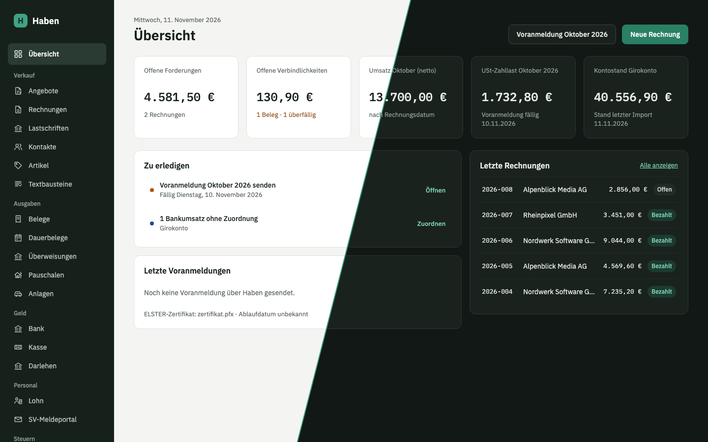
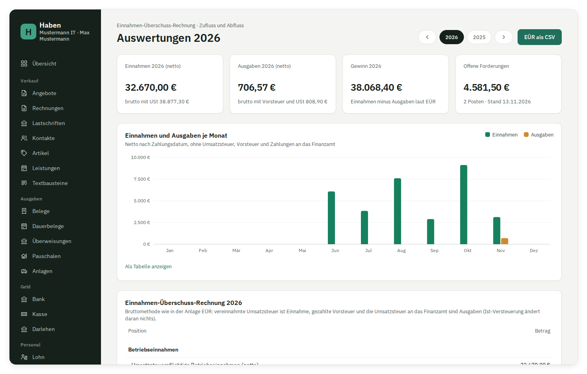

<div align="center">

<picture>
  <source media="(prefers-color-scheme: dark)" srcset="docs/hero-dunkel.png">
  
</picture>

Haben ist eine Open-Source-Buchhaltung für Freiberufler, Selbstständige, Kleinunternehmer und kleine GmbHs,
die du auf deinem eigenen Server betreibst. Sie schreibt E-Rechnungen (ZUGFeRD, XRechnung), gleicht dein Konto ab,
erstellt EÜR oder Bilanz und übermittelt die Steuern an ELSTER.

[](https://github.com/firsttris/haben/releases/latest)
[](https://haben.app/)
[](LICENSE)
[](https://hub.docker.com/r/tristanteu/haben)
[](https://github.com/firsttris/haben/actions/workflows/ci.yml)

<sub>English: self-hosted open-source bookkeeping for German freelancers and small companies (GmbH, UG), with e-invoicing, bank reconciliation and tax returns via ELSTER. The app and its [documentation](https://haben.app/) are in German.</sub>

<picture>
  <source media="(prefers-color-scheme: dark)" srcset="docs/screenshot-uebersicht-dunkel.png">
  
</picture>

</div>

> [!WARNING]
> Haben ist in der Beta. Datenmodell und Abläufe ändern sich noch, Migrationen lassen sich nicht zurückspielen.
> Mach vor jedem Update ein Backup ([Backup und Wiederherstellen](https://haben.app/installation.html#backup-und-wiederherstellen))
> und prüfe Meldungen ans Finanzamt vor dem Absenden.

## Warum Haben

Haben ist eine Alternative zu Lexware Office und sevDesk, die nichts kostet und deine Rechnungen auf deinem Server
lässt. Gebuchtes wird nach den GoBD festgeschrieben und lässt sich nur per Storno korrigieren. Bestehende Daten
übernimmst du aus Lexware Office, sevDesk, BuchhaltungsButler oder Accountable; dabei rechnet Haben deine alten Jahre
nach, damit du die Zahlen vor der Kündigung vergleichen kannst. Entwickelt wird Haben in Deutschland
und nur für das deutsche Steuerrecht.

## Funktionen

Die Details stehen jeweils auf der verlinkten Seite der [Dokumentation](https://haben.app/).

| Bereich | Was Haben kann |
|---|---|
| [Rechnungen](https://haben.app/rechnungen.html) | ZUGFeRD und XRechnung (KoSIT-geprüft), Live-Vorschau, Abschlags- und wiederkehrende Rechnungen, SEPA-Lastschrift, Mahnwesen, Versand per E-Mail |
| [Angebote](https://haben.app/angebote.html) | Optionale Positionen, Zahlungsplan, Auftragsbestätigung und Lieferschein |
| [Belegvorlagen](https://haben.app/belegvorlagen.html) | Eigenes Layout in Typst mit deinen Schriften und deinem Briefpapier |
| [Belege](https://haben.app/belege.html) | Hochladen per Kamera oder E-Mail; E-Rechnungen liest Haben direkt, andere Belege auf Wunsch per KI, auch mit eigenem Modell |
| [Bankabgleich](https://haben.app/bank.html) | Abruf per PSD2 oder Import (CAMT.053, PayPal, Stripe und weitere), Zuordnungsvorschläge mit Begründung |
| [Kasse](https://haben.app/kasse.html) und [Pauschalen](https://haben.app/pauschalen.html) | Kassenbuch, Homeoffice, Kilometer und Verpflegungsmehraufwand |
| [Anlagen](https://haben.app/anlagen.html) und [Lohn](https://haben.app/lohn.html) | AfA, GWG und Sammelposten; Lohnabrechnung nach dem Programmablaufplan des BMF |
| [Umsatzsteuer](https://haben.app/umsatzsteuer.html) | Voranmeldung nach Ist oder Soll mit der Herkunft jeder Kennzahl, Zusammenfassende Meldung |
| [Abgabe an ELSTER](https://haben.app/elster-abgabe.html) | Direkt per ERiC oder ohne Hersteller-ID über Mein ELSTER |
| [Jahreserklärungen](https://haben.app/jahreserklaerung.html) | USt-Erklärung, Anlage EÜR, Einkommensteuer; für GmbH und UG Körperschaft- und Gewerbesteuer und E-Bilanz |
| [Buchhaltung](https://haben.app/buchhaltung.html) | Doppelte Buchführung nach SKR03 oder SKR04, Journal, Kontenblätter, DATEV-Export |
| [Steuerberatung](https://haben.app/steuerberatung.html) | Eigener Zugang, der nur lesen kann |
| [REST-API](https://haben.app/api.html) und [MCP](https://haben.app/ki-assistenten.html) | Schnittstelle mit OpenAPI; KI-Assistenten fragen deine Buchhaltung nur lesend ab |

## Screenshots

<p align="center"></p>

<table>
  <tr>
    <td width="50%"><picture><source media="(prefers-color-scheme: dark)" srcset="docs/screenshot-rechnung-dunkel.png"></picture><br><sub>Rechnung mit Vorschau des PDFs</sub></td>
    <td width="50%"><picture><source media="(prefers-color-scheme: dark)" srcset="docs/screenshot-bank-dunkel.png"></picture><br><sub>Bankabgleich mit Vorschlag</sub></td>
  </tr>
  <tr>
    <td width="50%"><picture><source media="(prefers-color-scheme: dark)" srcset="docs/screenshot-umsatzsteuer-dunkel.png"></picture><br><sub>Umsatzsteuer-Voranmeldung</sub></td>
    <td width="50%"><picture><source media="(prefers-color-scheme: dark)" srcset="docs/screenshot-auswertungen-dunkel.png"></picture><br><sub>Auswertungen</sub></td>
  </tr>
</table>

## Installation

Du brauchst einen Linux-Server mit Docker oder Podman und eine Domain, die auf ihn zeigt. Passkeys verlangen HTTPS,
deshalb startet Haben mit Caddy, PostgreSQL und einem täglichen Backup mit restic.

```bash
mkdir haben && cd haben
curl -O https://raw.githubusercontent.com/firsttris/haben/main/deploy/compose.yml
curl -o .env https://raw.githubusercontent.com/firsttris/haben/main/deploy/compose.env.example
chmod 600 .env
# in .env eintragen: DOMAIN, DB_PASSWORD (openssl rand -hex 24),
# AUTH_SECRET, ENCRYPTION_KEY und RESTIC_PASSWORD (je openssl rand -base64 32), dann
docker compose up -d
```

Danach öffnest du deine Domain und legst dein Konto an. Wie es weitergeht, steht in
[Erste Schritte](https://haben.app/einrichtung.html); Podman, ERiC, Updates und alle Variablen in
[Betrieb und Installation](https://haben.app/installation.html). Ein Coding-Agent mit SSH-Zugang kann die Anleitung
auch für dich abarbeiten.

> [!IMPORTANT]
> Bewahre `ENCRYPTION_KEY` und `RESTIC_PASSWORD` zusätzlich an einem zweiten Ort auf. Ohne den Schlüssel sind
> ELSTER-Zertifikat und API-Schlüssel nach einer Wiederherstellung nicht mehr lesbar, ohne das Passwort lässt sich das
> Backup nicht öffnen.

## Fragen

<details>
<summary><b>Was kostet Haben?</b></summary>

Nichts, die Software steht unter der AGPL. Du zahlst nur deinen Server, ein kleiner VPS reicht.
</details>

<details>
<summary><b>Woher weiß ich, dass die Zahlen stimmen?</b></summary>

Du kannst nachrechnen. Beim Umzug rechnet Haben deine alten Jahre aus Lexware Office oder sevDesk nach, zum Vergleich
mit deinen Voranmeldungen ([Abgleich je Jahr](https://haben.app/lexoffice.html#schritt-5-abgleich-je-jahr)). Danach
stehen unter jeder Kennzahl der Voranmeldung die Rechnungen, Belege und Zahlungen dahinter, und Voranmeldung und EÜR
rechnet Haben zweimal, aus dem Journal und aus den Vorgängen
([Abgleich](https://haben.app/buchhaltung.html#abgleich-von-journal-umsatzsteuer-und-eür)). Nachprüfbar heißt nicht
geprüft: Die fachliche Prüfung bleibt bei dir und deiner Steuerberatung.
</details>

<details>
<summary><b>Ist Haben GoBD-konform?</b></summary>

Haben setzt die technischen Anforderungen um: Festschreibung, Audit-Log und ein Jahresarchiv mit SHA-256-Prüfsummen.
Backups, Aufbewahrung und Verfahrensdokumentation bleiben deine Sache, ein Testat für die Software gibt es nicht.
Mehr dazu in [Buchhaltung in Haben](https://haben.app/buchhaltung.html).
</details>

<details>
<summary><b>Brauche ich eine Hersteller-ID für ELSTER?</b></summary>

Nur für die direkte Übermittlung per ERiC. Ohne sie lädst du die Voranmeldung als XML in Mein ELSTER hoch oder lässt
die Browser-Erweiterung [Haben für Mein ELSTER](https://haben.app/elster-mit-erweiterung.html) die Formulare füllen.
Die Wege im Vergleich stehen unter [Abgabe an ELSTER](https://haben.app/elster-abgabe.html).
</details>

<details>
<summary><b>Ist das sicher?</b></summary>

Zugangsdaten liegen verschlüsselt in der Datenbank, ERiC läuft getrennt vom App-Prozess, und das Änderungsprotokoll
ist eine Hashkette. Zur Laufzeit kommt Haben mit gut zwanzig direkten Paketen aus. Ein unabhängiges Audit gibt es bisher nicht. Lücken meldest du bitte vertraulich, wie in
[SECURITY.md](SECURITY.md) beschrieben.
</details>

<details>
<summary><b>Wird Haben mit KI entwickelt?</b></summary>

Ja, zu einem großen Teil mit Coding-Agenten, aber nicht ungeprüft. Beträge gibt es nur in ganzen Cent, die
Festschreibung erzwingt die Datenbank, jede Änderung bringt Tests mit, und ein zweiter, unabhängiger Agent darf einen
Fehler nur melden, wenn ein Test ihn rot zeigt. Gemergt wird von einem Menschen. Mehr unter
[Leitplanken für Agenten](https://haben.app/entwicklung.html#leitplanken-für-agenten).
</details>

## Entwicklung

Voraussetzungen: Bun in der Version aus `packageManager` in `package.json`, Git und PostgreSQL 18. Mit Docker geht es auch ohne beides: `docker compose up` im
Hauptordner startet Datenbank, Migrationen und Dev-Server.

```sh
bun install
cp apps/web/.env.example apps/web/.env   # DATABASE_URL, BETTER_AUTH_SECRET, HABEN_ENCRYPTION_KEY eintragen
bun run db:migrate
bun run dev                               # http://localhost:3000
```

Ohne ERiC simuliert Haben die Übermittlung an ELSTER und zeigt das an. Aufbau und Pakete beschreibt die
[Architektur](https://haben.app/architektur.html), Tests und Regeln für Beiträge [Entwicklung](https://haben.app/entwicklung.html).

## Mitwirken

Fehler und Ideen gern als [Issue](https://github.com/firsttris/haben/issues/new). Wer mitbauen will, sucht sich eine
Aufgabe im [Project „Roadmap“](https://github.com/users/firsttris/projects/2) aus, etwa mit dem Label `einstieg`
([Etwas übernehmen](https://haben.app/entwicklung.html#etwas-übernehmen)). Besonders hilfreich sind anonymisierte
Kontoauszüge von Banken, die Haben noch nicht kennt, und Rückmeldungen zur Übermittlung an ELSTER. Was ein Pull Request
mitbringt, steht unter [Mitwirken](https://haben.app/entwicklung.html#mitwirken).

Vom selben Autor: [Kontext](https://github.com/firsttris/kontext) für Mail, Kalender und Chat im Team und
[Schreibzeug](https://github.com/firsttris/schreibzeug) für Office-Dateien im Browser, beide selbst gehostet.

## Sterne im Verlauf

<a href="https://www.star-history.com/#firsttris/haben&Date">
  <picture>
    <source media="(prefers-color-scheme: dark)" srcset="https://api.star-history.com/svg?repos=firsttris/haben&type=Date&theme=dark">
    
  </picture>
</a>

---

<sub>Lizenz: <a href="LICENSE">AGPL-3.0</a>, © Tristan Teufel und Mitwirkende. Wer Haben für andere betreibt, muss
ihnen den Quellcode anbieten; eine kommerzielle Lizenz ohne diese Pflicht gibt es über <a href="https://teufel-it.de">teufel-it.de</a>.
Haben ist keine Steuerberatung. ELSTER ist eine Marke der Finanzverwaltung; Haben steht in keiner Verbindung zu
Lexware, DATEV oder der Finanzverwaltung.</sub>
