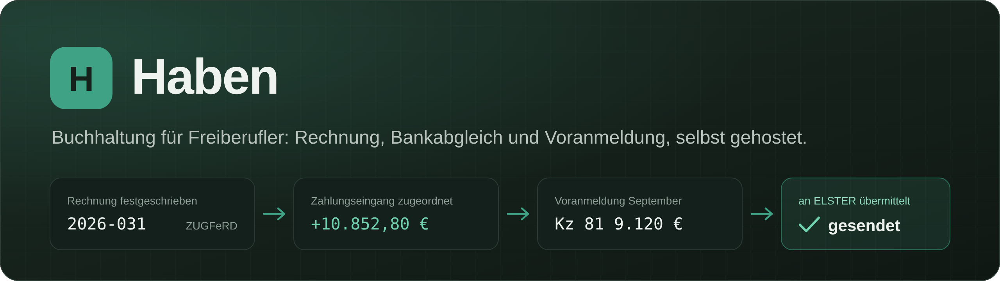
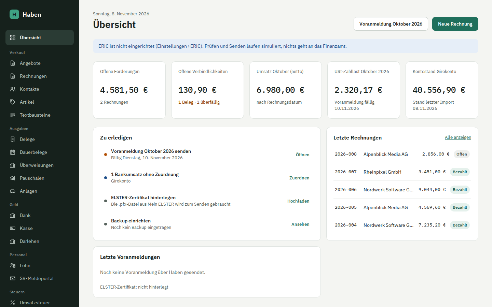
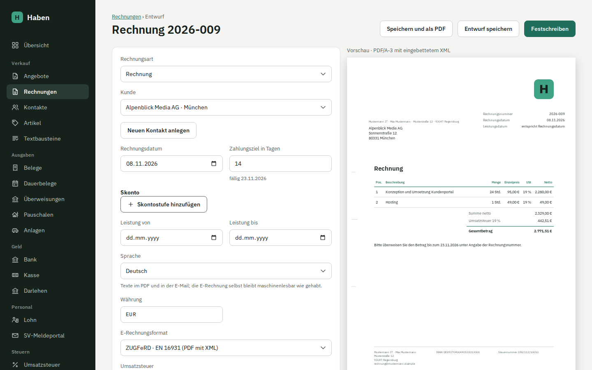
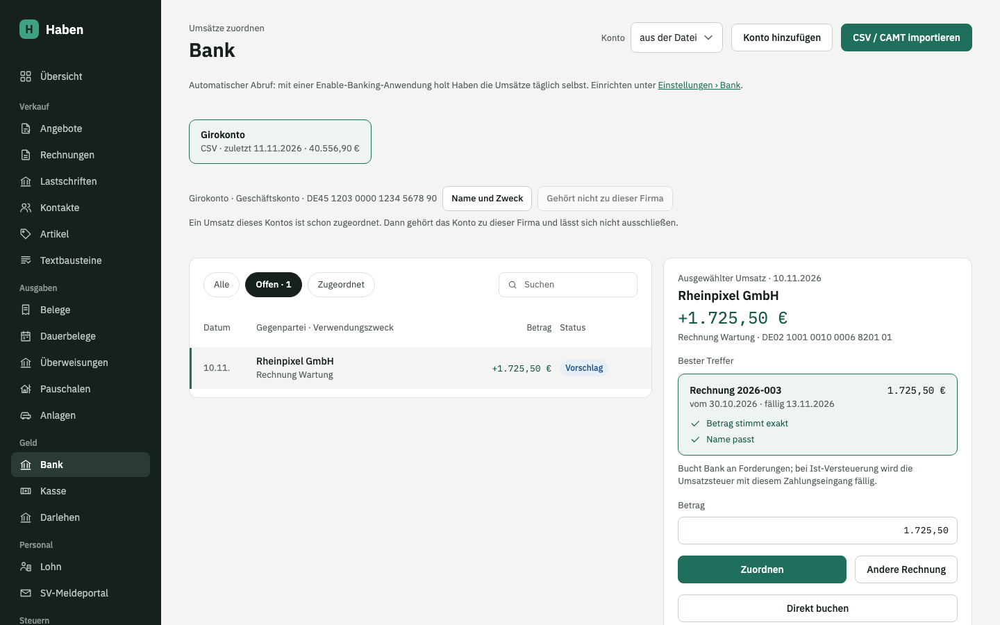
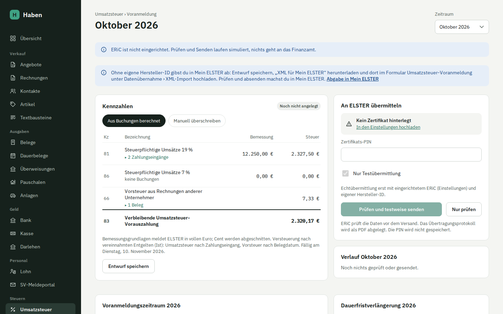

<div align="center">

<h1>Haben: Open-Source-Buchhaltung für Freiberufler, selbst gehostet</h1>



**Die Buchhaltungssoftware für Freiberufler, Selbstständige, Kleinunternehmer und kleine GmbHs, die du selbst betreibst.**<br>
Rechnungen mit E-Rechnung (ZUGFeRD, XRechnung), Belege, Bankabgleich, EÜR oder Bilanz mit E-Bilanz und die Steuern
direkt an ELSTER. GoBD-konform, auf deinem Server, ohne Datenabfluss.


[](https://github.com/firsttris/haben/actions/workflows/ci.yml)
[](https://github.com/firsttris/haben/releases/latest)
[](LICENSE)
[](https://firsttris.github.io/haben/)
[](https://firsttris.github.io/haben/rechnungen.html)
[](https://firsttris.github.io/haben/umsatzsteuer.html)
[](https://www.typescriptlang.org/)
[](https://tanstack.com/start)
[](https://www.postgresql.org/)
[](https://hub.docker.com/r/tristanteu/haben)
[](https://hub.docker.com/r/tristanteu/haben)
[](https://hub.docker.com/r/tristanteu/haben/tags)
[](https://firsttris.github.io/haben/installation.html)

[Warum?](#-warum-haben) •
[Funktionen](#-funktionen) •
[Schnellstart](#-schnellstart) •
[FAQ](#-faq) •
[Dokumentation](https://firsttris.github.io/haben/) •
[Entwicklung](#-entwicklung)

<sub>English: self-hosted open-source bookkeeping for German freelancers, small businesses and small limited companies (GmbH, UG), with e-invoicing (ZUGFeRD, XRechnung), bank reconciliation, EÜR or balance sheet with E-Bilanz, and VAT, corporate and trade tax returns via ELSTER. The app and its [documentation](https://firsttris.github.io/haben/) are in German.</sub>



</div>

> [!WARNING]
> **Beta:** Haben wird noch stark weiterentwickelt. Datenmodell und Abläufe können sich von Version zu Version
> ändern, und Migrationen lassen sich nicht zurückspielen. Vor jedem Update ein Backup machen
> (`docker compose exec backup backup.sh`, siehe [Backup und Wiederherstellen](https://firsttris.github.io/haben/installation.html#backup-und-wiederherstellen))
> und Auswertungen und Meldungen ans Finanzamt vor dem Absenden prüfen.

## 💡 Warum Haben?

In der Buchhaltung gibt es Soll und Haben. Haben ist, was dir gehört.

Rechnungen schreiben, Belege sammeln, Konto abgleichen, Voranmeldung schicken: Dafür braucht es kein Abo bei
Lexware Office (früher lexoffice) oder sevDesk und keinen fremden Dienst, der jede Rechnung sieht. Haben ist die
Open-Source-Alternative dazu: eine Web-App für Buchhaltung, Steuern und Rechnungen, die du mit Docker oder Podman
auf deinem eigenen Server betreibst.

**🇩🇪 Made in Germany**

- **Ein Weg vom Beleg bis zum Finanzamt**: festschreiben, Zahlung zuordnen, Voranmeldung prüfen und senden
- **GoBD-konform von Anfang an**: Festschreibung per Postgres-Trigger, Audit-Log, Korrekturen nur über Storno
- **Deine Daten bleiben bei dir**: eigener Server, Schlüssel verschlüsselt, Jahresarchiv mit Prüfsummen; KI nur auf Wunsch
- **Umzug ohne Datenverlust**: Rechnungen, Belege, Buchungen ohne Beleg und Kontakte aus Lexware Office übernehmen, DATEV-Export archivieren
- **Für Freiberufler und Kleingewerbe**: Einnahmen-Überschuss-Rechnung (EÜR), Ist- oder Soll-Versteuerung,
  Kleinunternehmerregelung nach § 19 UStG, Kontenrahmen SKR03 oder SKR04
- **Für GmbH und UG**: Bilanz und GuV, E-Bilanz, Körperschaft- und Gewerbesteuer, Gewinnausschüttung mit
  Kapitalertragsteuer-Anmeldung und Steuerbescheinigung für die Gesellschafter, Pflichtangaben nach § 35a GmbHG auf
  Rechnungen und Geschäftsbriefen, siehe [GmbH und UG](https://firsttris.github.io/haben/gmbh.html)

## ✨ Funktionen

| Bereich | Was Haben kann |
|---|---|
| 🧾 [Rechnungen](https://firsttris.github.io/haben/rechnungen.html) | Live-Vorschau, ZUGFeRD/XRechnung (KoSIT-geprüft), Netto- oder Bruttopreise (Endpreise für Privatkunden), mehrzeiliger Text zu jeder Position (auch in Angeboten, Vorlagen und Artikeln), Artikelkatalog und Textbausteine, Standard-Einleitung für Rechnungen und Angebote, Storno, Reverse Charge, § 19 UStG, Skonto auf PDF und in der E-Rechnung (im Bankabgleich erkannt), Abschlagsrechnungen, wiederkehrende Rechnungen, Mahnwesen, Logo und eigene Akzentfarbe, Versand per E-Mail an mehrere Empfänger |
| 📝 [Angebote](https://firsttris.github.io/haben/angebote.html) | Eigener Nummernkreis, Nummernformat mit eigenem Präfix für Rechnungen und Angebote, Kundennummern automatisch, PDF und Versand, mit einem Klick zur Rechnung |
| 📎 [Belege](https://firsttris.github.io/haben/belege.html) | Drag-and-drop, Kamera, Teilen am Handy oder per E-Mail (IMAP); E-Rechnungen direkt gelesen, sonst optional per KI; Lieferant aus dem gemeinsamen Kontaktverzeichnis für Kunden und Lieferanten; gebuchte Belege per Gegenbuchung stornieren und neu erfassen; offene Belege als [SEPA-Überweisung](https://firsttris.github.io/haben/belege.html#überweisen-sepa-datei) (pain.001) fürs Online-Banking, mit Skonto aus der E-Rechnung |
| 🏦 [Bankabgleich](https://firsttris.github.io/haben/bank.html) | Automatischer Abruf per PSD2 oder Import (DKB, N26, CAMT.053; PayPal, Stripe, Shopify Payments und eBay als Zahlungsdienstleister), Vorschläge mit Begründung, Teil- und Sammelzahlungen; Überweisungen aus Haben an ihrer Referenz erkannt |
| 📤 [Voranmeldung](https://firsttris.github.io/haben/umsatzsteuer.html) | Monatlich, vierteljährlich oder befreit, mit Vorschlag aus der Steuer des Vorjahres; Dauerfristverlängerung mit Sondervorauszahlung über ELSTER; Kennzahlen aus den Buchungen (Ist oder Soll), Herkunft jeder Zahl, Vorprüfung, Übermittlung per ERiC oder ohne Hersteller-ID über Mein ELSTER (XML-Import, Erweiterung, KI-Assistent; siehe [Abgabe an ELSTER](https://firsttris.github.io/haben/elster-abgabe.html)), Berichtigung |
| 📑 [Jahreserklärungen](https://firsttris.github.io/haben/jahreserklaerung.html) | USt-Erklärung, Anlage EÜR mit AVEÜR, Einkommensteuererklärung; für GmbH und UG Körperschaftsteuer mit Feststellung des Einlagekontos und Gewerbesteuer; per ERiC senden oder ohne Hersteller-ID mit der [Erweiterung](https://firsttris.github.io/haben/elster-mit-erweiterung.html) in Mein ELSTER eintragen; vorausgefüllte Belege von ELSTER abrufen |
| 🏛️ [Finanzamt](https://firsttris.github.io/haben/finanzamt.html) | Bescheide und Nachrichten über ELSTER, Herabsetzung der Vorauszahlungen mit Steuerprognose |
| 🏢 [GmbH und UG](https://firsttris.github.io/haben/gmbh.html) | Gesellschafter-Verrechnungskonto statt Privatkonten, Eröffnungsbuchung und Saldenvortrag, Bilanz und GuV der Kleinstkapitalgesellschaft, Rückstellungen für Körperschaft- und Gewerbesteuer, E-Bilanz per ERiC, Gewinnausschüttung mit Kapitalertragsteuer, Soli, Kirchensteuer, Kapitalertragsteuer-Anmeldung und Steuerbescheinigung je Gesellschafter (§ 45a EStG), Pflichtangaben nach § 35a GmbHG (Sitz, Registergericht, Geschäftsführung) im Fuß von Rechnung, Angebot und Mahnung, in der E-Rechnung und unter E-Mails |
| 👥 [Lohn](https://firsttris.github.io/haben/lohn.html) | Mitarbeiter mit Lohnsteuerabzugsmerkmalen und Sozialversicherung, Abrechnung je Monat mit Lohnsteuer nach dem Programmablaufplan des BMF, Soli, Kirchensteuer und Beiträgen: Gesellschafter-Geschäftsführer ohne SV, Minijob mit Pauschsteuer, Beschäftigte mit Monatsgehalt als Entwurf zum Gegenprüfen; festschreiben, stornieren, Entgeltabrechnung nach § 108 GewO als PDF, Lohnkonto je Jahr als PDF und CSV; Buchung und Lohnsteuer-Anmeldung folgen |
| ⏰ [Fristen](https://firsttris.github.io/haben/fristen.html) | Alle Steuertermine auf einer Seite, als Kalender-Feed (iCal) und per E-Mail |
| 🚗 [Pauschalen](https://firsttris.github.io/haben/pauschalen.html) · [Kasse](https://firsttris.github.io/haben/kasse.html) | Homeoffice, Kilometer, Verpflegungsmehraufwand; Kassenbuch für Barzahlungen |
| 🖥️ [Anlagen und AfA](https://firsttris.github.io/haben/anlagen.html) | Anlagenverzeichnis, lineare AfA, GWG und Sammelposten, AfA-Buchung zum Jahresende |
| 📊 [Auswertungen](https://firsttris.github.io/haben/auswertungen.html) | EÜR, offene Posten, Monatsverlauf, Jahresexport als ZIP mit SHA-256-Prüfsummen |
| 📚 [Buchhaltung](https://firsttris.github.io/haben/buchhaltung.html) | Doppelte Buchführung nach SKR03/SKR04, Journal, Saldenliste, Kontenblätter, DATEV-Export; für GmbH und UG Gesellschafter-Verrechnungskonto, manuelle Buchungen, Saldenvortrag, Bilanz und GuV (Entwurf) und Jahresabschluss |
| 📦 [Umzug aus Lexoffice](https://firsttris.github.io/haben/lexoffice.html) | Abruf über die Public API oder, ohne Tarif XL, als Sicherung über die Web-Oberfläche; DATEV-Buchungsstapel, offene Posten zum Stichtag und Anlagen übernehmen; im Abgleich je Jahr Privates bzw. bei GmbH und UG Gesellschafter, Kapital, Darlehen und Ertragsteuern getrennt ausgewiesen; bei GmbH und UG Bilanz, GuV und Steuern eines alten Jahres aus dem Stapel zum Vergleich und die Eröffnung aus seiner Schlussbilanz zum Bestätigen |
| 📦 [Umzug aus sevDesk](https://firsttris.github.io/haben/sevdesk.html) | Abruf über die sevDesk-API, gleiches Archiv, gleicher Abgleich |
| 🔐 [Anmeldung](https://firsttris.github.io/haben/einrichtung.html#konto-anlegen) · [App](https://firsttris.github.io/haben/einrichtung.html#als-app-installieren) | Passkey (Passwort als Ersatz), installierbar als App auf Handy und Desktop mit Kurzbefehlen und Teilen-Menü für Belege, helle und dunkle [Themes](https://firsttris.github.io/haben/einrichtung.html#einstellungen-und-darstellung) |
| 🔌 [REST-API](https://firsttris.github.io/haben/api.html) | Versionierte Schnittstelle mit OpenAPI-Beschreibung für eigene Werkzeuge und Automationen: Kontakte und Rechnungsentwürfe anlegen, mit Bestellnummer der Plattform ohne Duplikate; Belege aus Dokumentenarchiven und Skripten hochladen, landen als „Zu prüfen“; API-Tokens mit Rechten je Bereich; bucht und schreibt nichts fest |
| 🧩 [Eigene Seiten](https://firsttris.github.io/haben/eigene-seiten.html) | Eigene Werkzeuge wie eine Bestellübersicht aus n8n als Menüeintrag in Haben, im Rahmen angezeigt; Zugriff auf Haben nur über die REST-API mit eigenem Token |
| ♿ [Barrierefreiheit](https://firsttris.github.io/haben/barrierefreiheit.html) | Vollständig per Tastatur bedienbar, sichtbarer Fokus, Kontraste in allen Themes; jede Seite in der CI mit axe-core gegen WCAG 2.2 AA geprüft |

## 📸 Screenshots

<table>
  <tr>
    <td width="50%"><br><sub><b>Rechnung schreiben</b>: Vorschau des PDFs, während du tippst</sub></td>
    <td width="50%"><br><sub><b>Bankabgleich</b>: Vorschlag mit Begründung, Enter ordnet zu</sub></td>
  </tr>
  <tr>
    <td width="50%"><br><sub><b>Voranmeldung</b>: aus den Buchungen berechnet, direkt an ELSTER</sub></td>
    <td width="50%"><br><sub><b>Auswertungen</b>: EÜR nach Zufluss und Abfluss</sub></td>
  </tr>
</table>

## 🚀 Schnellstart

Haben läuft als vier Container: die App (`tristanteu/haben`, amd64 und arm64), PostgreSQL, Caddy für HTTPS und ein
tägliches Backup mit restic.
Du brauchst einen Linux-Server mit Docker oder Podman und eine Domain, die auf ihn zeigt (Ports 80 und 443),
denn Passkeys funktionieren nur über HTTPS.

### 1. Von einem Agenten aufsetzen lassen

Gib Claude Code oder einem anderen Coding-Agenten dieses Repository und SSH-Zugang zu deinem Server und sag:
„Setz Haben auf meinem Server auf, nach der [Installationsanleitung](https://firsttris.github.io/haben/installation.html).“

### 2. Manuell

```bash
mkdir haben && cd haben
curl -O https://raw.githubusercontent.com/firsttris/haben/main/deploy/compose.yml
curl -o .env https://raw.githubusercontent.com/firsttris/haben/main/deploy/compose.env.example
# in .env eintragen: DOMAIN, DB_PASSWORD (openssl rand -hex 24),
# AUTH_SECRET und ENCRYPTION_KEY (je openssl rand -base64 32), dann
docker compose up -d
```

Öffne **https://deine-domain**, leg dein Konto an und richte Firmendaten, Nummernkreis und ELSTER ein, wie in
[Erste Schritte](https://firsttris.github.io/haben/einrichtung.html) beschrieben.

Podman Quadlets, ERiC für die ELSTER-Übermittlung, Backup, Updates und alle Umgebungsvariablen stehen in
[Betrieb und Installation](https://firsttris.github.io/haben/installation.html).

> [!IMPORTANT]
> Sichere den Verschlüsselungsschlüssel (`ENCRYPTION_KEY` bzw. das Secret `haben-encryption-key`) zusätzlich an
> einem zweiten Ort. Ohne ihn sind ELSTER-Zertifikat und die Schlüssel für Lexoffice und sevDesk nach einer Wiederherstellung nicht mehr lesbar.

## ❓ FAQ

<details>
<summary><b>Was kostet Haben?</b></summary>

Die Software ist kostenlos (AGPL). Du brauchst nur einen Server, etwa einen VPS ab rund 5 € im Monat.
</details>

<details>
<summary><b>Ist Haben eine Alternative zu Lexware Office (lexoffice) und sevDesk?</b></summary>

Ja, ohne Abo und auf deinem eigenen Server. Rechnungen, Belege und Kontakte übernimmst du per API oder, bei
Lexware Office ohne Tarif XL, über eine Sicherung aus der Web-Oberfläche, siehe
[Umzug aus Lexoffice](https://firsttris.github.io/haben/lexoffice.html) und [Umzug aus sevDesk](https://firsttris.github.io/haben/sevdesk.html).
</details>

<details>
<summary><b>Für wen ist Haben gedacht?</b></summary>

Für Freiberufler, Selbstständige und Kleinunternehmer mit Einnahmen-Überschuss-Rechnung (EÜR), auch mit
Kleinunternehmerregelung nach § 19 UStG, und für kleine GmbHs und UGs. Eine GmbH oder UG macht ihre Buchhaltung in Haben, mit
Gesellschafter-Verrechnungskonto statt Privatkonten; Bilanz und GuV zeigt Haben als Entwurf für die Steuerberatung und
sendet E-Bilanz, Körperschaft- und Gewerbesteuererklärung (für eine GmbH ohne Beteiligungen und Organschaft) und
bucht Gewinnausschüttungen samt Kapitalertragsteuer-Anmeldung und Steuerbescheinigungen für die Gesellschafter. Die Bilanz zur Hinterlegung beim Unternehmensregister
erstellt Haben als PDF, mit den Vermerken zu Restlaufzeiten und gegenüber Gesellschaftern. Den Lohn des Gesellschafter-Geschäftsführers, von Minijobs und (als Entwurf zum Gegenprüfen) von Angestellten rechnet Haben ab; gebucht und angemeldet wird er noch nicht, siehe [Lohn](https://firsttris.github.io/haben/lohn.html).
</details>

<details>
<summary><b>Ist Haben GoBD-konform?</b></summary>

Ja. Gebuchtes wird festgeschrieben und lässt sich nur per Storno korrigieren, jede Änderung steht im
Audit-Log, und das Jahresarchiv hat SHA-256-Prüfsummen. Siehe [Buchhaltung in Haben](https://firsttris.github.io/haben/buchhaltung.html).
</details>

<details>
<summary><b>Wie kommen Voranmeldung und Erklärungen zu ELSTER?</b></summary>

Direkt aus Haben oder über das Portal Mein ELSTER ([alle Wege im Vergleich](https://firsttris.github.io/haben/elster-abgabe.html)):
- **Direkt aus Haben** per ERiC, für Voranmeldung, Umsatzsteuererklärung, Anlage EÜR und Einkommensteuer, dazu Bescheide
  aus dem ELSTER-Postfach. Dafür brauchst du eine eigene Hersteller-ID; die Beantragung dauert oft Wochen
  ([Erste Schritte](https://firsttris.github.io/haben/einrichtung.html#elster-einrichten)).
- **Über Mein ELSTER**, ohne Hersteller-ID: Die Voranmeldung lädst du als XML-Datei hoch. Alle vier Formulare trägt
  die Browser-Erweiterung [Haben für Mein ELSTER](https://firsttris.github.io/haben/elster-mit-erweiterung.html)
  ein, oder ein [KI-Assistent](https://firsttris.github.io/haben/elster-mit-assistent.html) wie Claude in Chrome.
  Absenden machst du dort selbst.
</details>

<details>
<summary><b>Kann meine Steuerberatung damit arbeiten?</b></summary>

Ja, über den [DATEV-Export](https://firsttris.github.io/haben/auswertungen.html#datev-export-für-die-steuerberatung) im Kontenrahmen SKR03 oder SKR04.
</details>

<details>
<summary><b>Können mehrere Personen Haben nutzen?</b></summary>

Nein, Haben kennt genau ein Konto, gedacht für dich und deine eigene Firma.
</details>

<details>
<summary><b>Kann ich Claude oder andere Agenten mit meiner Buchhaltung nutzen?</b></summary>

Ja, über MCP, und nur lesend: „Welche Rechnungen sind überfällig?“ Buchen und Senden an ELSTER
machst du weiter selbst. Siehe [Agenten (MCP)](https://firsttris.github.io/haben/ki-assistenten.html). Für
eigene Werkzeuge und Automationen gibt es die [REST-API](https://firsttris.github.io/haben/api.html).
</details>

<details>
<summary><b>Ist das sicher?</b></summary>

Prüf es selbst, der Code ist offen: Lass deinen Agenten Cloudflares [Security Audit Skill](https://github.com/cloudflare/security-audit-skill) oder
`/security-review` von Claude Code über dieses Repository laufen.
</details>

## 📚 Dokumentation

Alles im Detail, mit Suche: **https://firsttris.github.io/haben/**. Jede Funktion oben verlinkt ihre Seite; dazu kommen:

- **Einstieg:** [Betrieb und Installation](https://firsttris.github.io/haben/installation.html) (Docker Compose, Podman, Backup, Updates),
  [Erste Schritte](https://firsttris.github.io/haben/einrichtung.html) (Konto, Firmendaten, ELSTER und Hersteller-ID) und
  [Abgabe an ELSTER](https://firsttris.github.io/haben/elster-abgabe.html) (alle Wege zum Finanzamt im Vergleich)
- **Hintergrund:** [Buchhaltung in Haben](https://firsttris.github.io/haben/buchhaltung.html) (GoBD, Kontenrahmen, alle Buchungssätze),
  [Architektur](https://firsttris.github.io/haben/architektur.html) · [Entwicklung](https://firsttris.github.io/haben/entwicklung.html) und [Roadmap](https://firsttris.github.io/haben/roadmap.html)

## 🔧 Entwicklung

Voraussetzungen: Bun 1.4.4, Git und PostgreSQL 18. Bun ist Laufzeit und Paketmanager zugleich.

```sh
bun install
cp apps/web/.env.example apps/web/.env   # DATABASE_URL, BETTER_AUTH_SECRET, HABEN_ENCRYPTION_KEY eintragen
bun run db:migrate
bun run dev                               # http://localhost:3000
```

Oder ohne Bun und PostgreSQL auf dem Rechner, mit Docker: `docker compose up` im Hauptordner startet Datenbank,
Migrationen und Dev-Server mit Neuladen beim Speichern
([Mit Docker Compose](https://firsttris.github.io/haben/entwicklung.html#mit-docker-compose)).

Ohne ERiC (unter Einstellungen per Knopf von der Finanzverwaltung geladen) simuliert Haben die ELSTER-Übermittlung
und zeigt das deutlich an. Ohne `ANTHROPIC_API_KEY` bleibt die KI-Auslesung aus.

**Stack**: TanStack Start (React-API mit TanStack Redact, Server Functions), PostgreSQL mit Drizzle, Better Auth mit Passkeys, Zod, Typst für
die Rechnungs-PDFs, `@e-invoice-eu/core` für ZUGFeRD und XRechnung, ERiC über `koffi` in einem eigenen Prozess,
Vitest und Playwright. Aufbau und Abläufe beschreibt die [Architektur](https://firsttris.github.io/haben/architektur.html), alles Weitere
[Entwicklung](https://firsttris.github.io/haben/entwicklung.html).

| Paket | Inhalt |
|---|---|
| `apps/web` | Oberfläche, Server Functions, Datenbank, Anmeldung |
| `packages/core` | Beträge, Zeiträume, Voranmeldung, EÜR, Buchungssätze, Zuordnungsvorschläge |
| `packages/einvoice` | Rechnungs-PDF, ZUGFeRD und XRechnung erzeugen, eingehende E-Rechnungen lesen |
| `packages/elster` | ERiC-Anbindung im Worker-Prozess, XML für Voranmeldung, Jahreserklärungen und Nachrichten, Postfach, Belege von ELSTER |
| `packages/import` | Kontoauszüge (DKB, N26, CAMT.053), Exporte von Zahlungsdienstleistern (PayPal, Stripe, Shopify Payments, eBay), Kontoabruf über Enable Banking, DATEV-Buchungsstapel, Lexware Office (API und Web-Sicherung), sevDesk-API |
| `apps/elster-helfer` | Browser-Erweiterung „Haben für Mein ELSTER“ (TypeScript, Vite): trägt die Werte aus Haben in die Formulare ein |

## 🧩 Mehr von uns

- Suchst du einen Ersatz für Gmail oder Google Workspace? **[Kontext](https://github.com/firsttris/kontext)**: Mail, Kalender, Kontakte, Chat und Telefonie für dein Team, auf deinem eigenen Server.
- Word, Excel und PowerPoint ohne Microsoft 365? **[Schreibzeug](https://github.com/firsttris/schreibzeug)** bearbeitet sie im Browser und speichert sie als .docx, .xlsx und .pptx.

## 🤝 Mitwirken

Fehler und Ideen gern als Issue. Besonders hilfreich sind anonymisierte Kontoauszüge von Banken, die Haben noch nicht
kennt, und Rückmeldungen zur ELSTER-Übermittlung. Vor einem Pull Request bitte `bun run lint`, `bun run typecheck` und
`bun run test` laufen lassen (die Datenbanktests brauchen `TEST_DATABASE_URL`, siehe [Entwicklung](https://firsttris.github.io/haben/entwicklung.html)).

## ⭐ Sterne im Verlauf

<a href="https://www.star-history.com/#firsttris/haben&Date">
  <picture>
    <source media="(prefers-color-scheme: dark)" srcset="https://api.star-history.com/svg?repos=firsttris/haben&type=Date&theme=dark">
    
  </picture>
</a>

---

<div align="center">

⭐ Gefällt dir Haben? Ein [Stern auf GitHub](https://github.com/firsttris/haben) hilft anderen, es zu finden.<br>
🐛 [Fehler melden](https://github.com/firsttris/haben/issues/new) · 💡 [Idee vorschlagen](https://github.com/firsttris/haben/issues/new)

<sub>Lizenz: <a href="LICENSE">AGPL-3.0</a> · © Tristan Teufel und Mitwirkende<br>
Wer Haben für andere betreibt, muss ihnen den Quellcode anbieten; der Link steht in der Navigation. Eine kommerzielle Lizenz ohne diese Pflichten gibt es über <a href="https://teufel-it.de">teufel-it.de</a>.<br>
Haben ist keine Steuerberatung. Konten, Kategorien und Aufbewahrung vor dem Echtbetrieb mit deiner Steuerberatung abgleichen.<br>
ELSTER ist eine Marke der Finanzverwaltung. Haben steht in keiner Verbindung zu Lexware, DATEV oder der Finanzverwaltung.</sub>

</div>
