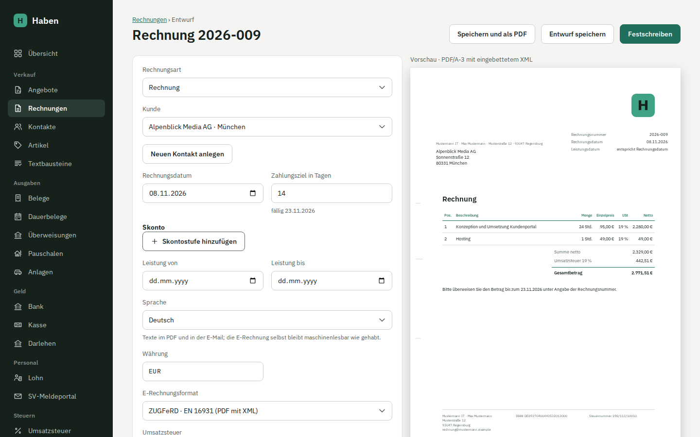
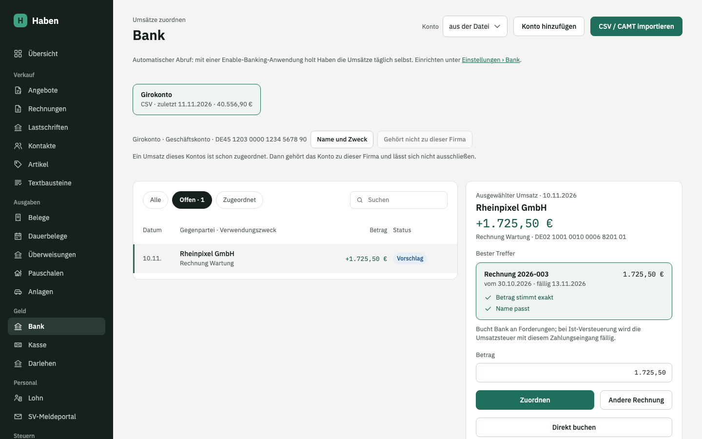
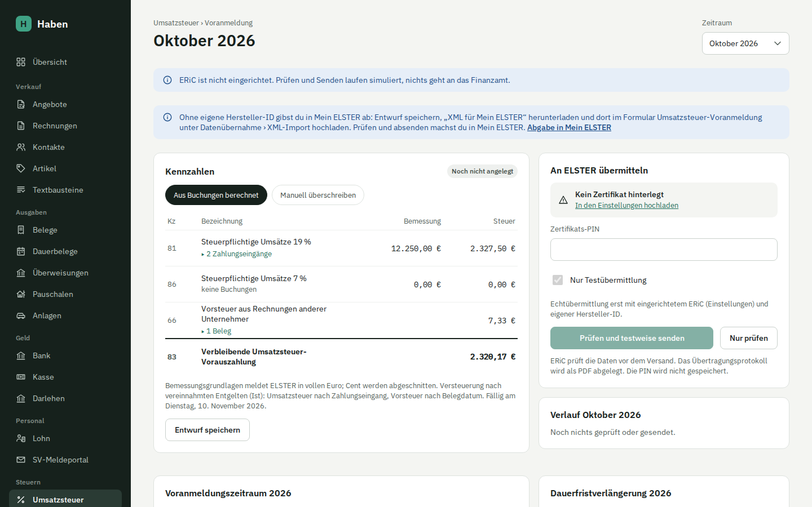
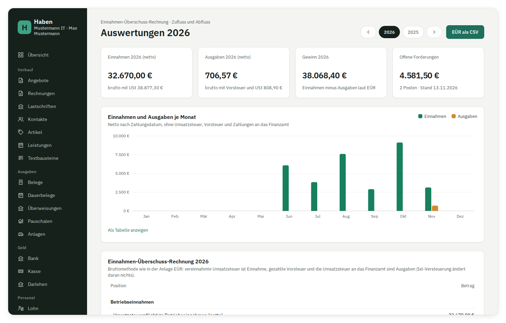
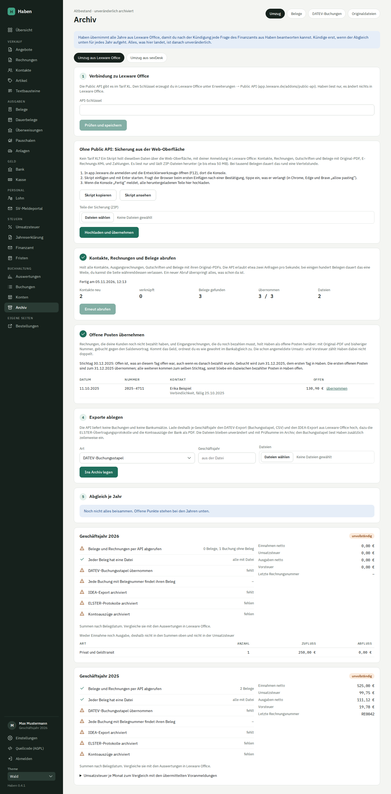
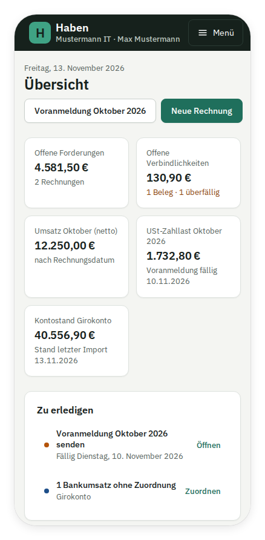

# Dokumentation

Hier steht alles über Haben im Detail: wie du es betreibst und einrichtest, was jede Seite macht, was im Hintergrund
gebucht wird und wie der Code aufgebaut ist. Den schnellen Überblick gibt die [README auf GitHub](https://github.com/firsttris/haben#readme).
Auch als Website mit Suche: **https://firsttris.github.io/haben/**

## Betrieb

| | |
|---|---|
| [Betrieb und Installation](installation.md) | Podman Quadlets, Caddy, Secrets, Umgebungsvariablen, ERiC einbinden, Backup und Wiederherstellung, Updates, häufige Probleme |
| [Erste Schritte](einrichtung.md) | Konto und Passkey, als App installieren, Firmendaten, Ist oder Soll, SKR03 oder SKR04, Nummernkreis, ELSTER und Hersteller-ID, E-Mail, KI-Auslesung, Bankkonten |

## Im Alltag

| | |
|---|---|
| [Rechnungen und E-Rechnung](rechnungen.md) | Editor, Artikelkatalog, Textbausteine, Festschreiben, ZUGFeRD und XRechnung, Pflichtangaben, Abschläge, wiederkehrende Rechnungen, Mahnwesen, Versand, Storno und Korrektur, Kontakte |
| [Angebote](angebote.md) | Eigener Nummernkreis, PDF, Versand per E-Mail, Antwort des Kunden, Rechnung aus dem Angebot |
| [Belege](belege.md) | Hochladen, Teilen am Handy, E-Rechnungen lesen, KI-Auslesung, Kategorien, Buchen |
| [Pauschalen](pauschalen.md) | Homeoffice-Tagespauschale, Fahrten mit dem Privatfahrzeug, Verpflegungsmehraufwand; Buchung und Storno |
| [Kassenbuch](kasse.md) | Barkasse: Einlage, Entnahme, Geldtransit, bar bezahlte Belege; nie negativer Bestand, Storno |
| [Anlagen und AfA](anlagen.md) | Anlagenverzeichnis, Anschaffung per Beleg, Übernahme aus Lexoffice, AfA buchen, Abgang |
| [Bankimport und Abgleich](bank.md) | Automatischer Abruf per PSD2 (Enable Banking), DKB, N26, CAMT.053, Dubletten, Saldenprüfung, Vorschläge, Teilzahlungen, Buchungen ohne Beleg |
| [Umsatzsteuer-Voranmeldung](umsatzsteuer.md) | Kennzahlen aus den Buchungen, Vorprüfung, Prüfen, Test- und Echtübermittlung, XML-Import in Mein ELSTER, Berichtigung |
| [Finanzamt](finanzamt.md) | Bescheide aus dem ELSTER-Postfach, Einspruchsfrist, Nachrichten über ELSTER, Herabsetzung der Vorauszahlungen, Bankverbindung |
| [Fristen](fristen.md) | Voranmeldungen, Abgabefristen, Vorauszahlungen, Einspruchsfristen; Kalender-Abo und Erinnerungen per E-Mail |
| [Jahreserklärungen](jahreserklaerung.md) | Umsatzsteuererklärung, Anlage EÜR mit AVEÜR und Einkommensteuererklärung, Prüfen, Test- und Echtübermittlung, Belege von ELSTER |
| [Abgabe an ELSTER](elster-abgabe.md) | Alle Wege im Überblick: direkt per ERiC mit Hersteller-ID oder über Mein ELSTER mit XML-Import, Erweiterung, KI-Assistent oder von Hand |
| [Lohn](lohn.md) | Mitarbeiter, Abrechnung je Monat (Geschäftsführer, Minijob, Angestellte als Entwurf), festschreiben und stornieren, Entgeltabrechnung als PDF, Lohnkonto |
| [Mein ELSTER mit Erweiterung](elster-mit-erweiterung.md) | Ohne Hersteller-ID: die Browser-Erweiterung trägt Voranmeldung, USt-Erklärung, EÜR und Einkommensteuer in Mein ELSTER ein, du sendest ab |
| [Auswertungen und Jahresexport](auswertungen.md) | EÜR, offene Posten, Monatsverlauf, CSV, Archiv-ZIP mit Prüfsummen, Aufbewahrung |
| [Umzug aus Lexoffice](lexoffice.md) | API-Abruf, Sicherung über die Web-Oberfläche oder Umzug nur über die Exporte, DATEV-Buchungsstapel, Originalexporte, offene Posten, Abgleich vor der Kündigung |
| [Umzug aus sevDesk](sevdesk.md) | API-Abruf aus sevDesk ins selbe Archiv, Unterschiede zu Lexoffice |
| [KI-Assistenten (MCP)](ki-assistenten.md) | Haben im Gespräch mit Claude Code, Claude Desktop oder einem lokalen Modell abfragen; nur lesen, API-Tokens, Datenschutz |
| [CSV-Import](csv-import.md) | Kontakte, Artikel und Anlagen aus CSV: Trennzeichen und Kodierung erkennen, Spalten zuordnen, Vorschau mit Fehlern je Zeile, Dubletten überspringen |
| [REST-API](api.md) | Kontakte und Rechnungsentwürfe aus eigenen Werkzeugen, mit Bestellnummer ohne Duplikate; Belege aus Dokumentenarchiven und Skripten; OpenAPI, Rechte je Token, Beispiele mit curl |
| [Eigene Seiten](eigene-seiten.md) | Eigene Werkzeuge wie eine Bestellübersicht aus n8n als Menüeintrag, im Rahmen angezeigt |
| [Mein ELSTER mit KI-Assistent](elster-mit-assistent.md) | Ohne Hersteller-ID in Mein ELSTER abgeben: der Assistent trägt die Kennzahlen ein, du sendest ab |
| [Barrierefreiheit und Tastatur](barrierefreiheit.md) | Bedienung ohne Maus, Tastenkürzel, Kontraste in allen Themes, Prüfung mit axe-core nach WCAG 2.2 AA |

## Hintergrund

| | |
|---|---|
| [Buchhaltung in Haben](buchhaltung.md) | Grundsätze, GoBD und Festschreibung, Ist und Soll, Kontenrahmen, alle Buchungssätze, Steuerschlüssel |
| [Architektur](architektur.md) | Module, Datenmodell, Ablauf von Anfragen, Dateiablage, ERiC-Worker, E-Rechnung, Sicherheit |
| [Entwicklung](entwicklung.md) | Lokale Umgebung, Befehle, Tests, Migrationen, Konventionen, neue Bankformate, Mitwirken |
| [Roadmap](roadmap.md) | Was geplant ist, was blockiert ist, Quellen für Feldkennungen |

## Screenshots

