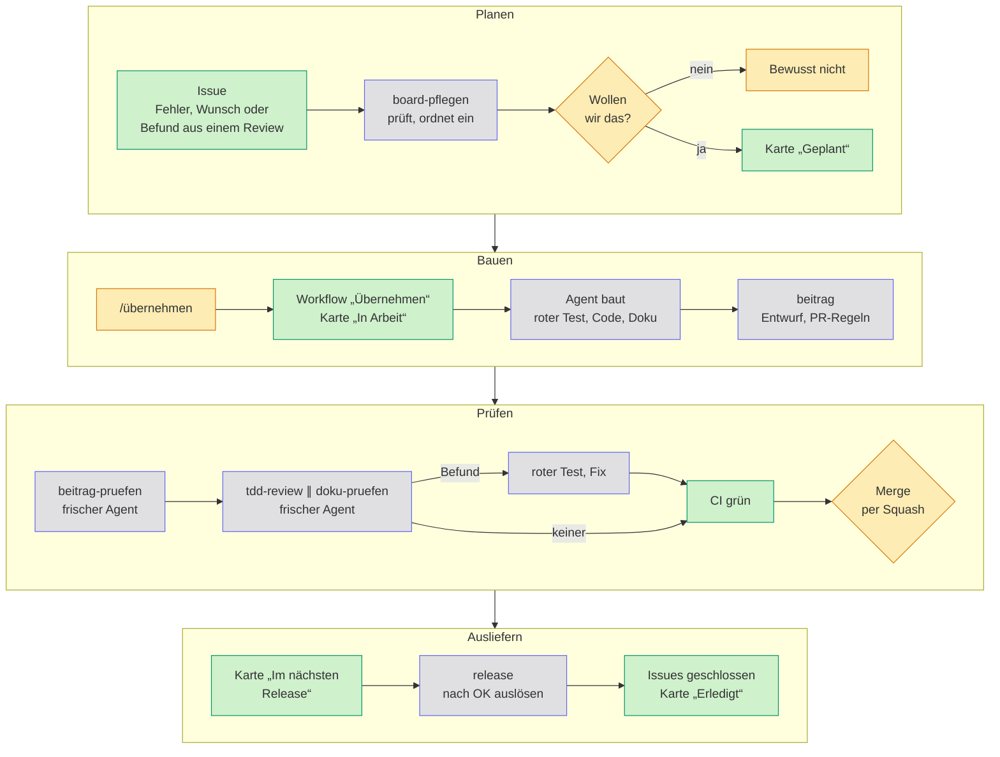
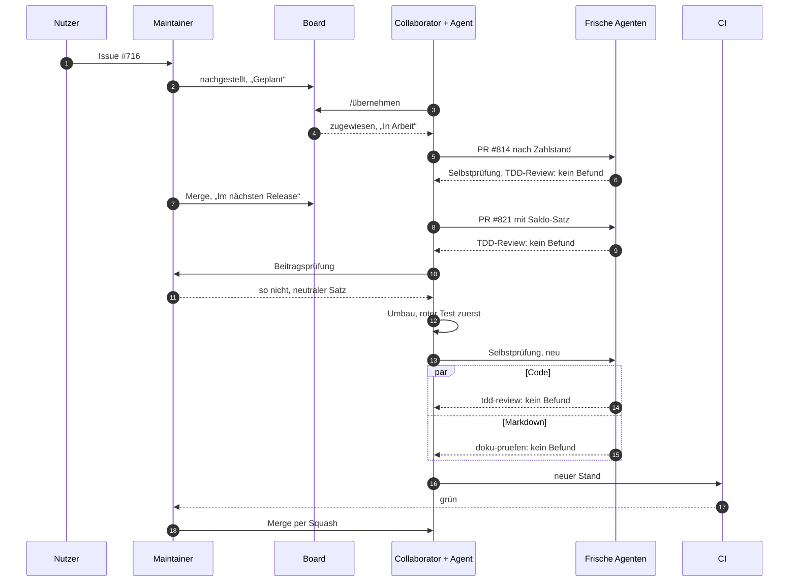

So entsteht Haben

# Agentic Engineering in der Praxis

Agenten schreiben den Code. Frische Agenten prüfen ihn und dürfen nur melden, was ein
fehlschlagender Test belegt. Ein Mensch entscheidet, was nach <code>main</code> kommt.

[Ein echtes Beispiel](#beispiel){ .md-button .md-button--primary } [Etwas übernehmen](mitwirken.md#etwas-übernehmen){ .md-button } [Zum Board](https://github.com/users/firsttris/projects/2){ .md-button }

**🧑 Mensch entscheidet**

Was gebaut wird, offene fachliche Fragen, den Merge und das Release.

**🤖 Agent baut und prüft**

Issues, Code mit rotem Test zuerst, Selbstprüfung, Review, Doku-Prüfung.

**⚙️ Automatik hält Regeln**

Board, Zuweisung, PR-Regeln, CI und das Schließen der Issues mit dem Release.

## Der Ablauf

Die Farben sind dieselben wie bei den Karten oben. „Frisch“ heißt: ein neuer Agent ohne den Verlauf dessen, der den Code geschrieben hat. Er kennt nur den Pull Request und das Repository und prüft deshalb, was dasteht. Was gemeint war, weiß er nicht.

| Schritt | Wer | Regel | Skill |
| --- | --- | --- | --- |
| Issue schreiben und einordnen | Agent, Maintainer entscheidet | [Issues schreiben](mitwirken.md#issues-schreiben) | `issue-schreiben`, `board-pflegen` |
| Übernehmen | wer mitbauen will | [Etwas übernehmen](mitwirken.md#etwas-übernehmen) | |
| Bauen | Agent | [Konventionen](entwicklung.md#konventionen), [Tests](entwicklung.md#tests) | `checks` |
| Pull Request | Agent | [Branches, Titel und Commits](mitwirken.md#branches-titel-und-commits) | `beitrag`, `pr-screenshots` |
| Selbstprüfung | frischer Agent | [Beiträge annehmen](mitwirken.md#beiträge-annehmen) | `beitrag-pruefen` |
| Review | frischer Agent, je einer für Code und Markdown | [Review](mitwirken.md#review), [Doku-Prüfung](mitwirken.md#doku-prüfung) | `tdd-review`, `doku-pruefen` |
| Fixes im Fork einer anderen Person | Agent | [Review](mitwirken.md#review), Punkt 4 | `fork-pushen` |
| Merge | Maintainer oder Collaborator mit Zustimmung | [Review](mitwirken.md#review), Punkt 6 | |
| Release | Agent schlägt vor, Maintainer gibt frei | [Veröffentlichen](entwicklung.md#veröffentlichen) | `release` |
| Amtliche Jahreswerte | Workflow öffnet ein Issue, Agent zieht nach | [Jahreswerte](entwicklung.md#jahreswerte) | `jahreswerte` |

Dazu kommt `belegvorlage`. Mit diesem Skill schreiben Nutzer ihr eigenes Rechnungslayout, ohne das Repository zu brauchen ([Eigene Belegvorlagen](belegvorlagen.md#mit-einem-ki-agenten)).

## Doku für Menschen, Skills für Agenten

**📖 Doku: was gilt und warum**

`docs/` und `DESIGN.md`, kurz und auf Deutsch. Menschen und Agenten lesen dieselben Regeln, jede steht nur an einer Stelle.

**🛠️ Skills: was zu tun ist**

`.claude/skills/`, Schritt für Schritt je Aufgabe. Ein Skill verweist auf die Regel, statt sie zu wiederholen.

**✅ Skripte: was sich sicher prüfen lässt**

`scripts/` und `.github/workflows/`. Ob ein Agent die Regel gelesen hat, spielt dann keine Rolle mehr.

`CLAUDE.md` und `AGENTS.md` sind nur der Einstieg: wo eine Regel steht und was nie passieren darf. Die Workflows halten Board und Pull Requests auf Stand:

| Workflow | Läuft bei | Tut |
| --- | --- | --- |
| Übernehmen | Kommentar `/übernehmen` oder `/freigeben`, täglich | weist zu, schiebt die Karte nach „In Arbeit“, fragt nach 14 Tagen nach, gibt nach weiteren sieben frei |
| Board | Issue zugewiesen, Pull Request geöffnet oder gemergt | zieht die Karte nach `Refs` und `Umgesetzt` mit |
| PR-Regeln, PR-Regeln Kommentar | jeder Push auf einen Pull Request, geänderter Titel oder Beschreibung | prüft Titel und Issue-Verweise, warnt bei gewachsenen Dateien und fehlender Doku, erinnert an Selbstprüfung und Review, schreibt das Ergebnis als einen Kommentar |
| CI | Pull Request außerhalb des Entwurfs, `main` | lint, Typen, Vitest mit Postgres, Playwright, KoSIT, ZUGFeRD, Container |
| Docs | Pull Request, `main` | baut diese Seiten, auf `main` auch veröffentlichen |
| Bump version, Release | Maintainer löst aus | Version, Image, GitHub-Release, schließt die umgesetzten Issues |
| Jahreswerte prüfen | montags | öffnet je neuem amtlichem Wert, neuer ERiC-Version oder geänderter Norm ein Issue |

Was die Automatik nicht sieht, also neue Issues einordnen, offene Gespräche finden und Karten aufräumen, übernimmt `board-pflegen`. Seine Vorschläge setzt es erst nach dem OK des Maintainers um.

## Ein Beispiel: der Satz auf dem Storno { #beispiel }

Issue [#716](https://github.com/firsttris/haben/issues/716) mit den Pull Requests [#814](https://github.com/firsttris/haben/pull/814) und [#821](https://github.com/firsttris/haben/pull/821), vom `/übernehmen` bis zum letzten Merge in gut acht Stunden.

1. **Issue:** Ein Nutzer meldet, dass das Storno einer unbezahlten Rechnung über 1 € verspricht: „Der Betrag wird Ihnen erstattet.“ Der Maintainer stellt den Fehler nach und setzt die Karte nach „Geplant“.
2. **Übernehmen:** Ein Collaborator kommentiert `/übernehmen` mit einem kurzen Plan. Sekunden später ist das Issue ihm zugewiesen und die Karte steht in „In Arbeit“.
3. **Erster Pull Request:** #814 richtet den Satz am Zahlstand aus, ohne Zahlung sagt das Storno keine Erstattung mehr zu. Zuerst kommen rote Tests, dann der Fix; Selbstprüfung und TDD-Review finden nichts. Der Maintainer prüft nach und merged. Wegen `Umgesetzt #716` wandert die Karte nach „Im nächsten Release“.
4. **Zweite Fassung:** Danach soll das Storno auch den Saldo des Kundenkontos nennen. Der Agent baut in #821 einen Satz dafür („Ihr Kundenkonto weist ein Guthaben i. H. v. … aus“), wieder mit roten Tests zuerst. Zwei Runden TDD-Review durch frische Agenten finden nichts. Für jeden Verdacht schrieben sie einen eigenen Test, und jeder blieb grün.
5. **Der Mensch entscheidet:** In der Beitragsprüfung rechnet der Maintainer den Saldo selbst nach. Er stimmt. Gemergt wird trotzdem nicht: Das Storno wird festgeschrieben und geht an den Kunden. Der Saldo stimmt aber nur, wenn der Bankabgleich vollständig ist. Bei einer eingegangenen, noch nicht zugeordneten Zahlung würde Haben dem Kunden schriftlich eine Forderung bescheinigen, die es nicht gibt. Sein Vorschlag lautet deshalb: nur „Die ursprüngliche Rechnung wird storniert.“
6. **Umbau:** Wieder kommt der rote Test zuerst, dann der Fix. Die Berechnung des Saldos fällt ganz weg. Weil sich der Ansatz geändert hat, läuft die Selbstprüfung neu.
7. **Code und Markdown getrennt geprüft:** `tdd-review` und `doku-pruefen` laufen nebeneinander, je in einem frischen Agenten. Das TDD-Review schreibt 25 eigene Tests für Grenzfälle und ältere Belege, die Doku-Prüfung gleicht `docs/rechnungen.md` mit Code und Entscheidung ab. Keiner findet einen Befund.
8. **Merge:** Die CI ist grün, der Maintainer merged per Squash. #821 verweist nur mit `Refs #716`, umgesetzt war das Issue schon mit #814. Es bleibt offen, bis das nächste Release es schließt.

> [!IMPORTANT]
> **Alle Tests grün, und trotzdem falsch.** Code und Tests der Saldo-Fassung waren richtig. Falsch war die fachliche Annahme, dass Haben auf einem festgeschriebenen Beleg über den Kontostand sprechen darf. Das prüft kein Test, das musste ein Mensch entscheiden.

## Leitplanken für Agenten

Dass kein ungeprüfter Code nach `main` kommt, hängt nicht davon ab, ob ein Agent die Regeln kennt, sondern davon, dass ein Fehler vor dem Merge auffällt.

**🧱 Fehlerklassen ausgeschlossen**

Geld in Cent statt Gleitkomma; Postgres-Trigger und Hashkette schützen Festgeschriebenes auch vor fehlerhaftem Code ([Konventionen](entwicklung.md#konventionen)).

**🧪 Tests für jede Änderung**

Keiner abgeschwächt, Übersprungenes genannt ([Mitwirken](mitwirken.md)).

**📏 Fremde Maßstäbe**

[KoSIT-Validator](entwicklung.md#kosit-validator), [SEPA-Schemas](entwicklung.md#schemas-der-sepa-überweisung-und--lastschrift), WCAG 2.2 AA; fachliche Details nach der Primärquelle im Code.

**🤖 Regeln als Skript**

Wo sie sich sicher entscheiden lassen ([Automatische Prüfungen der Regeln](mitwirken.md#automatische-prüfungen-der-regeln)).

**🔴 Review mit rotem Test**

Unabhängig, ein Befund nur mit Test, der fehlschlägt ([Review](mitwirken.md#review)).

**🧑 Ein Mensch merged**

Bei Steuer, Buchung, ELSTER und GoBD erst nach seinem OK.

> [!WARNING]
> **Was das nicht leistet:** Die Leitplanken fangen Fehler, die ein Test zeigen kann. Ist die fachliche Annahme selbst falsch, etwa bei einer Steuerregel, sind Code und Test gemeinsam falsch und trotzdem grün. Dagegen helfen nur die Primärquelle im Code, Rückmeldungen aus echten Abgaben und die Prüfung durch eine Steuerberatung. Ein unabhängiges Audit der Software oder ihrer Fachlogik gibt es bisher nicht.

## Mitmachen

Eine Karte aus dem Board aussuchen, im Issue <code>/übernehmen</code> kommentieren und
mit dem Agenten deiner Wahl loslegen. Die Skills liegen im Repository und gelten für jeden Agenten.

[Etwas übernehmen](mitwirken.md#etwas-übernehmen){ .md-button .md-button--primary } [Einstiegs-Issues](https://github.com/firsttris/haben/issues?q=is%3Aopen+label%3Aeinstieg){ .md-button }

