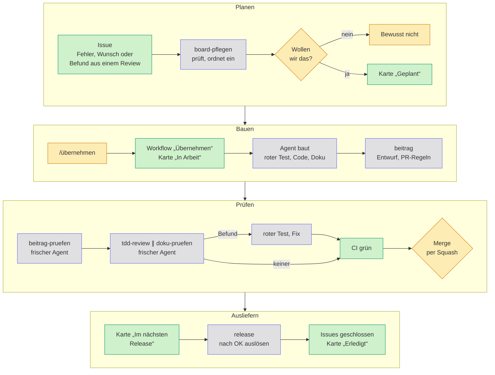
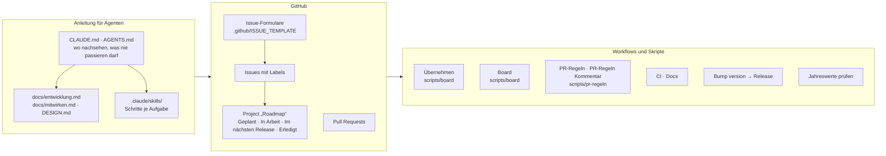
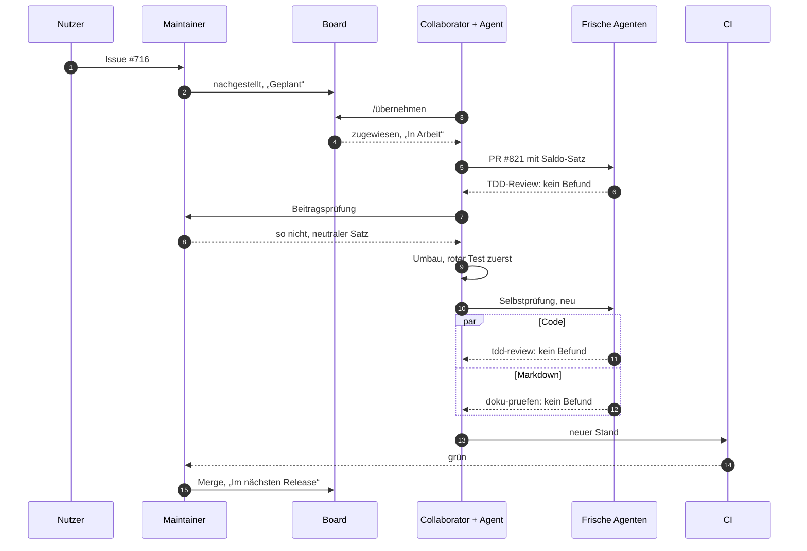

# So entsteht Haben

Den größten Teil des Codes von Haben schreiben Coding-Agenten. Was gebaut wird und was nach `main` kommt, entscheiden Menschen: ein Maintainer und ein paar Collaborators. Dazwischen prüfen Agenten die Arbeit anderer Agenten, und zwar so, dass ein Befund belegt sein muss. Eine Meinung reicht dafür nicht. Die Regeln stehen unter [Mitwirken](mitwirken.md), die Schritte für Agenten als Skills in [`.claude/skills/`](https://github.com/firsttris/haben/tree/main/.claude/skills). Diese Seite zeigt, wie das zusammenläuft.

## Der Ablauf

Gelb entscheidet ein Mensch, blau arbeitet ein Agent, grün läuft von selbst. Issues schreiben auch Agenten, aber nur auf Anweisung.

| Schritt | Wer | Regel | Skill |
| --- | --- | --- | --- |
| Issue schreiben und einordnen | Agent, Maintainer entscheidet | [Issues schreiben](mitwirken.md#issues-schreiben) | `issue-schreiben`, `board-pflegen` |
| Übernehmen | wer mitbauen will | [Etwas übernehmen](mitwirken.md#etwas-übernehmen) | |
| Bauen | Agent | [Konventionen](entwicklung.md#konventionen), [Tests](entwicklung.md#tests) | `checks` |
| Pull Request | Agent | [Branches, Titel und Commits](mitwirken.md#branches-titel-und-commits) | `beitrag`, `pr-screenshots` |
| Selbstprüfung | frischer Agent | [Beiträge annehmen](mitwirken.md#beiträge-annehmen) | `beitrag-pruefen` |
| Review | frischer Agent, je einer für Code und Markdown | [Review](mitwirken.md#review), [Doku-Prüfung](mitwirken.md#doku-prüfung) | `tdd-review`, `doku-pruefen` |
| Fixes im Fork einer anderen Person | Agent | [Review](mitwirken.md#review), Punkt 4 | `fork-pushen` |
| Merge | Maintainer oder Collaborator mit Zustimmung | [Review](mitwirken.md#review), Punkt 6 | |
| Release | Agent schlägt vor, Maintainer gibt frei | [Veröffentlichen](entwicklung.md#veröffentlichen) | `release` |
| Amtliche Jahreswerte | Workflow öffnet ein Issue, Agent zieht nach | [Jahreswerte](entwicklung.md#jahreswerte) | `jahreswerte` |

Dazu kommt `belegvorlage`. Mit diesem Skill schreiben Nutzer ihr eigenes Rechnungslayout, ohne das Repository zu brauchen ([Eigene Belegvorlagen](belegvorlagen.md#mit-einem-ki-agenten)).

„Frisch“ heißt: ein neuer Agent ohne den Verlauf dessen, der den Code geschrieben hat. Er kennt nur den Pull Request und das Repository und prüft deshalb, was dasteht. Was gemeint war, weiß er nicht.

## Was im Repository zusammenspielt

`CLAUDE.md` und `AGENTS.md` sind nur der Einstieg: Sie sagen, wo eine Regel steht und was nie passieren darf. Die Regeln selbst stehen in der Doku, damit Menschen und Agenten dieselben lesen. Was ein Agent dafür Schritt für Schritt tut, steht in einem Skill. Was sich sicher entscheiden lässt, prüft ein Workflow. Dann hängt es nicht davon ab, ob ein Agent die Regel gelesen hat.

| Workflow | Läuft bei | Tut |
| --- | --- | --- |
| Übernehmen | Kommentar `/übernehmen` oder `/freigeben`, täglich | weist zu, schiebt die Karte nach „In Arbeit“, fragt nach 14 Tagen nach, gibt nach weiteren sieben frei |
| Board | Issue zugewiesen, Pull Request geöffnet oder gemergt | zieht die Karte nach `Refs` und `Umgesetzt` mit |
| PR-Regeln, PR-Regeln Kommentar | jeder Push auf einen Pull Request | prüft Titel, Issue-Verweise, Dateigröße, Doku und Selbstprüfung, schreibt das Ergebnis als einen Kommentar |
| CI | „Ready for review“, `main` | lint, Typen, Vitest mit Postgres, Playwright, KoSIT, ZUGFeRD, Container |
| Docs | Pull Request, `main` | baut diese Seiten, auf `main` auch veröffentlichen |
| Bump version, Release | Maintainer löst aus | Version, Image, GitHub-Release, schließt die umgesetzten Issues |
| Jahreswerte prüfen | montags | öffnet je neuem amtlichem Wert, neuer ERiC-Version oder geänderter Norm ein Issue |

Was die Automatik nicht sieht, also neue Issues einordnen, offene Gespräche finden und Karten aufräumen, übernimmt `board-pflegen`. Seine Vorschläge setzt es erst nach dem OK des Maintainers um.

## Ein Beispiel: der Satz auf dem Storno

Issue [#716](https://github.com/firsttris/haben/issues/716) und Pull Request [#821](https://github.com/firsttris/haben/pull/821): Alle Prüfungen waren grün, und trotzdem kam die erste Fassung nicht nach `main`.

1. **Issue:** Ein Nutzer meldet, dass das Storno einer unbezahlten Rechnung über 1 € verspricht: „Der Betrag wird Ihnen erstattet.“ Der Maintainer stellt den Fehler nach und setzt die Karte nach „Geplant“.
2. **Übernehmen:** Ein Collaborator kommentiert `/übernehmen` mit einem kurzen Plan. Eine Minute später ist das Issue ihm zugewiesen und die Karte steht in „In Arbeit“.
3. **Erste Fassung:** Sein Agent baut einen Satz, der den Saldo des Kundenkontos auf dem Storno nennt („Ihr Kundenkonto weist ein Guthaben i. H. v. … aus“). Zuerst kommen rote Tests, dann der Fix. Zwei Runden TDD-Review durch frische Agenten finden nichts. Für jeden Verdacht schrieben sie einen eigenen Test, und jeder blieb grün.
4. **Der Mensch entscheidet:** In der Beitragsprüfung rechnet der Maintainer den Saldo selbst nach. Er stimmt. Gemergt wird trotzdem nicht: Das Storno wird festgeschrieben und geht an den Kunden. Der Saldo stimmt aber nur, wenn der Bankabgleich vollständig ist. Bei einer eingegangenen, noch nicht zugeordneten Zahlung würde Haben dem Kunden schriftlich eine Forderung bescheinigen, die es nicht gibt. Sein Vorschlag lautet deshalb: nur „Die ursprüngliche Rechnung wird storniert.“
5. **Umbau:** Wieder kommt der rote Test zuerst, dann der Fix. Die Berechnung des Saldos fällt ganz weg. Weil sich der Ansatz geändert hat, läuft die Selbstprüfung neu.
6. **Code und Markdown getrennt geprüft:** `tdd-review` und `doku-pruefen` laufen nebeneinander, je in einem frischen Agenten. Das TDD-Review schreibt 25 eigene Tests für Grenzfälle und ältere Belege, die Doku-Prüfung gleicht `docs/rechnungen.md` mit Code und Entscheidung ab. Keiner findet einen Befund.
7. **Merge:** Die CI ist grün, der Maintainer merged per Squash. Die Karte wandert nach „Im nächsten Release“, das Issue bleibt offen, bis das Release es schließt.

Code und Tests waren in beiden Fassungen richtig. Falsch war die fachliche Annahme, dass Haben auf einem festgeschriebenen Beleg über den Kontostand sprechen darf. Das prüft kein Test, das musste ein Mensch entscheiden.

## Leitplanken für Agenten

Dass kein ungeprüfter Code nach `main` kommt, hängt nicht davon ab, ob ein Agent die Regeln kennt, sondern davon, dass ein Fehler vor dem Merge auffällt:

- **Regeln an einer Stelle:** [Entwicklung](entwicklung.md), [Mitwirken](mitwirken.md) und [`DESIGN.md`](https://github.com/firsttris/haben/blob/main/DESIGN.md); `CLAUDE.md` und `AGENTS.md` verweisen nur darauf, die Abläufe stehen als Skills in `.claude/skills/`.
- **Fehlerklassen ausgeschlossen:** Geld in Cent statt Gleitkomma; Postgres-Trigger und Hashkette schützen Festgeschriebenes auch vor fehlerhaftem Code ([Konventionen](entwicklung.md#konventionen)).
- **Tests für jede Änderung,** keiner abgeschwächt, Übersprungenes genannt ([Mitwirken](mitwirken.md)).
- **Fremde Maßstäbe:** [KoSIT-Validator](entwicklung.md#kosit-validator), [SEPA-Schemas](entwicklung.md#schemas-der-sepa-überweisung-und--lastschrift), WCAG 2.2 AA; fachliche Details nach der Primärquelle im Code.
- **Regeln als Skript,** wo sie sich sicher entscheiden lassen ([Automatische Prüfungen der Regeln](mitwirken.md#automatische-prüfungen-der-regeln)).
- **Unabhängiges Review mit rotem Test** ([Review](mitwirken.md#review)).
- **Ein Mensch entscheidet** über den Merge.

Was das nicht leistet: Die Leitplanken fangen Fehler, die ein Test zeigen kann. Ist die fachliche Annahme selbst falsch, etwa bei einer Steuerregel, sind Code und Test gemeinsam falsch und trotzdem grün. Dagegen helfen nur die Primärquelle im Code, Rückmeldungen aus echten Abgaben und die Prüfung durch eine Steuerberatung. Ein unabhängiges Audit der Software oder ihrer Fachlogik gibt es bisher nicht.

## Mitmachen

Eine Karte aus dem [Project „Roadmap“](https://github.com/users/firsttris/projects/2) aussuchen und im Issue `/übernehmen` kommentieren ([Etwas übernehmen](mitwirken.md#etwas-übernehmen)). Die Skills liegen im Repository und gelten für jeden Agenten, nicht nur für Claude Code.
