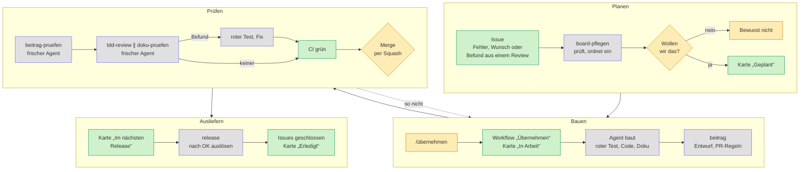

So entsteht Haben

# Agentic Engineering in der Praxis

Agenten schreiben den Code. Frische Agenten prüfen ihn und dürfen nur melden, was ein
fehlschlagender Test belegt. Ein Mensch entscheidet, was nach <code>main</code> kommt.

[Ein echtes Beispiel](#beispiel){ .md-button .md-button--primary } [Etwas übernehmen](mitwirken.md#etwas-übernehmen){ .md-button } [Zum Board](https://github.com/users/firsttris/projects/2){ .md-button }

**🧑 Mensch entscheidet**

Was gebaut wird, offene fachliche Fragen, den Merge und das Release.

**🤖 Agent baut und prüft**

Issues, Code mit rotem Test zuerst, Selbstprüfung, Review, Doku-Prüfung.

**⚙️ Automatik hält Regeln**

Board, Zuweisung, PR-Regeln, CI und das Schließen der Issues mit dem Release.

## Der Ablauf

Die Farben sind dieselben wie bei den Karten oben, kleingeschriebene Namen wie `board-pflegen` oder `tdd-review` sind [Skills](https://github.com/firsttris/haben/tree/main/.claude/skills) im Repository. „Frisch“ heißt: ein neuer Agent ohne den Verlauf dessen, der den Code geschrieben hat. Er kennt nur den Pull Request und das Repository und prüft deshalb, was dasteht. Was gemeint war, weiß er nicht.

## Ein Beispiel: der Satz auf dem Storno { #beispiel }

Issue [#716](https://github.com/firsttris/haben/issues/716) mit den Pull Requests [#814](https://github.com/firsttris/haben/pull/814) und [#821](https://github.com/firsttris/haben/pull/821), vom `/übernehmen` bis zum letzten Merge in gut acht Stunden, einmal durch den Ablauf oben und einmal über „so nicht“ zurück.

1. **Planen:** Ein Nutzer meldet, dass das Storno einer unbezahlten Rechnung über 1 € verspricht: „Der Betrag wird Ihnen erstattet.“ Der Maintainer stellt den Fehler nach und setzt die Karte nach „Geplant“.
2. **Bauen:** Ein Collaborator kommentiert `/übernehmen` mit einem kurzen Plan. Sekunden später ist das Issue ihm zugewiesen und die Karte steht in „In Arbeit“. Sein Agent richtet in #814 den Satz am Zahlstand aus, ohne Zahlung sagt das Storno keine Erstattung mehr zu. Zuerst kommen rote Tests, dann der Fix.
3. **Prüfen:** Selbstprüfung und TDD-Review finden nichts. Der Maintainer prüft nach und merged. Wegen `Umgesetzt #716` wandert die Karte nach „Im nächsten Release“.
4. **Noch einmal bauen und prüfen:** Danach soll das Storno auch den Saldo des Kundenkontos nennen. Der Agent baut in #821 einen Satz dafür („Ihr Kundenkonto weist ein Guthaben i. H. v. … aus“), wieder mit roten Tests zuerst. Zwei Runden TDD-Review durch frische Agenten finden nichts. Für jeden Verdacht schrieben sie einen eigenen Test, und jeder blieb grün.
5. **So nicht:** In der Beitragsprüfung rechnet der Maintainer den Saldo selbst nach. Er stimmt. Gemergt wird trotzdem nicht: Das Storno wird festgeschrieben und geht an den Kunden. Der Saldo stimmt aber nur, wenn der Bankabgleich vollständig ist. Bei einer eingegangenen, noch nicht zugeordneten Zahlung würde Haben dem Kunden schriftlich eine Forderung bescheinigen, die es nicht gibt. Sein Vorschlag lautet deshalb: nur „Die ursprüngliche Rechnung wird storniert.“
6. **Zurück zum Bauen:** Wieder kommt der rote Test zuerst, dann der Fix. Die Berechnung des Saldos fällt ganz weg. Weil sich der Ansatz geändert hat, läuft die Selbstprüfung neu.
7. **Prüfen, Code und Markdown getrennt:** `tdd-review` und `doku-pruefen` laufen nebeneinander, je in einem frischen Agenten. Das TDD-Review schreibt 25 eigene Tests für Grenzfälle und ältere Belege, die Doku-Prüfung gleicht `docs/rechnungen.md` mit Code und Entscheidung ab. Keiner findet einen Befund. Die CI ist grün, der Maintainer merged per Squash.
8. **Ausliefern:** #821 verweist nur mit `Refs #716`, umgesetzt war das Issue schon mit #814. Es bleibt offen, bis das nächste Release es schließt.

> [!IMPORTANT]
> **Alle Tests grün, und trotzdem falsch.** Code und Tests der Saldo-Fassung waren richtig. Falsch war die fachliche Annahme, dass Haben auf einem festgeschriebenen Beleg über den Kontostand sprechen darf. Das prüft kein Test, das musste ein Mensch entscheiden.

## Leitplanken für Agenten

Dass kein ungeprüfter Code nach `main` kommt, hängt nicht davon ab, ob ein Agent die Regeln kennt, sondern davon, dass ein Fehler vor dem Merge auffällt.

**🧱 Fehlerklassen ausgeschlossen**

Geld in Cent statt Gleitkomma; Postgres-Trigger und Hashkette schützen Festgeschriebenes auch vor fehlerhaftem Code ([Konventionen](entwicklung.md#konventionen)).

**🔴 Review mit rotem Test**

Tests für jede Änderung, keiner abgeschwächt. Ein unabhängiges Review meldet einen Befund nur mit einem Test, der fehlschlägt ([Review](mitwirken.md#review)).

**✅ Regeln als Skript**

Was sich sicher entscheiden lässt, prüfen Skripte und die CI ([Automatische Prüfungen der Regeln](mitwirken.md#automatische-prüfungen-der-regeln)), dazu fremde Maßstäbe wie [KoSIT-Validator](entwicklung.md#kosit-validator), SEPA-Schemas und WCAG 2.2 AA.

**📖 Doku für Menschen, Skills für Agenten**

Jede Regel steht einmal in `docs/` oder `DESIGN.md`, kurz und auf Deutsch. Ein Skill sagt Schritt für Schritt, was zu tun ist, und verweist auf die Regel. `CLAUDE.md` und `AGENTS.md` sind nur der Einstieg.

> [!WARNING]
> **Was das nicht leistet:** Ist die fachliche Annahme falsch wie im Beispiel, sind Code und Test gemeinsam falsch und trotzdem grün. Dagegen helfen nur die Primärquelle im Code, Rückmeldungen aus echten Abgaben, die Prüfung durch eine Steuerberatung und ein Mensch, der bei Steuer, Buchung, ELSTER und GoBD vor dem Merge zustimmt. Ein unabhängiges Audit der Software oder ihrer Fachlogik gibt es bisher nicht.

## Mitmachen

Eine Karte aus dem Board aussuchen, im Issue <code>/übernehmen</code> kommentieren und
mit dem Agenten deiner Wahl loslegen. Die Skills liegen im Repository und gelten für jeden Agenten.

[Etwas übernehmen](mitwirken.md#etwas-übernehmen){ .md-button .md-button--primary } [Einstiegs-Issues](https://github.com/firsttris/haben/issues?q=is%3Aopen+label%3Aeinstieg){ .md-button }

