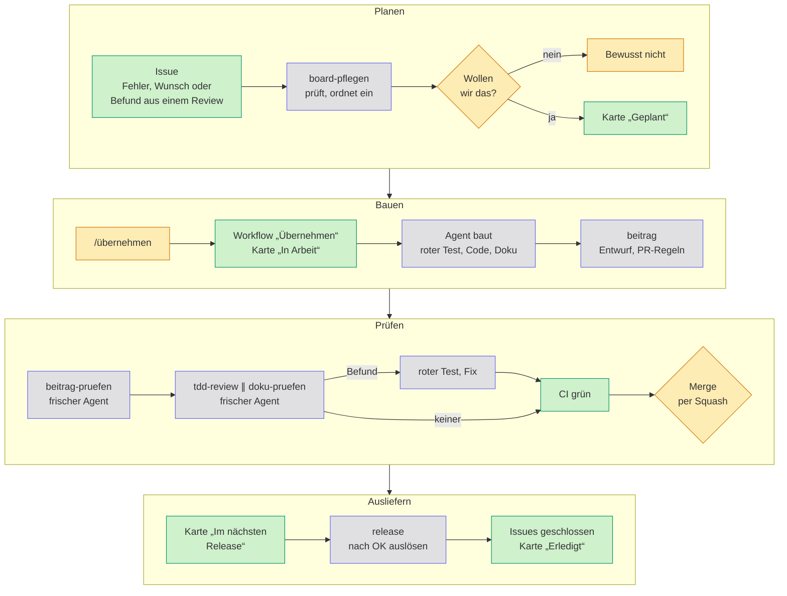
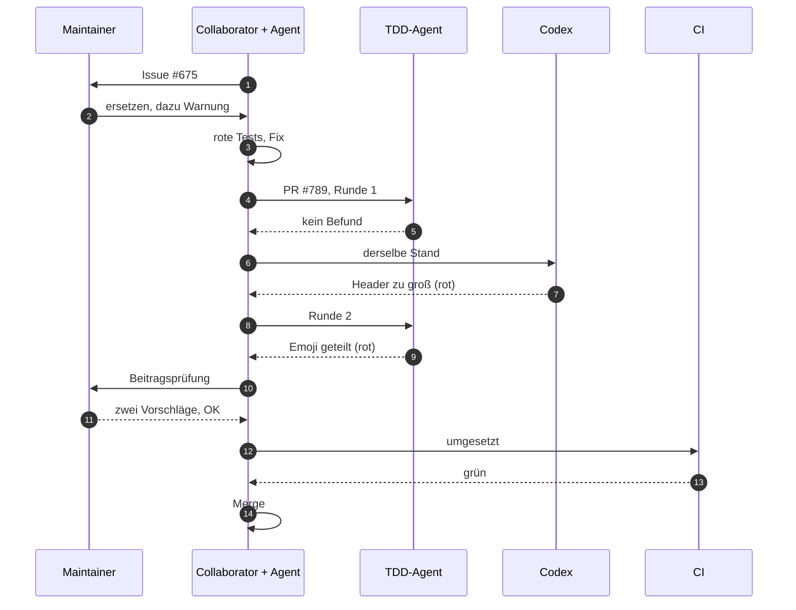

# So entsteht Haben

Den größten Teil des Codes von Haben schreiben Coding-Agenten wie Claude Code und Codex. Was gebaut wird und was nach `main` kommt, entscheiden Menschen: ein Maintainer und ein paar Collaborators. Dazwischen prüfen Agenten die Arbeit anderer Agenten, und zwar so, dass ein Befund belegt sein muss. Eine Meinung reicht dafür nicht. Die Regeln stehen unter [Mitwirken](mitwirken.md), die Schritte für Agenten als Skills in [`.claude/skills/`](https://github.com/firsttris/haben/tree/main/.claude/skills). Diese Seite zeigt, wie das zusammenläuft.

## Der Ablauf

Gelb entscheidet ein Mensch, blau arbeitet ein Agent, grün läuft von selbst. Issues schreiben auch Agenten, aber nur auf Anweisung.

| Schritt | Wer | Regel | Skill |
| --- | --- | --- | --- |
| Issue schreiben und einordnen | Agent, Maintainer entscheidet | [Issues schreiben](mitwirken.md#issues-schreiben) | `issue-schreiben`, `board-pflegen` |
| Übernehmen | wer mitbauen will | [Etwas übernehmen](mitwirken.md#etwas-übernehmen) | |
| Bauen | Agent | [Konventionen](entwicklung.md#konventionen), [Tests](entwicklung.md#tests) | `checks` |
| Pull Request | Agent | [Branches, Titel und Commits](mitwirken.md#branches-titel-und-commits) | `beitrag`, `pr-screenshots` |
| Selbstprüfung | frischer Agent | [Beiträge annehmen](mitwirken.md#beiträge-annehmen) | `beitrag-pruefen` |
| Review | frischer Agent, oft auch Codex | [Review](mitwirken.md#review), [Doku-Prüfung](mitwirken.md#doku-prüfung) | `tdd-review`, `doku-pruefen` |
| Merge | Maintainer oder Collaborator mit Zustimmung | [Review](mitwirken.md#review), Punkt 6 | |
| Release | Agent schlägt vor, Maintainer gibt frei | [Veröffentlichen](entwicklung.md#veröffentlichen) | `release` |

„Frisch“ heißt: ein neuer Agent ohne den Verlauf dessen, der den Code geschrieben hat. Er kennt nur den Pull Request und das Repository und prüft deshalb, was dasteht. Was gemeint war, weiß er nicht.

## Ein Beispiel: der Punkt im DATEV-Export

Issue [#675](https://github.com/firsttris/haben/issues/675) und Pull Request [#789](https://github.com/firsttris/haben/pull/789), vom Issue bis zum Merge in gut 29 Stunden.

1. **Issue:** Beim Review des Umzugs aus sevDesk ([#534](https://github.com/firsttris/haben/pull/534)) fiel auf, dass der eigene DATEV-Export einen Punkt im Belegfeld 1 stehen lässt. DATEV erlaubt dort keinen. Das Issue nennt die Quelle (DATEV Dok.-Nr. 1003221), den auf `main` geprüften Stand mit Links in den Code, drei Akzeptanzkriterien und eine offene Frage: entfernen oder ersetzen?
2. **Entscheidung vor dem Code:** Der Maintainer entscheidet sich fürs Ersetzen. Aus `RE.2026.001` wird `RE-2026-001`, so findet man die Nummer in DATEV wieder. Dazu kommt ein neues Kriterium: eine Warnung, wenn zwei Nummern zusammenfallen. Die Karte kommt nach „Geplant“ und bekommt das Label `einstieg`.
3. **Bauen:** Zuerst kommen Tests, die rot sind, darunter ein Test mit Postgres für SKR03 mit Ist und SKR04 mit Soll. Danach folgen der Fix an einer Stelle, die Export und Warnung gemeinsam nutzen, und ein Absatz in [Auswertungen](auswertungen.md).
4. **TDD-Review, Runde 1:** kein belegter Befund. Der Kommentar listet neun Verdachte und begründet je in einem Satz, warum keiner trägt. Einer davon lautete: Bei vielen Zusammenstößen wird der Hinweis im HTTP-Header zu groß. Das verwarf der Agent als konstruiert.
5. **Codex, gleicher Stand:** Derselbe Verdacht, aber mit rotem Test. Hat ein nginx davor nur 4 KiB Puffer für die Header, antwortet er mit 502 statt der Datei. Der Fix begrenzt den Header auf 2000 Bytes und zählt den Rest.
6. **Runde 2, nur für die Fixes:** Der TDD-Agent findet, dass das Kürzen ein Emoji in zwei Hälften teilen kann (`URIError`). Der Test ist rot, die Eingabe aber konstruiert, also wird der Befund nach den Regeln nur notiert.
7. **Beitragsprüfung:** Der Maintainer liest die DATEV-Quelle selbst und rechnet zwei Nummern von Hand gegen die Tests nach. Der Link auf die Quelle liefert inzwischen 404. Er schlägt vor, den Link umzustellen und den Einzeiler gegen das geteilte Emoji doch zu machen. Weil der DATEV-Export fachlich heikel ist, wird erst nach seinem OK gemergt.
8. **Merge:** Beide Vorschläge kommen als eigene Commits, der Test zuerst. Dann laufen die CI grün und der Squash, die Karte wandert nach „Im nächsten Release“. Zum Schluss gibt es noch einen Kommentar für die Release-Notiz: Wer schon einen Stapel mit Punkt an die Kanzlei gegeben hat, muss einen offenen Posten von Hand ausgleichen. Das Issue bleibt offen, bis das Release es schließt.

Zwei Prüfer, zwei Befunde, die der jeweils andere nicht hatte. Beide hätte niemand gemeldet, wenn ein Befund ohne roten Test gezählt hätte. Umgekehrt landete kein Stil-Hinweis im Pull Request.

## Leitplanken für Agenten

Dass kein ungeprüfter Code nach `main` kommt, hängt nicht davon ab, ob ein Agent die Regeln kennt, sondern davon, dass ein Fehler vor dem Merge auffällt:

- **Regeln an einer Stelle:** [Entwicklung](entwicklung.md), [Mitwirken](mitwirken.md) und [`DESIGN.md`](https://github.com/firsttris/haben/blob/main/DESIGN.md); `CLAUDE.md` und `AGENTS.md` verweisen nur darauf, die Abläufe stehen als Skills in `.claude/skills/`.
- **Fehlerklassen ausgeschlossen:** Geld in Cent statt Gleitkomma; Postgres-Trigger und Hashkette schützen Festgeschriebenes auch vor fehlerhaftem Code ([Konventionen](entwicklung.md#konventionen)).
- **Tests für jede Änderung,** keiner abgeschwächt, Übersprungenes genannt ([Mitwirken](mitwirken.md)).
- **Fremde Maßstäbe:** [KoSIT-Validator](entwicklung.md#kosit-validator), [SEPA-Schemas](entwicklung.md#schemas-der-sepa-überweisung-und--lastschrift), WCAG 2.2 AA; fachliche Details nach der Primärquelle im Code.
- **Regeln als Skript,** wo sie sich sicher entscheiden lassen ([Automatische Prüfungen der Regeln](mitwirken.md#automatische-prüfungen-der-regeln)).
- **Unabhängiges Review mit rotem Test** ([Review](mitwirken.md#review)).
- **Ein Mensch entscheidet** über den Merge.

Was das nicht leistet: Die Leitplanken fangen Fehler, die ein Test zeigen kann. Ist die fachliche Annahme selbst falsch, etwa bei einer Steuerregel, sind Code und Test gemeinsam falsch und trotzdem grün. Dagegen helfen nur die Primärquelle im Code, Rückmeldungen aus echten Abgaben und die Prüfung durch eine Steuerberatung. Ein unabhängiges Audit der Software oder ihrer Fachlogik gibt es bisher nicht.

## Mitmachen

Eine Karte aus dem [Project „Roadmap“](https://github.com/users/firsttris/projects/2) aussuchen und im Issue `/übernehmen` kommentieren ([Etwas übernehmen](mitwirken.md#etwas-übernehmen)). Die Skills liegen im Repository und gelten für jeden Agenten, nicht nur für Claude Code.
