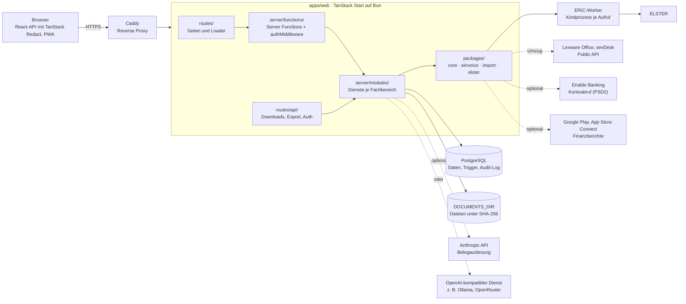

# Architektur

Haben ist eine einzelne Anwendung auf Basis von TanStack Start, die unter Bun läuft, mit PostgreSQL als einziger Datenbank und einem Verzeichnis für Belegdateien. Für die Entwicklungsumgebung siehe [Entwicklung](entwicklung.md), für den Betrieb [Installation](installation.md).

## Überblick

Der Browser spricht nur mit der eigenen Anwendung. Seiten laden ihre Daten über Server Functions; Dateien (Rechnungs-PDFs, Belege, Protokolle, CSV, ZIP) kommen über eigene API-Routen. Nach außen verbindet sich der Server nur mit ELSTER (über ERiC, dazu `download.elster.de` für das ERiC-Paket), optional mit der Anthropic-API oder einem OpenAI-kompatiblen KI-Dienst (selbst betrieben oder in der Cloud), mit Enable Banking für den Kontoabruf, mit Google Play und App Store Connect für die Finanzberichte der App-Stores, dem Datenportal des BMF für die Umrechnungskurse, dem eigenen Mailserver (SMTP, IMAP) und während des Umzugs mit Lexware Office oder sevDesk.

## Module

### Pakete

| Paket | Aufgabe |
| --- | --- |
| `packages/core` | Reine Fachlogik ohne Ein- und Ausgabe: Cent-Beträge und Formatierung, Zeiträume (Monate und Quartale) und Fälligkeiten mit Feiertagen je Bundesland (`holidays.ts`), Voranmeldungszeitraum und Vorschlag nach § 18 Abs. 2 UStG (`voranmeldungszeitraum.ts`), Sondervorauszahlung nach § 47 UStDV (`dauerfrist.ts`), Steuernummer-Umrechnung ins ELSTER-Format, Rechnungssummen, Termine und Prüfung der Dauerbelege (`dauerbeleg.ts`), umsatzsteuerliche Behandlung von Rechnungen (`treatment.ts`), Kontenrahmen und Buchungssätze (`posting.ts`), Kennzahlen der Voranmeldung aus Konto und Steuerschlüssel des Journals (`journal-kennzahlen.ts`), EÜR-Zeilen aus Konto und Herkunft des Journals, Anteil einer Zahlung an der ausgeglichenen Buchung und Konten der DATEV-Formel (`journal-euer.ts`), Kontierung und EÜR-Wirkung von Steuerzahlungen nach Steuerart, Bezugsjahr und Teil (`steuerzahlung.ts`), Konten und Buchung von Darlehen (`darlehen.ts`), Aufteilung eines Belegs auf mehrere Kategorien (`document-split.ts`), Vorschläge für den Bankabgleich (`matching.ts`), SEPA-Überweisung als pain.001.001.09 mit Zeichensatz, IBAN und BIC (`sepa.ts`, `sepa-text.ts`), Gläubiger-ID, Mandatsreferenz und Verfall des Lastschriftmandats (`sepa-mandat.ts`), SEPA-Lastschrift als pain.008.001.08 mit TARGET-Kalender und Einzugstag (`sepa-lastschrift.ts`), Sammelgutschrift und Rücklastschrift im Bankabgleich erkennen (`lastschrift-abgleich.ts`), Skonto aus den Zahlungsbedingungen einer XRechnung (`skonto.ts`), UStVA-Berechnung, EÜR (`euer.ts`), Umsatzsteuer aus Lexoffice-Belegen (`legacy-vat.ts`), Lebenszyklen von Rechnung, Angebot und Voranmeldung und der offene Betrag von Rechnungen und Belegen (`lebenszyklus.ts`; Rechnungsliste, Bankabgleich, offene Posten, Mahnwesen und die Sperre der Firmendaten rechnen damit, ein Test prüft, dass alle dasselbe ergeben), Lohnsteuer nach dem PAP des BMF (`lohnsteuer/`), Beiträge zur Sozialversicherung (`sozialversicherung/`), die Lohnabrechnung eines Monats aus den Stammdaten samt Lohnkonto (`lohnabrechnung/`), ihr Buchungssatz (`lohn-buchung.ts`) und die Lohnsteuerbescheinigung eines Jahres (`lohnsteuerbescheinigung.ts`); für GmbH und UG Bilanz und GuV der Kleinstkapitalgesellschaft (`hgb.ts`), Kontenzuordnung der E-Bilanz (`ebilanz.ts`), Körperschaft- und Gewerbesteuer (`koerperschaft.ts`), Gewinnausschüttung (`ausschuettung.ts`), manuelle Buchungen (`manual.ts`), freie Buchungen mit Steuerschlüssel (`freie-buchung.ts`) und Saldenvortrag (`vortrag.ts`) |
| `packages/gobd-kern` | Bausteine der Unveränderbarkeit ohne Bezug auf Haben, damit auch andere Apps sie nutzen ([#935](https://github.com/firsttris/haben/issues/935)): Dateispeicher unter SHA-256 mit Prüfung beim Lesen (`dateispeicher.ts`), Dateityp am Inhalt (`dateityp.ts`), Prüfwert der Hash-Kette (`pruefwert.ts`), `index.xml` nach dem Beschreibungsstandard (`beschreibung.ts`), SQL-Vorlage für Hash-Kette, Siegel und Sperren für neue Projekte (`sql/vorlage.ts`; Haben behält seine eigenen Migrationen). Haben bindet den Speicher an `DOCUMENTS_DIR` (`server/storage.ts`) und gibt für die `index.xml` die Spaltentypen seiner CSVs an (`modules/archiv/beschreibung.ts`) |
| `packages/einvoice` | Rechnungs-PDF mit Typst (Vorlage `templates/rechnung.typ`), weitere PDFs nach demselben Muster (Mahnung, Steuerbescheinigung, Bilanz zur Hinterlegung, Entgeltabrechnung `lohnabrechnung.typ`, Lohnkonto `lohnkonto.typ`, Ausdruck der Lohnsteuerbescheinigung `lohnsteuerbescheinigung.typ`), ZUGFeRD und XRechnung (CII und UBL selbst geschrieben, `factur-x.xml` mit `pdf-lib` eingebettet), Prüfung der Pflichtfelder je Format, Lesen eingehender E-Rechnungen (eingebettetes XML aus PDFs, CII und UBL) |
| `packages/import` | Parser für Kontoauszüge (DKB, N26, CAMT.053) und für Exporte von Zahlungsdienstleistern (PayPal, Stripe, Shopify Payments in `psp.ts`, eBay in `ebay.ts`, Etsy in `etsy.ts`), Dekodierung, Deduplizierung, Saldenprüfung, DATEV-Buchungsstapel lesen (`datev.ts`) und aus dem Journal schreiben (`datev-export.ts`), CSV-Import von Kontakten, Artikeln und Anlagen (`csv-import/`), Client und Abbildungen für die Lexware-Office-API (`lexoffice/`) und das Lesen einer Sicherung aus deren Web-Oberfläche (`lexoffice/web/`, erzeugt von `apps/web/public/lexware-sicherung.js`), Client und Abbildungen für die sevDesk-API (`sevdesk/`), Parser und Belegzuordnung für BuchhaltungsButler-Exporte (`buchhaltungsbutler/`), Leser und Abbildung des Accountable-Exports aus DATEV-Stapel, `Belege.zip` und `Daten.xlsx` (`accountable/`), Clients und Berichtsleser für Google Play und App Store Connect (`stores/`), Client und Abbildung für den Kontoabruf über Enable Banking (`enablebanking/`) |
| `packages/elster` | `ElsterClient` mit echtem ERiC-Client (Kindprozess, `koffi`) und simuliertem Client, UStVA-XML, Antrag auf Dauerfristverlängerung (`dauerfrist.ts`), Zusammenfassende Meldung (`zm.ts`), Lohnsteuer-Anmeldung (`lsta.ts`), Feldkennungen und Werte zum Ausfüllen in Mein ELSTER (`felder.ts`), XML der Jahreserklärungen (Umsatzsteuererklärung E50, `ust-erklaerung.ts`, Anlage EÜR mit AVEÜR E77, `erklaerung.ts`, Feldkennungen der EÜR in `euer-felder.ts` und die USt-Umgliederung zwischen Zeile 18 und 58 in `euer-umgliedern.ts`; Einkommensteuererklärung E10, `est.ts`), Kapitalertragsteuer-Anmeldung (`kapesta.ts`), Lohnsteuerbescheinigung bis 2025 (`lstb.ts`, ElsterLohn), Körperschaftsteuererklärung E30 (`kst.ts`, Anlage KSt 1 F in `kst1f.ts`) und Gewerbesteuererklärung E20 (`gewst.ts`), E-Bilanz als XBRL in der HGB-Taxonomie 6.9 oder 6.10 nach dem Wirtschaftsjahr mit Anlagenspiegel, Betriebsvermögensvergleich und Kontennachweis (`ebilanz/xbrl.ts`, `ebilanz/kontennachweis.ts`, Auswahl und Taxonomie-Auszüge `ebilanz/taxonomie.ts`, `ebilanz/taxonomie-6-9.json`, `ebilanz/taxonomie-6-10.json`), Sonstige Nachricht (`nachricht.ts`), Änderung der Bankverbindung (`bankverbindung.ts`), Datenabholung aus dem Postfach (`postfach.ts`, Download der Anhänge über Otto), Belegabruf der vorausgefüllten Steuererklärung (`vast.ts`, Entschlüsselung mit `EricDekodiereDaten`), Berechtigungen zum Belegabruf (`berechtigung.ts`, ElsterBRM), Transfer-Ticket, ERiC-Download (`install.ts`) |

### apps/elster-helfer

Die Browser-Erweiterung „Haben für Mein ELSTER“ (Manifest V3, TypeScript, gebaut mit Vite und `@crxjs/vite-plugin` nach `dist/`): `src/fill.ts` findet die Felder von Mein ELSTER über ihre amtliche Kennung (reine Logik ohne Chrome-APIs, getestet in `apps/web/e2e/elster-helfer.spec.ts`), `src/content.ts` trägt auf jeder Formularseite ein und zeigt die Leiste, `src/popup.ts` nimmt die Werte aus Haben entgegen und legt sie im Sitzungsspeicher des Browsers ab. Das Format der Werte ist der Typ `MeinElsterWerte` aus `packages/elster/src/felder.ts`, denselben, mit dem Haben sie erzeugt. Das Inhaltsskript ist ein Bündel ohne Nachladen, die Erweiterung gibt Mein ELSTER also keine Dateien frei (`web_accessible_resources`), an denen die Seite sie erkennen könnte. Für jedes Release baut und packt `scripts/elster-helfer/paket.ts` sie mit der Version aus dem Tag als `haben-fuer-mein-elster-chrome-<Version>.zip` (Format des Chrome Web Store). Sie läuft nur auf `www.elster.de/eportal/interpreter/eingabe/…` und verbindet sich nicht mit Haben ([Mein ELSTER mit Erweiterung](elster-mit-erweiterung.md)).

### apps/web

| Ordner | Aufgabe |
| --- | --- |
| `src/routes/` | Dateibasiertes Routing. `_app/` enthält alle Seiten hinter der Anmeldung (Übersicht, Rechnungen, Angebote, Belege, Bank, Kasse, Umsatzsteuer, Lohn, Jahreserklärung, Abschluss, Auswertungen, Buchungen, Konten, Kontakte, Archiv, Einstellungen und weitere); `setup.tsx`, `login.tsx` und `einladung.$token.tsx` sind öffentlich |
| `src/routes/api/` | HTTP-Routen für Better Auth (`auth/$`), Dateien (`rechnung`, `rechnungsanhang`, `angebot`, `angebotsanhang`, `standardanhang`, `dokument` für Auftragsbestätigung und Lieferschein, `mahnung`, `beleg`, `dauerbeleg`, `altbeleg`, `archiv`, `protokoll`, `postfach`, `vast`, `logo`, `ustva` für den XML-Import in Mein ELSTER, `ueberweisung` für SEPA-Dateien, `lohn/…` für Entgeltabrechnung, Lohnkonto und Lohnsteuerbescheinigung, `steuerbescheinigung`, `sv-protokoll`, `hinterlegung/$jahr`), CSV und DATEV (`kasse/$jahr`, `konten/$jahr`, `datev/$jahr`), Rückleitung der Bank beim Kontoabruf (`bank/callback`), Kalender-Abo der Fristen (`fristen/kalender`, mit geheimem Token statt Sitzung), MCP-Endpunkt für KI-Assistenten (`mcp`, mit API-Token statt Sitzung), REST-API (`v1/$`, mit API-Token statt Sitzung), Teilen-Ziel der PWA (`belege/teilen`), EÜR als CSV (`auswertungen/$jahr`) und Jahresarchiv (`export/$jahr`) |
| `src/components/` | React-Komponenten, die mehrere Seiten nutzen (Rechnungseditor, Vorschau, Upload, Statusanzeigen), dazu `archiv/` für die Umzugsseite |
| `src/server/functions/` | Server Functions je Bereich: Eingaben mit Zod prüfen, `authMiddleware` anhängen, Dienst aufrufen. Keine Fachlogik |
| `src/server/modules/<name>/` | Dienste je Fachbereich, jeweils mit öffentlicher `index.ts` (siehe [Module im Server](#module-im-server)) |
| `src/server/*.ts` | Gemeinsame Infrastruktur ohne Fachlogik: `auth`, `anmeldung`, `rollen`, `middleware`, `lese-route`, `csrf`, `setup-code`, `crypto`, `storage`, `file-response`, `env`, `errors`, `today`, `security-headers`; dazu `scheduler.ts`, der die Hintergrundarbeit der Module zusammensetzt |
| `src/server/db/` | Drizzle-Schema (`schema.ts`, `auth-schema.ts`), Verbindung, `withActor` für das Audit-Log, Migrationsskript |
| `apps/web/drizzle/` | SQL-Migrationen; Trigger und Funktionen stehen in eigenen Dateien (`0001_festschreibung.sql`, `*_trigger.sql`) |
| `src/styles/`, `styles.css` | Globales Stylesheet und seitenbezogene Stylesheets (Auswertungen, Archiv). Farben stehen als CSS-Variablen in `:root`; eine Farbe überschreibt sie per `[data-theme="…"]`, der dunkle Modus per `[data-mode="dark"]`. Klassen, die mehr als eine Seite nutzt, gehören ins globale Stylesheet, sonst fehlen sie auf Seiten, die das seitenbezogene nicht laden |
| `src/lib/theme.ts` | Farbe und Modus: Listen, Speicherung im `localStorage` und ein Inline-Skript, das `<html data-theme data-mode>` vor dem ersten Zeichnen setzt (`__root.tsx`) |
| `vite.config.ts` | Setzt `__HABEN_VERSION__` aus der Root-`package.json`; die Navigation zeigt so die ausgelieferte Version. Das Plugin `redact()` ersetzt React beim Bauen durch TanStack Redact |
| `src/lib/` | Formatierung und Better-Auth-Client für den Browser |

### Module im Server

Die Dienste liegen in `apps/web/src/server/modules/`, ein Ordner je Fachbereich. Ein Modul besitzt seine Tabellen und bietet nach außen nur an, was in seiner `index.ts` steht.

| Modul | Inhalt |
| --- | --- |
| `stammdaten` | `company` (Firmendaten, ausdrückliche Speicherbestätigung, Versteuerung und Kleinunternehmer je Jahr), `contacts` (Kunden und Lieferanten, Rollen je Kontakt), `sepa-mandate` (SEPA-Lastschriftmandate am Kontakt: anlegen, PDF, Widerruf, Status), `articles`, `logo`, `background` (Briefpapier), `nav-mark` (Zeichen der Firma in der Navigation, getrennt von der Beleggestaltung), `letterhead` (Briefkopf: Standardprofil, Logo und Briefpapier), `number-formats` (Nummernformate für Rechnungen und Angebote), `customer-numbers` (Kundennummern automatisch), `personenkonten-vergabe` (fehlende DATEV-Debitoren und -Kreditoren beim Export), `taxpayer` (persönliche Angaben), `text-blocks` (Textbausteine), `plan-templates` (Vorlagen für den Zahlungsplan im Angebot), `exchange-rates` (Umrechnungskurse des BMF je Währung und Monat), `csv-import` (Kontakte und Artikel aus CSV prüfen und anlegen), `settings-guard` (Sperren für Kontenrahmen, Versteuerung, Kleinunternehmer und Rechtsform, Speichern der Firmendaten); für eigene Belegvorlagen `layouts` (anlegen, ersetzen, zuweisen, setzen), `layout-liste` (Liste und Quelltext), `layout-pruefung` (Prüfung vor dem Speichern), `layout-renderer` (Render-Prozess ohne Netz für Vorschau und eigene Layouts), `layout-pakete` (Paket-Cache je Layout), `paket-download` und `tar-entpacken` (Pakete aus Typst Universe mit Grenzen laden und entpacken) |
| `rechnungen` | `invoices`, `invoice-taxes` (Steuerzeilen), `lastschrift` (Zahlungsart Lastschrift: Mandat prüfen, Angaben für PDF und E-Rechnung), `draft-line` und `skonto` (Position und Skonto eines Entwurfs, ohne weitere Abhängigkeiten), `attachment-store` (zusätzliche PDF-Anhänge, gemeinsam für Rechnungen und Angebote), `attachments`, `quote-attachments` und `attachment-limit` (Anhänge an Rechnungen und Angeboten, Höchstzahl), `quote-default-attachments` (Standardanhänge für Angebote), `external-reference` (Entwurf mit externer Referenz aus der REST-API), `number-counter` (Nummernkreise, Nummer im eingestellten Format), `quotes` (Angebote), `quote-choices` (Auswahl optionaler und alternativer Positionen), `quote-plan` (Abschläge aus dem Zahlungsplan, Übersicht und Fortschritt; gerechnet mit `zahlungsplan.ts` in `packages/core`), `order-documents` (Auftragsbestätigung, Lieferschein), `dunning` (Mahnungen), `invoice-mail` (Rechnungen, Mahnungen und Angebote per E-Mail), `recurring` (Serienrechnungen) |
| `belege` | `documents`, `splits` (Aufteilung auf mehrere Kategorien), `lieferant-belege` (gebuchte Belege eines Lieferanten für die Kontaktseite), `navigation` (vorheriger und nächster Beleg der Liste), `cancellation` (Storno und Neuerfassung), `extraction` (KI-Auslesung: wählt den Anbieter, prüft die Antwort), `extraction-schema` (gemeinsames Belegschema, Anweisung, Prüfung von Beträgen, Daten und Summen), `extraction-config` (Anbieter aus der Umgebung), `extraction-anthropic` und `extraction-openai` (Anbieter), `pdf-pages` (PDF in Seitenbilder mit `pdftoppm`), `pdf-seitentext` (Text der Seiten aus der Textschicht für die KI-Auslesung, #329), `lieferantenvorschlag` (Kontaktvorschlag und IBAN-Vorschlag aus E-Rechnung und Auslesung), `inbox` (Belege per E-Mail über IMAP), `external-reference` (Referenz für Belege aus der REST-API), `dauerbelege` (Vorlagen für wiederkehrende Ausgaben mit Vertrag, pausieren, beenden), `dauerbelege-lauf` (Belege „Zu prüfen“ zu jedem Termin, Vorschläge und „Buchen und zuordnen“ im Bankabgleich; Termine aus `dauerbeleg.ts` in `packages/core`) |
| `bank` | `bank` (Kontoauszüge, Zuordnung), `steuerzahlung` (Steuerzahlung als Zuordnung, Verbrauch der Steuerrückstellung einer GmbH; Kontierung aus `steuerzahlung.ts` in `packages/core`), `darlehen` (Darlehen anlegen, Bestand, Auszahlung, Tilgung, Zinsen und Gebühren als Zuordnung; Konten aus `darlehen.ts` in `packages/core`), `bank-sync` (Kontoabruf), `cash` (Kassenbuch), `cash-invoice` (Bareinnahme auf eine Ausgangsrechnung), `sepa-transfers` (SEPA-Überweisungen für offene Belege), `sepa-lastschriften` (Lastschriftdatei pain.008 aus fälligen Rechnungen, letzter Einzug je Mandat), `lastschrift-abgleich` (Sammelgutschrift aufteilen, Rücklastschrift zuordnen, Stand jeder Lastschrift), `document-payees` (IBAN des Lieferanten und Referenzen der Überweisungen je Beleg), `iban-entscheidung` (abweichende IBAN der E-Rechnung, Entscheidung je Beleg; Abgleich mit `iban-abgleich.ts` in `packages/core`) |
| `buchhaltung` | `ledger` (Hauptbuch: einziger Schreiber des Journals, Saldenliste, Kontenblatt), `journal` (Kontennamen), `assets` (Anlagenverzeichnis, AfA), `asset-methoden` (Regeln für degressive und Elektro-AfA), `asset-import` (Anlagen aus CSV übernehmen), `pauschalen` (Homeoffice, Fahrten, Verpflegung, Wege zur Betriebsstätte ohne Beleg); `manual` (manuelle und freie Buchungen, im Einzelunternehmen ab dem Stichjahr), `gemeldet` (gemeldete Zeiträume für Storno und freie Buchungen); für GmbH und UG `eroeffnung` (Eröffnungen von Hand oder aus dem DATEV-Stapel), `abschluss` (Bilanz, GuV, Jahr abschließen), `bilanzen` (Bilanz mit Vorjahresspalte), `restlaufzeiten` (Vermerke nach § 268 Abs. 4 und 5 HGB), `hinterlegung` (Bilanz zur Hinterlegung als PDF) |
| `umsatzsteuer` | `vat-figures` (Zahlen und Vorprüfung), `vat-journal` (Kennzahlen aus dem Journal ab dem Stichjahr), `vat` (Entwürfe, Berichtigung, Übermittlung), `vermerk` (Abgabe außerhalb von Haben vermerken, mit Protokoll), `zahlung` (Zahllast und Erstattung je abgegebener Voranmeldung als offener Posten, Prüfung der Zuordnung; gerechnet mit `ustva-posten.ts` in `packages/core`), `zeitraum` (Voranmeldungszeitraum je Jahr und Vorschlag), `dauerfrist` (Dauerfristverlängerung, Sondervorauszahlung, Kz 39), `zm` (Zusammenfassende Meldung), `mein-elster` (Voranmeldung als Datei für den XML-Import in Mein ELSTER) |
| `elster` | `elster-gateway` (Zugang, Zertifikat und PIN, Sendesperre und Protokoll für jede Übermittlung), `certificate`, `elster` (Datenschutzhinweise der Finanzverwaltung) |
| `finanzamt` | `finanzamt` (Nachrichten, Bankverbindung), `postfach` (Bescheide abholen), `vast` (Belege der vorausgefüllten Steuererklärung), `berechtigung` (Abrufberechtigung für den Ehegatten), `fristen` (Steuertermine, Kalender-Abo) |
| `ausschuettung` | `ausschuettung` (Gewinnverwendungsbeschluss, Steuerabzug je Gesellschafter, Storno, Kapitalertragsteuer-Anmeldung), `steuerbescheinigung` (Steuerbescheinigung nach § 45a EStG je Gesellschafter als PDF) |
| `lohn` | `employees` (Stammdaten der Mitarbeiter), `payroll` (Lohnlauf je Monat, Entwurf, festschreiben, Storno mit neuer Abrechnung), `abrechnung-pdf` (Entgeltabrechnung als PDF), `lohnkonto` (Lohnkonto je Jahr als PDF und CSV), `anmeldung` (Lohnsteuer-Anmeldung), `bescheinigung` (Lohnsteuerbescheinigung), `buchung` (Buchung beim Festschreiben, Gegenbuchung beim Storno, Nachbuchen älterer Abrechnungen), `sv-daten` (Stammdaten, festgeschriebene Abrechnungen und Zahltage für die Ausfüllliste, nur lesend); gerechnet wird mit `lohnabrechnung` und `lohnBuchung` in `packages/core` |
| `sv-meldungen` | `liste` (Beitragsnachweise je Monat und Einzugsstelle, DEÜV-Meldungen je Person aus `packages/core`, liest über `lohn`), `vermerke` (Vermerk „im Portal abgegeben“ mit Protokoll, Rücknahme, Vergleich mit der aktuellen Liste), `seite` (Ausfüllliste eines Monats, Fristen für `finanzamt`); übermittelt nichts an die Sozialversicherung |
| `jahreserklaerung` | `annual` (Umsatzsteuererklärung, Anlage EÜR, Einkommensteuer), `income-tax` (Angaben zur Einkommensteuer), `mein-elster` (Werte zum Ausfüllen in Mein ELSTER); für GmbH und UG `koerperschaft` (Angaben, Berechnung, Steuerrückstellungen), `kapg-erklaerung` (Körperschaft- und Gewerbesteuererklärung), `ebilanz` (E-Bilanz) |
| `auswertungen` | `reports` (EÜR, offene Posten), `kontakt-historie` (Rechnungen und Belege je Kontakt mit Summen je Jahr, aus Haben und dem Altbestand), `abgleich` (Journal gegen Umsatzsteuer und EÜR), `abgleich-kennzahlen` (Bemessungsgrundlagen der Voranmeldung aus Konto und Steuerschlüssel), `euer-journal` (EÜR aus dem Journal: Zahlungen anteilig auf die ausgeglichene Buchung; `euer-journal-nebenbuch` liefert, was die Buchung allein nicht hergibt), `euer-quelle` (EÜR ab dem Stichjahr aus dem Journal), `stichjahr` (Stichjahr anzeigen und vorziehen), `euer-formel` (Gewinn der EÜR nach der DATEV-Formel als Gegenprobe), `integrity` (Prüfung von Hash-Kette, Siegeln und Abgleich), `datev-export` (Buchungsstapel, Schalter für Personenkonten), `datev-vorgaenge` (Rechnung bzw. Beleg je Buchung: Belegfeld 1 und Personenkonto) |
| `archiv` | `archive` (Umzugsdateien), `export` (Jahresarchiv), `beschreibung` (die `index.xml` des Jahresarchivs nach dem Beschreibungsstandard der Finanzverwaltung, #546: je CSV eine Table mit den Spalten aus der Kopfzeile; Betrags- und Datumsspalten nur dort typisiert, wo ein Test die Werte gegen das Archiv prüft), `lexoffice` (Import über die API oder eine Sicherung aus der Web-Oberfläche), `sevdesk` (Import über die API in dieselben Tabellen), `buchhaltungsbutler` (Import der BB- und DATEV-Exporte samt PDF-Zuordnung), `accountable` mit `accountable-import`, `accountable-mapping` und `accountable-state` (Import des Accountable-Exports je Geschäftsjahr), `orders` und `order-pdfs` (Angebote, Auftragsbestätigungen und Lieferscheine aus sevDesk samt PDF im Archiv), `legacy-store` (Originalbelege der Umzüge und des JSON-Eingangs speichern), `payment-history` (Zahlungsstand übernommener Belege), `legacy-open` (übernommene offene Posten), `kontakt-altbestand` (archivierte Belege eines Kontakts für die Kontaktseite), `datev-eroeffnung` (Eröffnung aus der Schlussbilanz des DATEV-Stapels), `datev-abschluss` (Abschluss eines Jahres aus dem DATEV-Stapel zum Vergleich), `backup-status` (Stand des Backups, nur lesend) |
| `stores` | `connections` (Zugänge zu Google Play und App Store Connect), `sync` (Finanzberichte abrufen und unverändert ins Archiv legen), `import` (Monatsabrechnungen ins Konto des Stores übernehmen), `drafts` (Rechnungsentwurf je Monatsabrechnung an die Store-Gesellschaft), `payout` (Auszahlung aus dem Bankeingang, Kursdifferenz) |
| `mail` | `mail` (Versand mit Protokoll, Erinnerungen, wöchentliche Integritätsmail), `settings` (Zugang und Vorlagen), `transport` (Versandweg: `transport-smtp` über nodemailer, `transport-graph` über Microsoft Graph, mit `graph/` für Token, Anfrage, Wiederholung und Fehlertexte) |
| `mcp` | `server` (Endpunkt für KI-Assistenten), `tokens` (API-Tokens mit Rechten für MCP und REST-API, Schalter, Protokoll der Aufrufe), `tools` (Werkzeuge, nur lesen), `ausfuellliste` (Ausfüllliste der Voranmeldung für Mein ELSTER) |
| `eigene-seiten` | `pages` (eigene Seiten: Name, Adresse und Ziel für Menüeinträge, die eine Seite außerhalb von Haben im Rahmen zeigen oder in einem neuen Tab öffnen), `url` (Prüfung der Adresse: nur http und https, keine Zugangsdaten, nicht die Herkunft von Haben), `embedding` (Hinweis im Formular: verbietet die Seite das Einbetten, nach `X-Frame-Options` und `frame-ancestors`) |
| `datenimport` | `csv-import` (Kontakte, Artikel und Anlagen aus CSV), `external-import` (geprüfte Originalbelege und Journalpakete per Betreiber-CLI mit Vorschau, atomarer Übernahme und Herkunft); nutzt `stammdaten`, `archiv` und `buchhaltung`, ergänzt Kassenbewegungen über `bank`; eigene Herkunftstabelle `external_imports` |
| `zugang` | `einladungen` (Einladungslink anlegen, auflisten, zurückziehen), `zugaenge` (Konten mit Rolle und letzter Anmeldung, sperren, entfernen), `aenderungen` (was sich seit dem letzten Besuch der Steuerberatung geändert hat); Rolle, Sitzung und das Einlösen der Einladung stehen in der Infrastruktur (`server/rollen.ts`, `server/anmeldung.ts`), weil Better Auth und die Middleware sie brauchen |
| `eigene-konten` | `own-accounts` (eigene Sachkonten, #270: Aufwandskonto mit eigener Nummer und eigenem Namen, das wie seine Elternkategorie zählt; anlegen mit Prüfung gegen `ownAccountProblem` in `packages/core`, umbenennen, archivieren, löschen; die Nummer ist danach fest, Trigger in `0211`); die Kontonamen kommen über einen Cache in `accountName`, die Buchungen der EÜR und die Saldenliste für E-Bilanz, HGB und Körperschaftsteuer lösen ein eigenes Konto auf das Konto seiner Elternkategorie auf; eigene Tabelle `own_accounts` |
| `leistungen` | `service-entries` (abrechenbare Zeiteinträge je Kunde: anlegen, ändern, löschen, von außen mit Quelle und Kennung wiederholbar anlegen; der Stundensatz steht als Kopie am Eintrag); `abrechnen` (offene Einträge eines Kunden und Zeitraums → Rechnungsentwurf über `insertDraft` im selben Vorgang: eine Position je Stundensatz, Menge einmal gerundet); eigene Tabelle `service_entries` (Audit, Sperre gegen TRUNCATE; `invoice_id` als eigene Spalte statt an `invoices`, weil neue Spalten dort im Siegel landen; „abgerechnet“ gilt, solange die Rechnung nicht durch eine festgeschriebene Stornorechnung aufgehoben ist; Trigger `haben_reject_billed_service_entry` sperrt Eintrag und Verknüpfung, sobald die Rechnung festgeschrieben und nicht storniert ist), der Stundensatz als Vorgabe liegt am Kontakt (`contacts.hourly_rate_cents`); Seite `/leistungen` und REST-API `/api/v1/leistungen` |
| `api` | REST-API unter `/api/v1`: `routes` (Tabelle der Endpunkte mit Recht und Handler), `router` (Token, Recht, Rate, Body), `http` (Antworten und Fehlerformat), `contacts`, `invoices`, `documents` und `leistungen` (dünne Handler über `stammdaten`, `rechnungen`, `belege` und `leistungen`; die Schemas der Leistungen liegen in `leistungen-schemas.ts`), `schemas` (Zod für Eingaben und Antworten), `openapi` (Beschreibung aus beidem); schreibt keine eigenen Tabellen |
| `betrieb` | `status` (Stand für Betreiber: Version, ERiC und letzte Sicherung über `archiv` und `elster`), `cli` (Befehl `haben status [--json]` im Image, als eine Datei gebaut im `Containerfile`); schreibt keine Tabellen |

Die API-Umzüge und der lokale JSON-Eingang speichern Originalbelege gemeinsam über `archiv/legacy-store`. Die zusätzlichen Herkunftsnachweise des JSON-Eingangs liegen in `external_imports`; Buchungen und Kassenbewegungen bleiben bei ihren bestehenden Modulen. Der optionale Quellverweis `settles` einer Journalbuchung und nachgepflegte `settlements` durchlaufen denselben Schreiber in `datenimport/external-settlement-store`. Fachliche Regeln stehen unter [Zahlungen, Journal und EÜR](belegimport.md#zahlungen-journal-und-eür), Tabellen und Schutz unter [Archiv und Umzug](architektur-datenmodell.md#archiv-und-umzug).

Die Prüfung der Modulgrenzen (`scripts/modulgrenzen/`) läuft mit `bun run lint` in der CI und prüft jeden relativen Import, auch `export … from`, `import()` und Typen wie `import("…").T`. Sie löst den Pfad auf, statt nur den Text des Imports zu vergleichen; das kann Biome nicht, deshalb ist es ein eigenes Skript:

- **Aus einem anderen Modul nur über dessen `index.ts`.** Braucht ein Modul, eine Server Function oder eine Route etwas, das dort fehlt, wird es in der `index.ts` ergänzt. Die Datei enthält nur `export { … } from "./…"`, keine Logik.
- **Infrastruktur importiert keine Module.** `server/*.ts` und `server/db/` bleiben unabhängig von der Fachlogik. Ausgenommen sind die Stellen, die Module zusammensetzen: `server/functions/`, `server/plugins/` und `scheduler.ts`.
- **Module importieren weder Server Functions noch Oberfläche** (`server/functions/`, `server/plugins/`, `routes/`, `components/`). Gemeinsames ohne Serverbezug liegt in `src/lib/`.

Tests sind ausgenommen und dürfen auch Dateien hinter der `index.ts` anderer Module importieren. `modulgrenzen.test.ts` prüft die Regel selbst und die Struktur: Jedes Modul hat eine `index.ts`, und direkt unter `server/` liegt nur Infrastruktur.

Zwischen Modulen gibt es Abhängigkeiten in beide Richtungen, etwa `rechnungen` ↔ `bank` (Zahlungen einer Rechnung, Zuordnung zu einer Rechnung) oder `stammdaten` → `rechnungen` (die Sperre der Firmendaten zählt offene Rechnungen). Die Regel verbietet sie nicht, macht sie aber an der `index.ts` sichtbar.

## Firmendaten und Steuerstatus

`company.firmendaten_gespeichert_at` setzt ausschließlich `saveCompany` bei jeder bewussten Speicherung, mit der Datenbankzeit. Verwaltungsupdates lassen die Kennzeichnung stehen. `kleinunternehmerStand` erkennt eine technische Erstanlage am leeren Marker; `loadCompany(tx)` behält den Akteur des Aufrufers. Nur bei alten Snapshots ohne Marker dienen Akteur und leerer Name zum Erkennen der damaligen technischen Vorgabe. Die Migration ergänzt eine nullable Spalte und verändert weder alte Snapshots noch deren Hashes. Bewusst bestätigte Regelbesteuerung, bereits verwendete Vorgaben, benannte Altprofile und echte spätere Steuerwechsel bleiben erhalten.

## Datenmodell

Alle Tabellen mit Zweck und Schutz stehen unter [Datenmodell](architektur-datenmodell.md).

## Anmeldung

Rollen, Passwort, Passkeys und der SSO-Modus stehen unter [Anmeldung und SSO-Modus](architektur-anmeldung.md).

## Ablauf einer Anfrage

### Rechnung festschreiben

1. Die Seite ruft die Server Function `finalizeInvoiceDraft` auf. `authMiddleware` prüft die Sitzung.
2. `finalizeInvoice` in `server/modules/rechnungen/invoices.ts` öffnet eine Transaktion mit `withActor`.
3. In dieser Transaktion:
   - Entwurf mit `SELECT … FOR UPDATE` sperren,
   - Firmendaten, Kunde, Positionen, Beträge, die umsatzsteuerliche Behandlung und die Pflichtfelder des gewählten E-Rechnungsformats prüfen (`finalizeIssues`, dieselbe Prüfung wie in der Oberfläche, hier mit der Transaktion),
   - den Nummernkreis sperren und die nächste Nummer nur lesen (`peekNumber` in `server/modules/rechnungen/number-counter.ts`, Advisory Lock je Kreis); ein Kreis ist das Jahr des Rechnungsdatums oder, bei durchlaufendem Zähler, `0` (`counterCircle`), so steht er auch in den Zählertabellen und in `number_year`,
   - PDF und XML aus Positionen und den gespeicherten Steuerzeilen (`invoice_taxes`) erzeugen (siehe unten); bis hierhin hat die Transaktion nichts mit Audit-Eintrag geschrieben, die Hash-Kette ist also frei,
   - den Zähler auf diese Nummer setzen (`takeNumber`; ab hier ist die Kette gesperrt),
   - Rechnung auf `final` setzen, mit Verkäufer- und Käuferdaten, Summen, PDF, XML, SHA-256 und `locked_at`,
   - über `ledger.post` buchen und festschreiben; der Trigger prüft Soll = Haben.
4. Schlägt ein Schritt fehl, wird alles zurückgerollt. Die Nummer ist dann nicht verbraucht; der Nummernkreis bleibt lückenlos.

Ein Storno läuft genauso, nur mit dem Entwurf in derselben Transaktion (`cancelInvoice`): erst das Original sperren (`FOR UPDATE`), dann den Nummernkreis, dann den Storno-Entwurf anlegen und festschreiben. Schlägt etwas fehl oder bricht der Server ab, bleibt kein Entwurf zurück. Weil der Entwurf schon einen Audit-Eintrag schreibt, entsteht das PDF des Stornos bei gesperrter Kette; Stornos sind selten, der eine Entwurf in derselben Transaktion wiegt mehr.

Angebote nummeriert `finalizeQuote` nach demselben Muster (eigener Kreis). Die Reihenfolge der Sperren ist immer Rechnungszeilen, dann Nummernkreis, dann Kette: Das Festschreiben einer Korrektur sperrt das Original, bevor es eine Nummer zieht, also muss auch das Storno das Original vor dem Kreis sperren, sonst verklemmen sich beide. Wer in einer Transaktion schon etwas mit Audit-Eintrag geschrieben hat und danach eine Nummer braucht, sperrt den Kreis vorher (`lockNumbering`). Auch „Nächste Nummer festlegen“ nimmt die Sperre des Kreises und wartet so auf ein laufendes Festschreiben.

### Hauptbuch und Transaktionen

- **Ein Schreiber.** Ins Journal schreibt nur `post(tx, books, posting)` in `server/modules/buchhaltung/ledger.ts`: Buchung anlegen, Zeilen anlegen, sperren. Die Stellen, die buchen (Rechnungen, Belege, Bank, Kasse, Pauschalen, Anlagen, offene Posten aus Lexoffice, Ausschüttungen, Lohnabrechnungen, manuelle Buchungen und Eröffnungen), rufen nur noch `post` auf. Ein Test (`hauptbuch.test.ts`) schlägt fehl, sobald eine andere Datei `journal_entries` oder `journal_lines` beschreibt.
- **Ein Schreiber der Zahlungsnebenbücher.** Bankzuordnungen, Kassenzeilen und Ausbuchungen einschließlich Gegenzeilen speichert nur `bank/settlement-store.ts`; ein Quelltest schützt diese Grenze. Er synchronisiert die Umsatzsteuer neuer Anzahlungen zwingend beim Schreiben. Die Festschreibung der Rechnung verwendet dieselbe Funktion `withAdvanceVatChange`: Unter Sperre des Anzahlungsoriginals wird derselbe Nebenbuchplan vor und nach der Änderung berechnet und nur die Differenz gebucht. Es gibt keine Rückrechnung aus Journal-Kontonummern. Schreibende Rechnungslader verwenden `lockInvoice`, damit Original und betroffene Anzahlungen schon vor dem ersten Audit-Schreiben gesperrt sind. Auswertungen laden nur Anzahlungen mit Ereignissen im Zieljahr; Jahresverfahren und Korrekturketten werden innerhalb eines Leseaufrufs zwischengespeichert.
- **Firmendaten in der Transaktion.** `openBooks(tx)` liest Kontenrahmen, Versteuerung und Kleinunternehmer in der buchenden Transaktion, die Buchungszeilen werden danach berechnet. Nach dem Einfügen hält die Transaktion die Sperre der Hash-Kette; `post` liest die Firmendaten dann noch einmal und lehnt ab, wenn sie sich dazwischen geändert haben. Die Datenbank prüft zusätzlich den Kontenrahmen jeder Buchung und lehnt Buchungen ab, die beim Commit nicht festgeschrieben sind (`0065_hauptbuch_sperren.sql`).
- **Ein Kontenrahmen je Jahr.** `post` lehnt eine Buchung ab, wenn im Jahr ihres Datums schon in einem anderen Kontenrahmen gebucht ist. Umstellen geht nur zum Jahreswechsel; danach würde eine Buchung ins Vorjahr (Aufheben einer Zuordnung, rückdatierte Rechnung) sonst Kontonummern des neuen Rahmens zwischen die des alten stellen. Eine Gegenbuchung, die die Zeilen einer Buchung aus dem alten Rahmen umdreht (Storno einer Bareinnahme, Aufheben einer Ausbuchung aus dem Vorjahr nach dem Wechsel), bucht mit den Konten derselben Rolle im neuen Rahmen (`reverseLinesIn`, `kontoImKontenrahmen` in `packages/core`); ohne eindeutige Entsprechung lehnt Haben sie ab. Die Datenbank kann das nicht prüfen, sie kennt nur den Kontenrahmen der Firmendaten.
- **Transaktion ausdrücklich weitergeben.** Lesefunktionen nehmen eine Verbindung an (`q: Db | Tx = db`, etwa `loadCompany(tx)`, `getInvoice(id, tx)`, `finalizeIssues(id, tx)`), Schreibfunktionen gibt es auch ohne eigene Transaktion (`insertDraft(tx, …)`). `withActor` öffnet immer eine neue Transaktion und tritt keiner offenen bei. Ein stilles Beitreten hätte die ELSTER-Sendesperre geändert: `underSendLock` im ELSTER-Gateway hält eine Transaktion nur für die Sperre, protokolliert wird bewusst auf anderen Verbindungen, damit ein späterer Fehler das Protokoll einer Echtübermittlung nicht zurückrollt.
- **Ein Anwendungsfall, eine Transaktion.** Storno (Entwurf und Festschreiben) und Angebot zu Rechnung (Entwurf und Verknüpfung) laufen in einer Transaktion. Die Abschlagsrechnungen einer Schlussrechnung prüft Haben in der Transaktion, die den Entwurf speichert. Firmendaten speichert `saveCompany` in `settings-guard.ts` mit Prüfung der Sperren in derselben Transaktion; die Server Function ruft nur noch das auf.
- **Reihenfolge der Sperren.** Zeilen sperren (`FOR UPDATE`), dann schreiben; die Sperre der Hash-Kette kommt mit dem ersten Audit-Eintrag. Die Trigger aus `0065` nehmen sie in derselben Anweisung wie der Audit-Eintrag, die Reihenfolge bleibt also gleich. Wer Zeilen mit einem Fremdschlüssel auf eine Zeile anlegt, die er danach sperrt, sperrt sie vorher (siehe `cancelInvoice`), sonst verklemmen sich zwei gleichzeitige Aufrufe.

### Bankumsatz zuordnen

1. `allocateTransaction` → `allocate` in `server/modules/bank/bank.ts`, in einer Transaktion mit `withActor`.
2. Der Umsatz wird mit `FOR UPDATE` gesperrt; Vorzeichen und offener Betrag werden geprüft, ebenso der offene Betrag der Rechnung bzw. des Belegs.
3. Haben liest die Firmendaten in der Transaktion (`openBooks`), bildet den Buchungssatz mit `@haben/core` (`invoicePaymentPosting`, `documentPaymentPosting` oder `directPosting`), legt die Zuordnung an und bucht über `ledger.post` auf den Buchungstag des Umsatzes.
4. Der Trigger auf `allocations` prüft noch einmal, dass die Summe der Zuordnungen den Umsatz nicht übersteigt. Bei einem Zahlungseingang merkt sich Haben die IBAN des Kunden, falls noch keine hinterlegt ist.

Aufheben legt eine Gegenzeile und eine Gegenbuchung an, statt etwas zu löschen. Die Gegenbuchung spiegelt die Zeilen der ursprünglichen Buchung; ist das Jahr des Buchungstags in einem anderen Kontenrahmen gebucht, lehnt `post` sie ab (siehe oben).

## Dateiablage

Belegdateien, Verträge der Dauerbelege, Lexoffice-Dateien, Archivexporte, Bescheide aus dem Postfach, zusätzliche Anhänge von Rechnungen und Angeboten samt Standardanhängen, Übermittlungsprotokolle vermerkter Voranmeldungen und Protokolle aus dem SV-Meldeportal liegen im Dateisystem unter `DOCUMENTS_DIR` (Standard `data/belege`, im Container ein Volume), adressiert über ihren SHA-256: `<DOCUMENTS_DIR>/ab/abcdef…`. Daraus folgt:

- Dieselbe Datei wird nur einmal abgelegt; ein zweites Hochladen findet den vorhandenen Beleg.
- Gelöscht wird eine Datei erst, wenn kein Datensatz sie mehr nutzt (`fileInUse` in `server/db/file-in-use.ts`), etwa beim Löschen eines ungebuchten Belegs oder eines Anhangs im Rechnungsentwurf.
- Geschrieben wird atomar über eine temporäre Datei und `rename`, mit Dateirechten 0640.
- Beim Lesen prüft Haben den Hash. Eine veränderte Datei fällt sofort auf („beschädigt“).
- Den Dateityp erkennt Haben am Inhalt (PDF, JPEG, PNG, WebP, HEIC, XML), nicht an Endung oder Browserangabe.

Rechnungs-PDFs und -XML sowie ERiC-Protokolle liegen dagegen direkt in der Datenbank (`bytea` bzw. `text`). Datenbank und Belegverzeichnis gehören beide ins Backup (Backup-Container aus `deploy/backup`).

## ERiC-Worker

ERiC, die native Bibliothek der Finanzverwaltung, läuft nie im Anwendungsprozess. `EricProcessClient` in `packages/elster` startet für jeden Aufruf einen kurzlebigen Kindprozess (`worker.ts`), der ERiC per `koffi` lädt (über die Node-API, die Bun nachbildet), genau eine Anfrage über IPC ausführt und sich beendet. Stürzt ERiC ab oder hängt, bekommt die Anwendung nur eine Fehlermeldung; nach 120 Sekunden wird der Kindprozess beendet. Der Kindprozess startet ohne Core-Dump (`ulimit -c 0`): Unter Bun wäre der Dump eines Absturzes mehrere GB groß, und wo ihn ein Dienst wie systemd-coredump annimmt, käme die Fehlermeldung erst nach Sekunden bis Minuten. Beim Postfachabruf sendet derselbe Kindprozess die PostfachAnfrage und lädt danach die Anhänge über Otto (`libotto.so` aus dem ERiC-Paket); die Dateien reisen base64-kodiert über IPC zurück, bestätigt wird erst, wenn die Anwendung sie gespeichert hat.

Für eine Übermittlung entschlüsselt Haben das Zertifikat und schreibt es in ein temporäres Verzeichnis (Rechte 0700, Datei 0600), das nach dem Aufruf gelöscht wird. Die PIN wird je Übermittlung abgefragt; gespeichert wird sie nur, wenn du den automatischen Postfachabruf einschaltest (verschlüsselt, für Postfach, Belegabruf und Berechtigungen). Vor dem Senden prüft der Client, dass der Testmerker im XML zur gewünschten Art passt (Test- oder Echtübermittlung). Ohne ERiC verwendet Haben einen simulierten Client und zeigt das in der Oberfläche an.

ERiC selbst liefert Haben nicht mit. `packages/elster/src/install.ts` lädt das Paket auf Wunsch von `download.elster.de` (Einstellungen, `ERIC_AUTO_INSTALL` im Entrypoint oder `install-cli.ts`), entpackt per Stream nur die Einträge unter `Linux-x86_64/` in einen Unterordner von `ERIC_DIR` und schaltet über die Datei `AKTUELL` um, wenn Bibliothek und Plugins vollständig sind; so lässt sich auch ein Volume als Ziel nutzen. `ERIC_HOME` hat Vorrang. Der ELSTER-Client wird neu erzeugt, sobald sich das ERiC-Verzeichnis ändert. Auf Rechnern ohne Linux x86_64 startet `ERIC_WORKER_COMMAND` den Worker als x86_64-Prozess unter QEMU (`deploy/eric-x86_64/einrichten.sh`), die App selbst bleibt nativ; mit dem Befehl lassen auch Installation und Oberfläche ERiC zu (`ericPlatformSupported`).

## ELSTER-Gateway

Jede Übermittlung an die Finanzverwaltung läuft über `server/modules/elster/elster-gateway.ts`: Voranmeldung, Dauerfristverlängerung, Zusammenfassende Meldung, Jahreserklärungen, E-Bilanz, Kapitalertragsteuer-Anmeldung, Lohnsteuer-Anmeldung und -bescheinigung, Nachrichten an das Finanzamt, Änderung der Bankverbindung, Postfach, Belegabruf (VaSt) und Berechtigungen. Das Gateway übernimmt, was jede davon braucht, damit eine neue Übermittlungsart nichts vergessen kann:

| Aufgabe | Funktion | Was sie sicherstellt |
| --- | --- | --- |
| Zugang | `zugang` | Testfälle mit der eigenen Hersteller-ID, sonst der Test-ID; echt nur mit eigener ID und nie mit dem simulierten Client, der nichts sendet und sonst festschreiben würde, ohne dass etwas beim Finanzamt ist |
| Signatur | `signatur`, `prepareAbruf` | aktives Zertifikat und PIN; die gespeicherte PIN nur bei Abrufen und Anträgen |
| Sendesperre | `underSendLock` | eine Echtübermittlung desselben Vorgangs nie zweimal gleichzeitig; Voranmeldung und Jahreserklärung sehen beim zweiten Aufruf danach „bereits gesendet“, Nachrichten und Anträge ohne Status laufen nacheinander und gehen dann zweimal raus. Die Transaktion hält nur die Sperre, gearbeitet wird auf anderen Verbindungen |
| Protokoll | `protocolSubmission` | jeder Versuch wird gespeichert; scheitert das nach erfolgter Echtübermittlung, stehen Transferticket und XML im Server-Log, und die Meldung sagt, dass nicht erneut gesendet werden soll |
| Ablauf | `uebermitteln` | Sperre, Zugang, XML bauen, prüfen oder senden, protokollieren, in dieser Reihenfolge |

Die Bestätigung der Datenschutzhinweise prüft der Client selbst vor jedem Aufruf (`elster.ts`). Ein Test (`elster-gateway.test.ts`) schlägt fehl, sobald eine andere Datei Test-Hersteller-ID, simulierten Client, Zertifikat oder PIN selbst behandelt.

## E-Rechnung

Beim Festschreiben entsteht die Rechnung in zwei Stufen:

1. **Sichtbares PDF:** Typst setzt die Vorlage `rechnung.typ` mit IBM Plex Sans als PDF/A-3b. Der Compiler läuft im Prozess (`@myriaddreamin/typst-ts-node-compiler`). Die Vorschau der Editoren setzt dieselbe Vorlage aus dem Stand des Formulars als SVG, in einem eigenen Prozess (`render-worker.ts`).
2. **E-Rechnung:** `toEInvoiceData` in `xml.ts` baut aus denselben Daten das Rechnungsmodell nach EN 16931 (`modell.ts`, Felder in UBL-Namen). Daraus schreibt Haben das XML selbst:
   - **CII** (`cii.ts`, D16B) für XRechnung CII und **ZUGFeRD** (Profil EN 16931). Bei ZUGFeRD hängt `zugferd.ts` das CII als `factur-x.xml` mit `pdf-lib` an das PDF/A-3 aus Typst (AFRelationship „Alternative“) und ergänzt dessen XMP um die Factur-X-Angaben; die übrigen Metadaten und Zeitstempel bleiben die aus Typst, dieselbe Rechnung ergibt also dasselbe PDF. Das CII speichert Haben zusätzlich neben dem PDF.
   - **UBL** (`ubl.ts`, UBL 2.1) für XRechnung UBL, als `Invoice` oder bei Storno und Korrektur als `CreditNote`; das Typst-PDF bleibt als Sichtfassung dabei.
   Die Reihenfolge der Elemente folgt jeweils dem Schema. Länder- und Währungscodes prüft `validateForFormat` gegen die Codelisten der EN 16931 (`codelisten.ts`). Das XML jeder Beispielrechnung aus `beispielrechnungen.ts` liegt in `test-fixtures/e-rechnung/`; `e-rechnung-vergleich.test.ts` meldet jede Abweichung. Die Tests in `referenzen.test.ts` suchen jede gesetzte Referenz im erzeugten XML, weil der KoSIT-Validator ein fehlendes optionales Feld nicht meldet.

Eingehende E-Rechnungen liest `packages/einvoice` direkt: das eingebettete XML aus ZUGFeRD-PDFs oder reines XML (CII, UBL). Die Felder des Belegs werden daraus vorbefüllt, ohne KI.

## Hintergrundarbeit

Haben hat keine Job-Queue. Länger laufende Arbeit läuft als Promise im Serverprozess weiter, nachdem die Anfrage beantwortet ist:

- **KI-Auslesung von Belegen:** Nach dem Hochladen eines PDFs oder Fotos ohne E-Rechnung setzt Haben den Status „läuft“ und schickt die Datei an genau einen Anbieter. `extractionConfig` (`extraction-config.ts`) wählt ihn aus der Umgebung: einen OpenAI-kompatiblen Dienst, sobald `EXTRACTION_BASE_URL` gesetzt ist (oder `EXTRACTION_PROVIDER=openai-compatible`), sonst Anthropic mit `ANTHROPIC_API_KEY`. Schlägt der Anbieter fehl, gibt es keinen zweiten Versuch bei einem anderen; der Fehler steht am Beleg. Beide Anbieter liefern dasselbe Zod-Schema (`extraction-schema.ts`), Beträge als Dezimaltext, damit nichts gerundet wird; `toFields` prüft Beträge, Daten und Summen für beide gleich. Anthropic bekommt PDFs direkt und antwortet über `output_config.format`. Der OpenAI-kompatible Dienst bekommt Bilder als `image_url` mit data:-URL; PDFs wandelt `pdf-pages.ts` vorher mit `pdftoppm` (poppler-utils, im Image) als Kindprozess in PNG-Seiten um, in einem temporären Verzeichnis, das danach gelöscht wird. Die Anfrage verlangt `response_format` mit `json_schema` (aus dem Zod-Schema); lehnt der Dienst das mit 400/422 ab, fragt Haben denselben Dienst ohne und liest das JSON aus dem Text (Denkblock und Code-Zaun werden entfernt, Zahlen als Dezimaltext angenommen), geprüft gegen dasselbe Schema. Fehler tragen einen kurzen Code (`ExtractionError.reason`); nur er steht mit Anbieter und Modell im Log, nie Beleginhalt, Antwort oder Schlüssel. Ohne Anbieter verlässt keine Datei den Server.
- **Wiederkehrende Rechnungen:** Ein Nitro-Plugin (`server/plugins/scheduler.ts`) startet beim Serverstart einen Timer: 30 Sekunden nach dem Start und danach stündlich legt `runDueRecurring` die fälligen Rechnungen an (`server/modules/rechnungen/recurring.ts`). Verpasste Termine holt der Lauf mit ihrem Datum nach; ein eindeutiger Index auf `(recurring_id, recurring_date)` verhindert Doppelte. Im Audit-Log steht als Akteur `system:wiederkehrend`. `HABEN_SCHEDULER=off` schaltet den Timer ab.
- **Dauerbelege:** Derselbe Timer ruft `runDueDauerbelege` auf (`server/modules/belege/dauerbelege-lauf.ts`). Je Termin eine Transaktion: Vorlage mit `FOR UPDATE` sperren, Beleg „Zu prüfen“ anlegen, nächsten Termin weiterrücken; ein gleichzeitiger Lauf wartet auf die Sperre und sieht danach den neuen Termin, der eindeutige Index auf `(recurring_document_id, recurring_period)` fängt den Rest ab. Verpasste Termine holt der Lauf nach. Gebucht wird nichts. Akteur im Audit-Log ist `system:dauerbelege`.
- **Kontoabruf:** Derselbe Timer ruft `runDueBankSyncs` auf (`server/modules/bank/bank-sync.ts`). Jede aktive Verbindung wird höchstens alle 20 Stunden abgerufen, auch nach einem Fehler, weil PSD2 Banken nur wenige Zugriffe ohne den Nutzer am Tag erlaubt. Der Abruf baut aus der API-Antwort einen `ParsedStatement` und speichert ihn über denselben Weg wie eine Datei (`storeStatement`), also mit Hash-Dubletten und Kontosperre. Akteur im Audit-Log ist `system:bankabruf`.
- **Weitere Läufe desselben Timers** (`runScheduledJobs` in `server/scheduler.ts`): automatischer Abruf des ELSTER-Postfachs (nur mit ERiC), Umrechnungskurse des BMF samt Umrechnung offener Belege und Rechnungsentwürfe (Akteur `system:kurse`), Belege per E-Mail (IMAP), Erinnerungen an Fristen, die wöchentliche Mail mit dem Prüfwert des Audit-Logs und der Abruf der Finanzberichte aus den App-Stores (`runDueStoreSyncs`).
- **Basiszinssatz:** Derselbe Timer ruft `runDueBaseRate` auf (`server/modules/rechnungen/base-rate-job.ts`), nur mit dem Haken „Basiszinssatz automatisch abrufen“ (`company.dunning.autoBaseRate`). `dunning.baseRateSince` hält das Halbjahr (`JJJJ-01`, `JJJJ-07`), für das die Bundesbank den Satz bestätigt hat; liegt es vor dem laufenden, fragt der Lauf höchstens einmal am Tag die Zeitreihe `BBIN1.M.DE.BBK.BBKBAS2.EUR.ME` ab, bis sie einen Monat des neuen Halbjahrs meldet. Ein von Hand geänderter Satz setzt `baseRateSince` zurück. Akteur im Audit-Log ist `system:basiszins`.
- **Lexoffice-Abruf:** läuft mit einem `AbortController` im Prozess und schreibt seinen Fortschritt höchstens einmal je Sekunde in `lexoffice_imports`. Nach einem Neustart erkennt Haben einen hängengebliebenen Lauf an drei Minuten ohne Fortschritt; ein neuer Lauf setzt fort, weil vorhandene Belege übersprungen werden.

Laufende Auslesungen merkt sich der Prozess. Steht ein Beleg auf „läuft“, ohne dass der Prozess ihn ausliest (Neustart während der Auslesung), setzt Haben ihn beim nächsten Öffnen auf „Fehler“, damit er wieder bearbeitet werden kann.

## Sicherheit

- **Verschlüsselung:** ELSTER-Zertifikat und gespeicherte PIN, Lexware-API-Schlüssel, sevDesk-Token, der private Schlüssel für Enable Banking, SMTP- und IMAP-Passwort, Client Secret oder privater Schlüssel für den Versand über Microsoft Graph und die Sitzungskennung des Kontoabrufs liegen mit AES-256-GCM verschlüsselt in der Datenbank (`server/crypto.ts`, Format IV | Tag | Chiffrat). Der Schlüssel `HABEN_ENCRYPTION_KEY` (32 Byte, base64) steht nur in der Umgebung.
- **Dateiauslieferung:** Gespeicherte Dateien gehen mit `X-Content-Type-Options: nosniff`, `Cache-Control: private, no-store` und einer Content-Security-Policy hinaus: für PDFs `default-src 'none'; object-src 'self'`, sonst `sandbox`. Nur PDFs und Bilder werden im Browser angezeigt; XML und JSON kommen als Text, alles andere als Download.
- **Manipulationserkennung:** Das Audit-Log ist eine Hash-Kette, festgeschriebene Datensätze tragen ein Siegel (siehe [Buchhaltung in Haben](buchhaltung.md#manipulationserkennung-hash-kette-und-siegel)). Berechnet und geprüft wird beides in Postgres, damit der Hash nicht von einer Nachbildung des JSON in TypeScript abhängt. Ab dem ersten Eintrag ins Audit-Log hält eine Transaktion die Sperre der Kette bis zum Commit (Advisory Lock); Transaktionen mit Audit-Einträgen laufen also nacheinander. Wer in einer Transaktion weitere Sperren nimmt (etwa die der Kasse), nimmt sie vor der ersten Änderung mit Audit-Eintrag, sonst können sich zwei Transaktionen gegenseitig blockieren. Lange Arbeit nach dem ersten Audit-Eintrag hält andere Schreibvorgänge so lange auf; teure Arbeit gehört deshalb davor. Rechnungen und Angebote erzeugen PDF und XML vor dem ersten Schreiben (siehe [Rechnung festschreiben](#rechnung-festschreiben)), Mahnungen ebenso. Migrationen, die eine Spalte einer versiegelten Tabelle (`journal_entries`, `journal_lines`, `invoices`, `invoice_lines`, `invoice_taxes`, `documents`, `document_amounts`, `document_splits`, `vat_returns`, `cash_entries`, `allocations`, `pauschalen`, `asset_depreciations`, `document_cancellations`, `invoice_attachments`, `vat_return_filings`, `payslips`, `payslip_cancellations`) umbenennen, löschen oder deren Werte umrechnen, lassen die Siegel nicht mehr passen; die Prüfung meldet das zu Recht als Änderung festgeschriebener Daten. Neue Spalten sind unkritisch.
- **Eigene Seiten:** Der Rahmen hat `sandbox` ohne `allow-top-navigation` und `referrerpolicy="no-referrer"`; die fremde Seite bekommt weder Sitzung noch Token und kann Haben nicht wegnavigieren. Weil `allow-scripts` mit `allow-same-origin` auf derselben Herkunft die Sandbox aufheben würde, lehnt `checkPageUrl` die Herkunft von `BETTER_AUTH_URL` ab, ebenso andere Protokolle als http und https und Zugangsdaten in der Adresse. Haben setzt kein `frame-src`; ob die Seite sich einbetten lässt, entscheidet sie selbst mit `frame-ancestors`. Für den Hinweis darauf ruft der Server die Adresse einmal mit GET auf (nur der Inhaber, 5 s Zeitlimit) und liest nur die Header; den Inhalt verwirft er. Ein Menüeintrag „In neuem Tab“ ist ein Link mit `target="_blank"` und `rel="noreferrer"`.
- **Rollen:** Die Steuerberatung erreicht nur lesende Funktionen; Zertifikat, PIN, Zugangsdaten für Bank, E-Mail und Lexware Office, API-Tokens und Einstellungen liefert keine davon aus. Jede schreibende Server Function und jede API-Route mit Schreibzugriff verlangt den Inhaber, für die Steuerberatung lehnt zusätzlich `withActor` jede Transaktion ab (siehe [Anmeldung](architektur-anmeldung.md#anmeldung)). Einladungslinks gelten einmal und 72 Stunden und liegen nur als Hash in der Datenbank. Sperren beendet Sitzungen sofort, jede Anmeldung steht im Audit-Log.
- **Kein Geheimnis im Export:** Das Jahresarchiv enthält weder Zertifikat noch API-Schlüssel. Das Audit-Log speichert Chiffrate gar nicht erst, der Export filtert sie zusätzlich heraus.
- **Kontoabruf:** Die Rückleitung der Bank (`/api/bank/callback`) verlangt eine angemeldete Sitzung und einen `state`, den Haben beim Start zufällig erzeugt und nur einmal annimmt. Der Zugriff ist lesend; Zahlungen kann Haben nicht auslösen. Der private Schlüssel der Enable-Banking-Anwendung liegt in der Umgebung bzw. als Datei oder, unter Einstellungen eingetragen, verschlüsselt in `enable_banking_settings`.
- **Proxy:** Caddy terminiert TLS und setzt HSTS, `X-Frame-Options: SAMEORIGIN` und `Referrer-Policy: same-origin`. `SAMEORIGIN` statt `DENY`, weil die Vorschauen von Belegen, Rechnungen und Angeboten iframes auf derselben Origin sind. Die App setzt zusätzlich selbst `Content-Security-Policy: frame-ancestors 'self'` auf alle HTML-Antworten (`src/start.ts`, `server/security-headers.ts`); Dateien aus `file-response.ts` behalten ihre eigene CSP.

> [!IMPORTANT]
> `HABEN_ENCRYPTION_KEY` muss getrennt vom Datenbank-Backup gesichert werden. Ohne ihn lassen sich Zertifikat und API-Schlüssel nach einer Wiederherstellung nicht mehr entschlüsseln; das Zertifikat müsste neu hochgeladen werden.

## Entwurfsentscheidungen

Noch offen ist der [Fachentwurf zur Bilanzierung erhaltener Anzahlungen bei GmbH und UG](adr/erhaltene-anzahlungen.md)
aus [#750](https://github.com/firsttris/haben/issues/750); er beschreibt keine bereits umgestellte Buchungslogik.

| Entscheidung | Warum |
| --- | --- |
| Ganze Cent statt Dezimalzahlen | Keine Rundungsfehler durch Gleitkomma; Summen stimmen auf den Cent mit Rechnung und ELSTER überein |
| Unveränderbarkeit per Postgres-Trigger | GoBD verlangt, dass festgeschriebene Daten nicht geändert werden. Trigger greifen auch bei Fehlern im Code und bei SQL von Hand (`psql`, Datenbank-Werkzeuge), auch bei `TRUNCATE`: Weil Zeilen-Trigger dabei nicht feuern, hat jede versiegelte, nur anhängbare oder gegen Löschen gesperrte Tabelle und jede, deren Löschen das Audit-Log aufzeichnet, zusätzlich einen Trigger vor `TRUNCATE` (`0201`), der auch ein `CASCADE` von einer anderen Tabelle aus abbricht. Mit [getrennten Rollen](installation-konfiguration.md#getrennte-datenbankrollen) nutzt nur die Migration den Eigentümerzugang; die laufende App kann Trigger nicht abschalten und Anwendungsobjekte nicht per DDL ändern. Ohne zweite Verbindungsadresse bleibt der Eigentümermodus mit sichtbarem Hinweis erhalten. Rollen und Kennwörter verwaltet der Betreiber; die Rechtevergabe läuft nach jeder Migration unter derselben Sperre. Der Betreiber behält vollen Zugriff auf Server und Datenbank; den Nachweis tragen Audit-Log, Prüfsummen und Backups |
| Korrektur nur durch neue Zeilen | Storno, Gegenbuchung, Gegenzeile und berichtigte Voranmeldung lassen den ursprünglichen Stand sichtbar, statt ihn zu überschreiben |
| Audit-Log per Trigger mit Nutzer aus der Transaktion | Lückenlos, ohne dass jede Funktion selbst protokollieren muss. Akteur ist die ID des Kontos; Name, E-Mail und Rolle dazu stehen über den Trigger auf `user` in derselben Kette, auch nach dem Entfernen eines Zugangs |
| Ein Inhaber, Steuerberatung nur lesend, Passkey | Haben ist für eine Person und ihre Firma gedacht. Statt eines allgemeinen Rollenmodells gibt es genau zwei feste Rollen: den Inhaber mit allen Rechten und die Steuerberatung, die nur liest. Konten entstehen nur per Einladung, schreibend ist nur, was ausdrücklich für den Inhaber ist, und die Vorgabe jeder neuen Funktion ist „nur Inhaber“; so bleibt die Angriffsfläche klein. Weitere Rollen kommen erst, wenn sie gebraucht werden |
| Server Functions statt eigener REST-API für die Oberfläche | Typsichere Aufrufe von der Seite bis zur Datenbank in einem Projekt; HTTP-Routen für Dateien. Fremde Werkzeuge bekommen eine eigene, versionierte REST-API (`/api/v1`), die über dieselben Module geht |
| Fachlogik in `packages/core` ohne Ein- und Ausgabe | Buchungssätze, EÜR und Steuerberechnung sind ohne Datenbank testbar |
| Hauptbuch als einziger Schreiber des Journals | Festschreiben, Kontenrahmen und die Prüfung der Firmendaten stehen an einer Stelle; neue Buchungsarten können nichts davon vergessen |
| Transaktion ausdrücklich übergeben statt implizit beitreten | Wer eine Funktion aufruft, sieht, in welcher Transaktion sie liest; `underSendLock` arbeitet bewusst auf anderen Verbindungen und bleibt davon unberührt |
| Umsatzsteuer und EÜR aus den Nebenbüchern, Journal zum Abgleich; ab dem Stichjahr Voranmeldung und EÜR aus dem Journal | Die Formulare brauchen Kennzahlen je Satz, § 13b und Zahlungsdaten, die im Journal anfangs nur indirekt standen; der Abgleich deckt Widersprüche trotzdem auf. Seit #542 trägt das Journal sie: Ab dem Stichjahr (`company.journal_ab`, `journalAbJahr`) kommen die Kennzahlen der Voranmeldung (`umsatzsteuer/vat-journal.ts`) und die EÜR (`auswertungen/euer-quelle.ts`) wie bei DATEV aus dem Journal, die Nebenbücher sind die Gegenprobe (`euerAusNebenbuechern`). Stichjahr statt Umbau der Vergangenheit: Gesendete Voranmeldungen und Jahre davor bleiben, wie sie angemeldet sind, denn älteren Buchungen fehlen Bemessungsgrundlage oder Steuerschlüssel; bestehende Instanzen beginnen mit dem Jahr nach dem Update (Migration `0192`), vorziehen geht nur ohne gesendete Voranmeldung und mit gleichem Ergebnis aus beiden Quellen. Freie Buchungen mit Steuerschlüssel (`freie-buchung.ts`) gibt es erst ab dem Stichjahr und nie mit Vorsteuer: Eine freie Buchung ist ein Eigenbeleg, der Vorsteuerabzug braucht eine Rechnung (§ 15 Abs. 1 Nr. 1 Satz 2 UStG), dafür gibt es Belege Hintergrund: [Entscheidung Journal als Quelle](adr/journal-als-quelle.md) |
| E-Mail über Microsoft 365 nur App-only, ohne Upload-Session | Ein zweiter Versandweg neben SMTP hinter demselben `send()` mit Protokoll (`transport`). Haben sendet unbeaufsichtigt (wiederkehrende Rechnungen, Erinnerungen); ein delegiertes Token einer Person könnte ablaufen, deshalb Client Credentials über `@azure/msal-node`, bevorzugt mit Zertifikat, das Geheimnis wie jedes andere in `ciphertext`. Nur `Mail.Send`: Anhänge über 2,5 MB bräuchten eine Upload-Session und damit `Mail.ReadWrite`, also Lesezugriff auf die Postfächer; Haben bricht dann vor dem Senden mit einer Meldung ab (`graph/message.ts`). Wiederholt wird nur bei 429 und 503, nicht nach einer Zeitüberschreitung, sonst ginge eine Rechnung womöglich doppelt hinaus (`graph/send.ts`) Hintergrund: [Entscheidung E-Mail über Microsoft Graph](adr/mail-graph.md) |
| Dateien unter SHA-256 | Keine Dubletten, Integrität bei jedem Lesen prüfbar, Hash im Export als Nachweis |
| ERiC im Kindprozess | Eine abstürzende native Bibliothek reißt die Anwendung nicht mit |
| Bun als Laufzeit und Paketmanager | Ein Programm statt Node, npm, pnpm und tsx; TypeScript läuft ohne Build (ERiC-Worker, Migrationen, Skripte). Ausgeliefert wird ohnehin als Container. Die Prüfung aller Nachrichten mit dem echten ERiC (`eric-echt.test.ts`) läuft unter Bun wie zuvor unter Node |
| TanStack Redact statt React | Gleiche API, der Code importiert weiter aus `react`; das Plugin leitet die Imports beim Bauen um. Das Start-Bundle im Browser schrumpft von rund 94 auf 49 KB (gzip). Redact rendert synchron ohne Time-Slicing, das braucht Haben nicht. Die Version ist fest gepinnt, weil Redact noch 0.x ist; die Tests aus der Wurzel laden das Plugin ebenfalls (`vitest.config.ts`), damit sie prüfen, was ausgeliefert wird; zurück zu React geht es, indem man `redact()` aus beiden Dateien nimmt |
| Jahresexport als Stream | Ein Jahr mit vielen Belegen braucht kaum Arbeitsspeicher; die Prüfsummen entstehen beim Packen |
| Keine Job-Queue | Ein Prozess, eine Datenbank, einfacher Betrieb. Die einzigen langen Aufgaben sind wiederholbar bzw. fortsetzbar |
| KI-Auslesung optional, auch selbst betrieben | Ohne Anbieter oder mit eigenem Modell bleiben alle Daten auf dem eigenen Server; E-Rechnungen werden ohnehin direkt gelesen. Über dieselbe OpenAI-kompatible Schnittstelle gehen auch Cloud-Dienste wie OpenRouter, ohne eigenen Anbieter im Code. Genau ein Anbieter, kein Ausweichen auf einen anderen. Eingestellt über Umgebungsvariablen wie die übrigen Dienste; ein Schlüssel für den eigenen Dienst liegt damit nicht in der Datenbank |
| Vorschau mit Typst statt HTML-Nachbau | Eine Vorlage statt zweier, die auseinanderlaufen können; Umbrüche und Seiten stimmen. Gemessen (Kompilieren plus SVG bei laufender Eingabe, MacBook Pro mit Apple M5 Pro (18 Kerne, 64 GB), im Linux-Container (OrbStack, arm64), mit `docker run --cpus` und `--memory` gedrosselt; ein echter schwacher Rechner ist nicht gemessen): 4 CPUs 4 ms je Seite und 19 ms bei 80 Positionen, 0,25 CPU 13 und 205 ms, 0,1 CPU 198 und 603 ms. Der Render-Prozess bleibt warm, bekommt nichts aus der Umgebung der App, kein Netz und wird nach 5 s hart beendet (`render-client.ts`) |
| PDF-Seiten mit `pdftoppm` | Ein kleines Systempaket statt einer Rendering-Bibliothek im Serverprozess; läuft als Kindprozess mit Zeitlimit, ein kaputtes PDF trifft die App nicht. Typst kann PDFs nur als Vektor-SVG ausgeben, nicht als Bild |
| Altbestand aus Umzügen getrennt | Gilt für jede Quelle in `LEGACY_SOURCES` (Lexoffice, sevDesk, BuchhaltungsButler, Accountable, JSON-Eingang). Archivierte Belege bleiben unverändert und zählen weder in Voranmeldung noch in Auswertungen; Teil der Buchhaltung werden nur ausdrücklich übernommene offene Posten. Für Originaljournale und Zahlungsbezüge siehe [Belegimport](belegimport.md#zahlungen-journal-und-eür), für deren zeitliche Berücksichtigung die [EÜR](auswertungen.md#eür-nach-zufluss-und-abfluss) und für außerhalb von Haben abgegebene Voranmeldungen den [Abgabevermerk](umsatzsteuer.md#abgabe-außerhalb-von-haben-vermerken). |

## Schnellsuche

Die Schnellsuche (`server/functions/search-query.ts`) fragt `stammdaten`, `rechnungen` und `belege` über deren `index.ts` ab und prüft die Rolle bei jeder Anfrage: Die Steuerberatung findet keine Kontakte, Angebote und Rechnungsentwürfe. Die zuletzt geöffneten Kontakte, Rechnungen, Angebote und Belege speichert der Browser pro Instanz und Rolle, höchstens acht und nur als Typ und ID. Beim Öffnen löst der Server sie mit den aktuellen Berechtigungen auf.

PostgreSQL nutzt für Teilstringsuche GIN-Indizes mit `pg_trgm`, auch auf dem im Rechnungskopf gespeicherten Kundennamen. Beträge werden auf den Bruttospalten in ganzen Cent verglichen.
