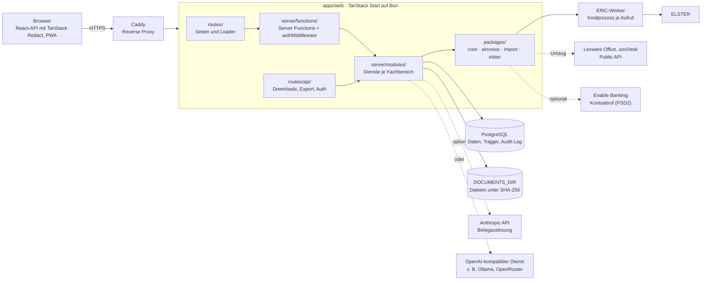

# Architektur

Haben ist eine einzelne Anwendung auf Basis von TanStack Start, die unter Bun läuft, mit PostgreSQL als einziger Datenbank und einem Verzeichnis für Belegdateien. Diese Seite beschreibt Aufbau, Datenmodell, Abläufe und die wichtigsten Entwurfsentscheidungen. Für die Entwicklungsumgebung siehe [Entwicklung](entwicklung.md), für den Betrieb [Installation](installation.md).

## Überblick

Der Browser spricht nur mit der eigenen Anwendung. Seiten laden ihre Daten über Server Functions; Dateien (Rechnungs-PDFs, Belege, Protokolle, CSV, ZIP) kommen über eigene API-Routen. Nach außen verbindet sich der Server nur mit ELSTER (über ERiC, dazu `download.elster.de` für das ERiC-Paket), optional mit der Anthropic-API oder einem OpenAI-kompatiblen KI-Dienst (selbst betrieben oder in der Cloud), mit Enable Banking für den Kontoabruf, dem Datenportal des BMF für die Umrechnungskurse, dem eigenen Mailserver (SMTP, IMAP) und während des Umzugs mit Lexware Office oder sevDesk.

## Module

### Pakete

| Paket | Aufgabe |
| --- | --- |
| `packages/core` | Reine Fachlogik ohne Ein- und Ausgabe: Cent-Beträge und Formatierung, Zeiträume (Monate und Quartale) und Fälligkeiten mit Feiertagen je Bundesland (`holidays.ts`), Voranmeldungszeitraum und Vorschlag nach § 18 Abs. 2 UStG (`voranmeldungszeitraum.ts`), Sondervorauszahlung nach § 47 UStDV (`dauerfrist.ts`), Steuernummer-Umrechnung ins ELSTER-Format, Rechnungssummen, Termine und Prüfung der Dauerbelege (`dauerbeleg.ts`), umsatzsteuerliche Behandlung von Rechnungen (`treatment.ts`), Kontenrahmen und Buchungssätze (`posting.ts`), Kennzahlen der Voranmeldung aus Konto und Steuerschlüssel des Journals (`journal-kennzahlen.ts`), EÜR-Zeilen aus Konto und Herkunft des Journals, Anteil einer Zahlung an der ausgeglichenen Buchung und Konten der DATEV-Formel (`journal-euer.ts`), Kontierung und EÜR-Wirkung von Steuerzahlungen nach Steuerart, Bezugsjahr und Teil (`steuerzahlung.ts`), Konten und Buchung von Darlehen (`darlehen.ts`), Aufteilung eines Belegs auf mehrere Kategorien (`document-split.ts`), Vorschläge für den Bankabgleich (`matching.ts`), SEPA-Überweisung als pain.001.001.09 mit Zeichensatz, IBAN und BIC (`sepa.ts`, `sepa-text.ts`), Gläubiger-ID, Mandatsreferenz und Verfall des Lastschriftmandats (`sepa-mandat.ts`), SEPA-Lastschrift als pain.008.001.08 mit TARGET-Kalender und Einzugstag (`sepa-lastschrift.ts`), Sammelgutschrift und Rücklastschrift im Bankabgleich erkennen (`lastschrift-abgleich.ts`), Skonto aus den Zahlungsbedingungen einer XRechnung (`skonto.ts`), UStVA-Berechnung, EÜR (`euer.ts`), Umsatzsteuer aus Lexoffice-Belegen (`legacy-vat.ts`), Lebenszyklen von Rechnung, Angebot und Voranmeldung und der offene Betrag von Rechnungen und Belegen (`lebenszyklus.ts`; Rechnungsliste, Bankabgleich, offene Posten, Mahnwesen und die Sperre der Firmendaten rechnen damit, ein Test prüft, dass alle dasselbe ergeben), Lohnsteuer nach dem PAP des BMF (`lohnsteuer/`), Beiträge zur Sozialversicherung (`sozialversicherung/`), die Lohnabrechnung eines Monats aus den Stammdaten samt Lohnkonto (`lohnabrechnung/`), ihr Buchungssatz (`lohn-buchung.ts`) und die Lohnsteuerbescheinigung eines Jahres (`lohnsteuerbescheinigung.ts`); für GmbH und UG Bilanz und GuV der Kleinstkapitalgesellschaft (`hgb.ts`), Kontenzuordnung der E-Bilanz (`ebilanz.ts`), Körperschaft- und Gewerbesteuer (`koerperschaft.ts`), Gewinnausschüttung (`ausschuettung.ts`), manuelle Buchungen (`manual.ts`), freie Buchungen mit Steuerschlüssel (`freie-buchung.ts`) und Saldenvortrag (`vortrag.ts`) |
| `packages/einvoice` | Rechnungs-PDF mit Typst (Vorlage `templates/rechnung.typ`), weitere PDFs nach demselben Muster (Mahnung, Steuerbescheinigung, Bilanz zur Hinterlegung, Entgeltabrechnung `lohnabrechnung.typ`, Lohnkonto `lohnkonto.typ`, Ausdruck der Lohnsteuerbescheinigung `lohnsteuerbescheinigung.typ`), ZUGFeRD und XRechnung über `@e-invoice-eu/core`, Prüfung der Pflichtfelder je Format, Lesen eingehender E-Rechnungen (eingebettetes XML aus PDFs, CII und UBL) |
| `packages/import` | Parser für Kontoauszüge (DKB, N26, CAMT.053) und für Exporte von Zahlungsdienstleistern (PayPal, Stripe, Shopify Payments in `psp.ts`, eBay in `ebay.ts`, Etsy in `etsy.ts`), Dekodierung, Deduplizierung, Saldenprüfung, DATEV-Buchungsstapel lesen (`datev.ts`) und aus dem Journal schreiben (`datev-export.ts`), CSV-Import von Kontakten, Artikeln und Anlagen (`csv-import/`), Client und Abbildungen für die Lexware-Office-API (`lexoffice/`) und das Lesen einer Sicherung aus deren Web-Oberfläche (`lexoffice/web/`, erzeugt von `apps/web/public/lexware-sicherung.js`), Client und Abbildungen für die sevDesk-API (`sevdesk/`), Client und Abbildung für den Kontoabruf über Enable Banking (`enablebanking/`) |
| `packages/elster` | `ElsterClient` mit echtem ERiC-Client (Kindprozess, `koffi`) und simuliertem Client, UStVA-XML, Antrag auf Dauerfristverlängerung (`dauerfrist.ts`), Zusammenfassende Meldung (`zm.ts`), Lohnsteuer-Anmeldung (`lsta.ts`), Feldkennungen und Werte zum Ausfüllen in Mein ELSTER (`felder.ts`), XML der Jahreserklärungen (Umsatzsteuererklärung E50, Anlage EÜR mit AVEÜR E77, `erklaerung.ts`; Einkommensteuererklärung E10, `est.ts`), Kapitalertragsteuer-Anmeldung (`kapesta.ts`), Lohnsteuerbescheinigung bis 2025 (`lstb.ts`, ElsterLohn), Körperschaftsteuererklärung E30 (`kst.ts`, Anlage KSt 1 F in `kst1f.ts`) und Gewerbesteuererklärung E20 (`gewst.ts`), E-Bilanz als XBRL in der HGB-Taxonomie 6.9 oder 6.10 nach dem Wirtschaftsjahr mit Anlagenspiegel, Betriebsvermögensvergleich und Kontennachweis (`ebilanz/xbrl.ts`, `ebilanz/kontennachweis.ts`, Auswahl und Taxonomie-Auszüge `ebilanz/taxonomie.ts`, `ebilanz/taxonomie-6-9.json`, `ebilanz/taxonomie-6-10.json`), Sonstige Nachricht (`nachricht.ts`), Änderung der Bankverbindung (`bankverbindung.ts`), Datenabholung aus dem Postfach (`postfach.ts`, Download der Anhänge über Otto), Belegabruf der vorausgefüllten Steuererklärung (`vast.ts`, Entschlüsselung mit `EricDekodiereDaten`), Berechtigungen zum Belegabruf (`berechtigung.ts`, ElsterBRM), Transfer-Ticket, ERiC-Download (`install.ts`) |

### apps/elster-helfer

Die Browser-Erweiterung „Haben für Mein ELSTER“ (Manifest V3, TypeScript, gebaut mit Vite und `@crxjs/vite-plugin` nach `dist/`): `src/fill.ts` findet die Felder von Mein ELSTER über ihre amtliche Kennung (reine Logik ohne Chrome-APIs, getestet in `apps/web/e2e/elster-helfer.spec.ts`), `src/content.ts` trägt auf jeder Formularseite ein und zeigt die Leiste, `src/popup.ts` nimmt die Werte aus Haben entgegen und legt sie im Sitzungsspeicher des Browsers ab. Das Format der Werte ist der Typ `MeinElsterWerte` aus `packages/elster/src/felder.ts`, denselben, mit dem Haben sie erzeugt. Das Inhaltsskript ist ein Bündel ohne Nachladen, die Erweiterung gibt Mein ELSTER also keine Dateien frei (`web_accessible_resources`), an denen die Seite sie erkennen könnte. Für jedes Release baut und packt `scripts/elster-helfer/paket.ts` sie mit der Version aus dem Tag als `haben-fuer-mein-elster-chrome-<Version>.zip` (Format des Chrome Web Store). Sie läuft nur auf `www.elster.de/eportal/interpreter/eingabe/…` und verbindet sich nicht mit Haben ([Mein ELSTER mit Erweiterung](elster-mit-erweiterung.md)).

### apps/web

| Ordner | Aufgabe |
| --- | --- |
| `src/routes/` | Dateibasiertes Routing. `_app/` enthält alle Seiten hinter der Anmeldung (Übersicht, Rechnungen, Angebote, Belege, Bank, Kasse, Umsatzsteuer, Lohn, Jahreserklärung, Abschluss, Auswertungen, Buchungen, Konten, Kontakte, Archiv, Einstellungen und weitere); `setup.tsx`, `login.tsx` und `einladung.$token.tsx` sind öffentlich |
| `src/routes/api/` | HTTP-Routen für Better Auth (`auth/$`), Dateien (`rechnung`, `rechnungsanhang`, `angebot`, `angebotsanhang`, `standardanhang`, `dokument` für Auftragsbestätigung und Lieferschein, `mahnung`, `beleg`, `dauerbeleg`, `altbeleg`, `archiv`, `protokoll`, `postfach`, `vast`, `logo`, `ustva` für den XML-Import in Mein ELSTER, `ueberweisung` für SEPA-Dateien, `lohn/…` für Entgeltabrechnung, Lohnkonto und Lohnsteuerbescheinigung, `steuerbescheinigung`, `sv-protokoll`, `hinterlegung/$jahr`), CSV und DATEV (`kasse/$jahr`, `konten/$jahr`, `datev/$jahr`), Rückleitung der Bank beim Kontoabruf (`bank/callback`), Kalender-Abo der Fristen (`fristen/kalender`, mit geheimem Token statt Sitzung), MCP-Endpunkt für KI-Assistenten (`mcp`, mit API-Token statt Sitzung), REST-API (`v1/$`, mit API-Token statt Sitzung), Teilen-Ziel der PWA (`belege/teilen`), EÜR als CSV (`auswertungen/$jahr`) und Jahresarchiv (`export/$jahr`) |
| `src/components/` | React-Komponenten, die mehrere Seiten nutzen (Rechnungseditor, Vorschau, Upload, Statusanzeigen), dazu `archiv/` für die Umzugsseite |
| `src/server/functions/` | Server Functions je Bereich: Eingaben mit Zod prüfen, `authMiddleware` anhängen, Dienst aufrufen. Keine Fachlogik |
| `src/server/modules/<name>/` | Dienste je Fachbereich, jeweils mit öffentlicher `index.ts` (siehe [Module im Server](#module-im-server)) |
| `src/server/*.ts` | Gemeinsame Infrastruktur ohne Fachlogik: `auth`, `anmeldung`, `rollen`, `middleware`, `csrf`, `setup-code`, `crypto`, `storage`, `file-response`, `env`, `errors`, `today`, `security-headers`; dazu `scheduler.ts`, der die Hintergrundarbeit der Module zusammensetzt |
| `src/server/db/` | Drizzle-Schema (`schema.ts`, `auth-schema.ts`), Verbindung, `withActor` für das Audit-Log, Migrationsskript |
| `apps/web/drizzle/` | SQL-Migrationen; Trigger und Funktionen stehen in eigenen Dateien (`0001_festschreibung.sql`, `*_trigger.sql`) |
| `src/styles/`, `styles.css` | Globales Stylesheet und seitenbezogene Stylesheets (Auswertungen, Archiv). Farben stehen als CSS-Variablen in `:root`; ein Theme überschreibt sie per `[data-theme="…"]`. Klassen, die mehr als eine Seite nutzt, gehören ins globale Stylesheet, sonst fehlen sie auf Seiten, die das seitenbezogene nicht laden |
| `src/lib/theme.ts` | Themes: Liste, Speicherung im `localStorage` und ein Inline-Skript, das `<html data-theme>` vor dem ersten Zeichnen setzt (`__root.tsx`) |
| `vite.config.ts` | Setzt `__HABEN_VERSION__` aus der Root-`package.json`; die Navigation zeigt so die ausgelieferte Version. Das Plugin `redact()` ersetzt React beim Bauen durch TanStack Redact |
| `src/lib/` | Formatierung und Better-Auth-Client für den Browser |

### Module im Server

Die Dienste liegen in `apps/web/src/server/modules/`, ein Ordner je Fachbereich. Ein Modul besitzt seine Tabellen und bietet nach außen nur an, was in seiner `index.ts` steht.

| Modul | Inhalt |
| --- | --- |
| `stammdaten` | `company` (Firmendaten, Versteuerung und Kleinunternehmer je Jahr), `contacts` (Kunden und Lieferanten, Rollen je Kontakt), `sepa-mandate` (SEPA-Lastschriftmandate am Kontakt: anlegen, PDF, Widerruf, Status), `articles`, `logo`, `background` (Briefpapier), `letterhead` (Briefkopf: Standardprofil, Logo und Briefpapier), `number-formats` (Nummernformate für Rechnungen und Angebote), `customer-numbers` (Kundennummern automatisch), `personenkonten-vergabe` (fehlende DATEV-Debitoren und -Kreditoren beim Export), `taxpayer` (persönliche Angaben), `text-blocks` (Textbausteine), `plan-templates` (Vorlagen für den Zahlungsplan im Angebot), `exchange-rates` (Umrechnungskurse des BMF je Währung und Monat), `csv-import` (Kontakte und Artikel aus CSV prüfen und anlegen), `settings-guard` (Sperren für Kontenrahmen, Versteuerung, Kleinunternehmer und Rechtsform, Speichern der Firmendaten) |
| `rechnungen` | `invoices`, `invoice-taxes` (Steuerzeilen), `lastschrift` (Zahlungsart Lastschrift: Mandat prüfen, Angaben für PDF und E-Rechnung), `draft-line` und `skonto` (Position und Skonto eines Entwurfs, ohne weitere Abhängigkeiten), `attachment-store` (zusätzliche PDF-Anhänge, gemeinsam für Rechnungen und Angebote), `attachments`, `quote-attachments` und `attachment-limit` (Anhänge an Rechnungen und Angeboten, Höchstzahl), `quote-default-attachments` (Standardanhänge für Angebote), `external-reference` (Entwurf mit externer Referenz aus der REST-API), `number-counter` (Nummernkreise, Nummer im eingestellten Format), `quotes` (Angebote), `quote-choices` (Auswahl optionaler und alternativer Positionen), `quote-plan` (Abschläge aus dem Zahlungsplan, Übersicht und Fortschritt; gerechnet mit `zahlungsplan.ts` in `packages/core`), `order-documents` (Auftragsbestätigung, Lieferschein), `dunning` (Mahnungen), `invoice-mail` (Rechnungen, Mahnungen und Angebote per E-Mail), `recurring` (Serienrechnungen) |
| `belege` | `documents`, `splits` (Aufteilung auf mehrere Kategorien), `navigation` (vorheriger und nächster Beleg der Liste), `cancellation` (Storno und Neuerfassung), `extraction` (KI-Auslesung: wählt den Anbieter, prüft die Antwort), `extraction-schema` (gemeinsames Belegschema, Anweisung, Prüfung von Beträgen, Daten und Summen), `extraction-config` (Anbieter aus der Umgebung), `extraction-anthropic` und `extraction-openai` (Anbieter), `pdf-pages` (PDF in Seitenbilder mit `pdftoppm`), `pdf-seitentext` (Text der Seiten aus der Textschicht für die KI-Auslesung, #329), `lieferantenvorschlag` (Kontaktvorschlag und IBAN-Vorschlag aus E-Rechnung und Auslesung), `inbox` (Belege per E-Mail über IMAP), `external-reference` (Referenz für Belege aus der REST-API), `dauerbelege` (Vorlagen für wiederkehrende Ausgaben mit Vertrag, pausieren, beenden), `dauerbelege-lauf` (Belege „Zu prüfen“ zu jedem Termin, Vorschläge und „Buchen und zuordnen“ im Bankabgleich; Termine aus `dauerbeleg.ts` in `packages/core`) |
| `bank` | `bank` (Kontoauszüge, Zuordnung), `steuerzahlung` (Steuerzahlung als Zuordnung, Verbrauch der Steuerrückstellung einer GmbH; Kontierung aus `steuerzahlung.ts` in `packages/core`), `darlehen` (Darlehen anlegen, Bestand, Auszahlung, Tilgung, Zinsen und Gebühren als Zuordnung; Konten aus `darlehen.ts` in `packages/core`), `bank-sync` (Kontoabruf), `cash` (Kassenbuch), `cash-invoice` (Bareinnahme auf eine Ausgangsrechnung), `sepa-transfers` (SEPA-Überweisungen für offene Belege), `sepa-lastschriften` (Lastschriftdatei pain.008 aus fälligen Rechnungen, letzter Einzug je Mandat), `lastschrift-abgleich` (Sammelgutschrift aufteilen, Rücklastschrift zuordnen, Stand jeder Lastschrift), `document-payees` (IBAN des Lieferanten und Referenzen der Überweisungen je Beleg), `iban-entscheidung` (abweichende IBAN der E-Rechnung, Entscheidung je Beleg; Abgleich mit `iban-abgleich.ts` in `packages/core`) |
| `buchhaltung` | `ledger` (Hauptbuch: einziger Schreiber des Journals, Saldenliste, Kontenblatt), `journal` (Kontennamen), `assets` (Anlagenverzeichnis, AfA), `asset-methoden` (Regeln für degressive und Elektro-AfA), `asset-import` (Anlagen aus CSV übernehmen), `pauschalen` (Homeoffice, Fahrten, Verpflegung ohne Beleg); `manual` (manuelle und freie Buchungen, im Einzelunternehmen ab dem Stichjahr), `gemeldet` (gemeldete Zeiträume für Storno und freie Buchungen); für GmbH und UG `eroeffnung` (Eröffnungen von Hand oder aus dem DATEV-Stapel), `abschluss` (Bilanz, GuV, Jahr abschließen), `bilanzen` (Bilanz mit Vorjahresspalte), `restlaufzeiten` (Vermerke nach § 268 Abs. 4 und 5 HGB), `hinterlegung` (Bilanz zur Hinterlegung als PDF) |
| `umsatzsteuer` | `vat-figures` (Zahlen und Vorprüfung), `vat-journal` (Kennzahlen aus dem Journal ab dem Stichjahr), `vat` (Entwürfe, Berichtigung, Übermittlung), `vermerk` (Abgabe außerhalb von Haben vermerken, mit Protokoll), `zahlung` (Zahllast und Erstattung je abgegebener Voranmeldung als offener Posten, Prüfung der Zuordnung; gerechnet mit `ustva-posten.ts` in `packages/core`), `zeitraum` (Voranmeldungszeitraum je Jahr und Vorschlag), `dauerfrist` (Dauerfristverlängerung, Sondervorauszahlung, Kz 39), `zm` (Zusammenfassende Meldung), `mein-elster` (Voranmeldung als Datei für den XML-Import in Mein ELSTER) |
| `elster` | `elster-gateway` (Zugang, Zertifikat und PIN, Sendesperre und Protokoll für jede Übermittlung), `certificate`, `elster` (Datenschutzhinweise der Finanzverwaltung) |
| `finanzamt` | `finanzamt` (Nachrichten, Bankverbindung), `postfach` (Bescheide abholen), `vast` (Belege der vorausgefüllten Steuererklärung), `berechtigung` (Abrufberechtigung für den Ehegatten), `fristen` (Steuertermine, Kalender-Abo) |
| `ausschuettung` | `ausschuettung` (Gewinnverwendungsbeschluss, Steuerabzug je Gesellschafter, Storno, Kapitalertragsteuer-Anmeldung), `steuerbescheinigung` (Steuerbescheinigung nach § 45a EStG je Gesellschafter als PDF) |
| `lohn` | `employees` (Stammdaten der Mitarbeiter), `payroll` (Lohnlauf je Monat, Entwurf, festschreiben, Storno mit neuer Abrechnung), `abrechnung-pdf` (Entgeltabrechnung als PDF), `lohnkonto` (Lohnkonto je Jahr als PDF und CSV), `anmeldung` (Lohnsteuer-Anmeldung), `bescheinigung` (Lohnsteuerbescheinigung), `buchung` (Buchung beim Festschreiben, Gegenbuchung beim Storno, Nachbuchen älterer Abrechnungen), `sv-daten` (Stammdaten, festgeschriebene Abrechnungen und Zahltage für die Ausfüllliste, nur lesend); gerechnet wird mit `lohnabrechnung` und `lohnBuchung` in `packages/core` |
| `sv-meldungen` | `liste` (Beitragsnachweise je Monat und Einzugsstelle, DEÜV-Meldungen je Person aus `packages/core`, liest über `lohn`), `vermerke` (Vermerk „im Portal abgegeben“ mit Protokoll, Rücknahme, Vergleich mit der aktuellen Liste), `seite` (Ausfüllliste eines Monats, Fristen für `finanzamt`); übermittelt nichts an die Sozialversicherung |
| `jahreserklaerung` | `annual` (Umsatzsteuererklärung, Anlage EÜR, Einkommensteuer), `income-tax` (Angaben zur Einkommensteuer), `mein-elster` (Werte zum Ausfüllen in Mein ELSTER); für GmbH und UG `koerperschaft` (Angaben, Berechnung, Steuerrückstellungen), `kapg-erklaerung` (Körperschaft- und Gewerbesteuererklärung), `ebilanz` (E-Bilanz) |
| `auswertungen` | `reports` (EÜR, offene Posten), `abgleich` (Journal gegen Umsatzsteuer und EÜR), `abgleich-kennzahlen` (Bemessungsgrundlagen der Voranmeldung aus Konto und Steuerschlüssel), `euer-journal` (EÜR aus dem Journal: Zahlungen anteilig auf die ausgeglichene Buchung; `euer-journal-nebenbuch` liefert, was die Buchung allein nicht hergibt), `euer-quelle` (EÜR ab dem Stichjahr aus dem Journal), `stichjahr` (Stichjahr anzeigen und vorziehen), `euer-formel` (Gewinn der EÜR nach der DATEV-Formel als Gegenprobe), `integrity` (Prüfung von Hash-Kette, Siegeln und Abgleich), `datev-export` (Buchungsstapel, Schalter für Personenkonten), `datev-vorgaenge` (Rechnung bzw. Beleg je Buchung: Belegfeld 1 und Personenkonto) |
| `archiv` | `archive` (Umzugsdateien), `export` (Jahresarchiv), `lexoffice` (Import über die API oder eine Sicherung aus der Web-Oberfläche), `sevdesk` (Import über die API in dieselben Tabellen), `legacy-open` (übernommene offene Posten), `datev-eroeffnung` (Eröffnung aus der Schlussbilanz des DATEV-Stapels), `datev-abschluss` (Abschluss eines Jahres aus dem DATEV-Stapel zum Vergleich), `backup-status` (Stand des Backups, nur lesend) |
| `mail` | `mail` (Versand mit Protokoll, Erinnerungen, wöchentliche Integritätsmail), `settings` (Zugang und Vorlagen), `transport` (Versandweg: `transport-smtp` über nodemailer, `transport-graph` über Microsoft Graph, mit `graph/` für Token, Anfrage, Wiederholung und Fehlertexte) |
| `mcp` | `server` (Endpunkt für KI-Assistenten), `tokens` (API-Tokens mit Rechten für MCP und REST-API, Schalter, Protokoll der Aufrufe), `tools` (Werkzeuge, nur lesen), `ausfuellliste` (Ausfüllliste der Voranmeldung für Mein ELSTER) |
| `eigene-seiten` | `pages` (eigene Seiten: Name und Adresse für Menüeinträge, die eine Seite außerhalb von Haben im Rahmen zeigen), `url` (Prüfung der Adresse: nur http und https, keine Zugangsdaten, nicht die Herkunft von Haben) |
| `datenimport` | `csv-import` (Kontakte, Artikel und Anlagen aus CSV: Vorschau und Import in einer Transaktion); liest und prüft mit `packages/import`, legt über `stammdaten` (`csv-import`) und `buchhaltung` (`asset-import`) an; schreibt keine eigenen Tabellen |
| `zugang` | `einladungen` (Einladungslink anlegen, auflisten, zurückziehen), `zugaenge` (Konten mit Rolle und letzter Anmeldung, sperren, entfernen), `aenderungen` (was sich seit dem letzten Besuch der Steuerberatung geändert hat); Rolle, Sitzung und das Einlösen der Einladung stehen in der Infrastruktur (`server/rollen.ts`, `server/anmeldung.ts`), weil Better Auth und die Middleware sie brauchen |
| `api` | REST-API unter `/api/v1`: `routes` (Tabelle der Endpunkte mit Recht und Handler), `router` (Token, Recht, Rate, Body), `http` (Antworten und Fehlerformat), `contacts`, `invoices` und `documents` (dünne Handler über `stammdaten`, `rechnungen` und `belege`), `schemas` (Zod für Eingaben und Antworten), `openapi` (Beschreibung aus beidem); schreibt keine eigenen Tabellen |

Die Prüfung der Modulgrenzen (`scripts/modulgrenzen/`) läuft mit `bun run lint` in der CI und prüft jeden relativen Import, auch `export … from`, `import()` und Typen wie `import("…").T`. Sie löst den Pfad auf, statt nur den Text des Imports zu vergleichen; das kann Biome nicht, deshalb ist es ein eigenes Skript:

- **Aus einem anderen Modul nur über dessen `index.ts`.** Braucht ein Modul, eine Server Function oder eine Route etwas, das dort fehlt, wird es in der `index.ts` ergänzt. Die Datei enthält nur `export { … } from "./…"`, keine Logik.
- **Infrastruktur importiert keine Module.** `server/*.ts` und `server/db/` bleiben unabhängig von der Fachlogik. Ausgenommen sind die Stellen, die Module zusammensetzen: `server/functions/`, `server/plugins/` und `scheduler.ts`.
- **Module importieren weder Server Functions noch Oberfläche** (`server/functions/`, `server/plugins/`, `routes/`, `components/`). Gemeinsames ohne Serverbezug liegt in `src/lib/`.

Tests sind ausgenommen und dürfen auch Dateien hinter der `index.ts` anderer Module importieren. `modulgrenzen.test.ts` prüft die Regel selbst und die Struktur: Jedes Modul hat eine `index.ts`, und direkt unter `server/` liegt nur Infrastruktur.

Zwischen Modulen gibt es Abhängigkeiten in beide Richtungen, etwa `rechnungen` ↔ `bank` (Zahlungen einer Rechnung, Zuordnung zu einer Rechnung) oder `stammdaten` → `rechnungen` (die Sperre der Firmendaten zählt offene Rechnungen). Die Regel verbietet sie nicht, macht sie aber an der `index.ts` sichtbar.

## Datenmodell

Alle Tabellen stehen in `apps/web/src/server/db/schema.ts`. Beträge sind ganze Cent, Steuersätze Basispunkte. Die Spalte „Schutz“ fasst die Trigger aus `apps/web/drizzle/` zusammen; Einzelheiten in [Buchhaltung in Haben](buchhaltung.md#gobd-unveränderbarkeit-in-der-datenbank).

### Stammdaten

| Tabelle | Zweck | Schutz |
| --- | --- | --- |
| `year_closings` | Abgeschlossene Geschäftsjahre (GmbH, UG) mit Zahl und Prüfwert der Buchungen | Nur anhängen; Buchungen mit Datum in einem abgeschlossenen Jahr abgelehnt; Audit |
| `company` | Firmendaten mit Gläubiger-ID für Lastschriften, Rechtsform, Versteuerungsart, Kontenrahmen, Zahlungsziel, Rechnungsformat, Standard-Einleitung für Rechnungen und Angebote; genau eine Zeile | Kontenrahmen, Versteuerung und Einschalten von § 19 gesperrt, sobald im laufenden Jahr gebucht ist; Rechtsform ab der ersten Buchung, bei GmbH und UG auch der Kontenrahmen; Audit |
| `elster_certificates` | ELSTER-Zertifikatsdatei, verschlüsselt; auf Wunsch die PIN für den automatischen Postfachabruf, ebenfalls verschlüsselt | Audit ohne Chiffrat und PIN |
| `contacts` | Kunden und Lieferanten, mit Herkunft aus Lexoffice; DATEV-Debitor und -Kreditor (`debitor_nr`, `kreditor_nr`, eindeutig, Bereich per CHECK) | nicht löschbar, versioniert, Audit |
| `contact_versions` | Stand eines Kontakts je Version | nur anhängen |
| `sepa_mandates` | SEPA-Lastschriftmandate eines Kunden (#445): Mandatsreferenz (eindeutig ohne Rücksicht auf Groß- und Kleinschreibung), Datum der Unterschrift, CORE oder B2B, Sequenz des ersten Einzugs aus Haben (`FRST` oder `RCUR`), letzter Einzug vor Haben, Kontoinhaber, IBAN, BIC; der Verfall nach 36 Monaten ohne Einzug folgt aus `mandatStatus` in `packages/core` | nur anhängen, Audit |
| `sepa_mandate_files` | Unterschriebenes Mandat als PDF im Dokumentenspeicher (SHA-256); das jüngste gilt | nur anhängen, Audit |
| `sepa_mandate_revocations` | Widerruf eines Mandats mit Tag und Grund; je Mandat höchstens einer | nur anhängen, Audit |
| `datev_personenkonten` | Debitoren und Kreditoren, die ein DATEV-Export geschrieben hat, je Kontakt und Rolle die erste Ausgabe; ab dann ist die Nummer am Kontakt fest (Trigger auf `contacts`) | nur anhängen, Audit |
| `bank_accounts` | Bankkonten, über die IBAN zugeordnet; `excluded_at` markiert ein Konto, das nicht zu dieser Firma gehört (ausgeblendet, kein Abruf, kein Import; nur ohne zugeordneten, verrechneten oder ausgebuchten Umsatz, ein Trigger prüft es) | Audit |
| `company_logo` | Aktuelles Firmenlogo (PNG oder JPEG) für Rechnungen, Angebote und Mahnungen; höchstens eine Zeile | Audit ohne Bilddaten (mit SHA-256) |
| `letterhead_background` | Aktuelles Briefpapier (PNG oder JPEG, aus einem PDF die erste Seite als Bild) hinter den Belegen; höchstens eine Zeile | Audit ohne Bilddaten (mit SHA-256) |
| `letterhead_profiles` | Gestaltung der Belege als JSON (`settings`: Layout je Belegart, Akzentfarbe, Logo-Größe und -Seite, Schalter, eigene Fußzeile); heute genau ein Standardprofil (`is_default`), ohne Zeile gelten die Vorgaben aus `packages/core` | höchstens ein Standardprofil, Akzentfarbe nur `#RRGGBB`, Audit |
| `custom_pages` | [Eigene Seiten](eigene-seiten.md): Name und Adresse für Menüeinträge, die eine Seite außerhalb von Haben im Rahmen zeigen | Audit |
| `exchange_rates` | Umsatzsteuer-Umrechnungskurse (§ 16 Abs. 6 UStG) je Währung und Monat, vom BMF abgerufen oder von Hand eingetragen; Belege und Rechnungen speichern ihren Kurs selbst | Audit |

### Rechnungen und Belege

| Tabelle | Zweck | Schutz |
| --- | --- | --- |
| `invoices` | Ausgangsrechnungen, Stornos und Korrekturen mit PDF, XML, SHA-256 und umsatzsteuerlicher Behandlung (`tax_treatment`, `exemption_reason`); Bestell-, Auftrags- und Lieferscheinnummer (`buyer_order_reference`, `seller_order_reference`, `despatch_advice_reference`, BT-13, BT-14, BT-16; leer = keine, ab `0160`); aus Vorlagen mit `recurring_id` und Termin (`recurring_date`, eindeutig je Vorlage); höchstens ein festgeschriebenes Storno je Rechnung; Gesamtrabatt wie eingegeben (`discount_percent` oder `discount_amount`), der Abzug je Satz folgt aus Zeilennetto minus `invoice_taxes.base`; Abschlag zu einer Zeile des Zahlungsplans (`payment_plan_row`); externe Referenz aus der REST-API (`external_source`, `external_id`, nur zusammen und zusammen eindeutig); Zahlungsart Überweisung oder Lastschrift mit Mandat (`payment_method`, `sepa_mandate_id`, nur zusammen, ab `0181`) | gesperrt ab Festschreibung, Audit ohne PDF/XML |
| `recurring_invoices` | Vorlagen für wiederkehrende Rechnungen: Positionen (JSON, mit `detail` für den Text zur Position), Intervall, nächster Termin, Modus (Entwurf oder festschreiben), Zahlungsart (`payment_method`; bei Lastschrift das jüngste am Fälligkeitstag gültige Mandat je Lauf) | Audit |
| `dunnings` | Zahlungserinnerungen und Mahnungen mit Stufe, Frist, Gebühr, Pauschale, Zinsen und PDF | nur anhängen, Audit ohne PDF |
| `invoice_lines` | Positionen einer Rechnung: Bezeichnung (`description`), optionaler mehrzeiliger Text (`detail`, BT-154), Artikelnummer (`item_number`, BT-155, aus dem Artikel kopiert, ab `0162`), Einzelpreis wie eingegeben (netto oder brutto, `invoices.price_mode`), Positionsrabatt wie eingegeben (`discount_percent` oder `discount_amount`), Zeilennetto nach Rabatt | gesperrt mit der Rechnung |
| `invoice_taxes` | Netto und Umsatzsteuer je Steuersatz, einmal beim Speichern des Entwurfs berechnet; Voranmeldung, Zahlungsbuchung, Auswertungen, Schlussrechnung, PDF und XML lesen nur diese Werte | gesperrt mit der Rechnung |
| `invoice_attachments` | Zusätzliche PDF-Anhänge einer Rechnung (#272): Dateiname, Größe, SHA-256 der Datei im Dateisystem (wie bei Belegen); je Rechnung jede Datei höchstens einmal. PDF und XML der Rechnung bleiben unberührt | gesperrt mit der Rechnung, im Siegel der Rechnung (Siegel ab `0125`), Audit |
| `invoice_number_counters` | Letzte vergebene Nummer je Jahr | darf nicht sinken, Audit |
| `quotes` | Angebote mit Gültigkeit, PDF, SHA-256, Bestell-, Auftrags- und Lieferscheinnummer wie bei `invoices`, Gesamtrabatt, Zahlungsplan (`payment_plan`, JSON) und ob er in die Auftragsbestätigung kommt, Antwort des Kunden (`decision`) und daraus entstandener Rechnung (`invoice_id`) | gesperrt ab Festschreibung bis auf Antwort und Rechnung, Audit ohne PDF |
| `quote_lines` | Positionen eines Angebots: Bezeichnung (`description`), optionaler mehrzeiliger Text (`detail`), Artikelnummer (`item_number`), Positionsrabatt, Art (`kind`: optional oder Alternative zur Position davor, sonst zählt sie zur Summe) | gesperrt mit dem Angebot |
| `quote_attachments` | Zusätzliche PDF-Anhänge eines Angebots (#415), wie `invoice_attachments`: Dateiname, Größe, SHA-256 der Datei im Dateisystem; je Angebot jede Datei höchstens einmal. Das PDF des Angebots bleibt unberührt | gesperrt mit dem Angebot (kein Siegel, wie das Angebot), Audit |
| `quote_default_attachments` | Standardanhänge für Angebote (#415) aus den Einstellungen: Dateiname, Größe, SHA-256; jedes neue Angebot bekommt sie als Zeilen in `quote_attachments` | änderbar, Audit |
| `quote_choices` | Auswahl des Kunden: gewählte optionale und alternative Positionen eines festgeschriebenen Angebots | nur anlegen und löschen, fest ab der ersten festgeschriebenen, nicht stornierten Rechnung zum Angebot, Audit |
| `quote_number_counters` | Letzte Angebotsnummer je Jahr (`AN-2026-001`) | darf nicht sinken, Audit |
| `documents` | Eingangsbelege; Datei im Dateisystem, Felder aus Auslesung oder Hand, beim Buchen festgehalten, ob mit Vorsteuerabzug (`vorsteuer_abzug`); externe Referenz aus der REST-API (`external_source`, `external_id`, nur zusammen und zusammen eindeutig); bei einer Neuerfassung der stornierte Beleg (`replaces_document_id`). Die Datei (`sha256`) ist eindeutig außer bei Neuerfassungen, je storniertem Beleg höchstens eine | gesperrt ab Buchung, Audit |
| `document_amounts` | Beträge eines Belegs je Steuersatz | gesperrt mit dem Beleg |
| `recurring_documents` | Dauerbelege: Vorlage für wiederkehrende Ausgaben mit Lieferant, Kategorie, Beträgen je Satz (JSON), Steuerausweis des Dokuments (`tax_shown`), Intervall, Ankertag, nächstem Termin, Ende, Zahlungsziel in Tagen, Status (aktiv, pausiert, beendet) und dem Vertrag im Dokumentenspeicher (SHA-256). Die Belege daraus tragen `documents.recurring_document_id` und `recurring_period` (Monatserster des Termins), zusammen eindeutig; sie nutzen alle die Datei der Vorlage beim Anlegen, deshalb gilt der eindeutige Index auf `documents.sha256` nur außerhalb von Neuerfassungen und Dauerbelegen | änderbar, Audit; die Belege selbst wie jeder Beleg |
| `document_splits` | Aufteilung eines Belegs auf mehrere Kategorien (#271): Kategorie, Steuersatz, Netto und anteilige Vorsteuer je Zeile (`allocateSplitTax` in `packages/core/src/document-split.ts`); ohne Zeilen gilt `documents.category`, mit Zeilen ist sie leer. Je Satz ergeben die Zeilen Netto und Vorsteuer aus `document_amounts`, die maßgeblich bleiben | gesperrt mit dem Beleg, Teil seines Siegels (ab `0129`; ältere Siegel ohne den Schlüssel bleiben gültig), Audit |
| `document_cancellations` | Storno eines gebuchten Belegs: Beleg, Gegenbuchung, Datum der Gegenbuchung (im noch nicht gemeldeten Zeitraum der Belegbuchung deren Datum, sonst Tag des Stornos), Grund; je Beleg höchstens einer. Der Beleg selbst bleibt unverändert; Voranmeldung und EÜR zählen den Storno an diesem Datum, offene Posten und Bankabgleich lassen den Beleg weg (`documentNotCancelled`) | nur anhängen, Audit, Siegel |
| `articles` | Artikel und Leistungen zum Einfügen in Rechnungen und Angebote: Bezeichnung (`description`), optionaler mehrzeiliger Text (`detail`), Preis netto oder brutto (`price_includes_tax`), Steuersatz, archivierbar | änderbar, Audit |
| `text_blocks` | Textbausteine: Kopf- oder Fußtext zum Einfügen in Rechnungen, Angebote und wiederkehrende Rechnungen, optional einem Kunden zugeordnet, archivierbar; eingefügt wird eine Kopie | änderbar, Audit |

### Buchhaltung, Bank und Umsatzsteuer

| Tabelle | Zweck | Schutz |
| --- | --- | --- |
| `journal_entries` | Buchungen mit Herkunft (Rechnung, Beleg, Zuordnung, Lohnabrechnung …) und Verweis auf die stornierte Buchung | geschrieben nur von `ledger.post`; gesperrt ab Entstehung, Soll = Haben beim Sperren (festgeschrieben wird erst nach den Zeilen), beim Commit festgeschrieben, Kontenrahmen = Firmendaten, Audit |
| `journal_lines` | Buchungszeilen mit Konto, Soll, Haben, Steuerschlüssel | gesperrt mit der Buchung |
| `cash_entries` | Kassenbuch: jede Bewegung der Barkasse mit lückenloser Nummer, Beleg oder Art (Einlage, Entnahme, Geldtransit, Bareinnahme auf eine Rechnung mit `invoice_id` und Steueranteil wie bei `allocations`, Bareinnahme ohne Rechnung mit Behandlung und Satz in `tax_treatment`, `tax_rate`, nur zusammen und nur dort), Buchung; Storno als Gegenzeile | nur anhängen, Bareinnahme nur auf eine festgeschriebene Rechnung, Audit |
| `bank_imports` | Jede importierte Auszugsdatei mit SHA-256, Zeitraum, Salden | nur anhängen, Audit |
| `bank_transactions` | Importierte Umsätze mit Hash zur Deduplizierung; EndToEndId, soweit der Auszug sie nennt | nur anhängen |
| `sepa_transfers` | Erzeugte SEPA-Dateien (pain.001) mit Auftraggeberkonto, Ausführungsdatum, Anzahl, Summe und XML | nur anhängen, Audit |
| `sepa_transfer_items` | Je Beleg eine Überweisung der Datei: EndToEndId (eindeutig), Betrag, Skonto, Empfänger, IBAN, Verwendungszweck | nur anhängen, Audit |
| `sepa_direct_debits` | Erzeugte Lastschriftdateien (pain.008, #445) mit Gläubigerkonto, Anzahl, Summe und XML | nur anhängen, Audit |
| `sepa_direct_debit_items` | Je Rechnung eine Lastschrift der Datei: Mandat, Sammler (`payment_info_id`), EndToEndId (eindeutig), Verfahren, Sequenz (FRST, RCUR), Einzugstag, Betrag, Konto, Verwendungszweck; zählt für den Verfall des Mandats | nur anhängen, Audit |
| `document_iban_decisions` | Entscheidung je Beleg, welche IBAN gilt, wenn die E-Rechnung (BT-84) eine andere nennt als der Kontakt (#410): Kontakt- und Rechnungs-IBAN beim Entscheiden, Wahl (`kontakt` oder `e-rechnung`), Person; die jüngste passende gilt | nur anhängen, Audit |
| `bank_connections` | Zustimmungen für den Kontoabruf über Enable Banking: Bank, Status, Ablauf, beim Verbinden gewählter Abrufbeginn, freigegebene Konten mit Abrufstand; Sitzungskennung verschlüsselt | Audit ohne Chiffrat |
| `allocations` | Zuordnung eines Umsatzes (ganz oder teilweise); aufgehoben per Gegenzeile; bei „Umsatzsteuer an das Finanzamt“ der Bezug auf die Voranmeldung (`vat_return_id`, offener Posten); bei einer Steuerzahlung Steuerart, Bezugsjahr und Teil (`tax_type`, `tax_year`, `tax_item`, nur zusammen und nur dort); bei einem Darlehen das Darlehen und der Teil (`loan_id`, `loan_part`); bei einer Direktbuchung auf eine Kategorie (#324) Kategorie und Steuersatz (`category`, `tax_rate`, nur zusammen und nur dort); bei einer Rücklastschrift die zurückgegebene Lastschrift (`direct_debit_item_id`, nur an Zuordnungen auf eine Rechnung, ab `0184`) | nur anhängen, Betragsprüfung, Bezug nur zu einer abgegebenen Voranmeldung, Audit |
| `bank_neutralizations` | Verrechnung zweier gegenläufiger Umsätze desselben Kontos, die zusammen null ergeben (#457), mit Notiz und Person; keine Buchung, der Bankabgleich (`db/bank-open.ts`, Funktion `haben_bank_neutralized`) zählt beide als erledigt; aufgehoben per Gegenzeile (`reverses_id`, höchstens eine) | nur anhängen, Trigger prüft Konto, Summe, keine Zuordnung und höchstens eine gültige Verrechnung je Umsatz; Zuordnung auf einen verrechneten Umsatz lehnt ein Trigger ab; Audit |
| `write_offs` | Ausbuchung des Rests einer Rechnung oder eines Belegs: gewährtes oder erhaltenes Skonto, Forderungsausfall, Kursdifferenz; zählt wie eine Zahlung, bewegt aber kein Geld; aufgehoben per Gegenzeile | nur anhängen, Audit |
| `loans` | Aufgenommene Darlehen: Name, Geber, Restlaufzeit, Verwendung, Restschuld zum Stichtag bei Übernahme; Bestand aus den Zuordnungen | Geber, Restlaufzeit, Verwendung und Restschuld fest nach der ersten Zuordnung (Trigger), Audit |
| `vat_returns` | Voranmeldungen je Monat oder Quartal mit Kennzahlen (seit `0153` auch Kz 62, Einfuhrumsatzsteuer), berechnet oder überschrieben; `month` hält den Zeitraum-Schlüssel aus ELSTER (1–12 Monate, 41–44 Quartale) | gesperrt nach Echtübermittlung oder Abgabevermerk, Audit |
| `vat_return_filings` | Abgabevermerk einer außerhalb von Haben abgegebenen Voranmeldung: Tag, Transferticket, Kz 83 laut Protokoll, Protokoll-PDF im Dokumentenspeicher (SHA-256); je Anmeldung höchstens einer | nur anhängen, nur zusammen mit der Festschreibung der Anmeldung in derselben Transaktion, mit deren Transferticket und Kz 83 (beim Commit geprüft), im Siegel der Voranmeldung (Siegel ab `0138`), Audit |
| `vat_frequencies` | Voranmeldungszeitraum ab Jahr und Quartalsbeginn: monatlich, vierteljährlich oder keine Voranmeldung | Audit |
| `vat_extensions` | Dauerfristverlängerung je Jahr mit angemeldeter Sondervorauszahlung, aus der Echtübermittlung oder von Hand | Audit |
| `vat_extension_submissions` | Prüfungen und Übermittlungen des Antrags auf Dauerfristverlängerung (USt 1 H) mit XML und Protokoll | nur anhängen, Audit ohne PDF |
| `zm_submissions` | Prüfungen und Übermittlungen der Zusammenfassenden Meldung je Quartal mit den gemeldeten Zeilen, XML und Protokoll; Berichtigungen als neue Zeile | nur anhängen, Audit ohne PDF |
| `vat_items_since` | Stichtag der offenen Posten aus Voranmeldungen: Zeitpunkt der Migration `0138`. Vorher gesendete Voranmeldungen sind nur mit einer Zahlung mit Bezug ein Posten (`ohneAltbestand` in `packages/core/src/ustva-posten.ts`) | eine Zeile, nur anhängen, Audit |
| `vat_return_submissions` | Jede Prüfung und Übermittlung mit XML und Protokoll-PDF | nur anhängen, Audit ohne PDF und XML |
| `elster_messages` | Nachrichten an das Finanzamt (Sonstige Nachricht, Änderung der Bankverbindung) mit Text, Werten und XML | nur anhängen, Audit ohne XML |
| `postfach_requests` | Abrufe des ELSTER-Postfachs und Bestätigungen der Abholung mit XML | nur anhängen, Audit ohne XML |
| `postfach_documents` | Abgeholte Bescheide und Mitteilungen, Datei im Dokumentenspeicher | nur anhängen, Audit |
| `vast_requests` | Belegabrufe (Liste und Abholung) mit XML, je Person und Jahr | nur anhängen, Audit ohne XML |
| `enable_banking_settings` | Zugang zu Enable Banking (eine Zeile): Application ID, privater Schlüssel verschlüsselt; geht vor den Umgebungsvariablen | Audit ohne Schlüssel |
| `store_connections` | Zugänge zu den Finanzberichten von Google Play und App Store Connect, eine Zeile je Store: Angaben ohne Geheimnis, Servicekonto-JSON bzw. .p8 verschlüsselt, Stand des Abrufs | Audit ohne Schlüssel |
| `mail_settings` | Zugang für E-Mails (eine Zeile): Versandweg `smtp` (Server, Port, Benutzer) oder `graph` (Tenant, Client, Anmeldeart, Fingerabdruck des Zertifikats, Postfach); das eine Geheimnis (SMTP-Passwort, Client Secret oder privater Schlüssel des Zertifikats) liegt verschlüsselt in `ciphertext`; Einstellungen der Erinnerungen und der wöchentlichen Mail mit dem Prüfwert des Audit-Logs; ein CHECK sichert die Spalten des gewählten Weges | Audit ohne Geheimnis |
| `inbox_settings` | IMAP-Zugang für Belege per E-Mail (Passwort verschlüsselt), Ordner, letzter Abruf und Fehler | Audit nur bei Änderungen am Zugang, ohne Passwort |
| `inbox_messages` | Abgerufene Mails je Message-ID mit angelegten Belegen, Dubletten und übersprungenen Anhängen | nur anhängen, Audit |
| `mail_log` | Gesendete E-Mails mit Versandweg (`smtp` oder `graph`), Empfänger, Blindkopie, Anhängen, Fehler, Bezug zu Rechnung, Mahnung bzw. Angebot und den erinnerten Fristen (Schlüssel Frist:Stufe) | nur anhängen, Audit |
| `brm_requests` | Anträge, Freischaltungen, Widerrufe und Listen der Abrufberechtigung mit XML (ohne Freischaltcode); der Stand ergibt sich aus dem Verlauf | nur anhängen, Audit ohne XML |
| `vast_belege` | Abgeholte, entschlüsselte Belege (Lohnsteuerbescheinigung, Rentenbezüge, Beiträge …) als XML | nur anhängen, Audit ohne XML |
| `dividends` | Gewinnausschüttungen einer GmbH oder UG: Beschluss, Zufluss, Bruttobetrag, Steuerabzug je Gesellschafter (JSON), Buchung; Storno per Gegenbuchung | nur anhängen, Audit |
| `kapest_submissions` | Prüfungen und Übermittlungen der Kapitalertragsteuer-Anmeldung je Ausschüttung mit XML und Protokoll-PDF; höchstens eine erfolgreiche Echtübermittlung | nur anhängen, Audit ohne PDF |
| `residual_terms` | Restlaufzeiten der Forderungen und Verbindlichkeiten einer GmbH oder UG je Jahr als JSON: je Konto Betrag beim Bestätigen und Teil über einem Jahr, für den Stichtag und die Vorjahresspalte (§ 268 Abs. 4 und 5 HGB) | änderbar, Audit |
| `corporate_tax_inputs` | Angaben einer GmbH oder UG zu Körperschaft- und Gewerbesteuer je Jahr als JSON: Hebesatz, Verlustvorträge, Rücktrag, unter `erklaerung` Anteilseigner, Verträge, Gründung, Einlagekonto | änderbar, Audit |
| `annual_submissions` | Prüfungen und Übermittlungen der Jahreserklärungen (Formulare `ust`, `euer`, `est`, `kst`, `gewst`) und der E-Bilanz (`ebilanz`) mit Werten, XML und Protokoll-PDF; höchstens eine erfolgreiche Echtübermittlung je Erklärung und Jahr | nur anhängen, Audit ohne PDF und XML |
| `income_tax_inputs` | Angaben zur Einkommensteuererklärung je Jahr (Vorsorge, Sonderausgaben, Kinder, KAP) | änderbar, Audit |
| `pauschalen` | Pauschalen ohne Beleg (Homeoffice, Fahrt, Verpflegung) mit Angaben, Betrag und Buchung; Storno als Gegenzeile | nur anhängen, Audit |
| `assets` | Anlagenverzeichnis: Art, Abschreibung, Anlagekonto, Anschaffung, Nutzungsdauer, degressiver Satz, Wechsel zur linearen AfA, Erinnerungswert, Übernahme, Abgang | Grundlagen fest nach der ersten Buchung (Wechsel zur linearen AfA nur in ein noch nicht gebuchtes Jahr), Audit |
| `asset_depreciations` | Gebuchte AfA je Anlage und Jahr mit Verweis auf die Buchung | nur anhängen, Audit |

### Lohn

| Tabelle | Zweck | Schutz |
| --- | --- | --- |
| `employees` | Mitarbeiter: Person, Lohnsteuerabzugsmerkmale, Kranken- und Pflegeversicherung, Meldedaten, Monatsgehalt, Eintritt und Austritt, Statusfeststellung des Gesellschafter-Geschäftsführers; fortlaufende Personalnummer | änderbar, Audit |
| `payroll_runs` | Lohnlauf je Monat mit Zahltag | Audit |
| `payslips` | Abrechnung je Mitarbeiter und Monat: Stand der Stammdaten (JSON), Bestandteile, Brutto, Steuern, SV-Anteile mit Einzelheiten, Netto, Auszahlung, Stufe, gegengeprüft; beim Festschreiben PDF und SHA-256; bei einer Korrektur die stornierte (`replaces_id`) | Entwurf änderbar; ab `locked_at` gesperrt und versiegelt; je Mitarbeiter und Monat höchstens eine nicht stornierte (Trigger); Audit ohne PDF |
| `payslip_cancellations` | Storno einer festgeschriebenen Abrechnung mit Tag und Grund; je Abrechnung höchstens eines | nur anhängen, nur für festgeschriebene, Audit, Siegel |
| `lsta_turnus` | Anmeldungszeitraum der Lohnsteuer je Jahr, wenn der Nutzer ihn abweichend vom Vorschlag festlegt | änderbar, Audit |
| `lsta_submissions` | Prüfungen und Übermittlungen der Lohnsteuer-Anmeldung je Zeitraum mit gemeldeten Kennzahlen (JSON), berichtigt, XML, Antwort und Protokoll-PDF | nur anhängen, Audit ohne PDF |
| `lstb_submissions` | Lohnsteuerbescheinigung je Mitarbeiter und Jahr: jede Prüfung und Übermittlung über ERiC und jeder Vermerk einer Übermittlung im ELSTER-Portal, mit Art (neu, Korrektur, Storno), KmId und Verweis auf die vorige, Werten, Angaben, Transferticket und XML | nur anhängen, je echt gesendeter KmId eine Zeile, Audit ohne Protokoll-PDF |
| `sv_portal_filings` | Vermerke „im SV-Meldeportal abgegeben“ je Beitragsnachweis oder Meldung (`gegenstand`): Tag, Werte der Ausfüllliste beim Vermerk (JSON), Notiz, Protokoll im Dokumentenspeicher (SHA-256, Name, Typ, Größe); eine Rücknahme ist eine neue Zeile mit `revokes_id` | nur anhängen, Rücknahme nur einmal und nur zum selben Gegenstand (Trigger), Audit |

### Archiv und Umzug

| Tabelle | Zweck | Schutz |
| --- | --- | --- |
| `archive_files` | Originalexporte (DATEV, IDEA, ELSTER-Protokolle, Kontoauszüge) unter SHA-256 | nur anhängen, Audit |
| `store_reports` | Abgerufene Finanzberichte der App-Stores je Store, Monat und Teil, mit Verweis auf die Originaldatei in `archive_files` | nur anhängen, Audit |
| `store_payouts` | Übernommene Auszahlungen der App-Stores: Bankeingang, angelegte Auszahlung und Kursdifferenz im Konto des Stores, bezahlte Monatsumsätze | nur anhängen, Audit |
| `datev_bookings` | Zeilen eines DATEV-Buchungsstapels, unverändert | nur anhängen |
| `lexoffice_connection` | API-Schlüssel für Lexware Office, verschlüsselt; eine Zeile | Audit ohne Chiffrat |
| `sevdesk_connection` | API-Token für sevDesk, verschlüsselt, mit Buchhaltungsversion; eine Zeile | Audit ohne Chiffrat |
| `lexoffice_imports` | Abrufe aus Lexoffice oder sevDesk (`source`) mit fortlaufend geschriebenem Fortschritt; höchstens einer läuft | Audit beim Anlegen |
| `lexoffice_vouchers` | Rechnungen und Belege aus Lexoffice oder sevDesk (`source`) mit vollständiger API-Antwort | nur anhängen |
| `lexoffice_voucher_files` | Dateien zu einem Lexoffice-Beleg | nur anhängen |
| `legacy_voucher_payments` | Einzelzahlungen zu Belegen aus sevDesk mit Datum, Betrag, Konto, Umsatz- und Zuordnungs-ID der Quelle; eindeutig je Zuordnung | nur anhängen, Audit |
| `legacy_order_documents` | Angebote, Auftragsbestätigungen und Lieferscheine aus sevdesk mit Positionen und Quellantwort; ohne Buchungswirkung | nur anhängen, Audit |
| `legacy_order_pdf_attempts` | Vorher-/Nachher-Quellantworten und Ergebnis automatischer V1-Auftrags-PDF-Abrufe | nur anhängen, Audit |
| `legacy_order_files` | Automatisch abgerufene oder manuell nachgereichte Original-PDFs zu Auftragsdokumenten mit Prüfsumme und Zeitpunkt | nur anhängen, Audit |

### Protokoll und Anmeldung

| Tabelle | Zweck | Schutz |
| --- | --- | --- |
| `audit_log` | Jede Änderung mit Zeitpunkt, Nutzer, Tabelle, altem und neuem Wert; als Hash-Kette mit Nummer (`seq`), Vorgänger-Hash und Hash | nur anhängen, auch kein `TRUNCATE` |
| `audit_chain` | Kopf der Hash-Kette: letzte Nummer und Hash, genau eine Zeile | nur vom Trigger auf `audit_log` fortgeschrieben |
| `seals` | Siegel festgeschriebener Buchungen, Rechnungen, Belege, Voranmeldungen und Lohnabrechnungen sowie jeder Zeile in Kassenbuch, Zuordnungen, Pauschalen, AfA und der Stornos von Belegen und Lohnabrechnungen: SHA-256 über Datensatz und abhängige Zeilen, mit den Spalten, über die er gebildet ist | nur anhängen, Audit |
| `user`, `session`, `account`, `verification`, `passkey` | Tabellen von Better Auth samt Passkey-Plugin; `user` trägt Rolle (`inhaber`, `steuerberatung`) und Sperre | `user`: genau ein lokaler Inhaber (`user_inhaber_single`), lokale Rolle nur durch den auditierten Offline-Rückweg änderbar, Audit; Passwörter und Sitzungen ohne Audit |
| `invitations` | Einladungen für die Steuerberatung: SHA-256 des Tokens, Rolle, Bezeichnung, Frist, eingelöst bzw. zurückgezogen | nur einmal einlösen oder zurückziehen, nie löschen; Audit |
| `user_logins` | Jede Anmeldung mit Konto, Rolle und Art (Passwort, Passkey, Einrichtung, SSO) | nur anhängen, Audit |
| `sso_issuers`, `sso_takeovers` | Einrichtung je Issuer und Betreiberzuordnung | nur anhängen, Audit |
| `sso_roles` | Zuletzt bestätigte externe Rolle je Konto und Issuer | Audit |
| `token_events`, `local_owner_recoveries` | Token-Verwaltung ohne Geheimnisse und Offline-Vorbereitung eines lokalen Inhabers | nur anhängen, Audit |
| `mcp_tokens` | API-Tokens für MCP und REST-API: Name, SHA-256 des Tokens, Anfang zum Wiedererkennen, Rechte, Ablauf, letzte Nutzung, Widerruf | ohne Audit (Zugangsdaten wie die Passkeys) |
| `mcp_calls` | Aufrufe über MCP und REST-API ohne Inhalte: Token, Werkzeug, Erfolg, Dauer; nach 90 Tagen gelöscht | ohne Audit |
| `backup_status` | Läufe des Backup-Containers (tägliches Backup, wöchentlicher Test-Restore) mit Ergebnis, Snapshot und Größe; der Container schreibt, die App liest | ohne Audit und Siegel (Betriebsdaten) |

## Anmeldung

Im Standardmodus hat Haben genau einen **Inhaber** und auf Wunsch Zugänge mit der Rolle **Steuerberatung**, die nur lesen ([Zugang für die Steuerberatung](steuerberatung.md)). Früher hatte Haben genau einen Nutzer; diese Entscheidung ist mit dem Zugang für die Steuerberatung aufgegeben, im SSO-Modus sind mehrere Inhaber möglich.

Haben hat zwei strikt getrennte Betriebsarten, umgeschaltet nur über `OIDC_ONLY`: den Standardmodus mit lokaler Anmeldung (dieser Abschnitt) und den SSO-Modus mit Rollen aus OIDC-Gruppen ([SSO-Modus](#sso-modus)). Im Standardmodus legt die Ersteinrichtung (`/setup`) den Inhaber mit E-Mail und Passwort an (mindestens 12 Zeichen). Dafür braucht es den Einrichtungscode, den der Server beim Start ins Log schreibt (`server/setup-code.ts`, oder fest aus `HABEN_SETUP_CODE`); ein Hook vor `/sign-up/email` prüft ihn. So kann niemand, der eine neue Instanz zuerst erreicht, das Konto an sich reißen. Jedes weitere Konto entsteht nur mit einer Einladung (`server/anmeldung.ts`):

- Der Inhaber erzeugt unter Einstellungen › Sicherheit einen Link `/einladung/<token>`. Das Token sind 32 zufällige Bytes; gespeichert ist nur sein SHA-256 in `invitations`, mit Rolle und Frist (72 Stunden).
- Die Seite schickt das Token beim Anlegen im Header `x-haben-einladung` mit. Der Hook vor `/sign-up/email` prüft, dass die Einladung noch gilt, sonst verlangt er wie bisher den Einrichtungscode. Der Datenbank-Hook `user.create.before` löst die Einladung atomar ein (`UPDATE … WHERE` nicht eingelöst, nicht zurückgezogen, nicht abgelaufen) und setzt die Rolle aus ihr; ohne Einladung entsteht ein Konto nur, solange es noch keines gibt, dann als Inhaber. Zwei gleichzeitige Anmeldungen mit demselben Link: nur eine bekommt die Zeile.
- Rolle und Sperre sind `additionalFields` von Better Auth mit `input: false`; die Anfrage kann sie nicht setzen. Die Spalte `role` ist die **lokale** Rolle; sie hat weiterhin die Vorgabe `steuerberatung` und bleibt bei Konten leer, die nur per SSO entstanden sind. Der partielle eindeutige Index `user_inhaber_single` (er ersetzt `user_single`) hält genau einen lokalen Inhaber auch bei zwei gleichzeitigen Einrichtungen, ein CHECK auf `invitations` lässt nur Einladungen für die Steuerberatung zu, und ein Trigger lehnt gewöhnliche Rollenänderungen ab; die ausdrückliche Offline-Vorbereitung des lokalen Inhabers ist der eng begrenzte, auditierte Ausnahmeweg. Den Endpunkt `update-user` von Better Auth lehnt der `before`-Hook für alle ab: Name und Bild änderten sich dort ohne Audit-Akteur und an der Rollenprüfung vorbei.
- Der Hook `session.create.before` gibt einem gesperrten Konto keine Sitzung, auch nicht per Passkey; Sperren löscht zusätzlich die laufenden Sitzungen. `session.create.after` schreibt jede Anmeldung mit Rolle und Art nach `user_logins`.

Im Standardmodus meldet man sich per Passkey an, das Passwort bleibt Rückfallebene. Better Auth begrenzt Anmeldeversuche (20 je Minute) und liest die Client-Adresse hinter Caddy aus `X-Forwarded-For`.

Geschützt wird an vier Stellen:

- Die Layout-Route `_app` leitet ohne Sitzung auf `/login` bzw. vor der Einrichtung auf `/setup` um, die Steuerberatung von jeder Seite außer ihren eigenen (`steuerberatungSieht` in `src/lib/rollen.ts`) auf `/steuerberatung`. Die Navigation zeigt ihr nur diese Seiten, Knöpfe zum Ändern fehlen. Das ist Bequemlichkeit, kein Schutz.
- Jede Server Function mit Daten hängt genau eine von zwei Middlewares an (`apps/web/src/server/middleware.ts`): `authMiddleware` lässt nur den Inhaber durch und ist die Vorgabe; `readMiddleware` lässt auch die Steuerberatung durch und steht nur an lesenden GET-Funktionen. Beide lesen die Sitzung über `sessionUser` (`server/rollen.ts`), das gesperrte Konten und unbekannte Rollen als nicht angemeldet behandelt, und legen das Konto mit Rolle in den Kontext. Abgelehnt wird mit 403. Eine neue Server Function ist also ohne Zutun nur für den Inhaber.
- Für die Steuerberatung läuft der Handler zusätzlich in `runReadOnly` (`server/db/actor.ts`, `AsyncLocalStorage`): `withActor` lehnt dort jede Transaktion ab. Rutscht in eine lesende Funktion doch ein Schreibvorgang mit Audit-Eintrag, schreibt er für die Steuerberatung nichts. Aufräumen beim Lesen (ein nach einem Neustart hängender Beleg auf „läuft“) lässt `getDocument` dann aus.
- Jede API-Route mit Sitzung ruft `requireUser(request, "inhaber" | "lesen")` (`server/rollen.ts`) und antwortet sonst mit 401 bzw. 403. Ausnahmen mit eigenem Token statt Sitzung sind das Kalender-Abo, `/api/mcp` und die REST-API unter `/api/v1`; deren Tokens legt nur der Inhaber an.

`rollen.test.ts` liest alle Server Functions und API-Routen aus dem Quelltext und bricht ab, wenn eine POST-Funktion nicht `authMiddleware` nimmt, eine Funktion mit `readMiddleware` nicht GET ist oder nicht in der geprüften Liste steht, eine Route die Sitzung an `requireUser` vorbei liest oder die Liste der Routen für die Steuerberatung sich ändert. Wer der Steuerberatung etwas Neues zeigen will, ergänzt die Liste dort bewusst. `zugang.test.ts` prüft gegen Postgres Einladung, Rollen, Middleware beider Rollen, Sperren und Audit.

Dazu kommt ein Schutz vor Anfragen fremder Seiten (CSRF): Das Sitzungscookie ist `SameSite=Lax`, und `createCsrfMiddleware` in `start.ts` lehnt jede schreibende Anfrage (alles außer GET, HEAD, OPTIONS) ab, deren `Sec-Fetch-Site` nicht `same-origin` ist oder deren `Origin` bzw. `Referer` nicht zu `BETTER_AUTH_URL` passt (`server/csrf.ts`). Das hält auch Seiten auf Nachbar-Subdomains derselben Domain ab. `/api/mcp` und das Teilen-Ziel `/api/belege/teilen` prüfen selbst. `/api/v1/…` ist ausgenommen, weil die REST-API das Sitzungscookie gar nicht liest, nur das Token im Header; eine fremde Seite erbt dort also keine Rechte.

KI-Assistenten melden sich an `/api/mcp` nicht mit der Sitzung an, sondern mit einem API-Token als Bearer-Header (siehe [KI-Assistenten](ki-assistenten.md)). `routes/api/mcp.ts` reicht jede Anfrage an `handleMcpRequest` (`server/modules/mcp/`) weiter. Der Endpunkt ist zustandslos (Streamable HTTP mit JSON-Antworten, nur POST): `authenticateMcp` prüft das Token gegen den SHA-256 in `mcp_tokens` und ob der Zugang eingeschaltet ist, dann beantwortet ein frischer `McpServer` die Anfrage mit den Werkzeugen, die die Rechte des Tokens erlauben. Die Werkzeuge (`tools.ts`) rufen nur die `index.ts` der Module auf und lesen nur. Jeder Aufruf landet ohne Inhalte in `mcp_calls`. Alles hinter `authenticateMcp` kennt nur den Zugang mit seinen Rechten; OAuth für die Connectors aus claude.ai kommt dort später dazu.

Die REST-API unter `/api/v1` ([REST-API](api.md)) nimmt dieselben Tokens. `routes/api/v1/$.ts` reicht jede Anfrage an `handleApiRequest` (`server/modules/api/`). Welche Endpunkte es gibt, steht in einer Tabelle (`routes.ts`): Methode, Pfad, nötiges Recht, Handler und was die Beschreibung über sie sagt. Der Router ordnet den Pfad zu, prüft Token (`authenticateMcp`), Rate (dasselbe Fenster wie MCP) und Recht (`hasScope`, schreiben schließt lesen ein), liest den JSON-Body und ruft den Handler; jeder Aufruf landet ohne Inhalte in `mcp_calls`, Änderungen stehen mit dem Akteur `api:<Name des Tokens>` im Audit-Log. Die Handler prüfen die Eingabe zuerst mit einem strengen Schema der API (unbekannte Felder sind ein Fehler), dann mit dem Schema der Oberfläche (`contactSchema`, `draftSchema`) samt deren Vorgaben, und rufen die `index.ts` von `stammdaten` und `rechnungen`. Festschreiben, Buchen und Versand bietet die API nicht an. Die OpenAPI-3.1-Beschreibung unter `/api/v1/openapi.json` entsteht beim ersten Abruf aus der Tabelle und den Zod-Schemas (`z.toJSONSchema`, JSON Schema 2020-12); die Tests prüfen die Antworten gegen dieselben Schemas.

Die externe Referenz eines Entwurfs (`invoices.external_source`, `external_id`) macht das Anlegen idempotent: `createDraftForReference` liefert eine vorhandene Rechnung mit derselben Referenz, und kommen zwei Anfragen gleichzeitig, fängt der eindeutige Index `invoices_external_ref` die zweite ab, die dann die erste liefert. Die beiden Spalten sind gewöhnliche Spalten der versiegelten Tabelle: Das Siegel einer ab jetzt festgeschriebenen Rechnung schließt sie ein (es nimmt beim Festschreiben alle Spalten), ältere Siegel behalten ihre Spaltenliste und bleiben gültig.

Belege aus der API (`POST /api/v1/belege`, multipart/form-data mit eigener Grenze je Endpunkt statt der 1 MB für JSON) gehen durch `uploadDocument` wie ein Upload in Haben: dieselbe Prüfung der Datei (`documentFileProblem`), Ablage unter dem SHA-256, E-Rechnung lesen oder KI-Auslesung im Hintergrund, Status `neu`. Die Referenz (`documents.external_source`, `external_id`) wird nur beim Anlegen gesetzt. `uploadDocument` sucht zuerst nach ihr, dann nach dem Hash; fängt der eindeutige Index `documents_external_ref` eine gleichzeitige Anfrage ab, gilt der Beleg der anderen. Ob ein vorhandener Beleg zur Anfrage passt (gleiche oder keine Referenz: `200`, sonst `409`), entscheidet der Handler. Wie bei Rechnungen sind die Spalten gewöhnliche Spalten der versiegelten Tabelle: Ein ab jetzt gebuchter Beleg schließt sie in sein Siegel ein, der Trigger `documents_locked` sperrt sie mit dem Beleg; Siegel älterer Belege bleiben gültig.

## Ablauf einer Anfrage

### Rechnung festschreiben

1. Die Seite ruft die Server Function `finalizeInvoiceDraft` auf. `authMiddleware` prüft die Sitzung.
2. `finalizeInvoice` in `server/modules/rechnungen/invoices.ts` öffnet eine Transaktion mit `withActor`.
3. In dieser Transaktion:
   - Entwurf mit `SELECT … FOR UPDATE` sperren,
   - Firmendaten, Kunde, Positionen, Beträge, die umsatzsteuerliche Behandlung und die Pflichtfelder des gewählten E-Rechnungsformats prüfen (`finalizeIssues`, dieselbe Prüfung wie in der Oberfläche, hier mit der Transaktion),
   - den Nummernkreis sperren und die nächste Nummer nur lesen (`peekNumber` in `server/modules/rechnungen/number-counter.ts`, Advisory Lock je Kreis); ein Kreis ist das Jahr des Rechnungsdatums oder, bei durchlaufendem Zähler, `0` (`counterCircle`), so steht er auch in den Zählertabellen und in `number_year`,
   - PDF und XML aus Positionen und den gespeicherten Steuerzeilen (`invoice_taxes`) erzeugen (siehe unten); bis hierhin hat die Transaktion nichts mit Audit-Eintrag geschrieben, die Hash-Kette ist also frei,
   - den Zähler auf diese Nummer setzen (`takeNumber`; ab hier ist die Kette gesperrt),
   - Rechnung auf `final` setzen, mit Verkäufer- und Käuferdaten, Summen, PDF, XML, SHA-256 und `locked_at`,
   - über `ledger.post` buchen und festschreiben; der Trigger prüft Soll = Haben.
4. Schlägt ein Schritt fehl, wird alles zurückgerollt. Die Nummer ist dann nicht verbraucht; der Nummernkreis bleibt lückenlos.

Ein Storno läuft genauso, nur mit dem Entwurf in derselben Transaktion (`cancelInvoice`): erst das Original sperren (`FOR UPDATE`), dann den Nummernkreis, dann den Storno-Entwurf anlegen und festschreiben. Schlägt etwas fehl oder bricht der Server ab, bleibt kein Entwurf zurück. Weil der Entwurf schon einen Audit-Eintrag schreibt, entsteht das PDF des Stornos bei gesperrter Kette; Stornos sind selten, der eine Entwurf in derselben Transaktion wiegt mehr.

Angebote nummeriert `finalizeQuote` nach demselben Muster (eigener Kreis). Die Reihenfolge der Sperren ist immer Rechnungszeilen, dann Nummernkreis, dann Kette: Das Festschreiben einer Korrektur sperrt das Original, bevor es eine Nummer zieht, also muss auch das Storno das Original vor dem Kreis sperren, sonst verklemmen sich beide. Wer in einer Transaktion schon etwas mit Audit-Eintrag geschrieben hat und danach eine Nummer braucht, sperrt den Kreis vorher (`lockNumbering`). Auch „Nächste Nummer festlegen“ nimmt die Sperre des Kreises und wartet so auf ein laufendes Festschreiben.

### Hauptbuch und Transaktionen

- **Ein Schreiber.** Ins Journal schreibt nur `post(tx, books, posting)` in `server/modules/buchhaltung/ledger.ts`: Buchung anlegen, Zeilen anlegen, sperren. Die Stellen, die buchen (Rechnungen, Belege, Bank, Kasse, Pauschalen, Anlagen, offene Posten aus Lexoffice, Ausschüttungen, Lohnabrechnungen, manuelle Buchungen und Eröffnungen), rufen nur noch `post` auf. Ein Test (`hauptbuch.test.ts`) schlägt fehl, sobald eine andere Datei `journal_entries` oder `journal_lines` beschreibt.
- **Firmendaten in der Transaktion.** `openBooks(tx)` liest Kontenrahmen, Versteuerung und Kleinunternehmer in der buchenden Transaktion, die Buchungszeilen werden danach berechnet. Nach dem Einfügen hält die Transaktion die Sperre der Hash-Kette; `post` liest die Firmendaten dann noch einmal und lehnt ab, wenn sie sich dazwischen geändert haben. Die Datenbank prüft zusätzlich den Kontenrahmen jeder Buchung und lehnt Buchungen ab, die beim Commit nicht festgeschrieben sind (`0065_hauptbuch_sperren.sql`).
- **Ein Kontenrahmen je Jahr.** `post` lehnt eine Buchung ab, wenn im Jahr ihres Datums schon in einem anderen Kontenrahmen gebucht ist. Umstellen geht nur zum Jahreswechsel; danach würde eine Buchung ins Vorjahr (Aufheben einer Zuordnung, rückdatierte Rechnung) sonst Kontonummern des neuen Rahmens zwischen die des alten stellen. Eine Gegenbuchung, die die Zeilen einer Buchung aus dem alten Rahmen umdreht (Storno einer Bareinnahme, Aufheben einer Ausbuchung aus dem Vorjahr nach dem Wechsel), bucht mit den Konten derselben Rolle im neuen Rahmen (`reverseLinesIn`, `kontoImKontenrahmen` in `packages/core`); ohne eindeutige Entsprechung lehnt Haben sie ab. Die Datenbank kann das nicht prüfen, sie kennt nur den Kontenrahmen der Firmendaten.
- **Transaktion ausdrücklich weitergeben.** Lesefunktionen nehmen eine Verbindung an (`q: Db | Tx = db`, etwa `loadCompany(tx)`, `getInvoice(id, tx)`, `finalizeIssues(id, tx)`), Schreibfunktionen gibt es auch ohne eigene Transaktion (`insertDraft(tx, …)`). `withActor` öffnet immer eine neue Transaktion und tritt keiner offenen bei. Ein stilles Beitreten hätte die ELSTER-Sendesperre geändert: `underSendLock` im ELSTER-Gateway hält eine Transaktion nur für die Sperre, protokolliert wird bewusst auf anderen Verbindungen, damit ein späterer Fehler das Protokoll einer Echtübermittlung nicht zurückrollt.
- **Ein Anwendungsfall, eine Transaktion.** Storno (Entwurf und Festschreiben) und Angebot zu Rechnung (Entwurf und Verknüpfung) laufen in einer Transaktion. Die Abschlagsrechnungen einer Schlussrechnung prüft Haben in der Transaktion, die den Entwurf speichert. Firmendaten speichert `saveCompany` in `settings-guard.ts` mit Prüfung der Sperren in derselben Transaktion; die Server Function ruft nur noch das auf.
- **Reihenfolge der Sperren.** Zeilen sperren (`FOR UPDATE`), dann schreiben; die Sperre der Hash-Kette kommt mit dem ersten Audit-Eintrag. Die Trigger aus `0065` nehmen sie in derselben Anweisung wie der Audit-Eintrag, die Reihenfolge bleibt also gleich. Wer Zeilen mit einem Fremdschlüssel auf eine Zeile anlegt, die er danach sperrt, sperrt sie vorher (siehe `cancelInvoice`), sonst verklemmen sich zwei gleichzeitige Aufrufe.

### Bankumsatz zuordnen

1. `allocateTransaction` → `allocate` in `server/modules/bank/bank.ts`, in einer Transaktion mit `withActor`.
2. Der Umsatz wird mit `FOR UPDATE` gesperrt; Vorzeichen und offener Betrag werden geprüft, ebenso der offene Betrag der Rechnung bzw. des Belegs.
3. Haben liest die Firmendaten in der Transaktion (`openBooks`), bildet den Buchungssatz mit `@haben/core` (`invoicePaymentPosting`, `documentPaymentPosting` oder `directPosting`), legt die Zuordnung an und bucht über `ledger.post` auf den Buchungstag des Umsatzes.
4. Der Trigger auf `allocations` prüft noch einmal, dass die Summe der Zuordnungen den Umsatz nicht übersteigt. Bei einem Zahlungseingang merkt sich Haben die IBAN des Kunden, falls noch keine hinterlegt ist.

Aufheben legt eine Gegenzeile und eine Gegenbuchung an, statt etwas zu löschen. Die Gegenbuchung spiegelt die Zeilen der ursprünglichen Buchung; ist das Jahr des Buchungstags in einem anderen Kontenrahmen gebucht, lehnt `post` sie ab (siehe oben).

## Dateiablage

Belegdateien, Verträge der Dauerbelege, Lexoffice-Dateien, Archivexporte, Bescheide aus dem Postfach, zusätzliche Anhänge von Rechnungen und Angeboten samt Standardanhängen, Übermittlungsprotokolle vermerkter Voranmeldungen und Protokolle aus dem SV-Meldeportal liegen im Dateisystem unter `DOCUMENTS_DIR` (Standard `data/belege`, im Container ein Volume), adressiert über ihren SHA-256: `<DOCUMENTS_DIR>/ab/abcdef…`. Daraus folgt:

- Dieselbe Datei wird nur einmal abgelegt; ein zweites Hochladen findet den vorhandenen Beleg.
- Gelöscht wird eine Datei erst, wenn kein Datensatz sie mehr nutzt (`fileInUse` in `server/db/file-in-use.ts`), etwa beim Löschen eines ungebuchten Belegs oder eines Anhangs im Rechnungsentwurf.
- Geschrieben wird atomar über eine temporäre Datei und `rename`, mit Dateirechten 0640.
- Beim Lesen prüft Haben den Hash. Eine veränderte Datei fällt sofort auf („beschädigt“).
- Den Dateityp erkennt Haben am Inhalt (PDF, JPEG, PNG, WebP, HEIC, XML), nicht an Endung oder Browserangabe.

Rechnungs-PDFs und -XML sowie ERiC-Protokolle liegen dagegen direkt in der Datenbank (`bytea` bzw. `text`). Datenbank und Belegverzeichnis gehören beide ins Backup (Backup-Container aus `deploy/backup`).

## ERiC-Worker

ERiC, die native Bibliothek der Finanzverwaltung, läuft nie im Anwendungsprozess. `EricProcessClient` in `packages/elster` startet für jeden Aufruf einen kurzlebigen Kindprozess (`worker.ts`), der ERiC per `koffi` lädt (über die Node-API, die Bun nachbildet), genau eine Anfrage über IPC ausführt und sich beendet. Stürzt ERiC ab oder hängt, bekommt die Anwendung nur eine Fehlermeldung; nach 120 Sekunden wird der Kindprozess beendet. Der Kindprozess startet ohne Core-Dump (`ulimit -c 0`): Unter Bun wäre der Dump eines Absturzes mehrere GB groß, und wo ihn ein Dienst wie systemd-coredump annimmt, käme die Fehlermeldung erst nach Sekunden bis Minuten. Beim Postfachabruf sendet derselbe Kindprozess die PostfachAnfrage und lädt danach die Anhänge über Otto (`libotto.so` aus dem ERiC-Paket); die Dateien reisen base64-kodiert über IPC zurück, bestätigt wird erst, wenn die Anwendung sie gespeichert hat.

Für eine Übermittlung entschlüsselt Haben das Zertifikat und schreibt es in ein temporäres Verzeichnis (Rechte 0700, Datei 0600), das nach dem Aufruf gelöscht wird. Die PIN wird je Übermittlung abgefragt; gespeichert wird sie nur, wenn du den automatischen Postfachabruf einschaltest (verschlüsselt, für Postfach, Belegabruf und Berechtigungen). Vor dem Senden prüft der Client, dass der Testmerker im XML zur gewünschten Art passt (Test- oder Echtübermittlung). Ohne ERiC verwendet Haben einen simulierten Client und zeigt das in der Oberfläche an.

ERiC selbst liefert Haben nicht mit. `packages/elster/src/install.ts` lädt das Paket auf Wunsch von `download.elster.de` (Einstellungen, `ERIC_AUTO_INSTALL` im Entrypoint oder `install-cli.ts`), entpackt per Stream nur die Einträge unter `Linux-x86_64/` in einen Unterordner von `ERIC_DIR` und schaltet über die Datei `AKTUELL` um, wenn Bibliothek und Plugins vollständig sind; so lässt sich auch ein Volume als Ziel nutzen. `ERIC_HOME` hat Vorrang. Der ELSTER-Client wird neu erzeugt, sobald sich das ERiC-Verzeichnis ändert. Auf Rechnern ohne Linux x86_64 startet `ERIC_WORKER_COMMAND` den Worker als x86_64-Prozess unter QEMU (`deploy/eric-x86_64/einrichten.sh`), die App selbst bleibt nativ; mit dem Befehl lassen auch Installation und Oberfläche ERiC zu (`ericPlatformSupported`).

## ELSTER-Gateway

Jede Übermittlung an die Finanzverwaltung läuft über `server/modules/elster/elster-gateway.ts`: Voranmeldung, Dauerfristverlängerung, Zusammenfassende Meldung, Jahreserklärungen, E-Bilanz, Kapitalertragsteuer-Anmeldung, Lohnsteuer-Anmeldung und -bescheinigung, Nachrichten an das Finanzamt, Änderung der Bankverbindung, Postfach, Belegabruf (VaSt) und Berechtigungen. Das Gateway übernimmt, was jede davon braucht, damit eine neue Übermittlungsart nichts vergessen kann:

| Aufgabe | Funktion | Was sie sicherstellt |
| --- | --- | --- |
| Zugang | `zugang` | Testfälle mit der eigenen Hersteller-ID, sonst der Test-ID; echt nur mit eigener ID und nie mit dem simulierten Client, der nichts sendet und sonst festschreiben würde, ohne dass etwas beim Finanzamt ist |
| Signatur | `signatur`, `prepareAbruf` | aktives Zertifikat und PIN; die gespeicherte PIN nur bei Abrufen und Anträgen |
| Sendesperre | `underSendLock` | eine Echtübermittlung desselben Vorgangs nie zweimal gleichzeitig; Voranmeldung und Jahreserklärung sehen beim zweiten Aufruf danach „bereits gesendet“, Nachrichten und Anträge ohne Status laufen nacheinander und gehen dann zweimal raus. Die Transaktion hält nur die Sperre, gearbeitet wird auf anderen Verbindungen |
| Protokoll | `protocolSubmission` | jeder Versuch wird gespeichert; scheitert das nach erfolgter Echtübermittlung, stehen Transferticket und XML im Server-Log, und die Meldung sagt, dass nicht erneut gesendet werden soll |
| Ablauf | `uebermitteln` | Sperre, Zugang, XML bauen, prüfen oder senden, protokollieren, in dieser Reihenfolge |

Die Bestätigung der Datenschutzhinweise prüft der Client selbst vor jedem Aufruf (`elster.ts`). Ein Test (`elster-gateway.test.ts`) schlägt fehl, sobald eine andere Datei Test-Hersteller-ID, simulierten Client, Zertifikat oder PIN selbst behandelt.

## E-Rechnung

Beim Festschreiben entsteht die Rechnung in zwei Stufen:

1. **Sichtbares PDF:** Typst setzt die Vorlage `rechnung.typ` mit IBM Plex Sans als PDF/A-3b. Der Compiler läuft im Prozess (`@myriaddreamin/typst-ts-node-compiler`). Die Vorschau der Editoren setzt dieselbe Vorlage aus dem Stand des Formulars als SVG, in einem eigenen Prozess (`render-worker.ts`).
2. **E-Rechnung:** `@e-invoice-eu/core` erzeugt aus denselben Daten
   - bei **ZUGFeRD** (Profil EN 16931) ein PDF/A-3 mit eingebettetem `factur-x.xml`; Haben liest das XML danach wieder aus und speichert es zusätzlich,
   - bei **XRechnung** (CII oder UBL) das XML; das Typst-PDF bleibt als Sichtfassung dabei.
   Was die Bibliothek im CII auslässt, ergänzt der Post-Processor in `packages/einvoice/src/cii.ts` an der Stelle laut Schema: das leere `ApplicableHeaderTradeDelivery`, die Bestellnummer (BT-13) im ZUGFeRD und die Lieferscheinnummer (BT-16) in jedem CII (gflohr/e-invoice-eu#685). Die Tests in `referenzen.test.ts` suchen jede gesetzte Referenz im erzeugten XML, weil der KoSIT-Validator ein fehlendes optionales Feld nicht meldet.

Eingehende E-Rechnungen liest `packages/einvoice` direkt: das eingebettete XML aus ZUGFeRD-PDFs oder reines XML (CII, UBL). Die Felder des Belegs werden daraus vorbefüllt, ohne KI.

## Hintergrundarbeit

Haben hat keine Job-Queue. Länger laufende Arbeit läuft als Promise im Serverprozess weiter, nachdem die Anfrage beantwortet ist:

- **KI-Auslesung von Belegen:** Nach dem Hochladen eines PDFs oder Fotos ohne E-Rechnung setzt Haben den Status „läuft“ und schickt die Datei an genau einen Anbieter. `extractionConfig` (`extraction-config.ts`) wählt ihn aus der Umgebung: einen OpenAI-kompatiblen Dienst, sobald `EXTRACTION_BASE_URL` gesetzt ist (oder `EXTRACTION_PROVIDER=openai-compatible`), sonst Anthropic mit `ANTHROPIC_API_KEY`. Schlägt der Anbieter fehl, gibt es keinen zweiten Versuch bei einem anderen; der Fehler steht am Beleg. Beide Anbieter liefern dasselbe Zod-Schema (`extraction-schema.ts`), Beträge als Dezimaltext, damit nichts gerundet wird; `toFields` prüft Beträge, Daten und Summen für beide gleich. Anthropic bekommt PDFs direkt und antwortet über `output_config.format`. Der OpenAI-kompatible Dienst bekommt Bilder als `image_url` mit data:-URL; PDFs wandelt `pdf-pages.ts` vorher mit `pdftoppm` (poppler-utils, im Image) als Kindprozess in PNG-Seiten um, in einem temporären Verzeichnis, das danach gelöscht wird. Die Anfrage verlangt `response_format` mit `json_schema` (aus dem Zod-Schema); lehnt der Dienst das mit 400/422 ab, fragt Haben denselben Dienst ohne und liest das JSON aus dem Text (Denkblock und Code-Zaun werden entfernt, Zahlen als Dezimaltext angenommen), geprüft gegen dasselbe Schema. Fehler tragen einen kurzen Code (`ExtractionError.reason`); nur er steht mit Anbieter und Modell im Log, nie Beleginhalt, Antwort oder Schlüssel. Ohne Anbieter verlässt keine Datei den Server.
- **Wiederkehrende Rechnungen:** Ein Nitro-Plugin (`server/plugins/scheduler.ts`) startet beim Serverstart einen Timer: 30 Sekunden nach dem Start und danach stündlich legt `runDueRecurring` die fälligen Rechnungen an (`server/modules/rechnungen/recurring.ts`). Verpasste Termine holt der Lauf mit ihrem Datum nach; ein eindeutiger Index auf `(recurring_id, recurring_date)` verhindert Doppelte. Im Audit-Log steht als Akteur `system:wiederkehrend`. `HABEN_SCHEDULER=off` schaltet den Timer ab.
- **Dauerbelege:** Derselbe Timer ruft `runDueDauerbelege` auf (`server/modules/belege/dauerbelege-lauf.ts`). Je Termin eine Transaktion: Vorlage mit `FOR UPDATE` sperren, Beleg „Zu prüfen“ anlegen, nächsten Termin weiterrücken; ein gleichzeitiger Lauf wartet auf die Sperre und sieht danach den neuen Termin, der eindeutige Index auf `(recurring_document_id, recurring_period)` fängt den Rest ab. Verpasste Termine holt der Lauf nach. Gebucht wird nichts. Akteur im Audit-Log ist `system:dauerbelege`.
- **Kontoabruf:** Derselbe Timer ruft `runDueBankSyncs` auf (`server/modules/bank/bank-sync.ts`). Jede aktive Verbindung wird höchstens alle 20 Stunden abgerufen, auch nach einem Fehler, weil PSD2 Banken nur wenige Zugriffe ohne den Nutzer am Tag erlaubt. Der Abruf baut aus der API-Antwort einen `ParsedStatement` und speichert ihn über denselben Weg wie eine Datei (`storeStatement`), also mit Hash-Dubletten und Kontosperre. Akteur im Audit-Log ist `system:bankabruf`.
- **Weitere Läufe desselben Timers** (`runScheduledJobs` in `server/scheduler.ts`): automatischer Abruf des ELSTER-Postfachs (nur mit ERiC), Umrechnungskurse des BMF samt Umrechnung offener Belege und Rechnungsentwürfe (Akteur `system:kurse`), Belege per E-Mail (IMAP), Erinnerungen an Fristen und die wöchentliche Mail mit dem Prüfwert des Audit-Logs.
- **Basiszinssatz:** Derselbe Timer ruft `runDueBaseRate` auf (`server/modules/rechnungen/base-rate-job.ts`), nur mit dem Haken „Basiszinssatz automatisch abrufen“ (`company.dunning.autoBaseRate`). `dunning.baseRateSince` hält das Halbjahr (`JJJJ-01`, `JJJJ-07`), für das die Bundesbank den Satz bestätigt hat; liegt es vor dem laufenden, fragt der Lauf höchstens einmal am Tag die Zeitreihe `BBIN1.M.DE.BBK.BBKBAS2.EUR.ME` ab, bis sie einen Monat des neuen Halbjahrs meldet. Ein von Hand geänderter Satz setzt `baseRateSince` zurück. Akteur im Audit-Log ist `system:basiszins`.
- **Lexoffice-Abruf:** läuft mit einem `AbortController` im Prozess und schreibt seinen Fortschritt höchstens einmal je Sekunde in `lexoffice_imports`. Nach einem Neustart erkennt Haben einen hängengebliebenen Lauf an drei Minuten ohne Fortschritt; ein neuer Lauf setzt fort, weil vorhandene Belege übersprungen werden.

Laufende Auslesungen merkt sich der Prozess. Steht ein Beleg auf „läuft“, ohne dass der Prozess ihn ausliest (Neustart während der Auslesung), setzt Haben ihn beim nächsten Öffnen auf „Fehler“, damit er wieder bearbeitet werden kann.

## Sicherheit

- **Verschlüsselung:** ELSTER-Zertifikat und gespeicherte PIN, Lexware-API-Schlüssel, sevDesk-Token, der private Schlüssel für Enable Banking, SMTP- und IMAP-Passwort, Client Secret oder privater Schlüssel für den Versand über Microsoft Graph und die Sitzungskennung des Kontoabrufs liegen mit AES-256-GCM verschlüsselt in der Datenbank (`server/crypto.ts`, Format IV | Tag | Chiffrat). Der Schlüssel `HABEN_ENCRYPTION_KEY` (32 Byte, base64) steht nur in der Umgebung.
- **Dateiauslieferung:** Gespeicherte Dateien gehen mit `X-Content-Type-Options: nosniff`, `Cache-Control: private, no-store` und einer Content-Security-Policy hinaus: für PDFs `default-src 'none'; object-src 'self'`, sonst `sandbox`. Nur PDFs und Bilder werden im Browser angezeigt; XML und JSON kommen als Text, alles andere als Download.
- **Manipulationserkennung:** Das Audit-Log ist eine Hash-Kette, festgeschriebene Datensätze tragen ein Siegel (siehe [Buchhaltung in Haben](buchhaltung.md#manipulationserkennung-hash-kette-und-siegel)). Berechnet und geprüft wird beides in Postgres, damit der Hash nicht von einer Nachbildung des JSON in TypeScript abhängt. Ab dem ersten Eintrag ins Audit-Log hält eine Transaktion die Sperre der Kette bis zum Commit (Advisory Lock); Transaktionen mit Audit-Einträgen laufen also nacheinander. Wer in einer Transaktion weitere Sperren nimmt (etwa die der Kasse), nimmt sie vor der ersten Änderung mit Audit-Eintrag, sonst können sich zwei Transaktionen gegenseitig blockieren. Lange Arbeit nach dem ersten Audit-Eintrag hält andere Schreibvorgänge so lange auf; teure Arbeit gehört deshalb davor. Rechnungen und Angebote erzeugen PDF und XML vor dem ersten Schreiben (siehe [Rechnung festschreiben](#rechnung-festschreiben)), Mahnungen ebenso. Migrationen, die eine Spalte einer versiegelten Tabelle (`journal_entries`, `journal_lines`, `invoices`, `invoice_lines`, `invoice_taxes`, `documents`, `document_amounts`, `document_splits`, `vat_returns`, `cash_entries`, `allocations`, `pauschalen`, `asset_depreciations`, `document_cancellations`, `invoice_attachments`, `vat_return_filings`, `payslips`, `payslip_cancellations`) umbenennen, löschen oder deren Werte umrechnen, lassen die Siegel nicht mehr passen; die Prüfung meldet das zu Recht als Änderung festgeschriebener Daten. Neue Spalten sind unkritisch.
- **Eigene Seiten:** Der Rahmen hat `sandbox` ohne `allow-top-navigation` und `referrerpolicy="no-referrer"`; die fremde Seite bekommt weder Sitzung noch Token und kann Haben nicht wegnavigieren. Weil `allow-scripts` mit `allow-same-origin` auf derselben Herkunft die Sandbox aufheben würde, lehnt `checkPageUrl` die Herkunft von `BETTER_AUTH_URL` ab, ebenso andere Protokolle als http und https und Zugangsdaten in der Adresse. Haben setzt kein `frame-src`; ob die Seite sich einbetten lässt, entscheidet sie selbst mit `frame-ancestors`.
- **Rollen:** Die Steuerberatung erreicht nur lesende Funktionen; Zertifikat, PIN, Zugangsdaten für Bank, E-Mail und Lexware Office, API-Tokens und Einstellungen liefert keine davon aus. Jede schreibende Server Function und jede API-Route mit Schreibzugriff verlangt den Inhaber, für die Steuerberatung lehnt zusätzlich `withActor` jede Transaktion ab (siehe [Anmeldung](#anmeldung)). Einladungslinks gelten einmal und 72 Stunden und liegen nur als Hash in der Datenbank. Sperren beendet Sitzungen sofort, jede Anmeldung steht im Audit-Log.
- **Kein Geheimnis im Export:** Das Jahresarchiv enthält weder Zertifikat noch API-Schlüssel. Das Audit-Log speichert Chiffrate gar nicht erst, der Export filtert sie zusätzlich heraus.
- **Kontoabruf:** Die Rückleitung der Bank (`/api/bank/callback`) verlangt eine angemeldete Sitzung und einen `state`, den Haben beim Start zufällig erzeugt und nur einmal annimmt. Der Zugriff ist lesend; Zahlungen kann Haben nicht auslösen. Der private Schlüssel der Enable-Banking-Anwendung liegt in der Umgebung bzw. als Datei oder, unter Einstellungen eingetragen, verschlüsselt in `enable_banking_settings`.
- **Proxy:** Caddy terminiert TLS und setzt HSTS, `X-Frame-Options: SAMEORIGIN` und `Referrer-Policy: same-origin`. `SAMEORIGIN` statt `DENY`, weil die Vorschauen von Belegen, Rechnungen und Angeboten iframes auf derselben Origin sind. Die App setzt zusätzlich selbst `Content-Security-Policy: frame-ancestors 'self'` auf alle HTML-Antworten (`src/start.ts`, `server/security-headers.ts`); Dateien aus `file-response.ts` behalten ihre eigene CSP.

> [!IMPORTANT]
> `HABEN_ENCRYPTION_KEY` muss getrennt vom Datenbank-Backup gesichert werden. Ohne ihn lassen sich Zertifikat und API-Schlüssel nach einer Wiederherstellung nicht mehr entschlüsseln; das Zertifikat müsste neu hochgeladen werden.

## Entwurfsentscheidungen

| Entscheidung | Warum |
| --- | --- |
| Ganze Cent statt Dezimalzahlen | Keine Rundungsfehler durch Gleitkomma; Summen stimmen auf den Cent mit Rechnung und ELSTER überein |
| Unveränderbarkeit per Postgres-Trigger | GoBD verlangt, dass festgeschriebene Daten nicht geändert werden. Trigger greifen auch bei Fehlern im Code und bei SQL von Hand (`psql`, Datenbank-Werkzeuge). Sie schützen vor Versehen, nicht vor Absicht: Die App verbindet sich als Eigentümer der Tabellen und könnte Trigger abschalten. Bei einer selbst gehosteten Installation mit einem Nutzer hat der Betreiber ohnehin vollen Zugriff auf Server und Datenbank; den Nachweis tragen Audit-Log, Prüfsummen und Backups |
| Korrektur nur durch neue Zeilen | Storno, Gegenbuchung, Gegenzeile und berichtigte Voranmeldung lassen den ursprünglichen Stand sichtbar, statt ihn zu überschreiben |
| Audit-Log per Trigger mit Nutzer aus der Transaktion | Lückenlos, ohne dass jede Funktion selbst protokollieren muss. Akteur ist die ID des Kontos; Name, E-Mail und Rolle dazu stehen über den Trigger auf `user` in derselben Kette, auch nach dem Entfernen eines Zugangs |
| Ein Inhaber, Steuerberatung nur lesend, Passkey | Haben ist für eine Person und ihre Firma gedacht. Statt eines allgemeinen Rollenmodells gibt es genau zwei feste Rollen: den Inhaber mit allen Rechten und die Steuerberatung, die nur liest. Konten entstehen nur per Einladung, schreibend ist nur, was ausdrücklich für den Inhaber ist, und die Vorgabe jeder neuen Funktion ist „nur Inhaber“; so bleibt die Angriffsfläche klein. Weitere Rollen kommen erst, wenn sie gebraucht werden |
| Server Functions statt eigener REST-API für die Oberfläche | Typsichere Aufrufe von der Seite bis zur Datenbank in einem Projekt; HTTP-Routen für Dateien. Fremde Werkzeuge bekommen eine eigene, versionierte REST-API (`/api/v1`), die über dieselben Module geht |
| Fachlogik in `packages/core` ohne Ein- und Ausgabe | Buchungssätze, EÜR und Steuerberechnung sind ohne Datenbank testbar |
| Hauptbuch als einziger Schreiber des Journals | Festschreiben, Kontenrahmen und die Prüfung der Firmendaten stehen an einer Stelle; neue Buchungsarten können nichts davon vergessen |
| Transaktion ausdrücklich übergeben statt implizit beitreten | Wer eine Funktion aufruft, sieht, in welcher Transaktion sie liest; `underSendLock` arbeitet bewusst auf anderen Verbindungen und bleibt davon unberührt |
| Umsatzsteuer und EÜR aus den Nebenbüchern, Journal zum Abgleich; ab dem Stichjahr die Voranmeldung aus dem Journal | Die Formulare brauchen Kennzahlen je Satz, § 13b und Zahlungsdaten, die im Journal anfangs nur indirekt standen; der Abgleich deckt Widersprüche trotzdem auf. Seit #542 trägt das Journal sie: Ab dem Stichjahr (`company.journal_ab`, `journalAbJahr`) kommen die Kennzahlen der Voranmeldung (`umsatzsteuer/vat-journal.ts`) und die EÜR (`auswertungen/euer-quelle.ts`) wie bei DATEV aus dem Journal, die Nebenbücher sind die Gegenprobe (`euerAusNebenbuechern`); siehe [Entwurf „Voranmeldung und EÜR aus dem Journal“](adr/journal-als-quelle.md) |
| Dateien unter SHA-256 | Keine Dubletten, Integrität bei jedem Lesen prüfbar, Hash im Export als Nachweis |
| ERiC im Kindprozess | Eine abstürzende native Bibliothek reißt die Anwendung nicht mit |
| Bun als Laufzeit und Paketmanager | Ein Programm statt Node, npm, pnpm und tsx; TypeScript läuft ohne Build (ERiC-Worker, Migrationen, Skripte). Ausgeliefert wird ohnehin als Container. Die Prüfung aller Nachrichten mit dem echten ERiC (`eric-echt.test.ts`) läuft unter Bun wie zuvor unter Node |
| TanStack Redact statt React | Gleiche API, der Code importiert weiter aus `react`; das Plugin leitet die Imports beim Bauen um. Das Start-Bundle im Browser schrumpft von rund 94 auf 49 KB (gzip). Redact rendert synchron ohne Time-Slicing, das braucht Haben nicht. Die Version ist fest gepinnt, weil Redact noch 0.x ist; die Tests aus der Wurzel laden das Plugin ebenfalls (`vitest.config.ts`), damit sie prüfen, was ausgeliefert wird; zurück zu React geht es, indem man `redact()` aus beiden Dateien nimmt |
| Jahresexport als Stream | Ein Jahr mit vielen Belegen braucht kaum Arbeitsspeicher; die Prüfsummen entstehen beim Packen |
| Keine Job-Queue | Ein Prozess, eine Datenbank, einfacher Betrieb. Die einzigen langen Aufgaben sind wiederholbar bzw. fortsetzbar |
| KI-Auslesung optional, auch selbst betrieben | Ohne Anbieter oder mit eigenem Modell bleiben alle Daten auf dem eigenen Server; E-Rechnungen werden ohnehin direkt gelesen. Über dieselbe OpenAI-kompatible Schnittstelle gehen auch Cloud-Dienste wie OpenRouter, ohne eigenen Anbieter im Code. Genau ein Anbieter, kein Ausweichen auf einen anderen. Eingestellt über Umgebungsvariablen wie die übrigen Dienste; ein Schlüssel für den eigenen Dienst liegt damit nicht in der Datenbank |
| Vorschau mit Typst statt HTML-Nachbau | Eine Vorlage statt zweier, die auseinanderlaufen können; Umbrüche und Seiten stimmen. Gemessen (Kompilieren plus SVG bei laufender Eingabe, MacBook Pro mit Apple M5 Pro (18 Kerne, 64 GB), im Linux-Container (OrbStack, arm64), mit `docker run --cpus` und `--memory` gedrosselt; ein echter schwacher Rechner ist nicht gemessen): 4 CPUs 4 ms je Seite und 19 ms bei 80 Positionen, 0,25 CPU 13 und 205 ms, 0,1 CPU 198 und 603 ms. Der Render-Prozess bleibt warm, bekommt nichts aus der Umgebung der App, kein Netz und wird nach 5 s hart beendet (`render-client.ts`) |
| PDF-Seiten mit `pdftoppm` | Ein kleines Systempaket statt einer Rendering-Bibliothek im Serverprozess; läuft als Kindprozess mit Zeitlimit, ein kaputtes PDF trifft die App nicht. Typst kann PDFs nur als Vektor-SVG ausgeben, nicht als Bild |
| Altbestand aus Lexoffice getrennt | Archivierte Daten bleiben unverändert und beeinflussen weder Voranmeldung noch Auswertungen; nur ausdrücklich übernommene offene Posten werden Teil der Buchhaltung |

## SSO-Modus

Token-Verantwortung ist von der interaktiven Sitzungsfrist getrennt. Eine geprüfte Herabstufung oder ein Gruppenentzug deaktiviert API-/MCP- und Kalender-Tokens des Verantwortlichen in derselben Transaktion wie die negative Rollenentscheidung. Ohne erneuten OIDC-Durchlauf gilt ein Token höchstens 30 Tage nach der letzten Bestätigung des Verantwortlichen (`currentTokenOwners` in `server/token-responsibility.ts`); dieselbe Prüfung lässt nach einem Moduswechsel keine Tokens eines Kontos ohne Identität in der neuen Betriebsart gelten. Deaktivierung erhält das Geheimnis; nur ein anderer berechtigter Inhaber (bei eigenen Tokens auch der einzige Inhaber) kann ausdrücklich übernehmen. Ein gemeinsamer Advisory-Lock je Konto serialisiert Entzug, Anlage und Übernahme. Ältere Rollenentscheidungen dürfen neuere Nachweise nicht überschreiben.

Der Offline-Rückweg verwendet den exklusiven Anwendungs-Lock und einen eng begrenzten Datenbankpfad für die lokale Inhaberrolle. Gewöhnliche Rollenänderungen bleiben gesperrt. Konto-ID und SSO-Zuordnungen bleiben erhalten; fehlende lokale Credentials entstehen ausschließlich durch ausdrückliche Betreiberaktion. Token-Verwaltung wird ohne Geheimnisse in `token_events`, die lokale Vorbereitung in `local_owner_recoveries` auditiert.

Mit `OIDC_ONLY=true` meldet man sich ausschließlich über einen OIDC-Anbieter an (Better Auth `genericOAuth`, Provider-ID `oidc`, Referenz Authelia); ohne diesen Schalter ist OIDC vollständig aus, auch wenn Anbieterwerte gesetzt sind. Der gemeinsame `before`-Hook (`server/sso-policy.ts`, `enforceMode`) sperrt in jeder Betriebsart die Endpunkte der anderen, auch bei internen `auth.api`-Aufrufen; im SSO-Modus sind E-Mail/Passwort abgeschaltet und das Passkey-Plugin nicht geladen, im Standardmodus ist der Anbieter nicht registriert. Verknüpfen und Entfernen von Identitäten gibt es in keiner Betriebsart, ebenso keine Token-Endpunkte.

**Callback.** Authorization Code Flow mit PKCE S256, browsergebundenem `state` (in der Datenbank), Nonce und ID-Token-Prüfung gegen die JWKS der Discovery; deren Issuer muss exakt `OIDC_ISSUER` sein. Der beim Start gesetzte serverseitige OAuth-State nennt den Issuer; ein vor einem Moduswechsel oder für einen anderen Issuer begonnener Vorgang wird verworfen. Nach dem geprüften ID-Token fragt `server/oidc.ts` UserInfo ab, wenn der Anbieter diesen Endpunkt nennt; das Subject muss exakt übereinstimmen (OIDC Core 5.3.2). Ein fehlender Gruppenclaim darf aus dem geprüften ID-Token ergänzt werden, ein vorhandener ungültiger Claim niemals. `server/sso-groups.ts` entscheidet die Rolle: Der Claim aus `OIDC_GROUPS_CLAIM` muss ein Array aus Zeichenketten sein, verglichen wird exakt; genau eine der beiden Haben-Gruppen gibt die Rolle, keine, beide, ein fehlender oder ungültiger Claim verweigern. Identitäten sind `[issuer, sub]` in `account.account_id` (partieller eindeutiger Index); Konten werden nie über gleiche E-Mail zusammengeführt (`account_not_linked` → Hinweis auf die Übernahme), Profilclaims ändern weder Namen noch Rechte bestehender Konten.

**Atomar.** `server/auth-transaction.ts` führt den Schreibteil des Callbacks in einer PostgreSQL-Transaktion aus. Sie beginnt erst nach dem geprüften UserInfo (`beginCallbackWrites`), sodass Code-Tausch und UserInfo keine Datenbankverbindung belegen; das Löschen des States liegt davor und bleibt auch nach einem Rollback bestehen. Ein `AsyncLocalStorage` bindet Drizzle-Adapter und Hooks an die Verbindung, auch Fehler-Redirects rollen zurück. In ihr entstehen Einrichtung (`sso_issuers`, beim ersten Callback eines Inhabers je Issuer), Konto (ohne lokale Rolle), Identität, bestätigte Rolle (`sso_roles`) und Sitzung gemeinsam oder gar nicht (`server/sso-callback.ts`). Vor der Einrichtung lehnt Haben die Steuerberatung ab. Ändert sich die Rolle, löscht dieselbe Transaktion alle bisherigen Sitzungen des Kontos. Wird eine **bekannte** Identität nach vollständig geprüftem ID-Token und UserInfo wegen ihrer Gruppen abgewiesen, widerruft eine eigene Transaktion **nach** dem Rollback ihre SSO-Sitzungen und setzt die Rolle in `sso_roles` auf leer; der Fehler-Redirect nimmt das nicht zurück. Ungeprüfte Antworten (Signatur, Nonce, State, Subject) ändern nichts.

**Wirksame Rolle.** Die Sitzung trägt `oidc_issuer`, `sso_role`, `sso_checked_at` und `sso_expires_at`, gesetzt nur im Callback (`input: false`). `sso_expires_at` liegt 15 Minuten nach der Prüfung, unabhängig von der Laufzeit der nach dem Callback verworfenen Tokens; der Sitzungsrefresh von Better Auth ändert nur `expires_at`. `effectiveRole` in `server/sso-policy.ts` liefert im Standardmodus die lokale Rolle einer lokalen Sitzung eines ungesperrten Kontos, im SSO-Modus nur `sso_role` einer Sitzung dieses Issuers vor Fristablauf; lokale Rolle und Sperre zählen dort nicht. `sessionUser` (`server/rollen.ts`) nimmt sie für Navigation, Server Functions, API-Routen und Audit; native Better-Auth-Endpunkte löschen eine Sitzung, die nicht gilt. Nach Fristablauf führt die Oberfläche zur Anmeldeseite, ohne automatischen Neustart des Flusses. Tokens speichert Haben nicht (Account-Create und -Update entfernen sie), einen Hintergrundrefresh gibt es nicht.

**Moduswechsel.** Beim Start (`server/sso-mode.ts`, Plugin `setup-code.ts`) löscht Haben die Sitzungen der anderen Betriebsart und bricht den Standardmodus ab, wenn es Konten, aber keinen ungesperrten lokalen Inhaber mit Passwort oder Passkey gibt. Gespeicherte lokale Zugangsdaten und Einladungen bleiben erhalten. Bestehende Konten ordnet nur der Betreiber zu: `src/server/db/sso-uebernahme.ts` (eigenständig, auch im Betriebs-Image) prüft oder übernimmt bei gestoppter Anwendung, erkennbar am Advisory Lock, den die laufende App geteilt hält; nur zum konfigurierten Issuer, nur für ein freies Subject, mit Eintrag in `sso_takeovers`, ohne Rolle. Mit `--ersetzen` tritt ein neues Subject an die Stelle der bisherigen Identität dieses Issuers; Sitzungen und bestätigte Rolle enden, `replaced_subject` hält das alte fest.

**Tabellen.** `sso_issuers` und `sso_takeovers` sind nur anhängbar, `sso_roles` hält je Konto und Issuer die zuletzt bestätigte Rolle; alle drei haben Audit-Trigger. Anmeldungen stehen mit wirksamer Rolle und Art `sso` in `user_logins`. Konfiguration und Authelia-Beispiel: [Single Sign-on mit OpenID Connect](installation.md#single-sign-on-mit-openid-connect).
