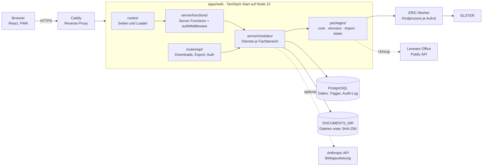

# Architektur

Haben ist eine einzelne Node-Anwendung auf Basis von TanStack Start mit PostgreSQL als einziger Datenbank und einem Verzeichnis für Belegdateien. Diese Seite beschreibt Aufbau, Datenmodell, Abläufe und die wichtigsten Entwurfsentscheidungen. Für die Entwicklungsumgebung siehe [Entwicklung](entwicklung.md), für den Betrieb [Installation](installation.md).

## Überblick

Der Browser spricht nur mit der eigenen Anwendung. Seiten laden ihre Daten über Server Functions; Dateien (Rechnungs-PDFs, Belege, Protokolle, CSV, ZIP) kommen über eigene API-Routen. Nach außen verbindet sich der Server nur mit ELSTER (über ERiC), optional mit der Anthropic-API und während des Umzugs mit Lexware Office.

## Module

### Pakete

| Paket | Aufgabe |
| --- | --- |
| `packages/core` | Reine Fachlogik ohne Ein- und Ausgabe: Cent-Beträge und Formatierung, Zeiträume und Fälligkeiten mit Feiertagen je Bundesland (`holidays.ts`), Steuernummer-Umrechnung ins ELSTER-Format, Rechnungssummen, umsatzsteuerliche Behandlung von Rechnungen (`treatment.ts`), Kontenrahmen und Buchungssätze (`posting.ts`), Vorschläge für den Bankabgleich (`matching.ts`), UStVA-Berechnung, EÜR (`euer.ts`), Umsatzsteuer aus Lexoffice-Belegen (`legacy-vat.ts`), Lebenszyklen von Rechnung, Angebot und Voranmeldung und der offene Betrag von Rechnungen und Belegen (`lebenszyklus.ts`; Rechnungsliste, Bankabgleich, offene Posten, Mahnwesen und die Sperre der Firmendaten rechnen damit, ein Test prüft, dass alle dasselbe ergeben) |
| `packages/einvoice` | Rechnungs-PDF mit Typst (Vorlage `templates/rechnung.typ`), ZUGFeRD und XRechnung über `@e-invoice-eu/core`, Prüfung der Pflichtfelder je Format, Lesen eingehender E-Rechnungen (eingebettetes XML aus PDFs, CII und UBL) |
| `packages/import` | Parser für Kontoauszüge (DKB, N26, CAMT.053), Dekodierung, Deduplizierung, Saldenprüfung, DATEV-Buchungsstapel (`datev.ts`), Client und Abbildungen für die Lexware-Office-API (`lexoffice/`), Client und Abbildung für den Kontoabruf über Enable Banking (`enablebanking/`) |
| `packages/elster` | `ElsterClient` mit echtem ERiC-Client (Kindprozess, `koffi`) und simuliertem Client, UStVA-XML, XML der Jahreserklärungen (Umsatzsteuererklärung E50, Anlage EÜR mit AVEÜR E77, `erklaerung.ts`; Einkommensteuererklärung E10, `est.ts`), Sonstige Nachricht (`nachricht.ts`), Änderung der Bankverbindung (`bankverbindung.ts`), Datenabholung aus dem Postfach (`postfach.ts`, Download der Anhänge über Otto), Belegabruf der vorausgefüllten Steuererklärung (`vast.ts`, Entschlüsselung mit `EricDekodiereDaten`), Berechtigungen zum Belegabruf (`berechtigung.ts`, ElsterBRM), Transfer-Ticket, ERiC-Download (`install.ts`) |

### apps/web

| Ordner | Aufgabe |
| --- | --- |
| `src/routes/` | Dateibasiertes Routing. `_app/` enthält alle Seiten hinter der Anmeldung (Übersicht, Rechnungen, Belege, Bank, Umsatzsteuer, Auswertungen, Buchungen, Kontakte, Archiv, Einstellungen); `setup.tsx` und `login.tsx` sind öffentlich |
| `src/routes/api/` | HTTP-Routen für Better Auth (`auth/$`), Dateien (`rechnung`, `angebot`, `mahnung`, `beleg`, `altbeleg`, `archiv`, `protokoll`, `postfach`, `vast`), Kalender-Abo der Fristen (`fristen/kalender`, mit geheimem Token statt Sitzung), MCP-Endpunkt für KI-Assistenten (`mcp`, mit API-Token statt Sitzung), Teilen-Ziel der PWA (`belege/teilen`), EÜR als CSV (`auswertungen/$jahr`) und Jahresarchiv (`export/$jahr`) |
| `src/components/` | React-Komponenten, die mehrere Seiten nutzen (Rechnungseditor, Vorschau, Upload, Statusanzeigen), dazu `archiv/` für die Umzugsseite |
| `src/server/functions/` | Server Functions je Bereich: Eingaben mit Zod prüfen, `authMiddleware` anhängen, Dienst aufrufen. Keine Fachlogik |
| `src/server/modules/<name>/` | Dienste je Fachbereich, jeweils mit öffentlicher `index.ts` (siehe [Module im Server](#module-im-server)) |
| `src/server/*.ts` | Gemeinsame Infrastruktur ohne Fachlogik: `auth`, `middleware`, `crypto`, `storage`, `file-response`, `env`, `errors`, `today`, `security-headers`; dazu `scheduler.ts`, der die Hintergrundarbeit der Module zusammensetzt |
| `src/server/db/` | Drizzle-Schema (`schema.ts`, `auth-schema.ts`), Verbindung, `withActor` für das Audit-Log, Migrationsskript |
| `apps/web/drizzle/` | SQL-Migrationen; Trigger und Funktionen stehen in eigenen Dateien (`0001_festschreibung.sql`, `*_trigger.sql`) |
| `src/styles/`, `styles.css` | Globales Stylesheet und seitenbezogene Stylesheets (Auswertungen, Archiv). Farben stehen als CSS-Variablen in `:root`; ein Theme überschreibt sie per `[data-theme="…"]`. Klassen, die mehr als eine Seite nutzt, gehören ins globale Stylesheet, sonst fehlen sie auf Seiten, die das seitenbezogene nicht laden |
| `src/lib/theme.ts` | Themes: Liste, Speicherung im `localStorage` und ein Inline-Skript, das `<html data-theme>` vor dem ersten Zeichnen setzt (`__root.tsx`) |
| `vite.config.ts` | Setzt `__HABEN_VERSION__` aus der Root-`package.json`; die Navigation zeigt so die ausgelieferte Version |
| `src/lib/` | Formatierung und Better-Auth-Client für den Browser |

### Module im Server

Die Dienste liegen in `apps/web/src/server/modules/`, ein Ordner je Fachbereich. Ein Modul besitzt seine Tabellen und bietet nach außen nur an, was in seiner `index.ts` steht.

| Modul | Inhalt |
| --- | --- |
| `stammdaten` | `company` (Firmendaten, Versteuerung und Kleinunternehmer je Jahr), `contacts`, `articles`, `logo`, `taxpayer` (persönliche Angaben), `settings-guard` (Sperren für Kontenrahmen, Versteuerung und Kleinunternehmer, Speichern der Firmendaten) |
| `rechnungen` | `invoices`, `invoice-taxes` (Steuerzeilen), `number-counter` (Nummernkreise), `quotes` (Angebote), `order-documents` (Auftragsbestätigung, Lieferschein), `dunning` (Mahnungen), `invoice-mail` (Rechnungen, Mahnungen und Angebote per E-Mail), `recurring` (Serienrechnungen) |
| `belege` | `documents`, `extraction` (Auslesen), `inbox` (Belege per E-Mail über IMAP) |
| `bank` | `bank` (Kontoauszüge, Zuordnung), `bank-sync` (Kontoabruf), `cash` (Kassenbuch) |
| `buchhaltung` | `ledger` (Hauptbuch: einziger Schreiber des Journals, Saldenliste, Kontenblatt), `journal` (Kontennamen), `assets` (Anlagenverzeichnis, AfA), `pauschalen` (Homeoffice, Fahrten, Verpflegung ohne Beleg) |
| `umsatzsteuer` | `vat-figures` (Zahlen und Vorprüfung), `vat` (Entwürfe, Berichtigung, Übermittlung) |
| `elster` | `elster-gateway` (Zugang, Zertifikat und PIN, Sendesperre und Protokoll für jede Übermittlung), `certificate`, `elster` (Datenschutzhinweise der Finanzverwaltung) |
| `finanzamt` | `finanzamt` (Nachrichten, Bankverbindung), `postfach` (Bescheide abholen), `vast` (Belege der vorausgefüllten Steuererklärung), `berechtigung` (Abrufberechtigung für den Ehegatten), `fristen` (Steuertermine, Kalender-Abo) |
| `jahreserklaerung` | `annual` (Umsatzsteuererklärung, Anlage EÜR, Einkommensteuer), `income-tax` (Angaben zur Einkommensteuer) |
| `auswertungen` | `reports` (EÜR, offene Posten), `abgleich` (Journal gegen Umsatzsteuer und EÜR), `integrity` (Prüfung von Hash-Kette, Siegeln und Abgleich), `datev-export` |
| `archiv` | `archive` (Umzugsdateien), `export` (Jahresarchiv), `lexoffice` (Import), `legacy-open` (übernommene offene Posten) |
| `mail` | `mail` (SMTP, Erinnerungen, wöchentliche Integritätsmail) |
| `mcp` | `server` (Endpunkt für KI-Assistenten), `tokens` (API-Tokens, Schalter, Protokoll der Aufrufe), `tools` (Werkzeuge, nur lesen) |

Die Lint-Regel `haben/modulgrenzen` (`eslint/modulgrenzen.js`) läuft mit `pnpm lint` in der CI und prüft jeden relativen Import:

- **Aus einem anderen Modul nur über dessen `index.ts`.** Braucht ein Modul, eine Server Function oder eine Route etwas, das dort fehlt, wird es in der `index.ts` ergänzt. Die Datei enthält nur `export { … } from "./…"`, keine Logik.
- **Infrastruktur importiert keine Module.** `server/*.ts` und `server/db/` bleiben unabhängig von der Fachlogik. Ausgenommen sind die Stellen, die Module zusammensetzen: `server/functions/`, `server/plugins/` und `scheduler.ts`.
- **Module importieren weder Server Functions noch Oberfläche** (`server/functions/`, `server/plugins/`, `routes/`, `components/`). Gemeinsames ohne Serverbezug liegt in `src/lib/`.

Tests sind ausgenommen und dürfen auch Dateien hinter der `index.ts` anderer Module importieren. `modulgrenzen.test.ts` prüft die Regel selbst und die Struktur: Jedes Modul hat eine `index.ts`, und direkt unter `server/` liegt nur Infrastruktur.

Zwischen Modulen gibt es Abhängigkeiten in beide Richtungen, etwa `rechnungen` ↔ `bank` (Zahlungen einer Rechnung, Zuordnung zu einer Rechnung) oder `stammdaten` → `rechnungen` (die Sperre der Firmendaten zählt offene Rechnungen). Die Regel verbietet sie nicht, macht sie aber an der `index.ts` sichtbar.

## Datenmodell

Alle Tabellen stehen in `apps/web/src/server/db/schema.ts`. Beträge sind ganze Cent, Steuersätze Basispunkte. Die Spalte „Schutz“ fasst die Trigger aus `apps/web/drizzle/` zusammen; Einzelheiten in [Buchhaltung in Haben](buchhaltung.md#gobd-unveränderbarkeit-in-der-datenbank).

### Stammdaten

| Tabelle | Zweck | Schutz |
| --- | --- | --- |
| `company` | Firmendaten, Versteuerungsart, Kontenrahmen, Zahlungsziel, Rechnungsformat; genau eine Zeile | Kontenrahmen, Versteuerung und Einschalten von § 19 gesperrt, sobald im laufenden Jahr gebucht ist; Audit |
| `elster_certificates` | ELSTER-Zertifikatsdatei, verschlüsselt; auf Wunsch die PIN für den automatischen Postfachabruf, ebenfalls verschlüsselt | Audit ohne Chiffrat und PIN |
| `contacts` | Kunden und Lieferanten, mit Herkunft aus Lexoffice | nicht löschbar, versioniert, Audit |
| `contact_versions` | Stand eines Kontakts je Version | nur anhängen |
| `bank_accounts` | Bankkonten, über die IBAN zugeordnet | Audit |
| `company_logo` | Firmenlogo (PNG oder JPEG) für Rechnungen, Angebote und Mahnungen; höchstens eine Zeile | Audit ohne Bilddaten (mit SHA-256) |

### Rechnungen und Belege

| Tabelle | Zweck | Schutz |
| --- | --- | --- |
| `invoices` | Ausgangsrechnungen, Stornos und Korrekturen mit PDF, XML, SHA-256 und umsatzsteuerlicher Behandlung (`tax_treatment`, `exemption_reason`); aus Vorlagen mit `recurring_id` und Termin (`recurring_date`, eindeutig je Vorlage); höchstens ein festgeschriebenes Storno je Rechnung | gesperrt ab Festschreibung, Audit ohne PDF/XML |
| `recurring_invoices` | Vorlagen für wiederkehrende Rechnungen: Positionen, Intervall, nächster Termin, Modus (Entwurf oder festschreiben) | Audit |
| `dunnings` | Zahlungserinnerungen und Mahnungen mit Stufe, Frist, Gebühr, Pauschale, Zinsen und PDF | nur anhängen, Audit ohne PDF |
| `invoice_lines` | Positionen einer Rechnung: Einzelpreis wie eingegeben (netto oder brutto, `invoices.price_mode`), Zeilennetto | gesperrt mit der Rechnung |
| `invoice_taxes` | Netto und Umsatzsteuer je Steuersatz, einmal beim Speichern des Entwurfs berechnet; Voranmeldung, Zahlungsbuchung, Auswertungen, Schlussrechnung, PDF und XML lesen nur diese Werte | gesperrt mit der Rechnung |
| `invoice_number_counters` | Letzte vergebene Nummer je Jahr | darf nicht sinken, Audit |
| `quotes` | Angebote mit Gültigkeit, PDF, SHA-256, Antwort des Kunden (`decision`) und daraus entstandener Rechnung (`invoice_id`) | gesperrt ab Festschreibung bis auf Antwort und Rechnung, Audit ohne PDF |
| `quote_lines` | Positionen eines Angebots | gesperrt mit dem Angebot |
| `quote_number_counters` | Letzte Angebotsnummer je Jahr (`AN-2026-001`) | darf nicht sinken, Audit |
| `documents` | Eingangsbelege; Datei im Dateisystem, Felder aus Auslesung oder Hand, beim Buchen festgehalten, ob mit Vorsteuerabzug (`vorsteuer_abzug`) | gesperrt ab Buchung, Audit |
| `document_amounts` | Beträge eines Belegs je Steuersatz | gesperrt mit dem Beleg |
| `articles` | Artikel und Leistungen zum Einfügen in Rechnungen und Angebote, Preis netto oder brutto (`price_includes_tax`), Steuersatz, archivierbar | änderbar, Audit |

### Buchhaltung, Bank und Umsatzsteuer

| Tabelle | Zweck | Schutz |
| --- | --- | --- |
| `journal_entries` | Buchungen mit Herkunft (Rechnung, Beleg, Zuordnung) und Verweis auf die stornierte Buchung | geschrieben nur von `ledger.post`; gesperrt ab Entstehung, Soll = Haben beim Sperren (festgeschrieben wird erst nach den Zeilen), beim Commit festgeschrieben, Kontenrahmen = Firmendaten, Audit |
| `journal_lines` | Buchungszeilen mit Konto, Soll, Haben, Steuerschlüssel | gesperrt mit der Buchung |
| `cash_entries` | Kassenbuch: jede Bewegung der Barkasse mit lückenloser Nummer, Beleg oder Art (Einlage, Entnahme, Geldtransit), Buchung; Storno als Gegenzeile | nur anhängen, Audit |
| `bank_imports` | Jede importierte Auszugsdatei mit SHA-256, Zeitraum, Salden | nur anhängen, Audit |
| `bank_transactions` | Importierte Umsätze mit Hash zur Deduplizierung | nur anhängen |
| `bank_connections` | Zustimmungen für den Kontoabruf über Enable Banking: Bank, Status, Ablauf, freigegebene Konten mit Abrufstand; Sitzungskennung verschlüsselt | Audit ohne Chiffrat |
| `allocations` | Zuordnung eines Umsatzes (ganz oder teilweise); aufgehoben per Gegenzeile | nur anhängen, Betragsprüfung, Audit |
| `vat_returns` | Voranmeldungen je Monat mit Kennzahlen, berechnet oder überschrieben | gesperrt nach Echtübermittlung, Audit |
| `vat_return_submissions` | Jede Prüfung und Übermittlung mit XML und Protokoll-PDF | nur anhängen, Audit ohne PDF und XML |
| `elster_messages` | Nachrichten an das Finanzamt (Sonstige Nachricht, Änderung der Bankverbindung) mit Text, Werten und XML | nur anhängen, Audit ohne XML |
| `postfach_requests` | Abrufe des ELSTER-Postfachs und Bestätigungen der Abholung mit XML | nur anhängen, Audit ohne XML |
| `postfach_documents` | Abgeholte Bescheide und Mitteilungen, Datei im Dokumentenspeicher | nur anhängen, Audit |
| `vast_requests` | Belegabrufe (Liste und Abholung) mit XML, je Person und Jahr | nur anhängen, Audit ohne XML |
| `mail_settings` | SMTP-Zugang (eine Zeile), Passwort verschlüsselt, Einstellungen der Erinnerungen und der wöchentlichen Mail mit dem Prüfwert des Audit-Logs | Audit ohne Passwort |
| `inbox_settings` | IMAP-Zugang für Belege per E-Mail (Passwort verschlüsselt), Ordner, letzter Abruf und Fehler | Audit nur bei Änderungen am Zugang, ohne Passwort |
| `inbox_messages` | Abgerufene Mails je Message-ID mit angelegten Belegen, Dubletten und übersprungenen Anhängen | nur anhängen, Audit |
| `mail_log` | Gesendete E-Mails mit Empfänger, Blindkopie, Anhängen, Fehler, Bezug zu Rechnung bzw. Mahnung und den erinnerten Fristen (Schlüssel Frist:Stufe) | nur anhängen, Audit |
| `brm_requests` | Anträge, Freischaltungen, Widerrufe und Listen der Abrufberechtigung mit XML (ohne Freischaltcode); der Stand ergibt sich aus dem Verlauf | nur anhängen, Audit ohne XML |
| `vast_belege` | Abgeholte, entschlüsselte Belege (Lohnsteuerbescheinigung, Rentenbezüge, Beiträge …) als XML | nur anhängen, Audit ohne XML |
| `annual_submissions` | Prüfungen und Übermittlungen der Jahreserklärungen mit Werten, XML und Protokoll-PDF; höchstens eine erfolgreiche Echtübermittlung je Erklärung und Jahr | nur anhängen, Audit ohne PDF und XML |
| `income_tax_inputs` | Angaben zur Einkommensteuererklärung je Jahr (Vorsorge, Sonderausgaben, Kinder, KAP) | änderbar, Audit |
| `pauschalen` | Pauschalen ohne Beleg (Homeoffice, Fahrt, Verpflegung) mit Angaben, Betrag und Buchung; Storno als Gegenzeile | nur anhängen, Audit |
| `assets` | Anlagenverzeichnis: Art, Abschreibung, Anlagekonto, Anschaffung, Nutzungsdauer, Übernahme, Abgang | Grundlagen fest nach der ersten Buchung, Audit |
| `asset_depreciations` | Gebuchte AfA je Anlage und Jahr mit Verweis auf die Buchung | nur anhängen, Audit |

### Archiv und Umzug

| Tabelle | Zweck | Schutz |
| --- | --- | --- |
| `archive_files` | Originalexporte (DATEV, IDEA, ELSTER-Protokolle, Kontoauszüge) unter SHA-256 | nur anhängen, Audit |
| `datev_bookings` | Zeilen eines DATEV-Buchungsstapels, unverändert | nur anhängen |
| `lexoffice_connection` | API-Schlüssel für Lexware Office, verschlüsselt; eine Zeile | Audit ohne Chiffrat |
| `lexoffice_imports` | Abrufe mit fortlaufend geschriebenem Fortschritt; höchstens einer läuft | Audit beim Anlegen |
| `lexoffice_vouchers` | Rechnungen und Belege aus Lexoffice mit vollständiger API-Antwort | nur anhängen |
| `lexoffice_voucher_files` | Dateien zu einem Lexoffice-Beleg | nur anhängen |

### Protokoll und Anmeldung

| Tabelle | Zweck | Schutz |
| --- | --- | --- |
| `audit_log` | Jede Änderung mit Zeitpunkt, Nutzer, Tabelle, altem und neuem Wert; als Hash-Kette mit Nummer (`seq`), Vorgänger-Hash und Hash | nur anhängen, auch kein `TRUNCATE` |
| `audit_chain` | Kopf der Hash-Kette: letzte Nummer und Hash, genau eine Zeile | nur vom Trigger auf `audit_log` fortgeschrieben |
| `seals` | Siegel festgeschriebener Buchungen, Rechnungen, Belege und Voranmeldungen sowie jeder Zeile in Kassenbuch, Zuordnungen, Pauschalen und AfA: SHA-256 über Datensatz und abhängige Zeilen, mit den Spalten, über die er gebildet ist | nur anhängen, Audit |
| `user`, `session`, `account`, `verification`, `passkey` | Tabellen von Better Auth samt Passkey-Plugin | – |

## Anmeldung

Haben hat genau einen Nutzer. Die Ersteinrichtung (`/setup`) legt ihn mit E-Mail und Passwort an (mindestens 12 Zeichen); ein Hook in Better Auth lehnt jedes weitere Konto ab, und ein eindeutiger Index auf `user` (`user_single`) verhindert ein zweites Konto auch bei zwei gleichzeitigen Einrichtungen. Danach meldet man sich per Passkey an, das Passwort bleibt Rückfallebene. Better Auth begrenzt Anmeldeversuche (20 je Minute) und liest die Client-Adresse hinter Caddy aus `X-Forwarded-For`.

Geschützt wird an drei Stellen:

- Die Layout-Route `_app` leitet ohne Sitzung auf `/login` bzw. vor der Einrichtung auf `/setup` um.
- Jede Server Function mit Daten hängt `authMiddleware` an (`apps/web/src/server/middleware.ts`), die die Sitzung prüft und den Nutzer in den Kontext legt. Die Umleitung im Browser allein schützt also nichts.
- Jede API-Route prüft die Sitzung selbst und antwortet sonst mit 401. Ausnahmen mit eigenem Token statt Sitzung sind das Kalender-Abo und `/api/mcp`.

KI-Assistenten melden sich an `/api/mcp` nicht mit der Sitzung an, sondern mit einem API-Token als Bearer-Header (siehe [KI-Assistenten](ki-assistenten.md)). `routes/api/mcp.ts` reicht jede Anfrage an `handleMcpRequest` (`server/modules/mcp/`) weiter. Der Endpunkt ist zustandslos (Streamable HTTP mit JSON-Antworten, nur POST): `authenticateMcp` prüft das Token gegen den SHA-256 in `mcp_tokens` und ob der Zugang eingeschaltet ist, dann beantwortet ein frischer `McpServer` die Anfrage mit den Werkzeugen, die die Rechte des Tokens erlauben. Die Werkzeuge (`tools.ts`) rufen nur die `index.ts` der Module auf und lesen nur. Jeder Aufruf landet ohne Inhalte in `mcp_calls`. Alles hinter `authenticateMcp` kennt nur den Zugang mit seinen Rechten; OAuth für die Connectors aus claude.ai kommt dort später dazu.

## Ablauf einer Anfrage

### Rechnung festschreiben

1. Die Seite ruft die Server Function `finalizeInvoiceDraft` auf. `authMiddleware` prüft die Sitzung.
2. `finalizeInvoice` in `server/modules/rechnungen/invoices.ts` öffnet eine Transaktion mit `withActor`.
3. In dieser Transaktion:
   - Entwurf mit `SELECT … FOR UPDATE` sperren,
   - Firmendaten, Kunde, Positionen, Beträge, die umsatzsteuerliche Behandlung und die Pflichtfelder des gewählten E-Rechnungsformats prüfen (`finalizeIssues`, dieselbe Prüfung wie in der Oberfläche, hier mit der Transaktion),
   - den Nummernkreis des Jahres sperren und die nächste Nummer nur lesen (`peekNumber` in `server/modules/rechnungen/number-counter.ts`, Advisory Lock je Kreis und Jahr),
   - PDF und XML aus Positionen und den gespeicherten Steuerzeilen (`invoice_taxes`) erzeugen (siehe unten); bis hierhin hat die Transaktion nichts mit Audit-Eintrag geschrieben, die Hash-Kette ist also frei,
   - den Zähler auf diese Nummer setzen (`takeNumber`; ab hier ist die Kette gesperrt),
   - Rechnung auf `final` setzen, mit Verkäufer- und Käuferdaten, Summen, PDF, XML, SHA-256 und `locked_at`,
   - über `ledger.post` buchen und festschreiben; der Trigger prüft Soll = Haben.
4. Schlägt ein Schritt fehl, wird alles zurückgerollt. Die Nummer ist dann nicht verbraucht; der Nummernkreis bleibt lückenlos.

Ein Storno läuft genauso, nur mit dem Entwurf in derselben Transaktion (`cancelInvoice`): erst das Original sperren (`FOR UPDATE`), dann den Nummernkreis, dann den Storno-Entwurf anlegen und festschreiben. Schlägt etwas fehl oder bricht der Server ab, bleibt kein Entwurf zurück. Weil der Entwurf schon einen Audit-Eintrag schreibt, entsteht das PDF des Stornos bei gesperrter Kette; Stornos sind selten, der eine Entwurf in derselben Transaktion wiegt mehr.

Angebote nummeriert `finalizeQuote` nach demselben Muster (eigener Kreis). Die Reihenfolge der Sperren ist immer Rechnungszeilen, dann Nummernkreis, dann Kette: Das Festschreiben einer Korrektur sperrt das Original, bevor es eine Nummer zieht, also muss auch das Storno das Original vor dem Kreis sperren, sonst verklemmen sich beide. Wer in einer Transaktion schon etwas mit Audit-Eintrag geschrieben hat und danach eine Nummer braucht, sperrt den Kreis vorher (`lockNumbering`). Auch „Nächste Nummer festlegen“ nimmt die Sperre des Kreises und wartet so auf ein laufendes Festschreiben.

### Hauptbuch und Transaktionen

- **Ein Schreiber.** Ins Journal schreibt nur `post(tx, books, posting)` in `server/modules/buchhaltung/ledger.ts`: Buchung anlegen, Zeilen anlegen, sperren. Die sieben Stellen, die buchen (Rechnungen, Belege, Bank, Kasse, Pauschalen, Anlagen, offene Posten aus Lexoffice), rufen nur noch `post` auf. Ein Test (`hauptbuch.test.ts`) schlägt fehl, sobald eine andere Datei `journal_entries` oder `journal_lines` beschreibt.
- **Firmendaten in der Transaktion.** `openBooks(tx)` liest Kontenrahmen, Versteuerung und Kleinunternehmer in der buchenden Transaktion, die Buchungszeilen werden danach berechnet. Nach dem Einfügen hält die Transaktion die Sperre der Hash-Kette; `post` liest die Firmendaten dann noch einmal und lehnt ab, wenn sie sich dazwischen geändert haben. Die Datenbank prüft zusätzlich den Kontenrahmen jeder Buchung und lehnt Buchungen ab, die beim Commit nicht festgeschrieben sind (`0065_hauptbuch_sperren.sql`).
- **Ein Kontenrahmen je Jahr.** `post` lehnt eine Buchung ab, wenn im Jahr ihres Datums schon in einem anderen Kontenrahmen gebucht ist. Umstellen geht nur zum Jahreswechsel; danach würde eine Buchung ins Vorjahr (Aufheben einer Zuordnung, rückdatierte Rechnung) sonst Kontonummern des neuen Rahmens zwischen die des alten stellen. Die Datenbank kann das nicht prüfen, sie kennt nur den Kontenrahmen der Firmendaten.
- **Transaktion ausdrücklich weitergeben.** Lesefunktionen nehmen eine Verbindung an (`q: Db | Tx = db`, etwa `loadCompany(tx)`, `getInvoice(id, tx)`, `finalizeIssues(id, tx)`), Schreibfunktionen gibt es auch ohne eigene Transaktion (`insertDraft(tx, …)`). `withActor` öffnet immer eine neue Transaktion und tritt keiner offenen bei. Ein stilles Beitreten hätte die ELSTER-Sendesperre geändert: `underSendLock` im ELSTER-Gateway hält eine Transaktion nur für die Sperre, protokolliert wird bewusst auf anderen Verbindungen, damit ein späterer Fehler das Protokoll einer Echtübermittlung nicht zurückrollt.
- **Ein Anwendungsfall, eine Transaktion.** Storno (Entwurf und Festschreiben) und Angebot zu Rechnung (Entwurf und Verknüpfung) laufen in einer Transaktion. Die Abschlagsrechnungen einer Schlussrechnung prüft Haben in der Transaktion, die den Entwurf speichert. Firmendaten speichert `saveCompany` in `settings-guard.ts` mit Prüfung der Sperren in derselben Transaktion; die Server Function ruft nur noch das auf.
- **Reihenfolge der Sperren.** Zeilen sperren (`FOR UPDATE`), dann schreiben; die Sperre der Hash-Kette kommt mit dem ersten Audit-Eintrag. Die Trigger aus `0065` nehmen sie in derselben Anweisung wie der Audit-Eintrag, die Reihenfolge bleibt also gleich. Wer Zeilen mit einem Fremdschlüssel auf eine Zeile anlegt, die er danach sperrt, sperrt sie vorher (siehe `cancelInvoice`), sonst verklemmen sich zwei gleichzeitige Aufrufe.

### Bankumsatz zuordnen

1. `allocateTransaction` → `allocate` in `server/modules/bank/bank.ts`, in einer Transaktion mit `withActor`.
2. Der Umsatz wird mit `FOR UPDATE` gesperrt; Vorzeichen und offener Betrag werden geprüft, ebenso der offene Betrag der Rechnung bzw. des Belegs.
3. Haben liest die Firmendaten in der Transaktion (`openBooks`), bildet den Buchungssatz mit `@haben/core` (`invoicePaymentPosting`, `documentPaymentPosting` oder `directPosting`), legt die Zuordnung an und bucht über `ledger.post` auf den Buchungstag des Umsatzes.
4. Der Trigger auf `allocations` prüft noch einmal, dass die Summe der Zuordnungen den Umsatz nicht übersteigt. Bei einem Zahlungseingang merkt sich Haben die IBAN des Kunden, falls noch keine hinterlegt ist.

Aufheben legt eine Gegenzeile und eine Gegenbuchung an, statt etwas zu löschen. Die Gegenbuchung spiegelt die Zeilen der ursprünglichen Buchung; ist das Jahr des Buchungstags in einem anderen Kontenrahmen gebucht, lehnt `post` sie ab (siehe oben).

## Dateiablage

Belegdateien, Lexoffice-Dateien und Archivexporte liegen im Dateisystem unter `DOCUMENTS_DIR` (Standard `data/belege`, im Container ein Volume), adressiert über ihren SHA-256: `<DOCUMENTS_DIR>/ab/abcdef…`. Daraus folgt:

- Dieselbe Datei wird nur einmal abgelegt; ein zweites Hochladen findet den vorhandenen Beleg.
- Geschrieben wird atomar über eine temporäre Datei und `rename`, mit Dateirechten 0640.
- Beim Lesen prüft Haben den Hash. Eine veränderte Datei fällt sofort auf („beschädigt“).
- Den Dateityp erkennt Haben am Inhalt (PDF, JPEG, PNG, WebP, HEIC, XML), nicht an Endung oder Browserangabe.

Rechnungs-PDFs und -XML sowie ERiC-Protokolle liegen dagegen direkt in der Datenbank (`bytea` bzw. `text`). Datenbank und Belegverzeichnis gehören beide ins Backup (Backup-Container aus `deploy/backup`).

## ERiC-Worker

ERiC, die native Bibliothek der Finanzverwaltung, läuft nie im Anwendungsprozess. `EricProcessClient` in `packages/elster` startet für jeden Aufruf einen kurzlebigen Kindprozess (`worker.ts`), der ERiC per `koffi` lädt, genau eine Anfrage über IPC ausführt und sich beendet. Stürzt ERiC ab oder hängt, bekommt die Anwendung nur eine Fehlermeldung; nach 120 Sekunden wird der Kindprozess beendet. Beim Postfachabruf sendet derselbe Kindprozess die PostfachAnfrage und lädt danach die Anhänge über Otto (`libotto.so` aus dem ERiC-Paket); die Dateien reisen base64-kodiert über IPC zurück, bestätigt wird erst, wenn die Anwendung sie gespeichert hat.

Für eine Übermittlung entschlüsselt Haben das Zertifikat und schreibt es in ein temporäres Verzeichnis (Rechte 0700, Datei 0600), das nach dem Aufruf gelöscht wird. Die PIN wird je Übermittlung abgefragt; gespeichert wird sie nur, wenn du den automatischen Postfachabruf einschaltest (verschlüsselt, für Postfach, Belegabruf und Berechtigungen). Vor dem Senden prüft der Client, dass der Testmerker im XML zur gewünschten Art passt (Test- oder Echtübermittlung). Ohne ERiC verwendet Haben einen simulierten Client und zeigt das in der Oberfläche an.

ERiC selbst liefert Haben nicht mit. `packages/elster/src/install.ts` lädt das Paket auf Wunsch von `download.elster.de` (Einstellungen, `ERIC_AUTO_INSTALL` im Entrypoint oder `install-cli.ts`), entpackt per Stream nur die Einträge unter `Linux-x86_64/` in einen Unterordner von `ERIC_DIR` und schaltet über die Datei `AKTUELL` um, wenn Bibliothek und Plugins vollständig sind; so lässt sich auch ein Volume als Ziel nutzen. `ERIC_HOME` hat Vorrang. Der ELSTER-Client wird neu erzeugt, sobald sich das ERiC-Verzeichnis ändert.

## ELSTER-Gateway

Jede Übermittlung an die Finanzverwaltung läuft über `server/modules/elster/elster-gateway.ts`: Voranmeldung, Jahreserklärungen, Nachrichten an das Finanzamt, Änderung der Bankverbindung, Postfach, Belegabruf (VaSt) und Berechtigungen. Das Gateway übernimmt, was jede davon braucht, damit eine neue Übermittlungsart nichts vergessen kann:

| Aufgabe | Funktion | Was sie sicherstellt |
| --- | --- | --- |
| Zugang | `zugang` | Testfälle mit der eigenen Hersteller-ID, sonst der Test-ID; echt nur mit eigener ID und nie mit dem simulierten Client, der nichts sendet und sonst festschreiben würde, ohne dass etwas beim Finanzamt ist |
| Signatur | `signatur`, `prepareAbruf` | aktives Zertifikat und PIN; die gespeicherte PIN nur bei Abrufen und Anträgen |
| Sendesperre | `underSendLock` | eine Echtübermittlung desselben Vorgangs nie zweimal gleichzeitig; Voranmeldung und Jahreserklärung sehen beim zweiten Aufruf danach „bereits gesendet“, Nachrichten und Anträge ohne Status laufen nacheinander und gehen dann zweimal raus. Die Transaktion hält nur die Sperre, gearbeitet wird auf anderen Verbindungen |
| Protokoll | `protocolSubmission` | jeder Versuch wird gespeichert; scheitert das nach erfolgter Echtübermittlung, stehen Transferticket und XML im Server-Log, und die Meldung sagt, dass nicht erneut gesendet werden soll |
| Ablauf | `uebermitteln` | Sperre, Zugang, XML bauen, prüfen oder senden, protokollieren, in dieser Reihenfolge |

Die Bestätigung der Datenschutzhinweise prüft der Client selbst vor jedem Aufruf (`elster.ts`). Ein Test (`elster-gateway.test.ts`) schlägt fehl, sobald eine andere Datei Test-Hersteller-ID, simulierten Client, Zertifikat oder PIN selbst behandelt.

## E-Rechnung

Beim Festschreiben entsteht die Rechnung in zwei Stufen:

1. **Sichtbares PDF:** Typst setzt die Vorlage `rechnung.typ` mit IBM Plex Sans als PDF/A-3b. Der Compiler läuft im Prozess (`@myriaddreamin/typst-ts-node-compiler`).
2. **E-Rechnung:** `@e-invoice-eu/core` erzeugt aus denselben Daten
   - bei **ZUGFeRD** (Profil EN 16931) ein PDF/A-3 mit eingebettetem `factur-x.xml`; Haben liest das XML danach wieder aus und speichert es zusätzlich,
   - bei **XRechnung** (CII oder UBL) das XML; das Typst-PDF bleibt als Sichtfassung dabei.

Eingehende E-Rechnungen liest `packages/einvoice` direkt: das eingebettete XML aus ZUGFeRD-PDFs oder reines XML (CII, UBL). Die Felder des Belegs werden daraus vorbefüllt, ohne KI.

## Hintergrundarbeit

Haben hat keine Job-Queue. Länger laufende Arbeit läuft als Promise im Serverprozess weiter, nachdem die Anfrage beantwortet ist:

- **KI-Auslesung von Belegen:** Nach dem Hochladen eines PDFs oder Fotos ohne E-Rechnung setzt Haben den Status „läuft“ und schickt die Datei an die Anthropic-API, wenn `ANTHROPIC_API_KEY` gesetzt ist. Die Antwort folgt einem festen Zod-Schema; Beträge kommen als Dezimaltext, damit nichts gerundet wird. Ohne Schlüssel verlässt keine Datei den Server.
- **Wiederkehrende Rechnungen:** Ein Nitro-Plugin (`server/plugins/scheduler.ts`) startet beim Serverstart einen Timer: 30 Sekunden nach dem Start und danach stündlich legt `runDueRecurring` die fälligen Rechnungen an (`server/modules/rechnungen/recurring.ts`). Verpasste Termine holt der Lauf mit ihrem Datum nach; ein eindeutiger Index auf `(recurring_id, recurring_date)` verhindert Doppelte. Im Audit-Log steht als Akteur `system:wiederkehrend`. `HABEN_SCHEDULER=off` schaltet den Timer ab.
- **Kontoabruf:** Derselbe Timer ruft `runDueBankSyncs` auf (`server/modules/bank/bank-sync.ts`). Jede aktive Verbindung wird höchstens alle 20 Stunden abgerufen, auch nach einem Fehler, weil PSD2 Banken nur wenige Zugriffe ohne den Nutzer am Tag erlaubt. Der Abruf baut aus der API-Antwort einen `ParsedStatement` und speichert ihn über denselben Weg wie eine Datei (`storeStatement`), also mit Hash-Dubletten und Kontosperre. Akteur im Audit-Log ist `system:bankabruf`.
- **Lexoffice-Abruf:** läuft mit einem `AbortController` im Prozess und schreibt seinen Fortschritt höchstens einmal je Sekunde in `lexoffice_imports`. Nach einem Neustart erkennt Haben einen hängengebliebenen Lauf an drei Minuten ohne Fortschritt; ein neuer Lauf setzt fort, weil vorhandene Belege übersprungen werden.

Laufende Auslesungen merkt sich der Prozess. Steht ein Beleg auf „läuft“, ohne dass der Prozess ihn ausliest (Neustart während der Auslesung), setzt Haben ihn beim nächsten Öffnen auf „Fehler“, damit er wieder bearbeitet werden kann.

## Sicherheit

- **Verschlüsselung:** ELSTER-Zertifikat, Lexware-API-Schlüssel und die Sitzungskennung des Kontoabrufs liegen mit AES-256-GCM verschlüsselt in der Datenbank (`server/crypto.ts`, Format IV | Tag | Chiffrat). Der Schlüssel `HABEN_ENCRYPTION_KEY` (32 Byte, base64) steht nur in der Umgebung.
- **Dateiauslieferung:** Gespeicherte Dateien gehen mit `X-Content-Type-Options: nosniff`, `Cache-Control: private, no-store` und einer Content-Security-Policy hinaus: für PDFs `default-src 'none'; object-src 'self'`, sonst `sandbox`. Nur PDFs und Bilder werden im Browser angezeigt; XML und JSON kommen als Text, alles andere als Download.
- **Manipulationserkennung:** Das Audit-Log ist eine Hash-Kette, festgeschriebene Datensätze tragen ein Siegel (siehe [Buchhaltung in Haben](buchhaltung.md#manipulationserkennung-hash-kette-und-siegel)). Berechnet und geprüft wird beides in Postgres, damit der Hash nicht von einer Nachbildung des JSON in TypeScript abhängt. Ab dem ersten Eintrag ins Audit-Log hält eine Transaktion die Sperre der Kette bis zum Commit (Advisory Lock); Transaktionen mit Audit-Einträgen laufen also nacheinander. Wer in einer Transaktion weitere Sperren nimmt (etwa die der Kasse), nimmt sie vor der ersten Änderung mit Audit-Eintrag, sonst können sich zwei Transaktionen gegenseitig blockieren. Lange Arbeit nach dem ersten Audit-Eintrag hält andere Schreibvorgänge so lange auf; teure Arbeit gehört deshalb davor. Rechnungen und Angebote erzeugen PDF und XML vor dem ersten Schreiben (siehe [Rechnung festschreiben](#rechnung-festschreiben)), Mahnungen ebenso. Migrationen, die eine Spalte einer versiegelten Tabelle (`journal_entries`, `journal_lines`, `invoices`, `invoice_lines`, `invoice_taxes`, `documents`, `document_amounts`, `vat_returns`, `cash_entries`, `allocations`, `pauschalen`, `asset_depreciations`) umbenennen, löschen oder deren Werte umrechnen, lassen die Siegel nicht mehr passen; die Prüfung meldet das zu Recht als Änderung festgeschriebener Daten. Neue Spalten sind unkritisch.
- **Kein Geheimnis im Export:** Das Jahresarchiv enthält weder Zertifikat noch API-Schlüssel. Das Audit-Log speichert Chiffrate gar nicht erst, der Export filtert sie zusätzlich heraus.
- **Kontoabruf:** Die Rückleitung der Bank (`/api/bank/callback`) verlangt eine angemeldete Sitzung und einen `state`, den Haben beim Start zufällig erzeugt und nur einmal annimmt. Der Zugriff ist lesend; Zahlungen kann Haben nicht auslösen. Der private Schlüssel der Enable-Banking-Anwendung liegt nur in der Umgebung bzw. als Datei, nie in der Datenbank.
- **Proxy:** Caddy terminiert TLS und setzt HSTS, `X-Frame-Options: SAMEORIGIN` und `Referrer-Policy: same-origin`. `SAMEORIGIN` statt `DENY`, weil die Vorschauen von Belegen, Rechnungen und Angeboten iframes auf derselben Origin sind. Die App setzt zusätzlich selbst `Content-Security-Policy: frame-ancestors 'self'` auf alle HTML-Antworten (`src/start.ts`, `server/security-headers.ts`); Dateien aus `file-response.ts` behalten ihre eigene CSP.

> [!IMPORTANT]
> `HABEN_ENCRYPTION_KEY` muss getrennt vom Datenbank-Backup gesichert werden. Ohne ihn lassen sich Zertifikat und API-Schlüssel nach einer Wiederherstellung nicht mehr entschlüsseln; das Zertifikat müsste neu hochgeladen werden.

## Entwurfsentscheidungen

| Entscheidung | Warum |
| --- | --- |
| Ganze Cent statt Dezimalzahlen | Keine Rundungsfehler durch Gleitkomma; Summen stimmen auf den Cent mit Rechnung und ELSTER überein |
| Unveränderbarkeit per Postgres-Trigger | GoBD verlangt, dass festgeschriebene Daten nicht geändert werden. Trigger greifen auch bei Fehlern im Code und bei SQL von Hand (`psql`, Datenbank-Werkzeuge). Sie schützen vor Versehen, nicht vor Absicht: Die App verbindet sich als Eigentümer der Tabellen und könnte Trigger abschalten. Bei einer selbst gehosteten Installation mit einem Nutzer hat der Betreiber ohnehin vollen Zugriff auf Server und Datenbank; den Nachweis tragen Audit-Log, Prüfsummen und Backups |
| Korrektur nur durch neue Zeilen | Storno, Gegenbuchung, Gegenzeile und berichtigte Voranmeldung lassen den ursprünglichen Stand sichtbar, statt ihn zu überschreiben |
| Audit-Log per Trigger mit Nutzer aus der Transaktion | Lückenlos, ohne dass jede Funktion selbst protokollieren muss |
| Ein Nutzer, Passkey | Haben ist für eine Person gedacht. Kein Rollenmodell, weniger Angriffsfläche |
| Server Functions statt eigener REST-API | Typsichere Aufrufe von der Seite bis zur Datenbank in einem Projekt; HTTP-Routen nur für Dateien |
| Fachlogik in `packages/core` ohne Ein- und Ausgabe | Buchungssätze, EÜR und Steuerberechnung sind ohne Datenbank testbar |
| Hauptbuch als einziger Schreiber des Journals | Festschreiben, Kontenrahmen und die Prüfung der Firmendaten stehen an einer Stelle; neue Buchungsarten können nichts davon vergessen |
| Transaktion ausdrücklich übergeben statt implizit beitreten | Wer eine Funktion aufruft, sieht, in welcher Transaktion sie liest; `underSendLock` arbeitet bewusst auf anderen Verbindungen und bleibt davon unberührt |
| Umsatzsteuer und EÜR aus den Nebenbüchern, Journal zum Abgleich | Die Formulare brauchen Kennzahlen je Satz, § 13b und Zahlungsdaten, die im Journal nur indirekt stehen; der Abgleich deckt Widersprüche trotzdem auf |
| Dateien unter SHA-256 | Keine Dubletten, Integrität bei jedem Lesen prüfbar, Hash im Export als Nachweis |
| ERiC im Kindprozess | Eine abstürzende native Bibliothek reißt die Anwendung nicht mit |
| Jahresexport als Stream | Ein Jahr mit vielen Belegen braucht kaum Arbeitsspeicher; die Prüfsummen entstehen beim Packen |
| Keine Job-Queue | Ein Prozess, eine Datenbank, einfacher Betrieb. Die einzigen langen Aufgaben sind wiederholbar bzw. fortsetzbar |
| KI-Auslesung optional | Ohne Schlüssel bleiben alle Daten auf dem eigenen Server; E-Rechnungen werden ohnehin direkt gelesen |
| Altbestand aus Lexoffice getrennt | Archivierte Daten bleiben unverändert und beeinflussen weder Voranmeldung noch Auswertungen; nur ausdrücklich übernommene offene Posten werden Teil der Buchhaltung |
