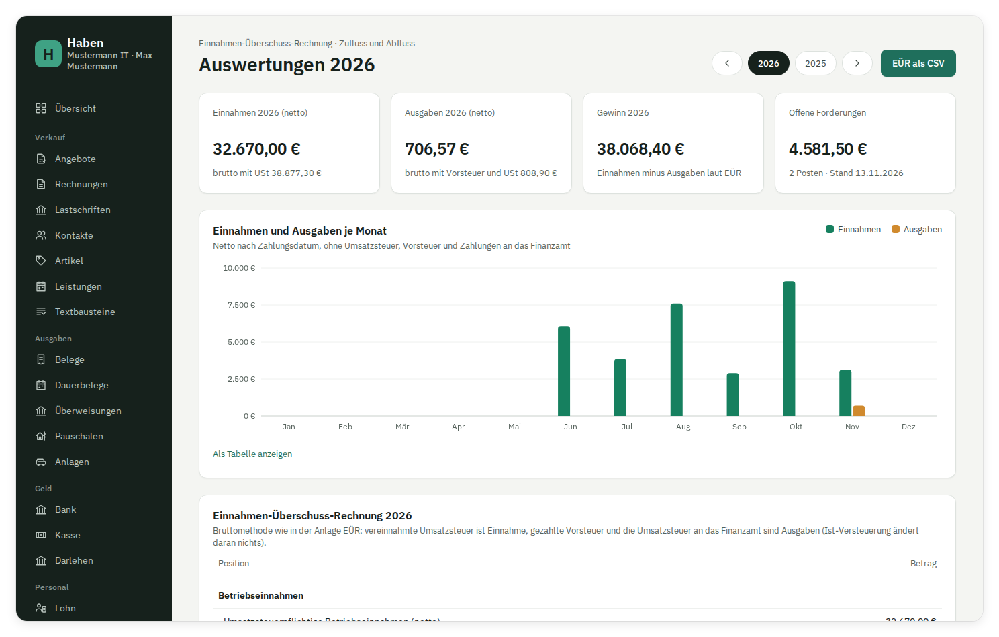

# Auswertungen und Jahresexport

Die Seite „Auswertungen“ zeigt dir die Einnahmen-Überschuss-Rechnung (EÜR) eines Jahres, Einnahmen und Ausgaben je Monat und die offenen Posten. Unter „Einstellungen“ lädst du das Jahresarchiv als ZIP für die Aufbewahrung herunter. Als Anlage EÜR an das Finanzamt geht die EÜR unter [Jahreserklärungen](jahreserklaerung.md).

Eine GmbH oder UG bilanziert (§ 238 HGB, § 8 Abs. 1 KStG) und macht keine EÜR. Bei ihr zeigt die Seite Einnahmen und Ausgaben je Monat nach Zahlung, den Überschuss nach Zahlung und die offenen Posten, aber keine EÜR-Tabelle und kein „EÜR als CSV“; den Gewinn zeigt der [Jahresabschluss](gmbh-abschluss.md#jahresabschluss-gmbh-und-ug).



## Überblick

Oben wählst du das Jahr: ‹ und › blättern ins Vor- und Folgejahr, dazwischen stehen das laufende Jahr und alle Jahre mit Bankumsätzen, festgeschriebenen Rechnungen oder gebuchten Belegen, jedes einmal. Darunter stehen vier Kennzahlen:

| Kennzahl | Bedeutung |
| --- | --- |
| Einnahmen (netto) | Summe der Monatswerte, ohne Umsatzsteuer; darunter der Bruttowert laut EÜR |
| Ausgaben (netto) | Summe der Monatswerte, ohne Vorsteuer (Belege ohne Vorsteuerabzug brutto); darunter der Bruttowert laut EÜR mit Vorsteuer und gezahlter Umsatzsteuer |
| Gewinn bzw. Verlust | Betriebseinnahmen minus Betriebsausgaben laut EÜR |
| Offene Forderungen | Summe aller offenen Rechnungen heute, mit Anzahl und Zahl der überfälligen |

## EÜR nach Zufluss und Abfluss

Haben rechnet die EÜR nach § 4 Abs. 3 EStG: Es zählt, wann Geld fließt, nicht wann eine Rechnung geschrieben oder ein Beleg gebucht wurde.

**Ab dem Stichjahr aus dem Journal.** Im Einzelunternehmen rechnet Haben die EÜR ab dem Stichjahr ([Wie die Kennzahlen entstehen](umsatzsteuer.md#wie-die-kennzahlen-entstehen)) wie DATEV aus den Buchungen; in GmbH und UG, die bilanzieren, bleibt die Übersicht nach Zahlung aus Rechnungen, Belegen und Zahlungen, sonst zählten Abschlussbuchungen wie Rückstellungen als Ausgabe: Eine Buchung ohne Forderung oder Verbindlichkeit (Bank, Kasse, privat bezahlt, Pauschale) zählt mit ihrem Datum nach ihren Konten; eine Rechnung bzw. ein Beleg auf Ziel zählt mit jeder Zahlung anteilig, gerundet wie die Zahlung. AfA und Privatnutzung kommen aus dem Journal, sobald das Jahr gebucht ist, vorher aus dem Anlagenverzeichnis. Für aus Lexoffice übernommene Rechnungen und Belege verteilt Haben die Zahlung auf die Zeilen, die es für Rechnung bzw. Beleg gebucht hätte. Was unten steht, gilt in beiden Fällen; die Rechnung aus Rechnungen, Belegen und Zahlungen bleibt die Gegenprobe im [Abgleich](buchhaltung.md#abgleich-von-journal-umsatzsteuer-und-eür).

### Was zählt

| Quelle | Datum | EÜR-Position |
| --- | --- | --- |
| Zahlungseingang, im Bankabgleich einer Rechnung zugeordnet | Buchungstag des Umsatzes | Einnahmen netto (steuerpflichtig oder steuerfrei) und vereinnahmte Umsatzsteuer |
| Zahlung, im Bankabgleich einem Beleg zugeordnet | Buchungstag des Umsatzes | Ausgabe in der Kategorie des Belegs und gezahlte Vorsteuer; ohne Vorsteuerabzug (Kleinunternehmer) der Bruttobetrag als Ausgabe. Ein [aufgeteilter Beleg](belege.md#auf-mehrere-kategorien-aufteilen) zählt anteilig je Zeile in deren Kategorie |
| Gebuchter Beleg, privat oder bar aus der [Kasse](kasse.md) bezahlt | Belegdatum; ein Storno fließt am Datum der Gegenbuchung zurück | wie oben |
| Bareinnahme auf eine Rechnung im [Kassenbuch](kasse.md) | Datum der Bareinnahme | wie ein Zahlungseingang |
| Bankumsatz „Umsatzsteuer an das Finanzamt“, Ausgang | Buchungstag; die Vorauszahlung für Dezember bzw. das vierte Quartal, gezahlt bis 10. Januar, im Vorjahr ([Vorauszahlung um den Jahreswechsel](#umsatzsteuer-vorauszahlung-um-den-jahreswechsel)) | An das Finanzamt gezahlte Umsatzsteuer |
| Bankumsatz „Umsatzsteuer an das Finanzamt“, Eingang | Buchungstag | Vom Finanzamt erstattete Umsatzsteuer |
| Bankumsatz „Sondervorauszahlung (Dauerfristverlängerung)“ | Buchungstag | wie „Umsatzsteuer an das Finanzamt“ |
| Bankumsatz „Kontoführung und Bankgebühren“ | Buchungstag | Ausgabe „Kontoführung und Gebühren“ |
| Bankumsatz „Mahngebühren und Verzugszinsen“ oder „Zinserträge“ | Buchungstag | Umsatzsteuerfreie und nicht steuerbare Betriebseinnahmen |
| Bankumsatz „Steuerzahlung oder Erstattung“ | Buchungstag | je nach Steuerart und Teil: Umsatzsteuer früherer Jahre als gezahlte bzw. erstattete Umsatzsteuer, Zinsen und Zuschläge als „Zinsen und Zuschläge zu betrieblichen Steuern“, Erstattungszinsen als Einnahme; Gewerbesteuer nur nachrichtlich, private Steuern gar nicht ([Steuerzahlungen](bank-steuern-darlehen.md#steuerzahlungen)) |
| Bankumsatz „Einnahme oder Ausgabe (Kategorie, Steuersatz)“ | Buchungstag | Einnahme netto (als Kleinunternehmer ohne Steuer) und vereinnahmte Umsatzsteuer; Ausgabe brutto in der Kategorie, ohne Vorsteuer ([Auf eine Kategorie buchen](bank.md#auf-eine-kategorie-buchen)) |
| Bankumsatz „Darlehen“ | Buchungstag | Zinsen und Gebühren als „Schuldzinsen zur Finanzierung von Anlagevermögen“ bzw. „Übrige Schuldzinsen“; Auszahlung und Tilgung zählen nicht ([Darlehen](bank-steuern-darlehen.md#darlehen)) |
| Bankumsatz „Lohn/Gehalt an Mitarbeiter“, „Lohnsteuer an das Finanzamt“ oder „SV-Beiträge an Krankenkasse oder Minijob-Zentrale“ | Buchungstag | Löhne und Gehälter einschließlich Lohnsteuer und Sozialversicherung; eine Rückzahlung mindert sie ([Lohn](lohn.md#buchung)) |
| Kursdifferenz beim Ausgleich einer Rechnung oder eines Belegs in Fremdwährung | Buchungstag | Erträge bzw. Aufwendungen aus Kursdifferenzen; die Rechnung bzw. der Beleg zählt dafür in voller Höhe ([Bankabgleich](bank.md#kursdifferenz-bei-fremdwährung)). In der Anlage EÜR: nicht steuerbare Einnahmen bzw. übrige Ausgaben |
| Beleg mit Kategorie „Anlagegut“, bezahlt | Buchungstag bzw. Belegdatum | nur die Vorsteuer; der Kaufpreis wirkt über die AfA |
| [Manuelle oder freie Buchung](buchhaltung.md#manuelle-und-freie-buchungen), im Einzelunternehmen ab dem Stichjahr | Datum der Buchung | nach ihren Konten: Erlös als Einnahme, Aufwand in der Zeile seines Kontos, Umsatzsteuer als vereinnahmte Umsatzsteuer; Privatkonten zählen nicht |
| Journalbuchung aus dem [Datenimport](belegimport.md#zahlungen-journal-und-eür), ab dem Stichjahr | bei offenen Forderungen/Verbindlichkeiten erst am Tag der zugeordneten Zahlung, sonst Buchungsdatum | nach den ursprünglichen Konten; Teilzahlungen anteilig. Fehlende Zahlungsbezüge bleiben ungeklärt und können ausdrücklich nachgepflegt werden |
| [Sachentnahme](buchhaltung.md#manuelle-und-freie-buchungen) (freie Buchung mit Steuerschlüssel) | Datum der Buchung | Sonstige Sach-, Nutzungs- und Leistungsentnahmen (netto) und die Umsatzsteuer darauf bei der vereinnahmten Umsatzsteuer |
| [Pauschale](pauschalen.md) | Datum der Pauschale | Ausgabe je Pauschale (Homeoffice, Fahrten, Verpflegung) |
| Anlagenverzeichnis | Jahr laut Abschreibungsplan | AfA, Sofortabschreibung GWG, Auflösung Sammelposten, Restbuchwert bei Abgang ([Anlagen und AfA](anlagen.md)) |

Bei Teilzahlungen teilt Haben die Zahlung im Verhältnis der Rechnung bzw. des Belegs auf Netto und Steuer je Steuersatz auf. Hebst du eine Zuordnung im Bankabgleich auf, hebt die Gegenzeile die ursprüngliche Zahlung in der EÜR genau auf. Auch eine aufgehobene Umsatzsteuerzahlung wird in derselben EÜR-Position zurückgenommen; sie zählt nicht als Erstattung des Finanzamts. Nach erneuter Zuordnung zählt die Zahlung einmal. Eine tatsächliche Erstattung vom Finanzamt bleibt dagegen eine Einnahme unter „Vom Finanzamt erstattete Umsatzsteuer“ ([amtliche Anleitung EÜR 2025, Zeilen 18 und 58](https://www.elster.de/eportal/helpGlobal?themaGlobal=help_euer_ufa_77_2025)).

Verrechnet das Finanzamt eine Umsatzsteuerzahlung mit einer Erstattung und teilst du den verbleibenden Bankumsatz entsprechend auf, stehen beide Teile in ihrer jeweiligen EÜR-Position. Die Reihenfolge der Teile ändert die Beträge nicht; beim Aufheben nimmt Haben jeden Teil in derselben Position zurück.

### Umsatzsteuer-Vorauszahlung um den Jahreswechsel

Regelmäßig wiederkehrende Ausgaben, die kurze Zeit nach dem Ende des Jahres abfließen, zu dem sie wirtschaftlich gehören, zählen in diesem Jahr ([§ 11 Abs. 2 Satz 2 EStG](https://www.gesetze-im-internet.de/estg/__11.html)). „Kurze Zeit“ sind höchstens zehn Tage (H 11 EStH), also der 22. Dezember bis 10. Januar. Die Umsatzsteuer-Vorauszahlung ist eine solche Ausgabe. Eine Zahlung „Umsatzsteuer an das Finanzamt“, die im [Bankabgleich einer Voranmeldung zugeordnet](bank.md#voranmeldung-zahllast-und-erstattung) ist, zählt Haben deshalb im Vorjahr, wenn

- die Voranmeldung für einen Zeitraum des Vorjahres gilt,
- ihre Vorauszahlung zwischen 22. Dezember und 10. Januar fällig ist: ohne Dauerfristverlängerung die für Dezember bzw. das vierte Quartal, am 10. Januar ([§ 18 Abs. 1 Satz 4 UStG](https://www.gesetze-im-internet.de/ustg_1980/__18.html)), und
- der Buchungstag zwischen 1. und 10. Januar liegt.

Gezahlt allein reicht nicht, fällig sein muss die Vorauszahlung in den zehn Tagen (BFH, Urteil vom 16.02.2022, X R 2/21, BStBl II 2022, 448). Mit [Dauerfristverlängerung](umsatzsteuer.md#dauerfristverlängerung) ist die Vorauszahlung für Dezember bzw. das vierte Quartal erst am 10. Februar fällig ([§ 46 UStDV](https://www.gesetze-im-internet.de/ustdv_1980/__46.html)); eine Zahlung im Januar zählt dann im Jahr der Zahlung (BFH, Urteil vom 21.06.2022, [VIII R 25/20](https://www.bundesfinanzhof.de/de/entscheidung/entscheidungen-online/detail/STRE202210196/)). Umgekehrt ist mit Dauerfristverlängerung die Vorauszahlung für November am 10. Januar fällig und zählt, bis dahin gezahlt, im Vorjahr. Eine verspätet gezahlte Vorauszahlung für einen früheren Monat, etwa die für November ohne Dauerfristverlängerung am 5. Januar, zählt im Jahr der Zahlung.

Fällt der 10. Januar auf ein Wochenende oder einen Feiertag, rechnet Haben trotzdem mit dem 10.: Die Verschiebung nach § 108 Abs. 3 AO zählt für § 11 EStG nicht (BFH, Urteil vom 27.06.2018, X R 44/16). Zum Jahreswechsel 2026/27 ist der 10. Januar ein Sonntag; die Zahlung am Montag, dem 11. Januar, ist pünktlich, zählt in der EÜR aber im Jahr der Zahlung. Ob die Finanzverwaltung das weiter so anwendet, klärst du mit deiner Steuerberatung.

Eine Erstattung aus der Voranmeldung für Dezember zählt im Jahr, in dem sie eingeht. Ob sie regelmäßig wiederkehrend ist, steht nicht fest; auch das klärst du mit der Steuerberatung. Zahlungen ohne Bezug auf eine Voranmeldung (ältere Zuordnungen) und die Sondervorauszahlung zählen am Buchungstag.

Die Buchung selbst behält ihr Datum; Voranmeldung, Journal und DATEV-Export bleiben, wie sie sind. Die EÜR aus den Buchungen ab dem Stichjahr und die aus Rechnungen, Belegen und Zahlungen verschieben dieselben Zahlungen, und der [Abgleich](buchhaltung.md#abgleich-von-journal-umsatzsteuer-und-eür) rechnet das Journal ebenso um.

**Gesperrtes Vorjahr:** War die Anlage EÜR oder die Einkommensteuererklärung des Vorjahres schon aus Haben übermittelt oder das Jahr abgeschlossen, als du die Zahlung zugeordnet hast, ändert Haben das Vorjahr nicht (GoBD). Die Zahlung zählt dann im Jahr der Zahlung, und die Vorprüfung der [Anlage EÜR](jahreserklaerung.md#anlage-eür) nennt sie mit Zeitraum und Betrag; hast du die Zuordnung nach der Übermittlung aufgehoben und den Umsatz neu zugeordnet, zählt die Zahlung über die aufgehobene Zuordnung schon im Vorjahr, und die Vorprüfung nennt nur, was dort noch fehlt. Erklärungen, die eine ältere Version von Haben übermittelt hat, enthalten die Zahlung nicht; sie sperren das Vorjahr deshalb immer.

**Übermittelt bleibt übermittelt:** Mit jeder Übermittlung speichert Haben, welche Zahlungen die Erklärung in das Vorjahr verschoben bzw. aus dem Folgejahr hereingenommen hat. Danach richten sich beide Jahre, auch wenn du später etwa die Dauerfristverlängerung des Jahres änderst. Hebst du eine bereits ins übermittelte Vorjahr übernommene Zuordnung auf, mindert ihre Gegenzeile im Folgejahr die gezahlte Umsatzsteuer; sie wird nicht als neue Erstattung ausgewiesen. Hat eine ältere Version von Haben die EÜR des Zahlungsjahres übermittelt, zählt die Zahlung dort weiter am Buchungstag. Wird der Betrag dadurch negativ, meldet die Vorprüfung der [Anlage EÜR](jahreserklaerung.md#anlage-eür) ihn vor dem Senden.

### Was nicht zählt

- Bankumsätze, die du noch nicht zugeordnet hast. Ordne vor dem Jahresabschluss alles im [Bankabgleich](bank.md) zu.
- Belege, die noch nicht gebucht sind, und über die Bank zu zahlende Belege ohne zugeordnete Zahlung (die stehen unter „Offene Verbindlichkeiten“).
- Privatentnahmen und -einlagen sowie Geldtransit zwischen eigenen Konten. Sie sind nicht betrieblich. Ausnahmen sind die Sachentnahme und die private Nutzung von Firmenwagen: Sie zählen als Einnahme (§ 6 Abs. 1 Nr. 4 EStG).
- Rechnungsentwürfe und Rechnungen ohne Zahlungseingang.

### Bruttomethode

Wie in der Anlage EÜR ist die vereinnahmte Umsatzsteuer eine Betriebseinnahme. Gezahlte Vorsteuer und die an das Finanzamt gezahlte Umsatzsteuer sind Betriebsausgaben, eine Erstattung vom Finanzamt ist wieder Einnahme. Ob du Ist- oder Soll-Versteuerung eingestellt hast, ändert an der EÜR nichts; das betrifft nur die [Umsatzsteuer-Voranmeldung](umsatzsteuer.md).

Die Tabelle „Einnahmen-Überschuss-Rechnung“ zeigt:

- **Betriebseinnahmen:** Betriebseinnahmen als umsatzsteuerlicher Kleinunternehmer (nur, wenn es solche gibt), Umsatzsteuerpflichtige Betriebseinnahmen (netto), Umsatzsteuerfreie und nicht steuerbare Betriebseinnahmen, Private Kfz-Nutzung (nur bei privat genutzten Firmenwagen), Sonstige Sach-, Nutzungs- und Leistungsentnahmen (nur bei Sachentnahmen), Erträge aus Kursdifferenzen (nur, wenn es welche gibt), Vereinnahmte Umsatzsteuer (auch die auf Sachentnahmen), Umsatzsteuer auf unentgeltliche Wertabgaben (nur die auf die private Kfz-Nutzung), Vom Finanzamt erstattete Umsatzsteuer. Belege mit Privatanteil zählen nur mit dem betrieblichen Teil
- **Betriebsausgaben:** Löhne und Gehälter einschließlich Lohnsteuer und Sozialversicherung, eine Zeile je Belegkategorie mit Betrag (Software, Hosting, Telefon …; bei der Bewirtung nur der abziehbare Teil von 70 %), je Pauschale, die Abschreibungen aus dem Anlagenverzeichnis, Aufwendungen aus Kursdifferenzen, Zinsen und Zuschläge zu betrieblichen Steuern, Schuldzinsen zur Finanzierung von Anlagevermögen, Übrige Schuldzinsen (diese jeweils nur, wenn es welche gibt), Gezahlte Vorsteuerbeträge, An das Finanzamt gezahlte Umsatzsteuer
- **Gewinn bzw. Verlust**, darunter nachrichtlich die nicht abziehbare Gewerbesteuer samt Nebenleistungen und Hinterziehungszinsen, wenn es welche gibt

Zahlungen auf Kleinunternehmer-Rechnungen (§ 19 UStG) stehen in der eigenen Zeile für Kleinunternehmer. Rechnungen mit Reverse Charge, ins Drittland oder steuerfrei nach § 4 UStG zählen wie Umsätze zu 0 % als umsatzsteuerfrei und nicht steuerbar. Die Steuer auf Belegen, die ohne Vorsteuerabzug gebucht sind, ist Teil der Ausgabe und erscheint nicht unter den Vorsteuerbeträgen.

Belege ohne gültige Kategorie landen unter „Sonstiger Aufwand“. Welche Kategorie auf welches Konto geht, steht in [Buchhaltung in Haben](buchhaltung.md#kontenrahmen).

## Einnahmen und Ausgaben je Monat

Das Säulendiagramm zeigt je Monat die Einnahmen und Ausgaben netto nach Zahlungsdatum, also ohne Umsatzsteuer, Vorsteuer, Umsatzsteuerzahlungen an oder vom Finanzamt und nicht abziehbare Steuern. Bankgebühren zählen zu den Ausgaben. Fährst du mit der Maus über einen Monat oder springst per Tab-Taste hinein, siehst du die Werte. Unter „Als Tabelle anzeigen“ stehen dieselben Zahlen mit Überschuss je Monat und Jahressumme.

## Offene Posten

Die drei Tabellen am Ende zeigen den Stand von heute, unabhängig vom gewählten Jahr. Sortiert wird nach Fälligkeit.

- **Offene Forderungen:** festgeschriebene Rechnungen und Rechnungskorrekturen, die nicht storniert sind, mit Betrag abzüglich zugeordneter Zahlungen. Eine Korrektur erscheint mit negativem offenem Betrag, ebenso eine Stornorechnung, solange die Zahlung auf die stornierte Rechnung noch nicht erstattet ist. Offen heißt hier dasselbe wie in der Rechnungsliste und im Bankabgleich.
- **Offene Verbindlichkeiten:** gebuchte Belege mit Zahlung „Bank“, abzüglich zugeordneter Zahlungen. Ohne Fälligkeitsdatum gilt das Belegdatum.
- **Umsatzsteuer gegenüber dem Finanzamt:** Zahllast (positiv) und Erstattung (negativ) jeder abgegebenen Voranmeldung, abzüglich der im Bankabgleich zugeordneten Zahlungen; eine berichtigte Anmeldung als eigene Zeile über die Differenz. Die Nummer führt zur Voranmeldung. Siehe [Zahlung an das Finanzamt](umsatzsteuer.md#zahlung-an-das-finanzamt).

Der Status zeigt, wie viele Tage ein Posten überfällig ist oder in wie vielen Tagen er fällig wird. Nummer bzw. Rechnungsnummer führen zur Rechnung oder zum Beleg. Eine Erstattung des Finanzamts ist nie überfällig; sie steht als „Erstattung erwartet“.

Beide Summen stehen auch als Kacheln in der **Übersicht**, mit Anzahl und überfälligen Posten; bei den Verbindlichkeiten ohne Überfälliges das nächste Fälligkeitsdatum. Ein Klick auf die Kachel führt zur jeweiligen Tabelle hier.

## EÜR als CSV

„EÜR als CSV“ lädt `euer-<Jahr>.csv` über `/api/auswertungen/<Jahr>`. Die Datei hat drei Spalten (`Bereich;Position;Betrag (EUR)`) mit allen Zeilen der Tabelle, den beiden Summen und dem Ergebnis. Format: UTF-8 mit BOM, Semikolon als Trennzeichen, Zeilenende CRLF, Beträge wie in den Exporten mit Dezimalkomma und ohne Tausenderpunkt (`1234,56`). Excel und LibreOffice öffnen sie mit Doppelklick richtig.

## Grenzen

Die Auswertung ist eine Vorschau und ersetzt nicht die Anlage EÜR. Bekannte Lücken:

- Die Auswertung nennt keine Zeilennummern der Anlage EÜR. Die Anlage selbst ordnet Haben den Zeilen zu und sendet sie über ELSTER ([Jahreserklärungen](jahreserklaerung.md)).
- Abschreibungen rechnet Haben linear, degressiv mit Wechsel zur linearen, als Staffel für Elektrofahrzeuge (§ 7 Abs. 2a EStG), als Sofortabschreibung geringwertiger Wirtschaftsgüter und als Sammelposten ([Anlagen und AfA](anlagen.md)); Sonderabschreibungen nach § 7g EStG und der Investitionsabzugsbetrag fehlen.
- Umsätze zu 0 %, Reverse Charge, Drittland und steuerfreie Umsätze landen gemeinsam unter „Umsatzsteuerfreie und nicht steuerbare Betriebseinnahmen“, ohne weitere Unterscheidung.
- Private Kfz-Nutzung rechnet Haben nur nach der 1-%-Regel ([Anlagen](anlagen.md)), ein Fahrtenbuch fehlt. Das häusliche Arbeitszimmer als Mittelpunkt kennt Haben nicht, die Homeoffice-Pauschale schon ([Pauschalen](pauschalen.md)).

> [!NOTE]
> Lass die EÜR vor der Abgabe von deiner Steuerberatung prüfen, besonders im ersten Jahr mit Haben und wenn du Altbestand aus Lexoffice übernommen hast.

## DATEV-Export für die Steuerberatung

Unter **Einstellungen › Export › DATEV-Export** lädst du die Buchungen eines Jahres als DATEV-Buchungsstapel herunter. Das ist die Datei, die Kanzleien in DATEV Unternehmen online oder Kanzlei-Rechnungswesen einlesen.

- **Format:** EXTF, Formatkategorie 21, Version 13, Windows-1252.
- **Kopfdaten:** Berater- und Mandantennummer (von der Kanzlei), Wirtschaftsjahr ist das Kalenderjahr, Sachkontenlänge 4, Kontenrahmen SKR03 bzw. SKR04 wie in Haben.
- **Buchungssätze:** Jede Buchung aus dem Journal wird in Buchungssätze „Konto an Gegenkonto“ zerlegt. Die Summe je Konto ist danach genau die aus der [Saldenliste](buchhaltung.md#die-seite-konten); mit Personenkonten steht die Summe von Forderungen bzw. Verbindlichkeiten auf den Debitoren bzw. Kreditoren.
- **Umsatzsteuer:** Haben bucht die Steuer als eigene Zeile, bei Ist-Versteuerung zuerst auf „Umsatzsteuer nicht fällig“. Damit DATEV sie nicht ein zweites Mal aus den Erlösen herausrechnet, tragen Buchungen auf Automatikkonten (SKR03 8400 und 8300, SKR04 4400 und 4300, dazu die Sachentnahme SKR03 8910 und 8915, SKR04 4620 und 4610, früher auch 4630, und die private Kfz-Nutzung mit Umsatzsteuer SKR03 8921, SKR04 4645) den BU-Schlüssel 40 (Aufhebung der Automatik). Die Kfz-Nutzung ohne Umsatzsteuer (SKR03 8924, SKR04 4639) ist ein Konto ohne Automatik und bleibt ohne Schlüssel (DATEV-Kontenrahmen SKR03 und SKR04, gültig für 2026).
- **Belegfeld 1:** die Rechnungsnummer bzw. die Belegnummer des Lieferanten, bei Zahlungen die der bezahlten Rechnung bzw. des Belegs; darüber gleicht DATEV offene Posten aus. DATEV erlaubt dort nur Ziffern, Buchstaben und `$ & % * + - /`, höchstens 36 Zeichen (DATEV, [ASCII-Import: Feldbeschreibungen für Standardformate](https://apps.datev.de/help-center/documents/1003221), Dok.-Nr. 1003221, Stand 13.08.2026, Feld 11 des Buchungsstapels). Haben ersetzt den Punkt durch `-` (`RE.2026.001` wird `RE-2026-001`), lässt alle anderen Zeichen außerhalb der Liste weg, etwa Leerzeichen, Umlaute und `_`, und kürzt danach auf 36 Zeichen. Ergeben zwei verschiedene Nummern dabei dasselbe Belegfeld, nennt die Seite nach dem Herunterladen beide.
- **Buchungstext:** wie im Journal, auf 60 Zeichen gekürzt.
- **Festschreibung:** gesetzt, wie in Haben.
- **Personenkonten:** auf Wunsch statt der Sammelkonten, siehe unten.

### Personenkonten

Haben bucht offene Posten im Journal auf die Sammelkonten „Forderungen aus Lieferungen und Leistungen“ (SKR03 1400, SKR04 1200) und „Verbindlichkeiten aus Lieferungen und Leistungen“ (SKR03 1600, SKR04 3300). Viele Kanzleien führen dagegen je Kunde einen Debitor und je Lieferant einen Kreditor. Mit **DATEV-Personenkonten** unter **Einstellungen › Export › DATEV-Export** setzt der Export diese Nummern ein; das Journal, die Saldenliste und alle Auswertungen in Haben bleiben bei den Sammelkonten.

- **Nummern:** am Kontakt, Felder **DATEV-Debitor** und **DATEV-Kreditor** ([Kontakte](kontakte.md)), oder aus dem [CSV-Import](csv-import.md#kontakte).
- **Welches Konto:** Entscheidend ist die Herkunft, nicht das Vorzeichen. Eine Rechnung und alles dazu (Zahlung, Teilzahlung, Rückzahlung, Skonto, Forderungsausfall, Storno, Korrektur, Bareinnahme) geht auf den Debitor des Kunden der Rechnung; ein Beleg und seine Zahlungen, Erstattungen und Skonti auf den Kreditor des Lieferanten, den der Beleg aus den Kontakten trägt. Eine Zeile wird ersetzt, nicht ergänzt: Die Summe der Debitoren ist der Saldo von 1400 bzw. 1200 in der Saldenliste, die der Kreditoren der von 1600 bzw. 3300. Eine Verrechnung zweier Belege steht mit beiden Seiten beim Kreditor des Lieferanten: die Rechnung mit ihrer Belegnummer im Soll, die Gutschrift mit ihrer im Haben, dazu an der Gutschrift die Umbuchung der Vorsteuer ([Verrechnen ohne Zahlung](belege.md#verrechnen-ohne-zahlung)).
- **Ab einem Jahr:** Der Schalter gilt ab dem Beginn des gewählten Jahres; davor bleibt der Stapel bei den Sammelkonten. Hat ein betroffenes Jahr bis heute schon Buchungen, speichert Haben die Änderung (auch das Abschalten) nur mit einem Häkchen: Ein Stapel, den die Kanzlei schon hat, sähe danach anders aus. Die Änderung steht im Änderungsprotokoll.
- **Fehlende Nummern vergibt Haben:** Braucht ein Kontakt für den Stapel einen Debitor bzw. Kreditor und hat keinen, vergibt der Export die nächste Nummer nach der höchsten bisher vergebenen (am Ende des Bereichs die erste nie vergebene) und trägt sie am Kontakt ein, mit Eintrag im Änderungsprotokoll. Nummern, die schon einmal an einem Kontakt standen, auch an einem archivierten oder später geänderten, vergibt Haben nicht noch einmal. Gleichzeitige Exporte warten aufeinander, so bekommt keine Nummer zwei Kontakte. Kontakte ohne offenen Posten im Jahr bekommen keine Nummer.
- **Fehlt der Kontakt, kein Stapel:** Hat ein Beleg keinen Lieferanten aus den Kontakten, lehnt der Export ab und nennt die Vorgänge, statt diese Zeilen still auf das Sammelkonto zu buchen. Einen neuen Kontakt aus abweichenden Schreibweisen legt Haben nicht an. Trag den Lieferanten deshalb schon beim Erfassen aus den Kontakten ein (Feld **Aus den Kontakten** im Beleg).
- **Gebuchter Beleg ohne Lieferanten:** Ein gebuchter Beleg ist fest, der Lieferant lässt sich nicht nachtragen. So löst du die Ablehnung:
  1. Ist der Beleg schon einer Zahlung zugeordnet, die Zuordnung im [Bankabgleich](bank.md) aufheben.
  2. Den Beleg öffnen, den die Meldung nennt, und mit **Beleg stornieren** aufheben ([Stornieren und neu erfassen](belege.md#stornieren-und-neu-erfassen)).
  3. **Neu erfassen**, im neuen Entwurf den Lieferanten unter **Aus den Kontakten** wählen und buchen.
  4. Die Zahlung im Bankabgleich dem neuen Beleg zuordnen.

  Buchung und Storno bleiben auf dem Sammelkonto und heben sich dort auf; der neue Beleg geht auf den Kreditor. Das gilt auch, wenn der Storno im Folgejahr steht, weil der Zeitraum des Belegs schon gemeldet war: Dann trägt das Sammelkonto den Betrag ins neue Jahr, und der Storno gleicht ihn dort aus. Liegt der alte Beleg in einem Jahr vor dem Schalter, betrifft er den Export nicht.
- **Eröffnung:** Eröffnungsbuchungen mit Restsalden aus der Vorgänger-Buchhaltung, etwa die [Eröffnung aus einem DATEV-Stapel](lexoffice.md#eröffnung-aus-dem-datev-stapel-gmbh-und-ug), haben keine Rechnung und keinen Beleg. Sie bleiben auf den Sammelkonten Forderungen bzw. Verbindlichkeiten und sperren den Export nicht. Dort bleiben auch die [übernommenen offenen Posten](lexoffice.md#schritt-3-offene-posten-übernehmen), die schon in der Eröffnung stehen und deshalb keine eigene Buchung haben, mit ihren Zahlungen: Sonst stünde der Kunde nach der Zahlung im Minus, und auf dem Sammelkonto bliebe der Posten offen. Übernommene Posten mit eigener Buchung gegen 9000 gehen wie alle anderen auf den Debitor bzw. Kreditor.
- **Fest ab dem ersten Export:** Welche Nummer ein Export geschrieben hat, merkt sich Haben je Kontakt und Rolle. Ab dann lässt sich die Nummer am Kontakt nicht mehr ändern oder entfernen, damit spätere Stapel dasselbe Konto tragen wie frühere; der Name darf sich ändern.
- **Wer exportieren darf:** Neue Nummern vergeben und festschreiben darf nur der Inhaber. Der [Zugang der Steuerberatung](steuerberatung.md) lädt den Stapel, solange alle Nummern darin schon festgeschrieben sind, und ändert dabei nichts. Braucht der Stapel eine neue oder noch fehlende Nummer, lehnt der Export für die Steuerberatung ab („Der erste Export mit neuen Personenkonten muss vom Inhaber kommen …“) und nennt die Kontakte; lade ihn dann einmal selbst herunter.
- **Kopfzeile:** Sachkontenlänge 4, die Personenkonten sind fünfstellig. Die Bereiche, Debitoren 10000 bis 69999 und Kreditoren 70000 bis 99999, stehen im [DATEV-Kontenrahmen SKR 03](https://www.datev.de/content/dam/markenassets/themen-und-produktgruppen/zielgruppen/mandant/unternehmer/branche/bau/11174%20SKR03%20BilrUg.pdf) bzw. [SKR 04](https://www.datev.de/content/dam/markenassets/themen-und-produktgruppen/zielgruppen/mandant/unternehmer/branche/bau/11175%20SKR04%20BilrUg.pdf) 2026, jeweils S. 36.

Namen und Anschriften der Debitoren und Kreditoren schreibt der Buchungsstapel nicht; gib der Kanzlei dafür die Kontaktliste (`stammdaten/kontakte.csv` im [Jahresarchiv](#jahresexport)) oder stimm ab, wie sie die Stammdaten anlegt.

Stimm die Übergabe einmal mit der Kanzlei ab: manche Kanzleien buchen lieber brutto mit Steuerschlüssel. Die Belege selbst stehen im Jahresarchiv.

## Jahresexport

Unter **Einstellungen › Export › Jahresarchiv** wählst du ein Jahr und lädst mit „ZIP herunterladen“ alles herunter, was Haben zu diesem Jahr gespeichert hat. Zur Auswahl stehen alle Jahre mit Daten, dazu immer das laufende und das vorige Jahr. Die Datei heißt `Haben-<Jahr>-<Datum>.zip` und kommt von `/api/export/<Jahr>`.

Das ZIP wird beim Herunterladen Datei für Datei erzeugt und gestreamt. Auch große Jahre brauchen deshalb kaum Arbeitsspeicher auf dem Server; der Download beginnt sofort, eine Gesamtgröße zeigt der Browser aber nicht an.

### Inhalt

Zugeordnet wird nach Datum: Rechnungen nach Rechnungsdatum, Belege nach Belegdatum (ohne Datum nach Tag des Hochladens), Buchungen nach Buchungsdatum, Bankumsätze nach Buchungstag, Voranmeldungen nach Zeitraum, das Protokoll nach Zeitpunkt der Änderung.

| Pfad | Inhalt |
| --- | --- |
| `LIESMICH.txt` | Firma, Steuernummer, Zeitraum, Erstellungszeitpunkt, Haben-Version, Erklärung aller Ordner, Prüfanleitung und Hinweise zur Aufbewahrung |
| `angebote/` | Nur wenn vorhanden: festgeschriebene Angebote als PDF, `angebote.csv` mit Antwort des Kunden, Rechnung und SHA-256; ihre [Anhänge](angebote.md#anhänge) unter `angebote/anhaenge/` (Name: Nummer_Dateiname) mit `anhaenge.csv` (Angebot, ursprünglicher Dateiname, Größe, SHA-256) |
| `rechnungen/` | Festgeschriebene Rechnungen, Stornos und Korrekturen als PDF und E-Rechnungs-XML (bei ZUGFeRD steckt das XML zusätzlich im PDF); `rechnungen.csv` mit Beträgen (in Euro; bei Fremdwährung mit Währung und Kurs), Format, Zeitpunkt der Festschreibung und SHA-256. Entwürfe fehlen. Nur wenn vorhanden: [zusätzliche Anhänge](rechnungen.md#zusätzliche-anhänge) unter `rechnungen/anhaenge/` (Name: Nummer_Dateiname) mit `anhaenge.csv` (Rechnung, ursprünglicher Dateiname, Größe, SHA-256). |
| `belege/` | Alle Belege des Jahres als Originaldatei, Name `Datum_Lieferant_Kurz-ID`; `belege.csv` mit Beträgen je Steuersatz (in Euro; bei Fremdwährung mit Kurs und Bruttobetrag laut Beleg), Kategorie, Zahlung, Status, Storno (Datum und Grund), Quelle der Auslesung, SHA-256 und ursprünglichem Dateinamen |
| `anlagen/anlagenverzeichnis.csv` | Anlagenverzeichnis des Jahres je Anlage: Anschaffung, Abschreibung mit Nutzungsdauer, degressivem Satz, Jahr des Wechsels zur linearen AfA und Erinnerungswert (Verzeichnis nach § 7a Abs. 8 EStG), Buchwert am Jahresanfang, Zugang, AfA, Abgang, Buchwert am Jahresende, ob die AfA gebucht ist |
| `pauschalen/pauschalen.csv` | Nur wenn vorhanden: Pauschalen ohne Beleg mit ihren Angaben als Eigenbeleg; Stornos als Gegenzeile |
| `kasse/kassenbuch.csv` | Nur wenn vorhanden: Kassenbuch mit fortlaufender Nummer, Anfangsbestand und Bestand nach jeder Zeile, bei Bareinnahmen die Rechnungsnummer |
| `buchungen/journal.csv` | Journal, eine Zeile je Buchungszeile mit Konto, Kontoname, Soll, Haben, Steuerschlüssel und, bei Ist-Versteuerung an der Zahlung, der Bemessungsgrundlage; Gegenbuchungen verweisen auf die Ursprungsbuchung |
| `bank/<IBAN>/umsaetze.csv` | Importierte Umsätze je Konto mit zugeordnetem und offenem Betrag und ob der Umsatz verrechnet ist |
| `bank/zuordnungen.csv` | Zuordnungen zu Rechnungen, Belegen und Buchungen ohne Beleg; aufgehobene als Gegenzeile |
| `bank/verrechnungen.csv` | Nur wenn vorhanden: miteinander verrechnete gegenläufige Umsätze mit Notiz, ohne Buchung ([Bank](bank.md#gegenläufige-umsätze-verrechnen)); aufgehobene als Gegenzeile |
| `bank/ausbuchungen.csv` | Nur wenn vorhanden: ausgebuchte Reste (Skonto gewährt und erhalten, Forderungsausfall); aufgehobene als Gegenzeile; bei Skonto zu einer Bareinnahme die Nummer im Kassenbuch |
| `bank/importe.csv` | Importierte Auszugsdateien mit SHA-256, Zeitraum und Salden (die Dateien selbst speichert der Bankimport nicht) |
| `umsatzsteuer/<JJJJ-MM>/` | Je Monat die Voranmeldung als `anmeldung.json` (bei mehreren, etwa berichtigten, `anmeldung-1.json`, `anmeldung-2.json` …), `übermittlungen.csv` und je Prüfung oder Übermittlung das ERiC-Protokoll (PDF) sowie das gesendete und empfangene XML; bei einer [Abgabe außerhalb von Haben](umsatzsteuer.md#abgabe-außerhalb-von-haben-vermerken) das Übermittlungsprotokoll des Vermerks (PDF) |
| `lexoffice/` | Nur bei übernommenem Altbestand aus Lexware Office oder sevDesk, siehe unten |
| `stammdaten/` | `kontakte.csv` (aktueller Stand), `kontakt-versionen.csv` (alle Versionen), `bankkonten.csv`, `firma.json` |
| `protokoll/audit.csv` | Änderungsprotokoll des Jahres mit altem und neuem Wert als JSON, in der Reihenfolge der Hash-Kette mit Ketten-Nr., Vorgänger-Hash und Hash |
| `protokoll/pruefwert.txt` | Prüfwert (Kopf der Hash-Kette) beim Erstellen des Archivs und am Ende des Jahres, zum Aufbewahren außerhalb des Servers |
| `FEHLER.txt` | Nur wenn eine Datei nicht lesbar war, mit Liste der betroffenen Belege |
| `index.xml` | Beschreibung aller CSV-Dateien für die Prüfsoftware, siehe [index.xml für die Prüfsoftware](#indexxml-für-die-prüfsoftware) |
| `pruefsummen.sha256` | SHA-256 jeder anderen Datei im Archiv |

Die Stammdaten sind nicht nach Jahr gefiltert, sondern der Stand beim Export.

Der Ordner `lexoffice/` enthält, falls du aus Lexoffice umgezogen bist (siehe [Umzug aus Lexoffice](lexoffice.md)):

| Pfad | Inhalt |
| --- | --- |
| `lexoffice/belege/` | Original-PDFs, E-Rechnungs-XML und Anhänge der Lexoffice-Belege des Jahres |
| `lexoffice/belege.csv` | Je Beleg Art, Richtung, Nummer, Kontakt, Beträge, Status, Zahlungsdatum, Steuersätze und Kategorien als JSON, Dateien mit SHA-256 und Lexoffice-ID |
| `lexoffice/zahlungen.csv` | Einzelzahlungen zu sevDesk-Vorgängen nach Zahlungsdatum: Belegnummer, Betrag, Konto, Umsatz- und Zuordnungs-ID der Quelle |
| `lexoffice/datev-buchungen.csv` | Die Zeilen des DATEV-Buchungsstapels mit Datei und Zeilennummer im Original |
| `lexoffice/originale/<Art>/` | Die unveränderten Originalexporte des Jahres: `datev`, `idea`, `elster`, `kontoauszug`, `storebericht` (Finanzberichte von Google Play und App Store), `sonstiges` |

PDF-, XML- und Bilddateien sind byte-genau die gespeicherten Originale. Fehlt eine Belegdatei im Speicher oder passt ihr Inhalt nicht mehr zum Hash, bricht der Export nicht ab: Die Zeile in `belege.csv` trägt dann „FEHLT“, und `FEHLER.txt` nennt den Beleg.

### CSV-Format

Alle CSV-Dateien im Archiv sind gleich aufgebaut:

- UTF-8 mit BOM, Trennzeichen Semikolon, Zeilenende CRLF
- Beträge in Euro mit Dezimalkomma und ohne Tausenderpunkt (`1234,56`), negative mit Minus
- Datumsangaben als `JJJJ-MM-TT`, Zeitpunkte in UTC nach ISO 8601
- Felder mit Semikolon, Anführungszeichen oder Zeilenumbruch in Anführungszeichen, Anführungszeichen verdoppelt (RFC 4180)
- Wahrheitswerte als `ja` bzw. `nein`

### index.xml für die Prüfsoftware

Bei einer Außenprüfung kann die Finanzverwaltung die Daten auf einem Datenträger verlangen (Datenüberlassung, Z3, § 147 Abs. 6 AO). Prüfsoftware wie IDEA liest sie ohne Handarbeit ein, wenn eine Beschreibungsdatei `index.xml` nach dem Beschreibungsstandard der Finanzverwaltung (GDPdU, Version 1.6 von 2019) dabeiliegt. Das Jahresarchiv enthält sie: Zu jeder CSV-Datei, die Haben selbst erzeugt (nicht zu unveränderten Originalen aus dem Altbestand oder hochgeladenen Anhängen, auch wenn deren Name auf `.csv` endet), steht dort ihr Pfad, der Zeichensatz (UTF-8), das Dezimalkomma, das Semikolon als Trenner, das Anführungszeichen für Felder, die übersprungene Kopfzeile und jede Spalte mit ihrem Namen. Betragsspalten (`1234,56`) und Datumsspalten (`JJJJ-MM-TT`) sind als Zahl mit zwei Nachkommastellen bzw. als Datum beschrieben, soweit Haben sie so schreibt, etwa bei Rechnungen, Belegen, Journal, Bankumsätzen und dem Kassenbuch (Einnahme, Ausgabe und Bestand); alles andere gilt als Text, damit Nummern ihre führenden Nullen behalten. Zeitpunkte sind Text, der Standard kennt keine Uhrzeit. Pro Jahr gibt es eine eigene `index.xml`; einen gemeinsamen Datenträger für mehrere Jahre stellt Haben nicht zusammen.

> [!IMPORTANT]
> Die `index.xml` verweist auf die Datei `gdpdu-01-03-2019.dtd`, legt sie aber **nicht** bei: Die DTD darf nicht verändert werden, und Haben hat keine Originalfassung. Sie gehört mit der `index.xml` zusammen auf den Datenträger. Die Prüfsoftware bringt sie meist mit; sonst gibt CaseWare Germany sie kostenlos heraus (Beschreibungsstandard, [Haufe](https://www.haufe.de/id/norm/grundsaetze-zur-ordnungsmaessigen-fuehrung-und-aufbewahrung-1-beschreibungsstandard-fuer-die-datenueberlassung-HI16888200.html)).

> [!WARNING]
> **Ungeprüft:** Ob IDEA oder eine andere Prüfsoftware die `index.xml` annimmt, hat niemand ausprobiert. Haben prüft den Aufbau gegen die Inhaltsmodelle der DTD und die Werte jeder Betrags- und Datumsspalte gegen das erzeugte Archiv, mehr nicht. Die CSV-Dateien beginnen mit einem Byte Order Mark (damit Tabellenprogramme sie öffnen); ob die Prüfsoftware es verträgt, ist ebenfalls offen. Leere Felder in Zahl- und Datumsspalten stehen für „kein Wert“, und negative Beträge (Stornos, Gutschriften, Abgänge auf dem Konto) stehen mit Minus (`-45,90`); ob die Prüfsoftware beides annimmt, ist offen. Beziehungen zwischen Tabellen (`ForeignKey`) und Zuordnungen von Werten (`Map`) beschreibt die Datei noch nicht.

### Prüfsummen prüfen

`pruefsummen.sha256` hat das Format von `sha256sum`. Nach dem Entpacken im Archivordner:

```sh
sha256sum -c pruefsummen.sha256           # Linux
shasum -a 256 -c pruefsummen.sha256       # macOS
```

Unter Windows berechnest du den Hash einzelner Dateien in PowerShell mit `Get-FileHash -Algorithm SHA256 <Datei>` und vergleichst ihn mit der Zeile in `pruefsummen.sha256`.

Zusätzlich stehen in `rechnungen.csv` und `belege.csv` die SHA-256-Werte, die Haben beim Festschreiben bzw. Hochladen berechnet hat. Sie müssen zu den Dateien im Archiv passen; so siehst du, dass sich seitdem nichts verändert hat.

### Änderungsprotokoll prüfen

Unter **Einstellungen › Export › Änderungsprotokoll prüfen** rechnet „Kette prüfen“ die Hash-Kette des Audit-Logs und die Siegel aller festgeschriebenen Datensätze nach und gleicht das Journal mit Umsatzsteuer und EÜR ab ([Abgleich](buchhaltung.md#abgleich-von-journal-umsatzsteuer-und-eür)). In das Feld darunter fügst du einen aufbewahrten Prüfwert ein, etwa aus `protokoll/pruefwert.txt` oder aus der wöchentlichen Mail, und vergleichst ihn mit dem Protokoll. Was die Prüfung erkennt und was nicht, steht unter [Buchhaltung in Haben](buchhaltung.md#manipulationserkennung-hash-kette-und-siegel).

### Keine Geheimnisse im Export

Das ELSTER-Zertifikat und der Lexware-API-Schlüssel sind nie im Archiv. Im Änderungsprotokoll fehlen die verschlüsselten Inhalte, vom Zertifikat stehen nur Dateiname, Ablaufdatum, Status und Hochladezeitpunkt drin. Firmendaten, Kontakte und Bankverbindungen sind dagegen enthalten; behandle das ZIP wie deine Buchhaltung selbst.

### Aufbewahrung

Der Text in `LIESMICH.txt` fasst die Fristen nach § 147 AO und den GoBD so zusammen:

- Bücher und Aufzeichnungen: 10 Jahre
- Buchungsbelege: 8 Jahre (seit 2025)
- Handels- und Geschäftsbriefe: 6 Jahre

Die Frist beginnt mit dem Ende des Kalenderjahrs. Am einfachsten bewahrst du das ganze Archiv 10 Jahre auf, für 2025 also bis mindestens 31.12.2035, unverändert und lesbar, zum Beispiel zusätzlich zum Backup auf einem zweiten Datenträger. Elektronisch empfangene Rechnungen (E-Rechnungen) musst du elektronisch aufbewahren; ein Ausdruck reicht nicht.

> [!IMPORTANT]
> Die Fristen haben sich zuletzt geändert und können für dich abweichen. Kläre mit deiner Steuerberatung, wie lange du was aufbewahren musst, bevor du alte Daten löschst. Das Jahresarchiv ersetzt kein Backup der Datenbank und der Belegdateien (siehe [Backup und Updates](installation-backup.md)).

Ein guter Zeitpunkt für den Export ist, wenn das Jahr abgeschlossen ist: alle Umsätze zugeordnet, alle Belege gebucht, die Dezember-Voranmeldung übermittelt. Du kannst den Export jederzeit wiederholen; Änderungen danach, etwa eine berichtigte Voranmeldung, stehen dann im neuen ZIP.
