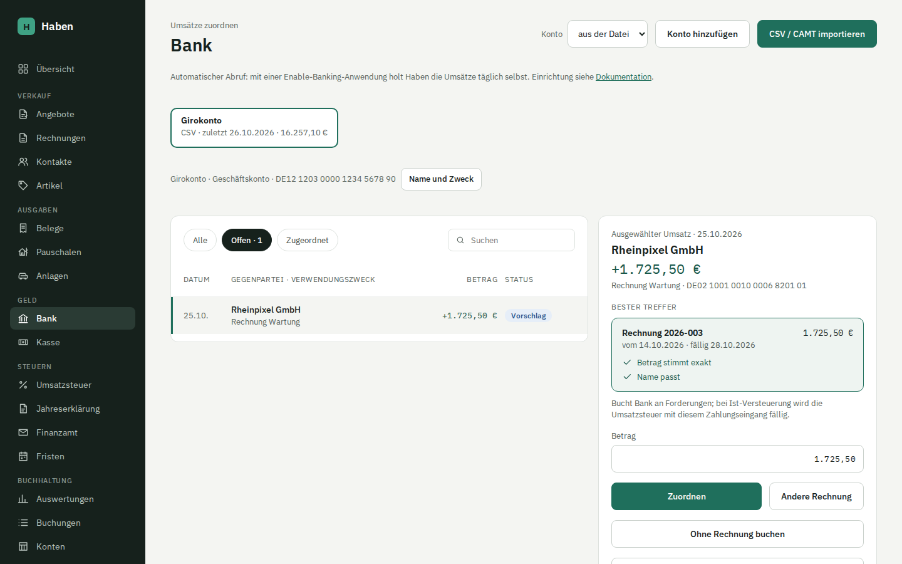

# Bankimport und Abgleich

Unter **Bank** holst du die Umsätze automatisch über Enable Banking ab oder importierst Kontoauszüge als Datei, und ordnest jeden Umsatz einer Rechnung, einem Beleg oder einer direkten Buchung zu. Haben schlägt passende offene Posten mit Begründung vor. Jede Zuordnung erzeugt sofort eine festgeschriebene Buchung.

## Automatischer Abruf

Ist Enable Banking eingerichtet (siehe [Installation](installation.md#kontoabruf-enable-banking)), steht unter **Bank** der Bereich **Automatischer Abruf** mit dem Knopf **Bank verbinden**.

1. **Bank verbinden** klicken, die Bank suchen und auswählen. Bietet die Bank beides an, wählst du Geschäfts- oder Privatkonto; das entscheidet, mit welchem Online-Banking-Zugang du dich gleich anmeldest.
2. **Weiter zur Bank** führt zur Anmeldeseite deiner Bank. Dort meldest du dich an, bestätigst mit TAN und wählst die Konten aus.
3. Die Bank leitet zurück zu Haben. Haben ordnet die freigegebenen Konten über die IBAN zu, legt fehlende an und holt sofort die ersten Umsätze. Neue Konten heißen nach Bank, Kontoname der Bank und den letzten vier Ziffern der IBAN, z. B. „Finom Geschäftskonto …7890“; die Meldung nach der Rückkehr nennt sie. Name und Zweck legst du danach mit **Name und Zweck** fest (siehe [Konto](#konto)).

Danach ruft Haben jede Verbindung einmal täglich ab, im Hintergrund und ohne dass du angemeldet sein musst. **Jetzt abrufen** holt die Umsätze sofort. Die Konten erscheinen wie gewohnt als Reiter, mit „Abruf“ statt „CSV“ und dem Kontostand der Bank.

### Zustimmung

Die Freigabe gilt nach PSD2 höchstens 180 Tage, bei manchen Banken weniger; das Datum steht an der Verbindung. Zwei Wochen vor Ablauf erscheint **Läuft bald ab** und der Knopf **Zustimmung erneuern**. Erneuern heißt: dieselbe Anmeldung bei der Bank noch einmal. Die neue Zustimmung löst die alte ab, und der Abruf macht dort weiter, wo er aufgehört hat. Lehnt die Bank den Zugriff ab, etwa weil du die Freigabe im Online-Banking widerrufen hast, steht die Verbindung auf **Abgelaufen**.

**Trennen** beendet die Zustimmung auch bei Enable Banking. Die schon abgerufenen Umsätze bleiben.

### Welche Umsätze abgerufen werden

- **Konto schon per Datei importiert:** Der erste Abruf beginnt am Tag nach dem letzten vorhandenen Umsatz. Banken schreiben den Verwendungszweck in der Schnittstelle oft anders als in der CSV; ein überlappender Zeitraum ergäbe sonst doppelte Umsätze.
- **Neues Konto:** ab dem 1. Januar des laufenden Jahres. Gibt die Bank so weit nicht zurück, die letzten 89 Tage; ältere Umsätze dann per Datei importieren.
- **Folgeabrufe** beginnen sieben Tage vor dem letzten Abruf. So kommen auch spät gebuchte Umsätze an; Doppelte erkennt Haben am Hash wie beim Dateiimport.
- **Vorgemerkte Umsätze** übernimmt Haben erst, wenn die Bank sie gebucht hat.
- **Konten ohne IBAN**, zum Beispiel Kreditkarten, ruft Haben nicht ab.

Der Dateiimport bleibt daneben möglich, etwa für ältere Zeiträume. Importierst du für ein abgerufenes Konto eine Datei mit Umsätzen, die schon abgerufen sind, können Doppelte entstehen, wenn die Bank den Verwendungszweck unterschiedlich liefert.

Jeder Abruf wird wie eine Datei als Import gespeichert, mit Zeitraum, Kontostand und Prüfsumme der API-Antwort. Die Bank zählt jeden Zugriff ohne dich; deshalb ruft Haben im Hintergrund höchstens einmal in 20 Stunden ab, auch nach einem Fehler.

## Unterstützte Formate

| Format | Erkennung | Eigene IBAN in der Datei | Salden |
| --- | --- | --- | --- |
| DKB-CSV (aktuelles Format) | Semikolon-CSV mit den Spalten Buchungsdatum, Zahlungspflichtige(r), Zahlungsempfänger(in), Betrag | ja | aus dem Kontostand im Dateikopf |
| DKB-CSV (Export bis 2023) | Semikolon-CSV mit Buchungstag, Auftraggeber/Begünstigter, Betrag | ja | aus dem Dateikopf |
| N26-CSV | Komma-CSV mit Booking Date bzw. Date, Amount, Partner Name bzw. Payee | nein | nein |
| CAMT.053 (XML) | Tagesauszug `BkToCstmrStmt` | ja | Anfangs- und Endsaldo des Auszugs |
| PayPal | Aktivitätenexport (CSV), Spalten deutsch (Brutto, Gebühr, Netto, Transaktionscode) oder englisch (Gross, Fee, Net, Transaction ID) | nein, in das Konto des [Zahlungsdienstleisters](#zahlungsdienstleister) | Guthaben aus den Umsätzen |
| Stripe | Saldenverlauf („Balance history“), alter Export (id, Type, Amount, Fee, Net, Available On) und neuer (balance_transaction_id, gross, fee, net, reporting_category) | nein, wie oben | wie oben |
| Shopify Payments | Transaktionsexport mit Payout ID, Payout Date, Amount, Fee, Net | nein, wie oben | wie oben |

Bank und Format erkennt Haben am Inhalt, nicht am Dateinamen. CAMT.052 und CAMT.054 werden mit einer eigenen Meldung abgelehnt; nur der Tagesauszug CAMT.053 wird gelesen.

Die Zeichenkodierung wird ebenfalls erkannt: UTF-8 mit oder ohne BOM, UTF-16 mit BOM, und alles, was kein gültiges UTF-8 ist, als Windows-1252 (ältere DKB-Exporte).

Beim Lesen gilt außerdem:

- Vorgemerkte Umsätze (DKB, CAMT-Status `PDNG`) werden übersprungen; Haben meldet ihre Anzahl.
- CAMT-Sammelbuchungen mit eigenen Einzelbeträgen werden in einzelne Umsätze aufgeteilt. Ergeben die Einzelbeträge nicht den Gesamtbetrag, kommt ein Hinweis.
- Fremdwährungen in der Datei werden gemeldet; Haben bucht nur in Euro.

## So gehst du vor

1. Bei deiner Bank die Umsätze als CSV oder CAMT.053 exportieren.
2. Unter **Bank** auf **CSV / CAMT importieren** klicken und eine oder mehrere Dateien wählen (bis 20 MB je Datei).
3. Haben meldet je Datei „… neue Umsätze für …“ und wie viele schon vorhanden waren, dazu Hinweise und eine eventuelle Lücke.
4. Links die offenen Umsätze durchgehen, rechts zuordnen.

### Konto

Nennt die Datei eine IBAN (DKB, CAMT), legt Haben das Konto beim ersten Import automatisch an und ordnet spätere Importe darüber zu. Als Name dient der Kontoname aus der Datei oder „Konto …“ mit den letzten vier Ziffern der IBAN.

### Name und Zweck

Unter den Reitern stehen Name, Zweck und IBAN des gewählten Kontos. Mit **Name und Zweck** änderst du beides, auch für Konten aus dem automatischen Abruf oder dem Dateiimport. Der Name ist nur Anzeige: Umsätze bleiben am Konto, und spätere Importe findet Haben weiter über die IBAN. Die Änderung steht im Änderungsprotokoll.

Viele Selbständige haben bei derselben Bank mehrere Konten, etwa ein Geschäftskonto und ein Steuerkonto, auf das sie die Umsatzsteuer zurücklegen und von dem das Finanzamt per Lastschrift einzieht. Der Zweck sagt Haben, wofür ein Konto dient:

| Zweck | Wirkung |
| --- | --- |
| Geschäftskonto (Standard) | wie bisher; sein Kontostand steht in der Übersicht |
| Steuerkonto | Vorbelegung für [Bankverbindung ändern](finanzamt.md#bankverbindung-ändern); Lastschriften und Erstattungen der Umsatzsteuer auf diesem Konto bekommen „Umsatzsteuer an das Finanzamt“ als Vorschlag; die Übersicht zeigt den Stand neben der noch offenen Zahllast (abzüglich schon zugeordneter Zahlungen an das Finanzamt nach Ende des Zeitraums) und warnt, wenn er nicht reicht |
| Rücklagen- oder Sparkonto | Überträge zu und von eigenen Konten bekommen „Geldtransit“ als Vorschlag |
| Privatkonto (nur zur Zuordnung) | Überweisungen dorthin oder von dort bekommen „Privat“ als Vorschlag. Das Konto legst du mit **Konto hinzufügen** an, ohne Umsätze zu importieren. |

Jedes Konto hat einen Zweck. Gebucht wird weiter auf das eine Bankkonto (1200 bzw. 1800); welche IBAN auf Rechnungen steht, bestimmen die Firmendaten.

N26-Exporte enthalten keine eigene IBAN. Dafür legst du das Konto vorher mit **Konto hinzufügen** an (Name und IBAN) und wählst es vor dem Import in der Auswahl **Konto** aus. Steht die Auswahl auf „aus der Datei“, lehnt Haben eine Datei ohne IBAN ab.

Wählst du ein Konto aus und die Datei nennt eine andere IBAN, bricht der Import mit einer Meldung ab.

Über der Liste steht je Konto ein Reiter mit Format und Datum des letzten Imports und dem Endsaldo. Ist der letzte Import älter als sieben Tage, ist die Angabe hervorgehoben.

## Was beim Import passiert

### Dubletten

Jeder Umsatz bekommt einen Hash aus Buchungsdatum, Betrag, IBAN der Gegenseite und Verwendungszweck (Leerzeichen und Groß-/Kleinschreibung vereinheitlicht). Dazu kommt ein Zähler für gleiche Umsätze innerhalb derselben Datei: Zwei echte, identische Buchungen am selben Tag bekommen so verschiedene Hashes (Zähler 0 und 1) und werden beide übernommen.

Umsätze, deren Hash es für das Konto schon gibt, überspringt Haben. Du kannst also überlappende Zeiträume oder dieselbe Datei noch einmal importieren, ohne doppelte Umsätze zu bekommen. Während eines Imports ist das Konto gesperrt, damit parallele Importe nichts doppelt anlegen.

### Saldenprüfung

Haben vergleicht den Anfangssaldo der neuen Datei mit dem Endsaldo des vorigen Imports desselben Kontos. Passen sie nicht zusammen und überschneiden sich die Zeiträume nicht, meldet Haben eine Lücke mit Differenz, etwa: „Lücke: Anfangssaldo … passt nicht zum Endsaldo … des vorigen Imports. … vermutlich fehlen Umsätze dazwischen.“ Importiert wird trotzdem.

Bei DKB-CSV leitet Haben die Salden aus dem Kontostand im Dateikopf ab, wenn dessen Datum zum Zeitraum der Umsätze passt. N26-CSV hat keine Salden; dort entfällt die Prüfung.

### Unveränderlichkeit

Importe, Umsätze und Zuordnungen lassen sich nur ergänzen. Datenbank-Trigger lehnen jedes Ändern oder Löschen ab. Ein Fehler wird nicht überschrieben, sondern mit einer Gegenzeile aufgehoben (siehe [Zuordnung aufheben](#zuordnung-aufheben)).

## Umsatzliste

Die Filter **Alle**, **Offen** (mit Anzahl) und **Zugeordnet** schränken die Liste ein, das Suchfeld durchsucht Gegenpartei, Verwendungszweck und Betrag. Angezeigt werden höchstens 500 Umsätze.

| Hinweis | Bedeutung |
| --- | --- |
| Vorschlag | Es gibt einen passenden offenen Posten. |
| Teilweise | Ein Teil des Umsatzes ist zugeordnet. |
| Beleg fehlt | Ausgabe ohne Zuordnung und ohne Vorschlag. |
| Offen | Eingang ohne Zuordnung und ohne Vorschlag. |
| Zugeordnet | Der ganze Betrag ist zugeordnet. |

Der Hinweis „Vorschlag“ in der Liste rechnet wie die Detailansicht, also auch mit der IBAN der Gegenseite.

## Vorschläge

Für den noch offenen Teil eines Umsatzes sucht Haben unter den offenen Posten: festgeschriebene Rechnungen und Rechnungskorrekturen, die nicht storniert und nicht voll bezahlt sind, und gebuchte Belege mit Bezahlung über das Geschäftskonto. Infrage kommen nur Posten in derselben Richtung: Eingänge für Rechnungen, Ausgänge für Belege und Rechnungskorrekturen.

Jeder Posten bekommt Punkte:

| Grund (wie angezeigt) | Punkte |
| --- | ---: |
| Betrag stimmt exakt | 50 |
| Rechnungsnummer im Verwendungszweck | 40 |
| IBAN bekannt vom Kontakt | 30 |
| Name passt | 15 |
| Datum passt (± 5 Tage), nur bei Belegen, gemessen an Beleg- oder Fälligkeitsdatum | 10 |
| Teilbetrag des offenen Betrags | 5 |

Die Rechnungsnummer wird ohne Leer- und Trennzeichen gesucht, `2026-034` findet also auch `2026034`. Beim Namen zählen gemeinsame Wörter ab drei Buchstaben; Rechtsformen wie GmbH, UG oder AG werden ignoriert.

Vorgeschlagen wird ein Posten erst ab 40 Punkten. Ein exakter Betrag reicht allein, ein passender Name allein nicht. Rechts erscheint der beste Treffer als **Bester Treffer** mit allen Gründen; bei Gleichstand gewinnt der ältere Posten.

## Zuordnen

1. Umsatz links anklicken. Ohne Auswahl ist der erste offene Umsatz gewählt.
2. Rechts den **besten Treffer** prüfen, oder mit **Andere Rechnung** einen anderen offenen Posten aus der Auswahl **Rechnung oder Beleg** nehmen.
3. **Betrag** prüfen. Vorbelegt ist der kleinere Wert aus offenem Umsatz und offenem Posten.
4. **Zuordnen** klicken. Ist der Umsatz damit ganz zugeordnet, springt die Auswahl zum nächsten offenen Umsatz, am Ende der Liste wieder von vorn.

Tastatur: **Enter** ordnet zu, solange der Fokus nicht in einem Eingabefeld, auf einem Knopf oder Link liegt. **J** springt zum nächsten, **K** zum vorigen Umsatz.

### Teilzahlungen und mehrere Zuordnungen

Ein Umsatz kann auf mehrere Posten verteilt werden: Betrag verringern, zuordnen, dann für den Rest den nächsten Posten wählen. Rechts steht dann „Noch offen: …“, in der Liste „Teilweise“. Umgekehrt kann eine Rechnung über mehrere Zahlungen bezahlt werden; sie steht bis zum vollen Betrag als „Teilbezahlt“ bzw. „Überfällig“ in der [Rechnungsliste](rechnungen.md#rechnungsliste-und-status).

Haben prüft bei jeder Zuordnung, dass der Betrag das Vorzeichen des Umsatzes hat, nicht größer ist als der offene Teil des Umsatzes und nicht größer als der offene Betrag der Rechnung bzw. des Belegs. Ein Datenbank-Trigger prüft Vorzeichen und Umsatzbetrag ein zweites Mal, und zwar am Ende der Transaktion, damit er bei einer [Aufteilung](#aufteilen-splitbuchung) alle Teile zusammen sieht.

Beim ersten Zahlungseingang auf eine Rechnung merkt sich Haben die IBAN der Gegenseite am Kontakt, wenn dort noch keine steht. Spätere Zahlungen bekommen dadurch den Grund „IBAN bekannt vom Kontakt“.

### Aufteilen (Splitbuchung)

Zahlungsdienstleister wie PayPal, Stripe, Shopify Payments oder Etsy zahlen selten den Rechnungsbetrag aus: Sie behalten ihre Gebühr ein. Steuerlich gilt trotzdem das Bruttoprinzip: Die Rechnung ist voll bezahlt (voller Erlös, bei Ist-Versteuerung die volle Umsatzsteuer), die Gebühr ist eine Ausgabe. Dafür teilst du den Umsatz auf.

**Rest als Gebühr:** Ist die gewählte Rechnung höher als der offene Umsatz, erscheint der Knopf **Voll zuordnen, Rest … als Gebühr**. Er ordnet die Rechnung mit ihrem vollen offenen Betrag zu und bucht die Differenz als Kontoführung und Bankgebühren (Nebenkosten des Geldverkehrs, 4970 bzw. 6855).

Beispiel: Rechnung über 4.760,00 €, PayPal zahlt 4.700,00 € aus.

| Konto SKR03 | Konto SKR04 | Soll | Haben |
| --- | --- | ---: | ---: |
| 1200 Bank | 1800 Bank | 4.760,00 | |
| 1400 Forderungen | 1200 Forderungen | | 4.760,00 |
| 4970 Nebenkosten des Geldverkehrs | 6855 Nebenkosten des Geldverkehrs | 60,00 | |
| 1200 Bank | 1800 Bank | | 60,00 |

Auf der Bank bleiben 4.700,00 €, die Rechnung steht auf „Bezahlt“. Bei Ist-Versteuerung kommt wie bei jedem Zahlungseingang die Umbuchung der Umsatzsteuer auf den vollen Rechnungsbetrag dazu (siehe [Buchungen](#buchungen)).

**Frei aufteilen:** Mit **Aufteilen** verteilst du den offenen Teil eines Umsatzes auf beliebig viele Teile. Jeder Teil hat ein Ziel (Rechnung, gebuchter Beleg oder eine Art aus **Ohne Rechnung buchen**) und einen Betrag mit dem Vorzeichen, mit dem er das Konto bewegt: Zahlungseingänge positiv, Gebühren und Ausgänge negativ. Zur Auswahl stehen auch Posten in Gegenrichtung, etwa ein gebuchter Gebührenbeleg des Dienstleisters in einer Auszahlung; so laufen Vorsteuer bzw. § 13b über den Beleg. **Aufteilen und buchen** ist erst möglich, wenn die Teile zusammen genau den offenen Betrag ergeben. Jeder Teil wird einzeln gebucht, alle in einem Schritt.

Teile einer Aufteilung hebst du nur gemeinsam auf (**Aufteilung aufheben**): Allein ergäbe ein Teil nicht mehr den Umsatz, etwa bliebe die Gebühr ohne den Erlös stehen.

### Rest ausbuchen: Skonto und Forderungsausfall

Zahlt ein Kunde weniger als die Rechnung, ist der Rest nicht immer eine Gebühr: Er hat Skonto abgezogen, oder der Rest ist nicht mehr einzutreiben. Ist die gewählte Rechnung höher als der Zahlungseingang, bietet Haben deshalb auch **Rest … als Skonto** und **Rest … als Forderungsausfall** an. Die Zahlung wird der Rechnung zugeordnet und der Rest mit dem Datum des Umsatzes ausgebucht. Die Rechnung ist danach erledigt („Bezahlt“ bzw. bei Forderungsausfall „Ausgebucht“).

Der ausgebuchte Rest mindert Erlöse und Umsatzsteuer anteilig je Steuersatz (§ 17 UStG):

| Konto SKR03 | Konto SKR04 | Soll | Haben |
| --- | --- | ---: | ---: |
| 8730 Gewährte Skonti bzw. 2400 Forderungsverluste | 4730 bzw. 6930 | 80,00 | |
| 1776 Umsatzsteuer 19 % (bei Ist 1766 nicht fällig) | 3806 (bei Ist 3816) | 15,20 | |
| 1400 Forderungen | 1200 Forderungen | | 95,20 |

Beispiel: Rechnung 4.760,00 €, der Kunde überweist 4.664,80 € (2 % Skonto). Bei Soll-Versteuerung mindert das Skonto die Umsatzsteuer in der Voranmeldung des Monats, in dem ausgebucht wird. Bei Ist-Versteuerung wird ohnehin nur fällig, was bezahlt ist; Haben mindert dann die noch nicht fällige Umsatzsteuer.

Hast du selbst Skonto abgezogen, liegt die Abbuchung unter dem Beleg. Dann gibt es **Rest … als erhaltenes Skonto**: Verbindlichkeiten an 3730 bzw. 5730 Erhaltene Skonti und an Vorsteuer, anteilig je Steuersatz; die Vorsteuer in der Voranmeldung sinkt im Monat der Ausbuchung. Ohne Vorsteuerabzug (Kleinunternehmer) mindert das Skonto den Aufwand brutto. Bei Belegen mit § 13b, mit Privatanteil oder für Anlagen gibt es das nicht.

Einen Forderungsausfall ohne Zahlung, etwa bei Insolvenz des Kunden, buchst du auf der Seite der Rechnung unter **Ausbuchen** (siehe [Rechnungen](rechnungen.md#ausbuchen)). Hebst du die Zuordnung einer Zahlung auf, hebt Haben einen mit ihr ausgebuchten Rest mit auf.

### Vorschläge ohne Rechnung und Geldtransit

Gibt es keinen passenden offenen Posten, schlägt Haben anhand der Kontozwecke eine Buchung ohne Rechnung vor, mit Begründung unter **Vorschlag ohne Rechnung**. Der Umsatz steht dann in der Liste auf „Vorschlag“.

- **Gegenkonto ist ein eigenes Konto** (Gegen-IBAN gehört zu einem deiner Konten): Geldtransit; ist eines der beiden ein Privatkonto, Privat.
- **Steuerkonto, Gegenpartei ist das Finanzamt** (Finanzamt, Finanzkasse, Landeshauptkasse, Bundeskasse und ähnliche) **und der Verwendungszweck nennt die Umsatzsteuer** („USt“, „Umsatzsteuer“, „Voranmeldung“): Umsatzsteuer an das Finanzamt. Nennt er eine andere Steuer (Einkommensteuer, Kirchensteuer, Gewerbesteuer, Kfz-Steuer …) oder gar keine, gibt es keinen Vorschlag: Auf dem Steuerkonto liegt oft auch die Rücklage für die private Einkommensteuer. Auf anderen Konten schlägt Haben die Umsatzsteuer nie vor.

Bei einem Geldtransit sucht Haben auf dem anderen Konto die Gegenbuchung: gleicher Betrag mit umgekehrtem Vorzeichen, höchstens fünf Tage auseinander, noch ganz offen, und als Gegenkonto das Ausgangskonto (fehlt die Gegen-IBAN, nimmt Haben sie nur, wenn es keine mit passender IBAN gibt). Eine fremde Zahlung über denselben Betrag, etwa eine Erstattung des Finanzamts, ist nie die Gegenbuchung. Gibt es sie, bucht **Beide Seiten als Geldtransit buchen** beide Umsätze in einem Schritt über das Geldtransitkonto (1360 bzw. 1460), wo sie sich aufheben. Das monatliche Zurücklegen der Umsatzsteuer erzeugt so nur noch einen Klick statt zwei Zuordnungen.

### Ohne Rechnung buchen

Für Umsätze ohne Rechnung oder Beleg klickst du **Ohne Rechnung buchen**, wählst unter **Buchen als** die Art und klickst **Buchen**.

| Auswahl | Gegenkonto SKR03 | Gegenkonto SKR04 |
| --- | --- | --- |
| Privat (Entnahme oder Einlage) | Ausgang: 1800 Privatentnahmen, Eingang: 1890 Privateinlagen | Ausgang: 2100, Eingang: 2180 |
| Geldtransit (eigenes Konto) | 1360 | 1460 |
| Umsatzsteuer an das Finanzamt | 1780 | 3820 |
| Kontoführung und Bankgebühren | 4970 | 6855 |
| Mahngebühren und Verzugszinsen (vom Kunden) | 2650 | 7100 |

Für Ausgaben mit Rechnung gilt: erst den Beleg unter [Belege](belege.md) hochladen und buchen, dann hier zuordnen. Direkt gebuchte Ausgaben haben keine Vorsteuer.

## Zahlungsdienstleister

PayPal, Stripe, Shopify Payments, Etsy oder SumUp führen ein eigenes Guthaben: Kunden zahlen dorthin, der Dienstleister behält Gebühren ein, zieht Erstattungen und Rückbuchungen ab und zahlt den Rest gesammelt auf dein Bankkonto aus. Eine Auszahlung auf der Bank entspricht dann vielen Rechnungen abzüglich vieler Gebühren. Dafür legst du den Dienstleister als eigenes Konto an.

1. Auf der Seite **Bank** **Konto hinzufügen**, Art **Zahlungsdienstleister**, den Dienstleister und einen Namen wählen. Das Konto hat keine IBAN, aber ein eigenes Verrechnungskonto: SKR03 1361 bis 1369, SKR04 1461 bis 1469, je Dienstleister eine Nummer.
2. Beim Dienstleister den Export herunterladen (PayPal: Aktivitäten als CSV; Stripe: Saldenverlauf; Shopify Payments: Transaktionen) und unter **CSV / CAMT importieren** einlesen, mit dem Konto des Dienstleisters unter **Konto**. In ein Bankkonto lässt sich so ein Export nicht importieren und umgekehrt.
3. Jede Zeile des Exports wird zu bis zu zwei Umsätzen: dem Bruttobetrag (Kundenzahlung, Erstattung, Auszahlung) und der einbehaltenen Gebühr. Nur abgeschlossene Zeilen in Euro werden übernommen; die übrigen meldet Haben. Shopify nennt Auszahlungen nicht als eigene Zeile: Haben bildet je ausgezahlter Auszahlungs-ID einen Umsatz über die Summe der Nettobeträge am Auszahlungstag. Exportiere deshalb immer ganze Auszahlungszeiträume.
4. Zahlungen ordnest du wie auf der Bank den Rechnungen zu, mit dem vollen Bruttobetrag. Der Erlös und bei Ist-Versteuerung die Umsatzsteuer zählen damit am Tag der Zahlung beim Dienstleister, nicht erst bei der Auszahlung.
5. Gebühren buchst du **ohne Rechnung** als Kontoführung und Bankgebühren, oder du ordnest sie der monatlichen Sammelrechnung des Dienstleisters zu (siehe unten).
6. Auszahlungen sind Geldtransit: Im Konto des Dienstleisters schlägt Haben bei einer Auszahlung „Geldtransit“ vor und sucht auf den Bankkonten den Eingang über denselben Betrag (± 5 Tage), dessen Gegenpartei der Dienstleister ist. **Beide Seiten als Geldtransit buchen** ordnet beide zu. Umgekehrt erkennt Haben auf der Bank einen Eingang von „PayPal …“ als Auszahlung, aber nur, wenn es im PayPal-Konto die passende Auszahlung gibt; eine mit PayPal bezahlte Rechnung auf dem Bankkonto ist kein Geldtransit.

Gebucht wird auf das Verrechnungskonto des Dienstleisters statt auf die Bank. Ist alles zugeordnet, steht es auf null, sobald das Guthaben ausgezahlt ist. Am Reiter des Kontos steht das Guthaben laut den importierten Umsätzen.

**Sammelrechnung der Gebühren:** Stellt der Dienstleister die Gebühren monatlich in Rechnung (mit Umsatzsteuer oder als § 13b), lädst du die Rechnung unter [Belege](belege.md) hoch und buchst sie. Dann wählst du im Konto des Dienstleisters eine Gebühr, unter **Andere Rechnung** diesen Beleg und klickst **Alle offenen Gebühren aus … diesem Beleg zuordnen**. Haben ordnet alle noch offenen Gebühren des Monats dem Beleg zu, bis er erledigt ist; Vorsteuer bzw. § 13b laufen einmal über den Beleg. Fehlt die Rechnung noch, bleiben die Gebühren offen.

In der **Übersicht** erscheinen Umsätze eines Dienstleisters, die seit über zwei Wochen offen sind, und ein Geldtransit ohne Gegenseite: Bleibt auf dem Geldtransitkonto ein Saldo stehen, fehlt zu einem Übertrag oder einer Auszahlung die andere Seite.

## Buchungen

Gebucht wird mit dem Buchungsdatum des Bankumsatzes.

**Zahlungseingang auf eine Rechnung**, Beispiel 1.190,00 € auf eine Rechnung zu 19 %:

| Konto SKR03 | Konto SKR04 | Soll | Haben |
| --- | --- | ---: | ---: |
| 1200 Bank | 1800 Bank | 1.190,00 | |
| 1400 Forderungen | 1200 Forderungen | | 1.190,00 |

Bei **Ist-Versteuerung** kommt die Umbuchung der Steuer dazu; erst damit wird sie fällig und erscheint in der [Voranmeldung](umsatzsteuer.md):

| Konto SKR03 | Konto SKR04 | Soll | Haben |
| --- | --- | ---: | ---: |
| 1766 USt nicht fällig 19 % | 3816 USt nicht fällig 19 % | 190,00 | |
| 1776 Umsatzsteuer 19 % | 3806 Umsatzsteuer 19 % | | 190,00 |

Bei Teilzahlungen wird nur der Steueranteil der Zahlung umgebucht, bei mehreren Steuersätzen anteilig je Satz. Rundungsreste schlägt Haben dem größten Posten zu, damit die Summe stimmt.

**Zahlung eines Belegs**, Beispiel 119,00 €:

| Konto SKR03 | Konto SKR04 | Soll | Haben |
| --- | --- | ---: | ---: |
| 1600 Verbindlichkeiten | 3300 Verbindlichkeiten | 119,00 | |
| 1200 Bank | 1800 Bank | | 119,00 |

**Direkte Buchung**, Beispiel Bankgebühr 9,90 €:

| Konto SKR03 | Konto SKR04 | Soll | Haben |
| --- | --- | ---: | ---: |
| 4970 Nebenkosten Geldverkehr | 6855 Nebenkosten Geldverkehr | 9,90 | |
| 1200 Bank | 1800 Bank | | 9,90 |

Bei Eingängen (Privateinlage, Geldtransit, Erstattung vom Finanzamt) steht die Bank im Soll und das Gegenkonto im Haben.

> [!IMPORTANT]
> Die Konten stammen aus `packages/core/src/posting.ts`. Gleiche sie vor dem Echtbetrieb mit deiner Steuerberatung ab.

## Zuordnung aufheben

Unter **Zugeordnet** steht neben jeder Zuordnung **Aufheben**, bei einer Aufteilung einmal **Aufteilung aufheben** für alle Teile. Haben löscht dabei nichts: Es legt eine Gegenzeile mit umgekehrtem Betrag an und bucht die ursprüngliche Buchung mit vertauschten Seiten zurück („Storno: …“), ebenfalls mit dem Buchungsdatum des Umsatzes. Die aufgehobene Zuordnung bleibt durchgestrichen sichtbar, der Betrag ist wieder offen.

Eine Zuordnung lässt sich nur einmal aufheben.

## Grenzen

- Automatischer Abruf nur über Enable Banking (PSD2), nicht über FinTS/HBCI. Ohne Enable Banking kommen die Umsätze per Datei.
- Dateiimport nur für DKB, N26 und CAMT.053. Andere Banken gehen, wenn sie CAMT.053 exportieren. Zahlungsdienstleister: PayPal, Stripe und Shopify Payments per CSV; Etsy, SumUp und andere lassen sich anlegen, aber noch nicht importieren.
- Zahlungsdienstleister nur in Euro; Zeilen in anderen Währungen (etwa ein USD-Guthaben bei PayPal) übernimmt Haben nicht und meldet sie.
- Kursdifferenzen bucht Haben nicht.
- Zuordnungen und ihre Aufhebung werden mit dem Buchungsdatum des Umsatzes gebucht. Hebst du eine Zuordnung in einem Monat auf, dessen Voranmeldung schon gesendet ist, ändern sich dessen berechnete Werte; die gesendete Anmeldung bleibt, wie sie ist, und die Seite des Monats weist auf die Abweichung hin (siehe [umsatzsteuer.md](umsatzsteuer.md)).
