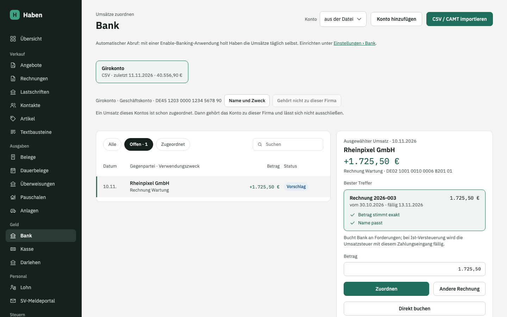

# Bankimport und Abgleich

Unter **Bank** holst du die Umsätze automatisch über Enable Banking ab oder importierst Kontoauszüge als Datei, und ordnest jeden Umsatz einer Rechnung, einem Beleg oder einer direkten Buchung zu. Haben schlägt passende offene Posten mit Begründung vor. Jede Zuordnung erzeugt sofort eine festgeschriebene Buchung.

## Automatischer Abruf

Ist Enable Banking eingerichtet (unter **Einstellungen › Bank**, siehe [Installation](installation.md#kontoabruf-enable-banking)), steht unter **Bank** der Bereich **Automatischer Abruf** mit dem Knopf **Bank verbinden**.

1. **Bank verbinden** klicken, die Bank suchen und auswählen. Gewählt ist die markierte Bank; bleibt nach der Suche nur eine übrig, ist sie schon gewählt. Unter der Liste steht, zu welcher Bank es weitergeht. Bietet die Bank beides an, wählst du Geschäfts- oder Privatkonto; das entscheidet, mit welchem Online-Banking-Zugang du dich gleich anmeldest. Unter **Umsätze abrufen ab** steht der Jahresbeginn; beginnt deine Buchhaltung in Haben später im Jahr, etwa nach einem Umzug, trägst du hier diesen Tag ein (siehe [Welche Umsätze abgerufen werden](#welche-umsätze-abgerufen-werden)).
2. **Weiter zur Bank** führt zur Anmeldeseite deiner Bank. Dort meldest du dich an, bestätigst mit TAN und wählst die Konten aus.
3. Die Bank leitet zurück zu Haben. Haben ordnet die freigegebenen Konten über die IBAN zu, legt fehlende an und holt sofort die ersten Umsätze. Neue Konten heißen nach Bank, Kontoname der Bank und den letzten vier Ziffern der IBAN, z. B. „Finom Geschäftskonto …7890“; die Meldung nach der Rückkehr nennt sie. Name und Zweck legst du danach mit **Name und Zweck** fest (siehe [Konto](#konto)).

Danach ruft Haben jede Verbindung einmal täglich ab, im Hintergrund und ohne dass du angemeldet sein musst. **Jetzt abrufen** holt die Umsätze sofort. Die Konten erscheinen wie gewohnt als Reiter, mit „Abruf“ statt „CSV“ und dem Kontostand der Bank.

### Zustimmung

Die Freigabe gilt nach PSD2 höchstens 180 Tage, bei manchen Banken weniger; das Datum steht an der Verbindung. Zwei Wochen vor Ablauf erscheint **Läuft bald ab** und der Knopf **Zustimmung erneuern**. Erneuern heißt: dieselbe Anmeldung bei der Bank noch einmal. Die neue Zustimmung löst die alte ab, und der Abruf macht dort weiter, wo er aufgehört hat. Lehnt die Bank den Zugriff ab, etwa weil du die Freigabe im Online-Banking widerrufen hast, steht die Verbindung auf **Abgelaufen**.

**Trennen** beendet die Zustimmung auch bei Enable Banking. Die schon abgerufenen Umsätze bleiben.

### Welche Umsätze abgerufen werden

- **Neues Konto:** ab dem 1. Januar des laufenden Jahres, oder ab dem Tag, den du unter **Umsätze abrufen ab** selbst einträgst. Manche Banken geben nur etwa 90 Tage zurück; lehnt die Bank den Zeitraum ab, holt Haben die letzten 89 Tage, nie aber Tage vor dem gewählten. Ältere Umsätze dann per Datei importieren.
- **Konto schon per Datei importiert:** Bleibt **Umsätze abrufen ab** auf der Vorgabe, beginnt der erste Abruf am Tag nach dem letzten vorhandenen Umsatz, auch wenn der im Vorjahr liegt. Mit einem selbst eingetragenen Tag gilt das, wenn die vorhandenen Umsätze bis zum Vortag oder darüber hinaus reichen; sonst beginnt der Abruf am eingetragenen Tag. Im Anschluss an vorhandene Umsätze gibt es keinen Rückfall auf die letzten 89 Tage: Lehnt die Bank den Zeitraum ab, meldet Haben einen Fehler, statt still eine Lücke zu lassen. Banken schreiben den Verwendungszweck in der Schnittstelle oft anders als in der CSV; ein überlappender Zeitraum ergäbe sonst doppelte Umsätze.
- **Zustimmung erneuert:** Bei Konten, die schon abgerufen wurden, macht der Abruf dort weiter, wo er aufgehört hat. **Umsätze abrufen ab** gilt nur für Konten, die noch nie abgerufen wurden; ein früher eingetragener Tag bleibt bei den anderen Konten erhalten.
- **Folgeabrufe** beginnen sieben Tage vor dem letzten Abruf. So kommen auch spät gebuchte Umsätze an; Doppelte erkennt Haben am Hash wie beim Dateiimport. Tage, die schon ein Dateiimport abdeckt, ruft Haben auch dabei nicht noch einmal ab: Der Folgeabruf beginnt frühestens am Tag nach dem letzten Umsatz aus einer Datei. Hast du beim Verbinden einen Tag unter **Umsätze abrufen ab** eingetragen, gehen auch Folgeabrufe nie vor diesen Tag zurück.
- **Vorgemerkte Umsätze** übernimmt Haben erst, wenn die Bank sie gebucht hat.
- **Kontostand:** Haben nimmt den gebuchten Saldo der Bank, bevorzugt den Tagesendsaldo (CLBD), sonst den aktuellen gebuchten Saldo (ITBD), und zwar den ersten, dessen Stichtag zum Abruf passt: nicht vor dem letzten Buchungstag, nicht nach dem Ende des Abrufs. Manche Banken melden den Tagesendsaldo nur bis gestern; mit einem Umsatz von heute gilt dann der gebuchte Saldo von heute. Verfügbare Salden mit Vormerkungen oder Kreditlinie übernimmt Haben nie.
- **Konten ohne IBAN**, zum Beispiel Kreditkarten, ruft Haben nicht ab.
- **Konten in Fremdwährung** ruft Haben nicht ab, weil es nur in Euro bucht. Manche Banken führen ein Unterkonto in US-Dollar unter derselben IBAN wie das Euro-Konto; die Meldung nach dem Verbinden nennt sie.

Der Dateiimport bleibt daneben möglich, etwa für ältere Zeiträume. Importierst du für ein abgerufenes Konto eine Datei mit Umsätzen, die schon abgerufen sind, können Doppelte entstehen, wenn die Bank den Verwendungszweck unterschiedlich liefert.

Jeder Abruf wird wie eine Datei als Import gespeichert, mit Zeitraum, Kontostand und Prüfsumme der API-Antwort. Die Bank zählt jeden Zugriff ohne dich; deshalb ruft Haben im Hintergrund höchstens einmal in 20 Stunden ab, auch nach einem Fehler.

## Unterstützte Formate

| Format | Erkennung | Eigene IBAN in der Datei | Salden |
| --- | --- | --- | --- |
| DKB-CSV (aktuelles Format) | Semikolon-CSV mit den Spalten Buchungsdatum, Zahlungspflichtige(r), Zahlungsempfänger(in), Betrag | ja | aus dem Kontostand im Dateikopf |
| DKB-CSV (Export bis 2023) | Semikolon-CSV mit Buchungstag, Auftraggeber/Begünstigter, Betrag | ja | aus dem Dateikopf |
| N26-CSV | Komma-CSV mit Booking Date bzw. Date, Amount, Partner Name bzw. Payee | nein | nein |
| Swan-CSV | Komma-CSV mit Kopfblock (IBAN, Alter und Neuer Kontostand, Von, Bis) und den Spalten Datum, Name, Verwendungszweck, Kredit EUR, Debit EUR | ja | Alter und Neuer Kontostand aus dem Kopfblock |
| CAMT.053 (XML) | Tagesauszug `BkToCstmrStmt` | ja | Anfangs- und Endsaldo des Auszugs |
| PayPal | Aktivitätenexport (CSV), Spalten deutsch (Brutto, Gebühr, Netto, Transaktionscode) oder englisch (Gross, Fee, Net, Transaction ID) | nein, in das Konto des [Zahlungsdienstleisters](#zahlungsdienstleister) | Guthaben aus den Umsätzen |
| Stripe | Saldenverlauf („Balance history“), alter Export (id, Type, Amount, Fee, Net, Available On) und neuer (balance_transaction_id, gross, fee, net, reporting_category) | nein, wie oben | wie oben |
| Shopify Payments | Transaktionsexport mit Payout ID, Payout Date, Amount, Fee, Net | nein, wie oben | wie oben |
| eBay | Transaktionsbericht (CSV), Spalten deutsch (Datum der Transaktionserstellung, Typ, Nettobetrag, Auszahlung Nr.) oder englisch (Transaction creation date, Type, Net amount, Payout ID) | nein, wie oben | wie oben |
| Etsy | Monatsabrechnung (CSV), Spalten deutsch (Datum, Art, Titel, Info, Betrag, Gebühren & Steuern, Netto) oder englisch (Date, Type, Title, Info, Amount, Fees & Taxes, Net) | nein, wie oben | wie oben |

Bank und Format erkennt Haben am Inhalt, nicht am Dateinamen. CAMT.052 und CAMT.054 werden mit einer eigenen Meldung abgelehnt; nur der Tagesauszug CAMT.053 wird gelesen.

Die Zeichenkodierung wird ebenfalls erkannt: UTF-8 mit oder ohne BOM, UTF-16 mit BOM, und alles, was kein gültiges UTF-8 ist, als Windows-1252 (ältere DKB-Exporte).

Beim Lesen gilt außerdem:

- Vorgemerkte Umsätze (DKB, CAMT-Status `PDNG`) werden übersprungen; Haben meldet ihre Anzahl.
- CAMT-Sammelbuchungen mit eigenen Einzelbeträgen werden in einzelne Umsätze aufgeteilt. Ergeben die Einzelbeträge nicht den Gesamtbetrag, kommt ein Hinweis.
- Fremdwährungen in der Datei werden gemeldet; Bankkonten führt Haben nur in Euro. Rechnungen und Belege in Fremdwährung gleichst du mit dem Euro-Betrag aus (siehe [Kursdifferenz](#kursdifferenz-bei-fremdwährung)).

## So gehst du vor

1. Bei deiner Bank die Umsätze als CSV oder CAMT.053 exportieren.
2. Unter **Bank** auf **CSV / CAMT importieren** klicken und eine oder mehrere Dateien wählen (bis 50 Dateien auf einmal, bis 20 MB je Datei).
3. Haben meldet je Datei „… neue Umsätze für …“ und wie viele schon vorhanden waren, dazu Hinweise und eine eventuelle Lücke.
4. Links die offenen Umsätze durchgehen, rechts zuordnen.

### Konto

Nennt die Datei eine IBAN (DKB, CAMT), legt Haben das Konto beim ersten Import automatisch an und ordnet spätere Importe darüber zu. Als Name dient der Kontoname aus der Datei oder „Konto …“ mit den letzten vier Ziffern der IBAN.

### Name und Zweck

Unter den Reitern stehen Name, Zweck und IBAN des gewählten Kontos. Mit **Name und Zweck** änderst du beides, auch für Konten aus dem automatischen Abruf oder dem Dateiimport. Der Name ist nur Anzeige: Umsätze bleiben am Konto, und spätere Importe findet Haben weiter über die IBAN. Die Änderung steht im Änderungsprotokoll.

Viele Selbständige haben bei derselben Bank mehrere Konten, etwa ein Geschäftskonto und ein Steuerkonto, auf das sie die Umsatzsteuer zurücklegen und von dem das Finanzamt per Lastschrift einzieht. Der Zweck sagt Haben, wofür ein Konto dient:

| Zweck | Wirkung |
| --- | --- |
| Geschäftskonto (Standard) | wie bisher; sein Kontostand steht in der Übersicht |
| Steuerkonto | Vorbelegung für [Bankverbindung ändern](finanzamt.md#bankverbindung-ändern); Lastschriften und Erstattungen der Umsatzsteuer auf diesem Konto bekommen „Umsatzsteuer an das Finanzamt“ als Vorschlag; die Übersicht zeigt den Stand neben der noch offenen Zahllast (abzüglich schon zugeordneter Zahlungen an das Finanzamt nach Ende des Zeitraums) und warnt, wenn er nicht reicht |
| Rücklagen- oder Sparkonto | Überträge zu und von eigenen Konten bekommen „Geldtransit“ als Vorschlag |
| Privatkonto (nur zur Zuordnung) | Überweisungen dorthin oder von dort bekommen „Privat“ als Vorschlag. Das Konto legst du mit **Konto hinzufügen** an, ohne Umsätze zu importieren. |

Jedes Konto hat einen Zweck. Gebucht wird weiter auf das eine Bankkonto (1200 bzw. 1800); welche IBAN auf Rechnungen steht, bestimmen die Firmendaten.

N26-Exporte enthalten keine eigene IBAN. Dafür legst du das Konto vorher mit **Konto hinzufügen** an (Name und IBAN) und wählst es vor dem Import in der Auswahl **Konto** aus. Steht die Auswahl auf „aus der Datei“, lehnt Haben eine Datei ohne IBAN ab.

Wählst du ein Konto aus und die Datei nennt eine andere IBAN, bricht der Import mit einer Meldung ab.

Über der Liste steht je Konto ein Reiter mit Format und Datum des letzten Imports und dem Endsaldo. Ist der letzte Import älter als sieben Tage, ist die Angabe hervorgehoben.

### Fremdes Konto ausschließen

Manchmal gehört ein Konto nicht zu dieser Firma, etwa wenn der Bankzugang auch das Konto einer zweiten Firma freigibt. Löschen geht nicht: Importierte Umsätze sind gesperrt. Stattdessen schließt du das Konto aus: Wähle es und klicke neben **Name und Zweck** auf **Gehört nicht zu dieser Firma**; nach einer Rückfrage ist es erledigt.

Das geht nur, **solange kein Umsatz des Kontos zugeordnet, verrechnet oder ausgebucht ist**, denn dann gehört das Konto zu dieser Firma. Hat das gewählte Konto schon eine Zuordnung, ist der Knopf gesperrt und nennt den Grund. Ein Zahlungsdienstleister lässt sich nicht ausschließen.

Ein ausgeschlossenes Konto:

- steht nicht mehr unter den Reitern und fehlt in Bankabgleich, Vorschlägen, Übersicht, Überweisungen und Lastschriften, in der Vorprüfung der Voranmeldung, in der Jahresauswahl und im [Jahresarchiv](auswertungen.md#jahresexport);
- wird beim automatischen Abruf übersprungen; die Verbindung selbst läuft für die anderen Konten weiter;
- nimmt keinen Import an: Eine Datei mit seiner IBAN oder mit diesem Konto als Ziel lehnt Haben mit einer Meldung ab.

Gelöscht wird nichts. Die Umsätze bleiben in der Datenbank, und der Schritt steht im [Änderungsprotokoll](buchhaltung.md#änderungsprotokoll). Unter **Ausgeschlossene Konten** am Ende der Seite siehst du die ausgeschlossenen Konten mit der Zahl ihrer Umsätze und nimmst ein Konto mit **… wieder aufnehmen** (mit dem Namen des Kontos) zurück; dann ist alles wie vorher da.

## Was beim Import passiert

### Dubletten

Jeder Umsatz bekommt einen Hash aus Buchungsdatum, Betrag, IBAN der Gegenseite und Verwendungszweck (Leerzeichen und Groß-/Kleinschreibung vereinheitlicht). Dazu kommt ein Zähler für gleiche Umsätze innerhalb derselben Datei: Zwei echte, identische Buchungen am selben Tag bekommen so verschiedene Hashes (Zähler 0 und 1) und werden beide übernommen.

Umsätze, deren Hash es für das Konto schon gibt, überspringt Haben. Du kannst also überlappende Zeiträume oder dieselbe Datei noch einmal importieren, ohne doppelte Umsätze zu bekommen. Während eines Imports ist das Konto gesperrt, damit parallele Importe nichts doppelt anlegen.

### Saldenprüfung

Haben vergleicht den Anfangssaldo der neuen Datei mit dem Endsaldo des vorigen Imports desselben Kontos. Passen sie nicht zusammen und überschneiden sich die Zeiträume nicht, meldet Haben eine Lücke mit Differenz, etwa: „Lücke: Anfangssaldo … passt nicht zum Endsaldo … des vorigen Imports. … vermutlich fehlen Umsätze dazwischen.“ Importiert wird trotzdem.

Bei DKB-CSV leitet Haben die Salden aus dem Kontostand im Dateikopf ab, wenn dessen Datum zum Zeitraum der Umsätze passt. Swan-CSV nennt beide Salden im Kopfblock. N26-CSV hat keine Salden; dort entfällt die Prüfung.

### Unveränderlichkeit

Importe, Umsätze, Zuordnungen und [Verrechnungen](#gegenläufige-umsätze-verrechnen) lassen sich nur ergänzen. Datenbank-Trigger lehnen jedes Ändern oder Löschen ab. Ein Fehler wird nicht überschrieben, sondern mit einer Gegenzeile aufgehoben (siehe [Zuordnung aufheben](#zuordnung-aufheben)).

## Umsatzliste

Die Filter **Alle**, **Offen** (mit Anzahl) und **Zugeordnet** (auch verrechnete Umsätze) schränken die Liste ein, das Suchfeld durchsucht Gegenpartei, Verwendungszweck und Betrag. Angezeigt werden höchstens 500 Umsätze.

| Hinweis | Bedeutung |
| --- | --- |
| Vorschlag | Es gibt einen passenden offenen Posten. |
| Teilweise | Ein Teil des Umsatzes ist zugeordnet. |
| Beleg fehlt | Ausgabe ohne Zuordnung und ohne Vorschlag. |
| Offen | Eingang ohne Zuordnung und ohne Vorschlag. |
| Zugeordnet | Der ganze Betrag ist zugeordnet. |
| Verrechnet | Mit einem gegenläufigen Umsatz verrechnet, ohne Buchung (siehe [Gegenläufige Umsätze verrechnen](#gegenläufige-umsätze-verrechnen)). |

Der Hinweis „Vorschlag“ in der Liste rechnet wie die Detailansicht, also auch mit der IBAN der Gegenseite.

## Vorschläge

Für den noch offenen Teil eines Umsatzes sucht Haben unter den offenen Posten: festgeschriebene Rechnungen und Rechnungskorrekturen, die nicht storniert und nicht voll bezahlt sind, gebuchte, nicht stornierte Belege mit Bezahlung über das Geschäftskonto und die Zahllast bzw. Erstattung abgegebener Voranmeldungen (siehe [Voranmeldung](#voranmeldung-zahllast-und-erstattung)). Infrage kommen nur Posten in derselben Richtung: Eingänge für Rechnungen, Ausgänge für Belege und Rechnungskorrekturen.

Jeder Posten bekommt Punkte:

| Grund (wie angezeigt) | Punkte |
| --- | ---: |
| Betrag stimmt exakt | 50 |
| Betrag stimmt mit … Skonto (…), in der Frist (siehe [Skonto auf eigene Rechnungen](#skonto-auf-eigene-rechnungen)) | 50 |
| Betrag passt bis auf eine Kursdifferenz (…), nur bei Fremdwährung (siehe [Kursdifferenz](#kursdifferenz-bei-fremdwährung)) | 30 |
| Rechnungsnummer im Verwendungszweck | 40 |
| Überweisung aus Haben (Referenz), nur bei Belegen | 60 |
| IBAN bekannt vom Kontakt bzw. bei Belegen IBAN des Lieferanten | 30 |
| Name passt | 15 |
| Datum passt (± 5 Tage), nur bei Belegen, gemessen an Beleg- oder Fälligkeitsdatum | 10 |
| Teilbetrag des offenen Betrags | 5 |

Die Rechnungsnummer wird ohne Leer- und Trennzeichen gesucht, `2026-034` findet also auch `2026034`. Beim Namen zählen gemeinsame Wörter ab drei Buchstaben; Rechtsformen wie GmbH, UG oder AG werden ignoriert.

Die IBAN des Lieferanten eines Belegs kennt Haben aus dem Kontakt, aus der E-Rechnung (BT-84) und aus einer [SEPA-Überweisung](belege.md#überweisen-sepa-datei) für diesen Beleg. Die IBAN aus der E-Rechnung zählt dabei nach derselben Regel wie für die SEPA-Datei ([Abweichende IBAN in der E-Rechnung](belege.md#abweichende-iban-in-der-e-rechnung)): nur, wenn sie der IBAN im Kontakt entspricht, am Beleg **IBAN der E-Rechnung nur für diesen Beleg** gewählt ist oder sie bei einem Kontakt ohne IBAN übernommen wurde. Solange am Beleg nichts entschieden ist oder **IBAN des Kontakts behalten** gewählt ist, bringt eine Zahlung an die IBAN aus der E-Rechnung keine Punkte für die IBAN; eine ausgetauschte Bankverbindung soll nicht vertrauenswürdig aussehen. Der Vorschlag kommt dann über Betrag, Rechnungsnummer und Name zustande. Die IBAN im Kontakt und die IBANs erzeugter SEPA-Überweisungen zählen immer.

Vorgeschlagen wird ein Posten erst ab 40 Punkten. Ein exakter Betrag reicht allein, ein passender Name allein nicht. Rechts erscheint der beste Treffer als **Bester Treffer** mit allen Gründen; bei Gleichstand gewinnt der ältere Posten.

### Voranmeldung: Zahllast und Erstattung

Jede gesendete oder [vermerkte](umsatzsteuer.md#abgabe-außerhalb-von-haben-vermerken) Voranmeldung ist ein offener Posten, die Zahllast als Ausgang, ein Überschuss als Eingang ([Zahlung an das Finanzamt](umsatzsteuer.md#zahlung-an-das-finanzamt)). Vorgeschlagen wird sie nur, wenn die Gegenpartei das Finanzamt ist (Finanzamt, Finanzkasse, Landeshauptkasse …) oder der Verwendungszweck die Umsatzsteuer nennt, und nie, wenn er eine andere Steuer oder die Sondervorauszahlung nennt. Punkte:

| Grund (wie angezeigt) | Punkte |
| --- | ---: |
| Betrag stimmt exakt | 50 |
| Zahllast und … Säumniszuschlag (§ 240 AO, … Monate): der Umsatz ist um genau den Säumniszuschlag höher; zugeordnet wird nur die Zahllast | 40 |
| Zeitraum im Verwendungszweck („USt 10/26“, „10.2026“, „Okt. 2026“, „Q3/26“, „3. VJ 2026“, „III/26“; ein Datum wie „05.10.26“ zählt nicht) | 40 |
| Finanzamt als Gegenpartei | 15 |
| Teilbetrag des offenen Betrags | 5 |

Wie bei Rechnungen ab 40 Punkten. Zwei Zeiträume mit gleicher Zahllast unterscheidet der Zeitraum im Verwendungszweck. Gebucht wird wie „Umsatzsteuer an das Finanzamt“ (SKR03 1780, SKR04 3820), mit dem Bezug auf die Voranmeldung; in der Liste der Zuordnungen steht er dahinter, etwa „Umsatzsteuer USt 10/2026“.

### Dauerbelege: noch zu prüfen

Belege aus einem [Dauerbeleg](belege.md#dauerbelege) (Miete, Versicherung, Leasing) entstehen ungebucht mit dem Status „Zu prüfen“ und sind deshalb noch kein offener Posten. Damit die Abbuchung trotzdem ihren Beleg findet, sucht Haben für einen Ausgang auch unter diesen Belegen, wenn sie über das Geschäftskonto bezahlt werden, mit denselben Punkten wie oben. Gezeigt werden nur Treffer, deren Betrag genau zum Umsatz passt, unter **Dauerbeleg, noch zu prüfen**:

- **Buchen und zuordnen** bucht den Beleg wie **Bestätigen und buchen** auf der Belegseite (Aufwand und Vorsteuer an Verbindlichkeiten, mit Belegdatum) und ordnet ihm in derselben Transaktion den Umsatz zu (Verbindlichkeiten an Bank). Fehlt dem Beleg etwas zum Buchen oder passt die Zuordnung nicht (etwa weil der Umsatz inzwischen zugeordnet ist), steht der Grund im Feld, und nichts ist gebucht.
- **Beleg prüfen** öffnet den Beleg; nach dem Buchen erscheint er hier als gewöhnlicher Vorschlag.

Haben bucht einen Dauerbeleg nie von selbst, auch nicht bei einem eindeutigen Treffer.

### Überweisungen aus Haben

Jede Überweisung einer [SEPA-Datei aus Haben](belege.md#überweisen-sepa-datei) trägt eine eigene Referenz (EndToEndId, `HABEN-` und 16 Hex-Ziffern). Taucht sie in der Abbuchung wieder auf, schlägt Haben den Beleg mit „Überweisung aus Haben (HABEN-…)“ vor, auch wenn der Betrag nach Skonto nicht mehr stimmt oder die Bank den Verwendungszweck kürzt. Gesucht wird die Referenz:

- in der EndToEndId des Umsatzes (CAMT.053: `Refs/EndToEndId`; Haben speichert sie, auch wenn die Bank eine eigene Referenz mitliefert),
- in der Referenz der Bank (DKB: Spalte „Kundenreferenz“),
- im Verwendungszweck, unabhängig von Leer- und Trennzeichen (manche Exporte schreiben `EREF: HABEN-…` dort hinein).

Zugeordnet wird wie immer erst mit **Zuordnen**. Wurde mit Skonto überwiesen, bleibt danach der Skontobetrag offen; ihn buchst du mit **Rest … als erhaltenes Skonto** aus.

### Lastschriften aus Haben

Für Rechnungen mit Zahlungsart [Lastschrift](rechnungen.md#lastschrift) erzeugt Haben eine [Sammeldatei](rechnungen.md#sammeldatei-für-die-bank). Jede Lastschrift darin trägt eine eigene Referenz (EndToEndId, `HABEN-…`), jeder Sammler eine Kennung (PmtInfId).

**Sammelgutschrift.** Die Bank schreibt jeden Sammler als eine Summe gut. Liefert der Auszug Einzelangaben (CAMT.053 mit `TxDtls`), zerlegt der Import die Summe schon in Einzelumsätze; jeder findet seine Rechnung über die Referenz wie unter [Überweisungen aus Haben](#überweisungen-aus-haben). Bleibt es eine Summe (etwa im CSV-Export der DKB), erkennt Haben sie am Betrag: Ergeben die noch nicht gutgeschriebenen Lastschriften eines Sammlers, oder alle Sammler desselben Einzugstags aus einer Datei, genau den Betrag, und liegt die Buchung zwischen einem Tag vor und 30 Tagen nach dem Einzugstag, steht rechts **Sammler einer Lastschriftdatei** mit den Rechnungen. **Auf … Rechnungen aufteilen** bucht jede Rechnung mit ihrem Betrag als Zahlung, als [Aufteilung](#aufteilen-splitbuchung).

**Rücklastschrift.** Gibt die Bank des Kunden eine Lastschrift zurück (etwa mangels Deckung oder nach einem Widerspruch innerhalb von acht Wochen), bucht deine Bank den Betrag zurück, oft mit einem Entgelt. Haben erkennt die Rückgabe an der Referenz der Lastschrift oder an einem Rückgabetext (RETURN, REJECT, REFUND, Rücklastschrift) zusammen mit „Rechnung …“ oder der Mandatsreferenz, und nur bei einer schon gutgeschriebenen Lastschrift. Passt mehr als eine Lastschrift (etwa nur die Mandatsreferenz bei mehreren Einzügen auf dasselbe Mandat), schlägt Haben nichts vor; dann ordnest du von Hand zu. Rechts steht dann **Rücklastschrift** mit Rechnung, Grund und Entgelt. Die Gründe stammen aus der Rückgabe (Anlage 3 des DFÜ-Abkommens, Kap. 7.1.7.12, `Rsn/Cd`), etwa AM04 „Rückgabe mangels Deckung“, AC04 „Konto aufgelöst“, MD01 „Kein gültiges Mandat“, MS02 „Rückgabe durch den Zahler“, MD06 „Erstattung auf Verlangen des Zahlers“ (Texte aus Anlage 3, Kap. 2.2.3.10.3, und EPC173-14 v8.1).

**Rechnung wieder öffnen** bucht den Betrag als negative Zahlung auf die Rechnung und das Entgelt als Kontoführung und Bankgebühren; beides ist eine Aufteilung und lässt sich nur zusammen aufheben. Die Sammelgutschrift davor hebst du erst auf, wenn die Rücklastschrift aufgehoben ist; sonst stünde die Rechnung doppelt offen. Die Rechnung ist wieder offen und steht unter **Lastschriften** zum erneuten Einzug (jetzt als Folgelastschrift), solange das Mandat gilt. Die Rückgabe zählt für den Verfall des Mandats wie ein Einzug (Rulebook Kap. 4.2: „even if rejected, returned or refunded“). Ob du das Entgelt beim Kunden einforderst, entscheidest du; dafür gibt es die [Mahnung](rechnungen.md#mahnwesen) mit Gebühr.

## Zuordnen

1. Umsatz links anklicken. Ohne Auswahl ist der erste offene Umsatz gewählt.
2. Rechts den **besten Treffer** prüfen, oder mit **Andere Rechnung** einen anderen offenen Posten aus der Auswahl **Rechnung, Beleg oder Voranmeldung** nehmen.
3. **Betrag** prüfen. Vorbelegt ist der kleinere Wert aus offenem Umsatz und offenem Posten.
4. **Zuordnen** klicken. Ist der Umsatz damit ganz zugeordnet, springt die Auswahl zum nächsten offenen Umsatz, am Ende der Liste wieder von vorn.

Tastatur: **Enter** ordnet zu, solange der Fokus nicht in einem Eingabefeld, auf einem Knopf oder Link liegt. **J** springt zum nächsten, **K** zum vorigen Umsatz.

### Teilzahlungen und mehrere Zuordnungen

Ein Umsatz kann auf mehrere Posten verteilt werden: Betrag verringern, zuordnen, dann für den Rest den nächsten Posten wählen. Rechts steht dann „Noch offen: …“, in der Liste „Teilweise“. Umgekehrt kann eine Rechnung über mehrere Zahlungen bezahlt werden; sie steht bis zum vollen Betrag als „Teilbezahlt“ bzw. „Überfällig“ in der [Rechnungsliste](rechnungen.md#rechnungsliste-und-status).

Haben prüft bei jeder Zuordnung, dass der Betrag das Vorzeichen des Umsatzes hat, nicht größer ist als der offene Teil des Umsatzes und nicht größer als der offene Betrag der Rechnung bzw. des Belegs. Ein Datenbank-Trigger prüft Vorzeichen und Umsatzbetrag ein zweites Mal, und zwar am Ende der Transaktion, damit er bei einer [Aufteilung](#aufteilen-splitbuchung) alle Teile zusammen sieht.

Beim ersten Zahlungseingang auf eine Rechnung merkt sich Haben die IBAN der Gegenseite am Kontakt, wenn dort noch keine steht. Spätere Zahlungen bekommen dadurch den Grund „IBAN bekannt vom Kontakt“.

### Aufteilen (Splitbuchung)

Zahlungsdienstleister wie PayPal, Stripe, Shopify Payments oder Etsy zahlen selten den Rechnungsbetrag aus: Sie behalten ihre Gebühr ein. Steuerlich gilt trotzdem das Bruttoprinzip: Die Rechnung ist voll bezahlt (voller Erlös, bei Ist-Versteuerung die volle Umsatzsteuer), die Gebühr ist eine Ausgabe. Dafür teilst du den Umsatz auf.

**Rest als Gebühr:** Ist die gewählte Rechnung höher als der offene Umsatz, erscheint der Knopf **Voll zuordnen, Rest … als Gebühr**. Er ordnet die Rechnung mit ihrem vollen offenen Betrag zu und bucht die Differenz als Kontoführung und Bankgebühren (Nebenkosten des Geldverkehrs, 4970 bzw. 6855).

Beispiel: Rechnung über 4.760,00 €, PayPal zahlt 4.700,00 € aus.

| Konto SKR03 | Konto SKR04 | Soll | Haben |
| --- | --- | ---: | ---: |
| 1200 Bank | 1800 Bank | 4.760,00 | |
| 1400 Forderungen | 1200 Forderungen | | 4.760,00 |
| 4970 Nebenkosten des Geldverkehrs | 6855 Nebenkosten des Geldverkehrs | 60,00 | |
| 1200 Bank | 1800 Bank | | 60,00 |

Auf der Bank bleiben 4.700,00 €, die Rechnung steht auf „Bezahlt“. Bei Ist-Versteuerung kommt wie bei jedem Zahlungseingang die Umbuchung der Umsatzsteuer auf den vollen Rechnungsbetrag dazu (siehe [Buchungen](#buchungen)).

**Frei aufteilen:** Mit **Aufteilen** verteilst du den offenen Teil eines Umsatzes auf beliebig viele Teile. Jeder Teil hat ein Ziel (Rechnung, gebuchter Beleg oder eine Art aus **Direkt buchen**) und einen Betrag mit dem Vorzeichen, mit dem er das Konto bewegt: Zahlungseingänge positiv, Gebühren und Ausgänge negativ. Zur Auswahl stehen auch Posten in Gegenrichtung, etwa ein gebuchter Gebührenbeleg des Dienstleisters in einer Auszahlung; so laufen Vorsteuer bzw. § 13b über den Beleg. **Aufteilen und buchen** ist erst möglich, wenn die Teile zusammen genau den offenen Betrag ergeben. Jeder Teil wird einzeln gebucht, alle in einem Schritt.

Teile einer Aufteilung hebst du nur gemeinsam auf (**Aufteilung aufheben**): Allein ergäbe ein Teil nicht mehr den Umsatz, etwa bliebe die Gebühr ohne den Erlös stehen.

### Rest ausbuchen: Skonto und Forderungsausfall

Zahlt ein Kunde weniger als die Rechnung, ist der Rest nicht immer eine Gebühr: Er hat Skonto abgezogen, oder der Rest ist nicht mehr einzutreiben. Ist die gewählte Rechnung höher als der Zahlungseingang, bietet Haben deshalb auch **Rest … als Skonto** und **Rest … als Forderungsausfall** an. Die Zahlung wird der Rechnung zugeordnet und der Rest mit dem Datum des Umsatzes ausgebucht. Die Rechnung ist danach erledigt („Bezahlt“ bzw. bei Forderungsausfall „Ausgebucht“).

Der ausgebuchte Rest mindert Erlöse und Umsatzsteuer anteilig je Steuersatz (§ 17 UStG):

| Konto SKR03 | Konto SKR04 | Soll | Haben |
| --- | --- | ---: | ---: |
| 8730 Gewährte Skonti bzw. 2400 Forderungsverluste | 4730 bzw. 6930 | 80,00 | |
| 1776 Umsatzsteuer 19 % (bei Ist 1766 nicht fällig) | 3806 (bei Ist 3816) | 15,20 | |
| 1400 Forderungen | 1200 Forderungen | | 95,20 |

Beispiel: Rechnung 4.760,00 €, der Kunde überweist 4.664,80 € (2 % Skonto). Bei Soll-Versteuerung mindert das Skonto die Umsatzsteuer in der Voranmeldung des Monats, in dem ausgebucht wird. Bei Ist-Versteuerung wird ohnehin nur fällig, was bezahlt ist; Haben mindert dann die noch nicht fällige Umsatzsteuer.

Hast du selbst Skonto abgezogen, liegt die Abbuchung unter dem Beleg. Dann gibt es **Rest … als erhaltenes Skonto**: Verbindlichkeiten an 3730 bzw. 5730 Erhaltene Skonti und an Vorsteuer, anteilig je Steuersatz; die Vorsteuer in der Voranmeldung sinkt im Monat der Ausbuchung. Ohne Vorsteuerabzug (Kleinunternehmer) mindert das Skonto den Aufwand brutto. Bei Belegen mit § 13b, mit Privatanteil oder für Anlagen gibt es das nicht.

Einen Forderungsausfall ohne Zahlung, etwa bei Insolvenz des Kunden, buchst du auf der Seite der Rechnung unter **Ausbuchen** (siehe [Rechnungen](rechnungen.md#ausbuchen)). Hebst du die Zuordnung einer Zahlung auf, hebt Haben einen mit ihr ausgebuchten Rest mit auf.

### Skonto auf eigene Rechnungen

Steht auf deiner Rechnung [Skonto](rechnungen.md#skonto), rechnet Haben für jede Stufe den Zahlbetrag aus. Geht bis zum letzten Tag einer Frist (Buchungsdatum des Umsatzes) genau dieser Betrag ein – endet die Frist an einem Samstag, Sonntag oder Feiertag, auch noch am nächsten Werktag (§ 193 BGB, Feiertage des Bundeslands aus den Firmendaten wie beim Zahlungsziel) –, schlägt Haben die Rechnung vor wie bei einem exakten Betrag, mit der Begründung „Betrag stimmt mit 2 % Skonto (95,20 €), in der Frist“. Der Knopf heißt dann **Zuordnen, Rest 95,20 € als Skonto**: Ein Klick (oder Enter) ordnet die Zahlung zu und bucht den Rest als gewährtes Skonto aus, wie oben beschrieben. Die Rechnung ist danach „Bezahlt“.

Das gilt nur, solange die Rechnung noch ganz offen ist, und nur für Rechnungen in Euro. Kommt die Zahlung nach der Frist oder mit einem anderen Betrag, ist sie ein Teilbetrag; willst du das Skonto trotzdem gewähren, nimmst du **Rest … als Skonto** von Hand.

### Kursdifferenz bei Fremdwährung

Rechnungen und Belege in Fremdwährung stehen im Bankabgleich mit ihrem Euro-Betrag zum Kurs der Rechnung (USt-Umrechnungskurs oder eigener Kurs). Die Bank rechnet zum Tageskurs, die Zahlung weicht also meist um ein paar Cent oder Euro ab. Weicht sie um höchstens 5 % ab, bekommt die Rechnung dafür 30 Punkte („Betrag passt bis auf eine Kursdifferenz (USD)“); vorgeschlagen wird sie, sobald ein weiterer Grund wie Rechnungsnummer, IBAN oder Name dazukommt. Ist eine Rechnung oder ein Beleg in Fremdwährung gewählt, als bester Treffer oder unter **Andere Rechnung**, bietet Haben **Ausgleichen, … als Kursdifferenz** an:

- **Weniger** als offen: Die Zahlung wird zugeordnet, der Rest ausgebucht.
- **Mehr** als offen: Haben teilt den Umsatz auf, den offenen Betrag auf die Rechnung bzw. den Beleg und den Überschuss als Kursdifferenz.

Die Differenz ist Aufwand oder Ertrag aus Kursdifferenzen, ohne Umsatzsteuer; die Umsatzsteuer bleibt beim Kurs der Rechnung (§ 16 Abs. 6 UStG):

| Fall | SKR03 | SKR04 |
| --- | --- | --- |
| Kunde zahlt weniger, du zahlst mehr | 2150 Aufwendungen aus Kursdifferenzen | 6880 |
| Kunde zahlt mehr, du zahlst weniger | 2660 Erträge aus Kursdifferenzen | 4840 |

Beispiel: Rechnung über 1.190,00 USD, zum USt-Kurs 1 EUR = 1,0812 USD sind das 1.100,63 €. Der Kunde überweist 1.095,00 €. Haben ordnet 1.095,00 € zu und bucht 5,63 € auf 2150 gegen Forderungen. Bei Ist-Versteuerung wird die Umsatzsteuer der Rechnung trotzdem voll fällig, auch auf den ausgebuchten Teil. In der EÜR stehen die Erlöse in voller Höhe und die 5,63 € als eigener Posten „Aufwendungen aus Kursdifferenzen“; im Abgleich der Auswertungen werden die Konten gegen diesen Posten geprüft.

Hebst du die Zuordnung auf, hebt Haben Ausbuchung bzw. Aufteilung mit auf.

### Vorschläge ohne Rechnung und Geldtransit

Gibt es keinen passenden offenen Posten, schlägt Haben anhand der Kontozwecke eine Buchung ohne Rechnung vor, mit Begründung unter **Vorschlag ohne Rechnung**. Der Umsatz steht dann in der Liste auf „Vorschlag“.

- **Gegenkonto ist ein eigenes Konto** (Gegen-IBAN gehört zu einem deiner Konten): Geldtransit; ist eines der beiden ein Privatkonto, Privat.
- **Steuerkonto, Gegenpartei ist das Finanzamt** (Finanzamt, Finanzkasse, Landeshauptkasse, Bundeskasse und ähnliche) **und der Verwendungszweck nennt die Umsatzsteuer** („USt“, „Umsatzsteuer“, „Voranmeldung“): Umsatzsteuer an das Finanzamt; nennt er die Sondervorauszahlung („Sondervorauszahlung“, „SVZ“, „1/11“), stattdessen Sondervorauszahlung (Dauerfristverlängerung). Nennt er eine andere Steuer (Einkommensteuer, Kirchensteuer, Gewerbesteuer, Kfz-Steuer …) oder gar keine, gibt es keinen Vorschlag: Auf dem Steuerkonto liegt oft auch die Rücklage für die private Einkommensteuer. Auf anderen Konten schlägt Haben die Umsatzsteuer nie vor.

Bei einem Geldtransit sucht Haben auf dem anderen Konto die Gegenbuchung: gleicher Betrag mit umgekehrtem Vorzeichen, höchstens fünf Tage auseinander, noch ganz offen, und als Gegenkonto das Ausgangskonto (fehlt die Gegen-IBAN, nimmt Haben sie nur, wenn es keine mit passender IBAN gibt). Eine fremde Zahlung über denselben Betrag, etwa eine Erstattung des Finanzamts, ist nie die Gegenbuchung. Gibt es sie, bucht **Beide Seiten als Geldtransit buchen** beide Umsätze in einem Schritt über das Geldtransitkonto (1360 bzw. 1460), wo sie sich aufheben. Das monatliche Zurücklegen der Umsatzsteuer erzeugt so nur noch einen Klick statt zwei Zuordnungen.

### Aus früheren Zuordnungen gelernt

Greift keine der Regeln aus [Vorschläge ohne Rechnung](#vorschläge-ohne-rechnung-und-geldtransit), schlägt Haben die Buchungsart vor, mit der du frühere Umsätze derselben Gegenpartei gebucht hast: gleiche Gegen-IBAN, ohne IBAN gleicher Name, und dieselbe Richtung (die Gebühren von Stripe sind keine Vorlage für dessen Auszahlung). Ein aufgeteilter Umsatz zählt einmal, und zwar mit dem Teil in seiner Richtung: Die von einer Auszahlung abgezogene Gebühr macht die Auszahlung nicht zu einer Gebühr. Vorgeschlagen wird nur, was mindestens zweimal und bei mehr als der Hälfte dieser Umsätze so gebucht wurde. Die Begründung nennt, wie oft und wann zuletzt, etwa „3 von 4 Umsätzen mit dieser Gegen-IBAN so gebucht, zuletzt am 01.10.2026“ bei der monatlichen Kontoführungsgebühr. Aufgehobene Zuordnungen zählen nicht. Ein KI-Modell steckt nicht dahinter, nur das Zählen der eigenen Zuordnungen (siehe [Roadmap](roadmap.md#bewusst-nicht)).

So gelernt werden:

- Kontoführung und Bankgebühren, Privat, Mahngebühren und Zinserträge;
- [Einnahmen und Ausgaben auf eine Kategorie](#auf-eine-kategorie-buchen), jede Kategorie und jeder Steuersatz für sich: Hast du die Aufladungen beim Kiosk zweimal als Telefon gebucht, steht beim dritten Mal „Ausgabe: Telefon“ als Vorschlag da, und unter **Direkt buchen** sind Art und Kategorie schon gewählt. Zwei Zahlungen eines Privatkunden mit 7 % und eine mit 19 % ergeben „Einnahme: Erlöse 7 %“. Eine Kategorie, die am Tag des Umsatzes so nicht buchbar wäre, schlägt Haben nicht vor, etwa Erlöse mit 19 %, wenn du inzwischen Kleinunternehmer bist.

Nie gelernt werden Geldtransit (dafür braucht es die Gegenbuchung), alles mit dem Finanzamt, weil über dieselbe IBAN Umsatzsteuer und private Steuern laufen, und Lohn, Sozialversicherung, Steuerzahlungen und Darlehen: Dort ändern sich Abrechnung, Steuerart und Jahr oder der Teil der Rate von Zahlung zu Zahlung, und die Regeln oben kennen sie besser.

Gebucht wird ein gelernter Vorschlag wie jeder andere erst mit **Buchen**; Haben bucht nie von selbst.

### Direkt buchen

Für Umsätze ohne Rechnung oder Beleg klickst du **Direkt buchen** („Bankumsatz einer Buchungsart zuordnen, ohne einen separaten Beleg anzulegen“; bis Version 0.6 hieß die Schaltfläche „Ohne Rechnung buchen“), wählst unter **Buchen als** die Art und klickst **Buchen**.

| Auswahl | Gegenkonto SKR03 | Gegenkonto SKR04 |
| --- | --- | --- |
| Privat (Entnahme oder Einlage) | Ausgang: 1800 Privatentnahmen, Eingang: 1890 Privateinlagen | Ausgang: 2100, Eingang: 2180 |
| Gesellschafter (Verrechnungskonto), statt Privat in GmbH und UG | beide Richtungen: 0730 Verbindlichkeiten gegenüber Gesellschaftern | beide Richtungen: 3510 |
| Geldtransit (eigenes Konto) | 1360 | 1460 |
| Umsatzsteuer an das Finanzamt (ohne Bezug; besser die Voranmeldung als offenen Posten zuordnen, siehe oben) | 1780 | 3820 |
| Sondervorauszahlung (Dauerfristverlängerung), siehe [Umsatzsteuer](umsatzsteuer.md#buchen) | 1781 Umsatzsteuer-Vorauszahlungen 1/11 | 3830 |
| Kontoführung und Bankgebühren | 4970 | 6855 |
| Mahngebühren und Verzugszinsen (vom Kunden) | 2650 | 7100 |
| Zinserträge (Guthabenzinsen auf ein betriebliches Konto) | 2650 Sonstige Zinsen und ähnliche Erträge | 7100 |
| Steuerzahlung oder Erstattung (Finanzamt, Gemeinde), siehe [Steuerzahlungen](#steuerzahlungen) | je nach Steuerart und Teil | je nach Steuerart und Teil |
| Einnahme oder Ausgabe (Kategorie, Steuersatz), siehe [Auf eine Kategorie buchen](#auf-eine-kategorie-buchen) | Konto der Kategorie | Konto der Kategorie |
| Darlehen: Auszahlung, Tilgung, Zinsen oder Gebühren, siehe [Darlehen](#darlehen) | je nach Darlehen und Teil | je nach Darlehen und Teil |
| Kapitalertragsteuer an das Finanzamt (Ausschüttung), nur GmbH und UG | 1746 Verbindlichkeiten aus Einbehaltungen | 3760 |
| Lohn/Gehalt an Mitarbeiter | 1740 Verbindlichkeiten aus Lohn und Gehalt | 3720 |
| Lohnsteuer an das Finanzamt | 1741 Verbindlichkeiten aus Lohn- und Kirchensteuer | 3730 |
| SV-Beiträge an Krankenkasse oder Minijob-Zentrale | 1742 Verbindlichkeiten im Rahmen der sozialen Sicherheit | 3740 |

Die drei Lohnzahlungen bezahlen, was eine festgeschriebene [Lohnabrechnung](lohn.md#buchung) als Verbindlichkeit gebucht hat, und höchstens so viel, wie auf dem Konto noch offen ist; ohne festgeschriebene Abrechnung lehnt Haben sie ab. Ein Eingang (Rückzahlung, Erstattung) geht nur, soweit das Konto überzahlt ist. Lohnsteuer, Soli und Kirchensteuer überweist du gemeinsam als „Lohnsteuer an das Finanzamt“, im Minijob die Pauschsteuer mit den Beiträgen an die Minijob-Zentrale. Eine Lastschrift des Finanzamts über genau den Gesamtbetrag (Kz 83) einer übermittelten [Lohnsteuer-Anmeldung](lohn.md#lohnsteuer-anmeldung) schlägt Haben als „Lohnsteuer an das Finanzamt“ vor. Im Einzelunternehmen zählen sie in der EÜR am Tag der Zahlung als Ausgaben für Personal.

Für Ausgaben mit Rechnung gilt: erst den Beleg unter [Belege](belege.md) hochladen und buchen, dann hier zuordnen. Direkt gebuchte Ausgaben haben keine Vorsteuer.

### Auf eine Kategorie buchen

Eine Einnahme ohne Rechnung, etwa die Zahlung eines Privatkunden, oder eine kleine Ausgabe ohne Beleg buchst du unter **Direkt buchen** als **Einnahme oder Ausgabe (Kategorie, Steuersatz)**. Du wählst die **Kategorie** und bei Einnahmen den **Steuersatz** (19 % oder 7 %); Haben zeigt Netto und Umsatzsteuer des Betrags an. Das geht auch als Teil einer Aufteilung.

Gebucht wird nur auf eine Kategorie, nicht frei auf ein Konto mit Steuerschlüssel: Voranmeldung, EÜR und E-Bilanz hängen an den Kategorien und ihren Konten (siehe [Roadmap](roadmap.md#bewusst-nicht)). Für Vorgänge ohne Bankumsatz, etwa eine Sachentnahme, gibt es ab dem Stichjahr [freie Buchungen mit Steuerschlüssel](buchhaltung.md#manuelle-und-freie-buchungen); Bank- und Steuerkonten lassen sich auch dort nicht bebuchen.

| Kategorie | SKR03 | SKR04 | Voranmeldung | EÜR (Einzelunternehmen) |
| --- | --- | --- | --- | --- |
| Erlöse 19 % | 8400, Steuer 1776 | 4400, Steuer 3806 | Kz 81 im Monat der Zahlung, bei Ist und Soll | Einnahme netto, Steuer als vereinnahmte Umsatzsteuer |
| Erlöse 7 % | 8300, Steuer 1771 | 4300, Steuer 3801 | Kz 86 im Monat der Zahlung, bei Ist und Soll | ebenso |
| Erlöse als Kleinunternehmer | 8195 | 4185 | – | Einnahme als Kleinunternehmer |
| Ausgabekategorie, z. B. Telefon | Konto der Kategorie ([Belegkategorien](buchhaltung.md#aufwandskonten-der-belegkategorien)) | ebenso | keine Vorsteuer | Ausgabe brutto in der Zeile der Kategorie |

Beispiel: Ein Privatkunde überweist für eine Reparatur 119,00 €, Erlöse 19 %:

| Konto SKR03 | Konto SKR04 | Soll | Haben |
| --- | --- | ---: | ---: |
| 1200 Bank | 1800 Bank | 119,00 | |
| 8400 Erlöse 19 % USt | 4400 | | 100,00 |
| 1776 Umsatzsteuer 19 % | 3806 | | 19,00 |

- **Einnahmen:** Die Umsatzsteuer entsteht mit der Leistung, nicht mit einer Rechnung (§ 13 Abs. 1 Nr. 1 UStG); an Privatkunden musst du keine Rechnung ausstellen (§ 14 Abs. 2 Satz 1 Nr. 2 UStG). Ohne Rechnung kennt Haben nur den Tag der Zahlung; daran wird die Steuer fällig, bei Ist- und bei Soll-Versteuerung, und nie auf „Umsatzsteuer nicht fällig“ gebucht. Bei Soll gilt das auch für eine Anzahlung vor der Leistung (§ 13 Abs. 1 Nr. 1 Buchst. a Satz 4 UStG). Liegt die Leistung in einem früheren Monat als die Zahlung, gehört der Umsatz bei Soll in den Monat der Leistung; dann schreibe besser eine Rechnung. Steuerfreie Umsätze, Reverse Charge, innergemeinschaftliche Lieferungen und Ausfuhren gehen nur über eine [Rechnung](rechnungen.md) mit ihren Pflichtangaben. Als Kleinunternehmer gibt es keinen Steuersatz (§ 19 UStG).
- **Ausgaben:** brutto als Aufwand, ohne Vorsteuer: Die Vorsteuer darfst du nur mit einer Rechnung abziehen (§ 15 Abs. 1 Satz 1 Nr. 1 Satz 2 UStG). Hast du eine, buche sie als [Beleg](belege.md). Nicht direkt buchen lassen sich Anlagegüter und geringwertige Wirtschaftsgüter (Anlagenverzeichnis), die Einfuhrumsatzsteuer (Bescheid des Zolls), Bewirtung (Bewirtungsbeleg, § 4 Abs. 5 Satz 1 Nr. 2 Satz 2 EStG) und Geschenke (Empfänger, § 4 Abs. 7 EStG); Bankgebühren haben ihre eigene Art.
- Eine Zahlung in Gegenrichtung, etwa die Erstattung an einen Privatkunden, bucht die Seiten umgekehrt und mindert Erlöse und Umsatzsteuer im Monat der Erstattung.

Kategorie und Steuersatz stehen an der Zuordnung, gesperrt und versiegelt; eine Aufhebung übernimmt sie in die Gegenzeile. In den Quellen der [Voranmeldung](umsatzsteuer.md#quellen-aufklappen) erscheint die Buchung als „Direktbuchung“ mit Link auf den Bankumsatz.

**Zinserträge** sind Zinsen auf das Guthaben eines betrieblichen Kontos, ohne Umsatzsteuer (§ 4 Nr. 8 Buchst. a UStG); in der EÜR zählen sie bei den umsatzsteuerfreien Betriebseinnahmen. Hat die Bank Kapitalertragsteuer und Solidaritätszuschlag einbehalten, teilst du die Gutschrift mit **Aufteilen** auf: den Bruttozins als Zinserträge (positiv) und die einbehaltenen Steuern als [Steuerzahlung](#steuerzahlungen) mit der Steuerart „Kapitalertragsteuer (von der Bank einbehalten)“ bzw. „Solidaritätszuschlag zur Kapitalertragsteuer“ (negativ). Beispiel: 100,00 € Zinsen, 25,00 € Kapitalertragsteuer und 1,37 € Soli, gutgeschrieben 73,63 €:

| Konto SKR03 | Konto SKR04 | Soll | Haben |
| --- | --- | ---: | ---: |
| 1200 Bank | 1800 Bank | 73,63 | |
| 1810 Privatsteuern (GmbH: 2213 und 2216) | 2150 (GmbH: 7630 und 7633) | 26,37 | |
| 2650 Sonstige Zinsen und ähnliche Erträge | 7100 | | 100,00 |

Im Einzelunternehmen ist die einbehaltene Steuer eine Entnahme, angerechnet wird sie in der Einkommensteuererklärung; in GmbH und UG ist sie Steueraufwand, den die Steuerberechnung dem Einkommen wieder hinzurechnet. Kirchensteuer auf die Zinsen buchst du im Einzelunternehmen als Kirchensteuer.

### Steuerzahlungen

Zahlungen an das Finanzamt oder die Gemeinde und Erstattungen von dort, die keine Voranmeldung sind, buchst du unter **Direkt buchen** als **Steuerzahlung oder Erstattung**. Dazu gibst du drei Dinge an:

- **Steuerart:** Umsatzsteuer, Gewerbesteuer, im Einzelunternehmen Einkommensteuer, Kirchensteuer und Solidaritätszuschlag, in GmbH und UG Körperschaftsteuer und Solidaritätszuschlag, dazu die von der Bank einbehaltene Kapitalertragsteuer (siehe oben).
- **Bezugsjahr:** das Jahr, für das die Steuer festgesetzt ist, etwa 2024 für den Bescheid über die Gewerbesteuer 2024. Es bleibt am Vorgang stehen; gezählt wird die Zahlung trotzdem am Tag der Zahlung (§ 11 EStG).
- **Teil der Zahlung:** die Steuer selbst oder eine steuerliche Nebenleistung (§ 3 Abs. 4 AO): Nachzahlungs- oder Erstattungszinsen (§ 233a AO), Stundungs- oder Aussetzungszinsen (§§ 234, 237 AO), Hinterziehungszinsen (§ 235 AO), Säumniszuschlag (§ 240 AO), Verspätungszuschlag (§ 152 AO) oder Zwangsgeld (§ 329 AO).

Ob Zinsen und Zuschläge den Gewinn mindern, entscheidet die Steuerart, nicht das Wort „Zinsen“ im Verwendungszweck: Zur Umsatzsteuer sind sie Betriebsausgaben, zur Gewerbesteuer nicht (§ 4 Abs. 5b EStG), zur Einkommensteuer privat (§ 12 Nr. 3 EStG), zur Körperschaftsteuer nicht abziehbar (§ 10 Nr. 2 KStG). Ein Bescheid mit Steuer, Zinsen und Zuschlag in einer Zahlung wird mit **Aufteilen** auf mehrere Teile verteilt, jeder mit eigener Steuerart, eigenem Bezugsjahr und eigenem Teil; zusammen ergeben sie den Umsatz, aufgehoben wird nur die ganze Aufteilung.

Gebucht wird ohne Steuerschlüssel: Eine Steuerzahlung erzeugt weder Umsatz noch Vorsteuer, die Voranmeldung bleibt unverändert. Die Konten (DATEV-Kontenrahmen 2026):

| Steuerart und Teil | SKR03 | SKR04 | EÜR (Einzelunternehmen) |
| --- | --- | --- | --- |
| Umsatzsteuer, Steuer für das Vorjahr | 1790 Umsatzsteuerverbindlichkeiten Vorjahr | 3841 | gezahlte bzw. erstattete Umsatzsteuer |
| Umsatzsteuer, Steuer für frühere Jahre | 1791 Umsatzsteuerverbindlichkeiten frühere Jahre | 3845 | gezahlte bzw. erstattete Umsatzsteuer |
| Gewerbesteuer des laufenden Jahres (Vorauszahlung) | 4320 Gewerbesteuer | 7610 | keine Betriebsausgabe, nachrichtlich |
| Gewerbesteuer für Vorjahre, Nachzahlung und Erstattung | 2281 Gewerbesteuernachzahlungen und -erstattungen für Vorjahre nach § 4 Abs. 5b EStG | 7641 | keine Betriebsausgabe, nachrichtlich |
| Einkommen-, Kirchensteuer, Soli des Inhabers, mit Zinsen und Zuschlägen | 1810 Privatsteuern | 2150 | Entnahme; übersteigen die Erstattungen im Jahr die Zahlungen, Einlage |
| Erstattungszinsen zur Einkommensteuer | 1890 Privateinlagen | 2180 | Einlage (private Kapitalerträge, § 20 Abs. 1 Nr. 7 EStG) |
| Körperschaftsteuer bzw. Soli des laufenden Jahres (GmbH) | 2200 bzw. 2208 | 7600 bzw. 7608 | – |
| Körperschaftsteuer bzw. Soli für Vorjahre (GmbH), Nachzahlung | 2203 bzw. 2209, vorher die Rückstellung 0963 | 7603 bzw. 7609, vorher 3040 | – |
| Körperschaftsteuer bzw. Soli für Vorjahre (GmbH), Erstattung | 2204 bzw. 2210 | 7604 bzw. 7607 | – |
| Gewerbesteuer für Vorjahre (GmbH), Nachzahlung | 2281, vorher die Rückstellung 0956 | 7641, vorher 3035 | – |
| Zinsen § 233a AO zur Umsatzsteuer / zu Gewerbe- und Körperschaftsteuer | 2107 / 2105 | 7305 / 7308 | Betriebsausgabe / nachrichtlich bei der Gewerbesteuer |
| Stundungs- und Aussetzungszinsen (§§ 234, 237 AO) zur Umsatzsteuer / zu Gewerbe- und Körperschaftsteuer | 2111 / 2108 | 7311 / 7306 | Betriebsausgabe / nachrichtlich bei der Gewerbesteuer |
| Hinterziehungszinsen (§ 235 AO), auch zur Umsatzsteuer | 2108 | 7306 | nie abziehbar (§ 4 Abs. 5 Satz 1 Nr. 8a EStG), nachrichtlich bei der Gewerbesteuer |
| Säumniszuschlag zur Umsatzsteuer / zur Gewerbesteuer / zur Körperschaftsteuer | 2103 / 2102 / 2104 | 7303 / 7302 / 7304 | Betriebsausgabe / nachrichtlich bei der Gewerbesteuer |
| Verspätungszuschlag, Zwangsgeld zur Umsatzsteuer / zu Gewerbe- und Körperschaftsteuer | 4396 / 4397 | 6436 / 6437 | Betriebsausgabe / nachrichtlich bei der Gewerbesteuer |
| Erstattungszinsen § 233a AO zur Umsatz- oder Gewerbesteuer | 2657 Zinserträge § 233a AO, steuerpflichtig | 7105 | Betriebseinnahme |

Beispiel: Der Bescheid über die Gewerbesteuer 2024 kommt im Oktober 2026, die Stadtkasse zieht 543,00 € ein: 500,00 € Steuer, 18,00 € Nachzahlungszinsen und 25,00 € Verspätungszuschlag. Aufgeteilt in drei Teile, Steuerart Gewerbesteuer, Bezugsjahr 2024:

| Konto SKR03 | Konto SKR04 | Soll | Haben |
| --- | --- | ---: | ---: |
| 2281 Gewerbesteuer Vorjahre | 7641 | 500,00 | |
| 2105 Zinsen § 233a AO nicht abzugsfähig | 7308 | 18,00 | |
| 4397 Verspätungszuschläge nicht abzugsfähig | 6437 | 25,00 | |
| 1200 Bank | 1800 Bank | | 543,00 |

Die EÜR 2026 bleibt dadurch unverändert; die 543,00 € stehen nachrichtlich als Gewerbesteuer in der [Anlage EÜR](jahreserklaerung.md#anlage-eür). Wären es dieselben Beträge zur Umsatzsteuer 2024, zählten 500,00 € als gezahlte Umsatzsteuer und 43,00 € als Betriebsausgabe.

**Abgrenzung zur Voranmeldung:** Die Zahllast einer abgegebenen Voranmeldung ordnest du weiter der [Voranmeldung](#voranmeldung-zahllast-und-erstattung) zu, auch die für Dezember im Januar. Umsatzsteuer als Steuerzahlung gibt es nur für frühere Jahre, also aus Jahreserklärung oder Bescheid; die Steuer des laufenden Jahres lehnt Haben dort ab. Zinsen und Zuschläge zur Umsatzsteuer, etwa ein Säumniszuschlag zur Voranmeldung, gehen auch für das laufende Jahr. Liegt eine Zahlung „Umsatzsteuer früherer Jahre“ zwischen 22. Dezember und 10. Januar, weist die Jahreserklärung darauf hin: Ist es die Vorauszahlung für Dezember oder das vierte Quartal, gehört sie in das Vorjahr (§ 11 Abs. 2 Satz 2 EStG) und als Voranmeldung zugeordnet.

**GmbH und UG:** Eine Nachzahlung von Körperschaftsteuer, Soli oder Gewerbesteuer für ein Vorjahr verbraucht zuerst die Rückstellung, die der [Jahresabschluss](buchhaltung.md#körperschaft--und-gewerbesteuer-gmbh-und-ug) zum 31.12. dieses Jahres gebucht hat, soweit Zahlungen für dasselbe Jahr sie nicht schon verbraucht haben; nur der Rest ist Aufwand für Vorjahre. Bleibt nach dem endgültigen Bescheid ein Rest der Rückstellung stehen, löst ihr ihn mit der Steuerberatung als manuelle Buchung auf. Nicht abziehbare Zinsen und Zuschläge rechnet die Steuerberechnung dem Einkommen wieder hinzu.

Erstattungszinsen zur Gewerbesteuer sind Betriebseinnahmen wie die zur Umsatzsteuer; § 4 Abs. 5b EStG nimmt nur die Nachzahlungszinsen aus dem Gewinn (BFH, Urteil vom 26.09.2025, IV R 16/23). Die Erstattung der Gewerbesteuer selbst bleibt außerhalb des Gewinns.

**Nicht unterstützt:** Erstattungszinsen zur Körperschaftsteuer und zum Solidaritätszuschlag der GmbH (steuerfrei nach § 10 Nr. 2 KStG; die Kürzung außerhalb der Bilanz bilden die Erklärungen in Haben nicht ab) und Steuern, die nicht in der Auswahl stehen. Die Kfz-Steuer kommt weiter mit einem Beleg (Kategorie „Kfz: Steuer“), die Lohnsteuer über die [Lohnabrechnung](lohn.md#buchung).

### Darlehen

Ein aufgenommenes Darlehen legst du unter **Geld › Darlehen** an: Name, **Darlehensgeber** (Kreditinstitut oder anderer Darlehensgeber; Darlehen von Gesellschaftern laufen weiter über das Gesellschafter-Verrechnungskonto), **Restlaufzeit** und **Verwendung** (laufender Betrieb oder Finanzierung von Anlagevermögen). Ein laufendes Darlehen bringt seine **Restschuld** zum Stichtag mit, etwa beim Umzug in Haben; ein neues beginnt bei null und bekommt seinen Bestand mit der Auszahlung. Die Restschuld gilt nach Tagesabschluss: Auszahlungen und Tilgungen bis einschließlich des Stichtags stecken schon darin, deshalb lehnt Haben es ab, einen Bankumsatz von diesem Tag oder früher als Auszahlung oder Tilgung zuzuordnen. Zinsen und Gebühren aus dieser Zeit lassen sich weiter zuordnen. Die Seite zeigt je Darlehen das Konto und den **Bestand**: Restschuld beim Anlegen plus Auszahlungen minus Tilgungen aus dem Bankabgleich. Nach der ersten Zuordnung sind Geber, Restlaufzeit, Verwendung und Restschuld fest, weil sie die Konten der gebuchten Zahlungen bestimmen; der Name bleibt änderbar.

Im Bankabgleich ordnest du unter **Direkt buchen** bzw. mit **Aufteilen** „Darlehen“ zu, mit dem Darlehen und dem Teil:

| Teil | Buchung | EÜR (Einzelunternehmen) |
| --- | --- | --- |
| Auszahlung (Eingang) | Bank an Darlehen | keine Wirkung |
| Tilgung (Ausgang, höchstens bis zum Bestand) | Darlehen an Bank | keine Wirkung |
| Zinsen | Zinsaufwand an Bank | Schuldzinsen |
| Gebühren (Bearbeitung, Bereitstellung) | Kreditprovisionen und Verwaltungskostenbeiträge an Bank | Schuldzinsen |

Konten (DATEV-Kontenrahmen 2026): Das Darlehen steht nach Geber und Restlaufzeit auf

| Restlaufzeit | Kreditinstitut SKR03 | SKR04 | Anderer Geber SKR03 | SKR04 |
| --- | --- | --- | --- | --- |
| ohne Angabe | 0630 | 3150 | 1705 Darlehen | 3560 |
| bis 1 Jahr | 0631 | 3151 | 1706 | 3561 |
| 1 bis 5 Jahre | 0640 | 3160 | 1707 | 3564 |
| größer 5 Jahre | 0650 | 3170 | 1708 | 3567 |

Eine Grenze für die Restlaufzeit legt Haben nicht fest: Du wählst sie beim Anlegen. Ohne Angabe bestätigst du sie in einer GmbH oder UG im [Jahresabschluss](buchhaltung.md#vermerke-unter-der-bilanz) je Konto (§ 268 Abs. 5 HGB); die Konten mit Restlaufzeit vermerkt Haben dort von selbst. Zinsen gehen bei der Finanzierung von Anlagevermögen auf 2126 bzw. 7326 (Zinsen zur Finanzierung des Anlagevermögens), sonst auf 2120 bzw. 7320 (langfristige Verbindlichkeiten), mit Restlaufzeit bis zu einem Jahr auf 2110 bzw. 7310; Gebühren auf 2141 bzw. 7355.

Beispiel: Die Bank bucht eine Rate von 1.000,00 € ab, davon 800,00 € Tilgung und 200,00 € Zinsen. Mit **Aufteilen** in zwei Teile:

| Konto SKR03 | Konto SKR04 | Soll | Haben |
| --- | --- | ---: | ---: |
| 0630 Verbindlichkeiten gegenüber Kreditinstituten | 3150 | 800,00 | |
| 2120 Zinsaufwendungen für langfristige Verbindlichkeiten | 7320 | 200,00 | |
| 1200 Bank | 1800 Bank | | 1.000,00 |

Der Umsatz ist ganz zugeordnet, der Bestand sinkt um 800,00 €, in der EÜR zählen nur die 200,00 € als Schuldzinsen (Anlage EÜR: übrige Schuldzinsen bzw. Schuldzinsen zur Finanzierung von Anlagevermögen). Die Grenze für Schuldzinsen bei Überentnahmen (§ 4 Abs. 4a EStG, Anlage SZ) rechnet Haben nicht; hast du mehr entnommen, als du Gewinn und Einlagen hattest, prüft das die Steuerberatung. In GmbH und UG rechnet die Steuerberechnung die Zinsen dem Gewerbeertrag anteilig hinzu (§ 8 Nr. 1 a GewStG, über dem Freibetrag).

Hebst du eine Zuordnung auf, kehrt der Bestand zurück: Eine aufgehobene Tilgung erhöht ihn wieder. Eine Auszahlung lässt sich nur aufheben, solange die Tilgungen danach nicht höher als der Bestand wären; sonst hebst du zuerst die Tilgungen auf.

**Nicht unterstützt:** Darlehen, die das Unternehmen vergibt, Darlehen in Fremdwährung, Disagio und Gesellschafterdarlehen mit eigenem Konto.

## Zahlungsdienstleister

PayPal, Stripe, Shopify Payments, eBay, Etsy, SumUp, Google Play oder der App Store führen ein eigenes Guthaben: Kunden zahlen dorthin, der Dienstleister behält Gebühren ein, zieht Erstattungen und Rückbuchungen ab und zahlt den Rest gesammelt auf dein Bankkonto aus. Eine Auszahlung auf der Bank entspricht dann vielen Rechnungen abzüglich vieler Gebühren. Dafür legst du den Dienstleister als eigenes Konto an.

1. Auf der Seite **Bank** **Konto hinzufügen**, Art **Zahlungsdienstleister**, den Dienstleister und einen Namen wählen. Das Konto hat keine IBAN, aber ein eigenes Verrechnungskonto: SKR03 1361 bis 1369, SKR04 1461 bis 1469, je Dienstleister eine Nummer.
2. Beim Dienstleister den Export herunterladen (PayPal: Aktivitäten als CSV; Stripe: Saldenverlauf; Shopify Payments: Transaktionen; eBay: im Verkäufer-Cockpit Pro unter Zahlungen › Berichte den Transaktionsbericht; Etsy: unter Finanzen › Monatliche Abrechnungen die CSV) und unter **CSV / CAMT importieren** einlesen, mit dem Konto des Dienstleisters unter **Konto**. In ein Bankkonto lässt sich so ein Export nicht importieren und umgekehrt.
3. Jede Zeile des Exports wird zu bis zu zwei Umsätzen: dem Bruttobetrag (Kundenzahlung, Erstattung, Auszahlung) und der einbehaltenen Gebühr. Nur abgeschlossene Zeilen in Euro werden übernommen; die übrigen meldet Haben. Shopify nennt Auszahlungen nicht als eigene Zeile: Haben bildet je ausgezahlter Transaktion einen Auszahlungsteil über ihren Nettobetrag am Auszahlungstag, mit der Auszahlungs-ID im Verwendungszweck. Liegt eine Auszahlung über einer Monatsgrenze oder überschneiden sich zwei Exporte, kommt jeder Teil trotzdem genau einmal an. Im Bankabgleich gehören alle Teile einer Auszahlungs-ID zusammen zum Eingang auf der Bank (siehe unten).
4. Zahlungen ordnest du wie auf der Bank den Rechnungen zu, mit dem vollen Bruttobetrag. Der Erlös und bei Ist-Versteuerung die Umsatzsteuer zählen damit am Tag der Zahlung beim Dienstleister, nicht erst bei der Auszahlung.
5. Gebühren buchst du **ohne Rechnung** als Kontoführung und Bankgebühren, oder du ordnest sie der monatlichen Sammelrechnung des Dienstleisters zu (siehe unten).
6. Auszahlungen sind Geldtransit: Im Konto des Dienstleisters schlägt Haben bei einer Auszahlung „Geldtransit“ vor und sucht auf den Bankkonten den Eingang über denselben Betrag (± 5 Tage), dessen Gegenpartei der Dienstleister ist. **Beide Seiten als Geldtransit buchen** ordnet beide zu. Umgekehrt erkennt Haben auf der Bank einen Eingang von „PayPal …“ als Auszahlung, aber nur, wenn es im PayPal-Konto die passende Auszahlung gibt; eine mit PayPal bezahlte Rechnung auf dem Bankkonto ist kein Geldtransit. Bei Shopify Payments besteht eine Auszahlung aus mehreren Teilen: Haben verbindet den Eingang auf der Bank mit allen Teilen derselben Auszahlungs-ID, wenn sie zusammen genau den Eingang ergeben. Fehlt ein Teil noch (der Export des Vormonats ist nicht importiert), gibt es keinen Vorschlag.

**eBay-Transaktionsbericht:** Eine Bestellung oder Rückerstattung wird zum Transaktionsbetrag (inkl. Kosten) und zu den einbehaltenen Gebühren (Nettobetrag minus Transaktionsbetrag, also Verkaufsprovision, internationale Gebühr und andere Abzüge der Zeile zusammen; bei einer Rückerstattung schreibt eBay einen Teil der Provision gut). Steuer, die eBay selbst abführt (Spalte „Von eBay eingezogene Steuer“, etwa für Käufer im Vereinigten Königreich), zählt weder zum Erlös noch zu den Gebühren. Sonstige Gebühren, Versandetiketten, Einbehalte, Korrekturen und die Auszahlung kommen mit ihrem Nettobetrag. Zeilen ohne Nettobetrag (die Artikelzeilen eines Multikaufs) und Auszahlungen in anderer Währung übernimmt Haben nicht; hat der Käufer in einer anderen Währung bezahlt, kommt nur der Nettobetrag in Euro, ohne getrennte Gebühr. Ergeben die Zeilen einer Auszahlung nicht deren Betrag, weist Haben darauf hin: Meist steht ein Teil im Bericht des Vormonats. Welche Spalten der Bericht enthält, stellst du bei eBay ein; Haben braucht mindestens Datum, Typ, Nettobetrag und Auszahlung Nr., für die Trennung der Gebühren den Transaktionsbetrag (inkl. Kosten). eBay hält die Daten nur 90 Tage vor: lade den Bericht mindestens jedes Quartal herunter.

**Etsy-Monatsabrechnung:** Kopfzeile und Datum („05. November 2026“ bzw. „March 31, 2025“) richten sich nach der Sprache deines Kontos, die Beträge stehen mit Dezimalpunkt und Währungszeichen („€8.73“), leere Zellen als „--“, die neueste Zeile steht oben. Haben ordnet die Umsätze nach Datum. Ein Verkauf wird zum Bruttobetrag; jede Zeile mit Gebühren (Einstell-, Transaktions- und Zahlungsabwicklungsgebühr) und jede Zeile für Etsy Ads oder Offsite Ads wird ein eigener Umsatz, bei einer Erstattung auch die Gutschrift der Gebühr. Die Gebühren lassen sich wie bei den anderen Dienstleistern der monatlichen Sammelrechnung zuordnen (siehe unten); Etsy Ads und Offsite Ads stehen bei Etsy auf derselben Rechnung und zählen mit. Hat eine Zeile Betrag und Gebühren, entstehen zwei Umsätze. Die Auszahlung („Überweisung“ bzw. „Deposit“) hat keine Betragsspalte; Haben liest ihren Betrag aus dem Titel („€69.75 an dein Bankkonto überwiesen“) und legt einen negativen Umsatz an. Steuer, die Etsy für den Käufer abführt (Zeilen der Art „Tax“, etwa Sales Tax), zählt weder zum Erlös noch zu den Gebühren: Sie steckt im Verkauf und wird mit einer eigenen Zeile wieder abgezogen, bei Erstattungen umgekehrt. Haben verrechnet die Zeile mit dem Verkauf derselben Bestellung am selben Tag (Bestellnummer in der Info der Zeile und im Titel „Payment for Order #…“), bei einer Erstattung mit der Erstattung derselben Bestellung. Der Verkauf kommt dann mit dem Betrag der Rechnung an und lässt sich ihr zuordnen. Der Tag gehört zur Zuordnung, damit dieselbe Zeile bei jedem Import mit demselben Betrag ankommt: Importierst du den laufenden Monat und später den ganzen Monat, legt Haben nichts ein zweites Mal an, auch wenn dazwischen eine weitere Teilerstattung derselben Bestellung hinzugekommen ist. Findet Haben nicht genau einen solchen Verkauf oder eine solche Erstattung in der Datei, etwa weil sie im Vormonat oder an einem anderen Tag steht oder eine Bestellung am selben Tag mehrmals teilerstattet wurde, bleibt die Zeile als eigener Umsatz „Umsatzsteuer“ mit ihrem Nettobetrag stehen und Haben weist darauf hin; geraten wird nicht. Wie die Steuer zu buchen ist, klärst du mit deiner Steuerberatung. Zeilen in anderer Währung als Euro übernimmt Haben nicht und meldet sie. Eine Art, die Haben noch nicht kennt (etwa ein Versandetikett), kommt mit ihrem Nettobetrag und einem Hinweis. Die Abrechnung hat keine Auszahlungsnummer, deshalb prüft Haben nicht, ob die Zeilen einer Auszahlung vollständig sind. Gleiche Zeilen am selben Tag, etwa zwei Einstellgebühren für denselben Artikel, bleiben beide erhalten.

Gebucht wird auf das Verrechnungskonto des Dienstleisters statt auf die Bank. Ist alles zugeordnet, steht es auf null, sobald das Guthaben ausgezahlt ist. Am Reiter des Kontos steht das Guthaben laut den importierten Umsätzen.

**Sammelrechnung der Gebühren:** Stellt der Dienstleister die Gebühren monatlich in Rechnung (mit Umsatzsteuer oder als § 13b), lädst du die Rechnung unter [Belege](belege.md) hoch und buchst sie. Dann wählst du im Konto des Dienstleisters eine Gebühr, unter **Andere Rechnung** diesen Beleg und klickst **Alle offenen Gebühren aus … diesem Beleg zuordnen**. Haben ordnet alle noch offenen Gebühren des Monats dem Beleg zu, bis er erledigt ist; Vorsteuer bzw. § 13b laufen einmal über den Beleg. Stehen auf der Rechnung Gebühren verschiedener Art, etwa Transaktionsgebühren und Werbung, [teilst du den Beleg auf](belege.md#auf-mehrere-kategorien-aufteilen), auch mit § 13b. Fehlt die Rechnung noch, bleiben die Gebühren offen.

In der **Übersicht** erscheinen Umsätze eines Dienstleisters, die seit über zwei Wochen offen sind, und ein Geldtransit ohne Gegenseite: Bleibt auf dem Geldtransitkonto ein Saldo stehen, fehlt zu einem Übertrag oder einer Auszahlung die andere Seite.

### Google Play und App Store

Google und Apple verkaufen deine Apps im eigenen Namen (als Kommissionär, § 3 Abs. 11a UStG) und rechnen monatlich mit dir ab: Dein Entgelt ist, was nach Provision und Steuer übrig bleibt. Haben holt die Finanzberichte dafür selbst ab, legt sie unverändert unter **Archiv** ab (Art „Finanzbericht eines App-Stores“; im [Jahresexport](auswertungen.md#jahresexport) unter `lexoffice/originale/storebericht/`) und übernimmt je Monat diesen Auszahlungsanspruch als Umsatz in das Zahlungsdienstleister-Konto des Stores.

1. Unter **Bank** ein Konto der Art **Zahlungsdienstleister** mit Anbieter **Google Play** bzw. **App Store** anlegen.
2. Unter **Einstellungen › Bank › Google Play und App Store** den Zugang eintragen. Haben prüft ihn beim Speichern mit einem Abruf; Schlüssel liegen verschlüsselt in der Datenbank.
   - **Google Play:** Google legt die Berichte in einen eigenen Cloud-Storage-Bucket (`gs://pubsite_prod_rev_…`, in der Play Console unter Berichte herunterladen › Finanzberichte). Lege in der Google Cloud ein Servicekonto mit JSON-Schlüssel an und lade seine E-Mail-Adresse in der Play Console unter Nutzer und Berechtigungen mit „Finanzdaten ansehen“ für alle Apps ein; Rollen am Bucket gibt es nicht.
   - **App Store:** In App Store Connect unter Benutzer und Zugriff › Integrationen einen **Team-Schlüssel** mit der Rolle Finanzen anlegen (persönliche Schlüssel sehen keine Finanzberichte) und Issuer ID, Key ID, die Datei `AuthKey_….p8` und die Vendor-Nummer (Zahlungen und Finanzberichte) eintragen.
3. Der Abruf läuft mit den übrigen Hintergrundjobs höchstens einmal am Tag; **Jetzt abrufen** startet ihn sofort. „Berichte ab Monat“ ist der erste Berichtsmonat, den Haben holt.

**Was Haben übernimmt:**

- **Google Play:** den Einnahmenbericht (`earnings/earnings_JJJJMM.zip`), nicht die geschätzten Verkäufe aus `sales/`. Je Monat ein Umsatz am Monatsletzten über die Summe aller Zeilen in der Auszahlungswährung (Spalte „Amount (Merchant Currency)“); im Verwendungszweck stehen Umsätze (Charge, Charge refund), Gebühren (Google fee …), Steuern und Korrekturen. Beträge mit mehr als zwei Nachkommastellen summiert Haben genau und rundet erst die Summe. Haben übernimmt nur Berichte in Euro; eine andere Auszahlungswährung stellst du im Zahlungsprofil von Google um. Legt Google für einen Monat eine Korrekturdatei nach, wird sie ein eigener Umsatz. Quellen: [Berichte herunterladen und exportieren](https://support.google.com/googleplay/android-developer/answer/6135870), [Einnahmenbericht auswerten](https://support.google.com/googleplay/android-developer/answer/2482017).
- **App Store:** je Fiskalmonat den Bericht „All Countries or Regions (Detailed)“ (`FINANCE_DETAIL`, Region Z1) und daraus je Währung einen Umsatz am Ende des Fiskalmonats über die Summe von „Extended Partner Share“. Apple zahlt alle Währungen gesammelt in Euro aus, zum Kurs am Zahltag, der nicht im Bericht steht; Haben rechnet Fremdwährung deshalb mit dem [Umsatzsteuer-Umrechnungskurs](einrichtung.md#fremdwährung) des Fiskalmonats um (§ 16 Abs. 6 UStG). Fehlt der Kurs noch, kommt die Währung erst ins Konto, wenn er vorliegt. Gibt es für einen Monat noch keinen Bericht, fragt Haben bei den nächsten Abrufen wieder, höchstens drei Monate lang; ein Monat ohne Verkäufe hat keinen. Quellen: [Download Finance Reports](https://developer.apple.com/documentation/appstoreconnectapi/get-v1-financereports), [Financial report fields](https://developer.apple.com/help/app-store-connect/reference/reporting/financial-report-fields/).

Jeder Umsatz trägt eine feste Referenz (`googleplay-earnings-2026-10`, `appstore-finance-2026-10-USD`) und kommt genau einmal ins Konto, auch wenn sich ein Kurs später ändert. Jeder Bericht kommt genau einmal ins Archiv und lässt sich danach weder ändern noch löschen; lässt er sich nicht lesen, bleibt er im Archiv und Haben meldet es beim Abruf.

**Auszahlung:** Keiner der Berichte nennt die Zahlung auf dein Bankkonto. Kommt sie an (Gegenpartei etwa „Google Payment Ireland“ bzw. „Apple Distribution International“), zeigt Haben beim Eingang auf der Bank **Auszahlung von Google Play** bzw. **App Store** mit den Monatsumsätzen, die noch keine Auszahlung abdeckt; vorgewählt sind die ältesten, die zum Betrag passen. **Als Auszahlung buchen** legt im Konto des Stores die Auszahlung über den Betrag des Eingangs an und bucht beide Seiten als Geldtransit.

- **Google** zahlt in Euro genau die Monatsbeträge; ergeben die gewählten Monate nicht den Eingang, bucht Haben nichts.
- **Apple** zahlt alle Währungen gesammelt zu eigenen Kursen. Die Abweichung zu den mit dem Umsatzsteuer-Umrechnungskurs umgerechneten Monatsumsätzen legt Haben als eigenen Umsatz „Kursdifferenz“ im Konto des Stores an und bucht ihn als Kursertrag (SKR03 2660, SKR04 4840) bzw. Kursaufwand (SKR03 2150, SKR04 6880). Danach steht der Monat im Konto auf null. Eine Abweichung über 10 % nimmt Haben nicht an: Dann fehlt meist ein Monat in der Auswahl oder es ist einer zu viel. Steht eine Währung eines gewählten Fiskalmonats mit einem Erlösanteil (nicht null) noch nicht im Konto, weil ihr Umrechnungskurs fehlt, bucht Haben die Auszahlung nicht: Ihr Erlösanteil wäre sonst Kursdifferenz statt Umsatz an die Store-Gesellschaft. Trage den Kurs unter Einstellungen › Fremdwährung ein und rufe die Berichte erneut ab.

Jeder Monat lässt sich nur einer Auszahlung zuordnen; die Übernahme ist unveränderlich. Hebst du den Geldtransit auf, bleibt die Auszahlung im Konto des Stores stehen und lässt sich wie jeder Geldtransit wieder mit dem Eingang verbinden.

**Rechnung an die Store-Gesellschaft:** Im Kommissionsmodell erbringst du deine Leistung an den Store, nicht an die Käufer ([EuGH C-101/24 Xyrality](https://curia.europa.eu/juris/liste.jsf?num=C-101/24)). Sitzt die Gesellschaft im EU-Ausland, ist die Leistung dort steuerbar (§ 3a Abs. 2 UStG) und die Gesellschaft schuldet die Steuer: Reverse Charge, Kz 21 und [Zusammenfassende Meldung](umsatzsteuer.md#zusammenfassende-meldung). Eine Gutschrift stellen Google und Apple dir dafür nicht aus. Haben legt deshalb je Monat (bei Apple je Monat und Währung) einen Rechnungsentwurf an:

1. Unter **Kontakte** die Gesellschaft mit Anschrift und USt-IdNr. anlegen, wie sie in deinem Vertrag bzw. Zahlungsprofil steht (bei Google in der Regel Google Commerce Ltd, bei Apple für die meisten Länder Apple Distribution International Ltd, beide Irland). Der Kontakt braucht die Rolle **Kunde**, denn du stellst ihm Rechnungen; hast du ihn nur als Lieferanten angelegt (etwa für die Gebühr des Developer Program), setze beim Kontakt zusätzlich den Haken **Kunde**. Die Auswahl in Schritt 2 zeigt nur Kunden im Ausland.
2. Unter **Einstellungen › Bank › Google Play und App Store** bei **Store-Gesellschaft für die Rechnungsentwürfe** diesen Kontakt wählen. Ab dann legt jeder Abruf für neu übernommene Monate einen Entwurf an; **Rechnungsentwürfe für alle Monate anlegen** holt das für ältere nach.
3. Den Entwurf unter **Rechnungen** prüfen und festschreiben, dann im Konto des Stores dem Monatsumsatz zuordnen.

Der Entwurf geht über den Auszahlungsanspruch des Monats, zu 0 % mit Reverse Charge bei einer Gesellschaft im EU-Ausland bzw. als nicht steuerbare Leistung ins Drittland (Kz 45) bei einer außerhalb, auf Englisch, mit dem Berichtszeitraum als Leistungszeitraum. Bei Fremdwährung trägt er den Kurs, mit dem Haben den Monatsumsatz umgerechnet hat, damit Rechnung und Umsatz in Euro übereinstimmen. Jeder Entwurf hat die Referenz des Monatsumsatzes als externe Referenz; dieselbe Abrechnung bekommt keinen zweiten, und ein gelöschter Entwurf kommt beim Abruf nicht wieder. Keinen Entwurf gibt es ohne gewählten Kontakt, für einen Monat ohne positiven Betrag und als Kleinunternehmer (das klärst du mit deiner Steuerberatung).

**Grenzen:** Der Aufbau der Berichte stammt aus den Beschreibungen von Google und Apple; mit echten Dateien geprüft ist er noch nicht. Haben erkennt die Spalten an ihren Namen und bricht bei unbekannter Währung, unlesbarem Betrag oder Datum ab, statt zu raten. Auch die Namen, unter denen Google und Apple auf dem Kontoauszug stehen, sind noch nicht an echten Auszügen geprüft. Apple verkauft in manchen Ländern über andere Gesellschaften als Apple Distribution International; Haben legt alle Entwürfe an den einen gewählten Kontakt an, prüfe sie vor dem Festschreiben gegen deinen Vertrag. Kz 21 zählt Haben nach dem Rechnungsdatum, nicht nach dem Monat der Leistung (siehe [Umsätze ohne Steuer](umsatzsteuer.md#umsätze-ohne-steuer-kz-21-41-43-45-und-48)); ein Entwurf vom Abruf Anfang des Folgemonats landet damit einen Monat später. Wie der Monatsumsatz zu buchen ist, klärst du mit deiner Steuerberatung. Zahlungsavis, Rechnungen und Steuerdokumente bieten beide Stores nicht über die Schnittstelle an.

## Buchungen

Gebucht wird mit dem Buchungsdatum des Bankumsatzes.

**Zahlungseingang auf eine Rechnung**, Beispiel 1.190,00 € auf eine Rechnung zu 19 %:

| Konto SKR03 | Konto SKR04 | Soll | Haben |
| --- | --- | ---: | ---: |
| 1200 Bank | 1800 Bank | 1.190,00 | |
| 1400 Forderungen | 1200 Forderungen | | 1.190,00 |

Bei **Ist-Versteuerung** kommt die Umbuchung der Steuer dazu; erst damit wird sie fällig und erscheint in der [Voranmeldung](umsatzsteuer.md):

| Konto SKR03 | Konto SKR04 | Soll | Haben |
| --- | --- | ---: | ---: |
| 1766 USt nicht fällig 19 % | 3816 USt nicht fällig 19 % | 190,00 | |
| 1776 Umsatzsteuer 19 % | 3806 Umsatzsteuer 19 % | | 190,00 |

Bei Teilzahlungen wird nur der Steueranteil der Zahlung umgebucht, bei mehreren Steuersätzen anteilig je Satz. Rundungsreste schlägt Haben dem größten Posten zu, damit die Summe stimmt.

Bezahlt der Kunde bar, erfasst du das im [Kassenbuch](kasse.md#rechnung-bar-bezahlt): gebucht genauso, nur 1000 Kasse (SKR04 1600) statt Bank, mit dem Datum der Bareinnahme. Der Bankabgleich sieht danach nur noch den offenen Rest.

**Zahlung eines Belegs**, Beispiel 119,00 €:

| Konto SKR03 | Konto SKR04 | Soll | Haben |
| --- | --- | ---: | ---: |
| 1600 Verbindlichkeiten | 3300 Verbindlichkeiten | 119,00 | |
| 1200 Bank | 1800 Bank | | 119,00 |

**Direkte Buchung**, Beispiel Bankgebühr 9,90 €:

| Konto SKR03 | Konto SKR04 | Soll | Haben |
| --- | --- | ---: | ---: |
| 4970 Nebenkosten Geldverkehr | 6855 Nebenkosten Geldverkehr | 9,90 | |
| 1200 Bank | 1800 Bank | | 9,90 |

**Rücklastschrift**, Beispiel 297,50 € auf eine Rechnung zu 19 % mit 3,00 € Entgelt: die Zahlung mit vertauschten Seiten, dazu die Gebühr.

| Konto SKR03 | Konto SKR04 | Soll | Haben |
| --- | --- | ---: | ---: |
| 1400 Forderungen | 1200 Forderungen | 297,50 | |
| 1200 Bank | 1800 Bank | | 297,50 |
| 4970 Nebenkosten Geldverkehr | 6855 Nebenkosten Geldverkehr | 3,00 | |
| 1200 Bank | 1800 Bank | | 3,00 |

Bei **Ist-Versteuerung** geht die Umsatzsteuer zurück auf „nicht fällig“ (SKR03 1776 an 1766, SKR04 3806 an 3816, hier 47,50 €), denn das Entgelt ist nicht mehr vereinnahmt; mit dem nächsten Zahlungseingang wird sie wieder fällig. Bei Soll-Versteuerung bleibt die Steuer, wie sie ist.

Bei Eingängen (Privateinlage, Geldtransit, Erstattung vom Finanzamt) steht die Bank im Soll und das Gegenkonto im Haben. Steuerzahlungen stehen unter [Steuerzahlungen](#steuerzahlungen).

> [!IMPORTANT]
> Die Konten stammen aus `packages/core/src/posting.ts`. Gleiche sie vor dem Echtbetrieb mit deiner Steuerberatung ab.

## Zuordnung aufheben

Unter **Zugeordnet** steht neben jeder Zuordnung **Aufheben**, bei einer Aufteilung einmal **Aufteilung aufheben** für alle Teile. Haben fragt vorher in einem Dialog nach und nennt Zuordnung und Betrag. Es löscht dabei nichts: Es legt eine Gegenzeile mit umgekehrtem Betrag an und bucht die ursprüngliche Buchung mit vertauschten Seiten zurück („Storno: …“), ebenfalls mit dem Buchungsdatum des Umsatzes. Die aufgehobene Zuordnung bleibt durchgestrichen sichtbar, der Betrag ist wieder offen.

Eine Zuordnung lässt sich nur einmal aufheben.

## Gegenläufige Umsätze verrechnen

Manche Umsätze heben sich auf, ohne dass Geld fließt: Bei einer Kartenprüfung bucht etwa PayPal 1,00 € ab und am nächsten Tag wieder zurück. Das ist weder Einnahme noch Ausgabe, und keine Buchungsart passt. Solche Paare verrechnest du miteinander; beide gelten danach als erledigt.

1. Einen der beiden Umsätze links anklicken. Gibt es auf demselben Konto einen ganz offenen Umsatz mit genau dem umgekehrten Betrag, steht rechts **Mit Gegenumsatz verrechnen**.
2. Unter **Gegenumsatz** den passenden wählen; der zeitlich nächste steht oben.
3. Unter **Notiz** den Grund eintragen, etwa „PayPal-Autorisierung mit automatischer Rückbuchung“. Ohne Notiz geht es nicht.
4. **Verrechnen** klicken. Beide Umsätze stehen danach in der Liste als „Verrechnet“ unter **Zugeordnet**, rechts unter **Verrechnet** mit Gegenumsatz und Notiz.

Was dabei passiert:

- **Keine Buchung, keine Zuordnung.** Voranmeldung, EÜR, Journal und DATEV-Export bleiben unverändert; die Vorprüfung der Voranmeldung zählt die beiden nicht mehr als offen.
- **Die Umsätze bleiben, wie sie sind.** Haben legt eine eigene Zeile mit beiden Umsätzen, der Notiz und der Person an, die nur ergänzt werden kann. Sie steht im [Änderungsprotokoll](buchhaltung.md#änderungsprotokoll) und im [Jahresexport](auswertungen.md#jahresexport) unter `bank/verrechnungen.csv`; in `umsaetze.csv` sind beide als verrechnet und nicht offen markiert.
- **Nur, was sich genau aufhebt:** zwei verschiedene Umsätze auf demselben Konto, zusammen genau 0,00 €, beide ohne Zuordnung. Ist einer schon (auch teilweise) zugeordnet, hebst du erst die Zuordnung auf. Ein Umsatz steckt höchstens in einer gültigen Verrechnung, und ein verrechneter Umsatz lässt sich nicht zusätzlich zuordnen. Ein Datenbank-Trigger prüft das ein zweites Mal.

**Aufheben:** Neben der Verrechnung steht **Aufheben**. Nach der Rückfrage legt Haben eine Gegenzeile an; gebucht wird auch dabei nichts. Beide Umsätze sind danach wieder offen, die aufgehobene Verrechnung bleibt durchgestrichen sichtbar. Danach kannst du sie neu verrechnen oder zuordnen.

Einen einzelnen Umsatz ohne Gegenstück verrechnet Haben nicht: Was Geld bewegt, wird zugeordnet oder [direkt gebucht](#direkt-buchen). Umsätze zwischen zwei eigenen Konten sind [Geldtransit](#vorschläge-ohne-rechnung-und-geldtransit).

## Grenzen

- Automatischer Abruf nur über Enable Banking (PSD2), nicht über FinTS/HBCI. Ohne Enable Banking kommen die Umsätze per Datei.
- Dateiimport nur für DKB, N26, Swan und CAMT.053. Andere Banken gehen, wenn sie CAMT.053 exportieren. Zahlungsdienstleister: PayPal, Stripe, Shopify Payments, eBay und Etsy per CSV, [Google Play und App Store](#google-play-und-app-store) per Abruf der Finanzberichte; SumUp und andere lassen sich anlegen, aber noch nicht importieren.
- Zahlungsdienstleister nur in Euro; Zeilen in anderen Währungen (etwa ein USD-Guthaben bei PayPal) übernimmt Haben nicht und meldet sie. Ausnahme ist der App Store: Fremdwährung rechnet Haben mit dem Umsatzsteuer-Umrechnungskurs in Euro um (siehe [Google Play und App Store](#google-play-und-app-store)).
- Kursdifferenzen nur beim Ausgleich einer Rechnung oder eines Belegs in Fremdwährung; Bankkonten und Verrechnungskonten von Zahlungsdienstleistern nur in Euro.
- Zuordnungen und ihre Aufhebung werden mit dem Buchungsdatum des Umsatzes gebucht. Hebst du eine Zuordnung in einem Monat auf, dessen Voranmeldung schon gesendet ist, ändern sich dessen berechnete Werte; die gesendete Anmeldung bleibt, wie sie ist, und die Seite des Monats weist auf die Abweichung hin (siehe [umsatzsteuer.md](umsatzsteuer.md)).
