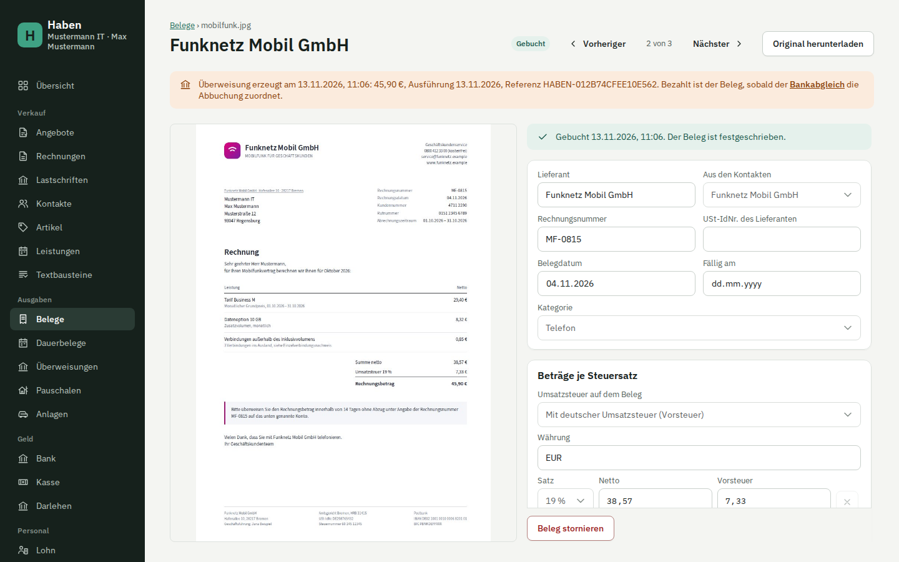

# Belege und Eingangsrechnungen

Unter **Belege** legst du Eingangsrechnungen und Quittungen ab. E-Rechnungen liest Haben direkt aus, andere PDFs und Fotos auf Wunsch mit Claude. Du prüfst die Felder, wählst eine Kategorie und buchst den Beleg; danach ist er festgeschrieben.



## So gehst du vor

1. Beleg hochladen (siehe unten).
2. Den Beleg in der Liste öffnen. Ist er aus einer E-Rechnung oder von der KI vorbefüllt, steht dort „Vorbefüllt aus … Bitte prüfen und bestätigen.“
3. **Lieferant**, **Rechnungsnummer**, **USt-IdNr. des Lieferanten**, **Belegdatum**, **Fällig am** und **Kategorie** prüfen oder eintragen. Ist der Lieferant schon in den Kontakten (Rolle **Lieferant**), wählst du ihn unter **Aus den Kontakten**: Das Feld sucht beim Tippen nach Name, Lieferantennummer, Ort und USt-IdNr.; Pfeiltasten und Enter wählen einen Treffer, Escape schließt die Liste, ein geleertes Feld nimmt die Verknüpfung weg. Haben übernimmt Name und USt-IdNr. Änderst du den Namen danach von Hand, fällt die Verknüpfung weg. Ein neuer Lieferant lässt sich eintippen, oder du legst ihn gleich als Kontakt an, mit der letzten Zeile der Trefferliste („… als neuen Lieferanten anlegen“, mit dem getippten Namen): Der Dialog übernimmt Name und USt-IdNr. vom Beleg und hakt die Rolle **Lieferant** an; nach dem Speichern ist er unter **Aus den Kontakten** gewählt. Abbrechen oder ein Fehler im Dialog lassen alle Eingaben am Beleg stehen. Gibt es die USt-IdNr. schon bei einem Kontakt, gleich welcher Rolle, steht nach dem Tippen ein Hinweis im Dialog: Ist der vorhandene Kontakt ein Lieferant, kannst du ihn wählen, statt einen zweiten anzulegen; ist er nur ein Kunde, bleibt der Hinweis mit einem Link auf den Kontakt, damit du dort die Rolle ergänzt; ist er archiviert, verweist der Hinweis darauf, ihn unter **Kontakte** wiederherzustellen. Gibt es mehrere, nennt der Hinweis den Lieferanten, den du wählen kannst. Zusammengeführt wird nichts. Bei einer E-Rechnung füllt der Dialog außerdem Anschrift und E-Mail des Verkäufers vor. Eine IBAN vom Beleg, aus der E-Rechnung (BT-84) oder der KI-Auslesung, steht nur als **Vorschlag** unter dem Feld IBAN (bei einer Gutschrift nicht: dort ist BT-84 das Konto des Käufers): mit Herkunft, bei der KI mit dem Textausschnitt, in dem sie steht, und ob die Prüfziffer stimmt. Ins Feld kommt sie erst mit **IBAN übernehmen**; prüfe sie vorher beim Lieferanten. Einen bestehenden Kontakt ändert der Beleg nie. Gebuchte Belege mit Lieferant aus den Kontakten stehen auch auf dessen Kontaktseite unter **Ausgaben und Belege**, mit Summen je Jahr ([Rechnungen und Belege am Kontakt](kontakte.md#rechnungen-und-belege-am-kontakt)).
4. Unter **Beträge je Steuersatz** Netto und Vorsteuer je Satz prüfen. Mit **+ Steuersatz** kommt eine Zeile für einen weiteren Satz dazu (höchstens 19 %, 7 % und 0 % je einmal). Gehören Teile der Rechnung in verschiedene Kategorien, teilst du sie mit **Auf mehrere Kategorien aufteilen** auf (siehe [Auf mehrere Kategorien aufteilen](#auf-mehrere-kategorien-aufteilen)).
5. Unter **Bezahlung** wählen, ob der Beleg über das Geschäftskonto, privat oder bar aus der Kasse bezahlt wurde (siehe [Bezahlung](belege-bezahlen.md#bezahlung)).
6. **Bestätigen und buchen**, dann im Dialog **Buchen**. Ungespeicherte Änderungen werden dabei vorher gespeichert.

Mit **Speichern** sicherst du Zwischenstände, ohne zu buchen.

## Hochladen

| Weg | Wie |
| --- | --- |
| Ziehen und Ablegen | Dateien auf die Fläche „Belege hierher ziehen“ ziehen. |
| Dateiauswahl | **Dateien auswählen**, auch mehrere auf einmal (bis 50 je Vorgang). |
| Kamera | Auf dem Handy **Foto aufnehmen**; öffnet direkt die Rückkamera. |
| Teilen-Menü | In der als App installierten Version (PWA) taucht Haben im Teilen-Menü des Telefons auf. Geteilte Dateien gehen an `/api/belege/teilen` (bis 20 je Vorgang). Bei genau einer Datei öffnet Haben danach gleich den Beleg, sonst die Liste. |
| E-Mail | Anhänge aus einem eigenen Postfach, siehe [Belege per E-Mail](#belege-per-e-mail). |
| REST-API | Eigene Werkzeuge, Dokumentenarchive und Skripte schicken Belege mit einem API-Token, siehe [Belege aus der REST-API](#belege-aus-der-rest-api). |

Erlaubt sind PDF, JPEG, PNG, WebP, HEIC und E-Rechnungs-XML bis 20 MB je Datei. Nach dem Hochladen meldet Haben je Datei „abgelegt“, „liegt schon in Haben, nicht doppelt abgelegt“ oder den Grund der Ablehnung.

### Was im Hintergrund passiert

1. **Dateityp erkennen.** Haben erkennt den Typ am Inhalt der Datei (den ersten Bytes), nicht an Dateiendung oder Browserangabe. XML wird auch mit vorangestelltem UTF-8-BOM erkannt.
2. **Ablegen unter dem SHA-256.** Die Datei wird unter ihrem SHA-256-Hash im Verzeichnis `DOCUMENTS_DIR` gespeichert (`<dir>/ab/abcdef…`), atomar über eine temporäre Datei. Beim Lesen prüft Haben den Hash erneut und meldet eine beschädigte Datei.
3. **Keine Dubletten.** Gibt es schon einen Beleg mit demselben Hash, entsteht kein zweiter; du landest beim vorhandenen.
4. **E-Rechnung lesen.** Bei PDF und XML versucht Haben zuerst, eine E-Rechnung zu lesen (siehe unten).
5. **KI-Auslesung.** Ist es keine E-Rechnung und ist die KI-Auslesung eingerichtet (Claude oder ein eigenes Modell), startet für PDF, JPEG, PNG und WebP die Auslesung im Hintergrund. Der Beleg zeigt solange „Wird ausgelesen“, Liste und Detailseite aktualisieren sich selbst.
6. **Eigene Rechnung erkennen.** Bei jedem Weg prüft Haben, ob du gerade eine eigene Ausgangsrechnung hochgeladen hast, und schlägt dann keine Ausgabe vor (siehe [Eigene Ausgangsrechnung erkennen](#eigene-ausgangsrechnung-erkennen)).

Ohne E-Rechnung und ohne KI füllst du die Felder von Hand aus.

## Belege per E-Mail

Unter **Einstellungen › E-Mail › Belege per E-Mail** trägst du ein Postfach ein, aus dem Haben sie selbst abholt:

- **Zugang:** IMAP-Server, Port, Verschlüsselung, Benutzername, Passwort und Ordner. Für Gmail, GMX, web.de, Posteo und mailbox.org sind Server und Port vorbelegt; Gmail, GMX und web.de brauchen ein App-Passwort bzw. freigeschaltetes IMAP. Das Passwort liegt verschlüsselt in der Datenbank.
- **Was abgeholt wird:** jede ungelesene Mail im Ordner. Ihre Anhänge gehen wie beim Hochladen zu den Belegen. E-Rechnungen werden gelesen, sonst greift die KI-Auslesung, und Dubletten erkennt Haben am Inhalt.
- **Was übersprungen wird:** eingebettete Bilder wie Logos und Signaturen sowie Dateien, die kein Beleg sein können (Word, ZIP …), und Mails über 60 MB (deren Anhänge lädst du einzeln hoch). Der Grund steht im Abrufprotokoll.
- **Danach** ist die Mail im Postfach als gelesen markiert. Am Beleg steht als Notiz, von wem und mit welchem Betreff er kam.
- **Wann:** stündlich, solange „Stündlich abrufen“ an ist, oder sofort mit **Jetzt abrufen**. Je Lauf höchstens 50 Mails.

Am besten richtest du eine eigene Adresse oder einen Ordner mit Filterregel ein, etwa `belege@…` oder „Rechnungen“, und leitest Rechnungen dorthin weiter. Im Hauptpostfach würde Haben jede ungelesene Mail anfassen.

Jede abgeholte Mail steht mit ihrer Message-ID im Abrufprotokoll (nur anhängen). Markierst du sie wieder als ungelesen, legt Haben sie kein zweites Mal ab. Ausnahme: Scheitert die Verarbeitung einer Mail, steht der Fehler im Abrufprotokoll und die Mail ist trotzdem als gelesen markiert, damit sie spätere Mails nicht aufhält; setzt du sie wieder auf ungelesen, holt Haben sie nach, mit einem zweiten Eintrag „(nachgeholt)“ neben dem des Fehlschlags. Schlägt der Abruf fehl, etwa wegen eines falschen Passworts, steht der Fehler in den Einstellungen und auf der Belegseite.

## Belege aus der REST-API

Liegen deine Belege schon in einem anderen System, etwa einem Dokumentenarchiv, oder holt ein eigenes Skript sie aus Kundenportalen, dann liefert es sie über die [REST-API](api.md#belege) an Haben: `POST /api/v1/belege` mit der Datei im Feld `datei` (oder `file`, so schickt sie etwa [Paperless-ngx](api.md#paperless-ngx)), angemeldet mit einem API-Token, das das Recht „Belege lesen und hochladen“ (`belege:anlegen`) hat. Ein Token mit `belege:lesen` sieht nur den Stand.

- **Derselbe Weg wie beim Hochladen:** gleiche Formate und 20 MB je Datei, Ablage unter dem SHA-256, E-Rechnungen werden sofort gelesen, sonst greift die KI-Auslesung, wenn sie eingerichtet ist.
- **Der Beleg landet als „Zu prüfen“** in der Liste, gebucht wird nichts. Du prüfst und buchst ihn wie jeden anderen. Im Änderungsprotokoll steht als Akteur das Token mit ID und Namen (`api:5b1d0c4e-…:Dokumentenarchiv`).
- **Keine Dubletten:** Das Werkzeug kann zu jedem Beleg eine Referenz mitschicken, Quelle und Kennung des Dokuments (`externalSource`, `externalId`). Dieselbe Referenz legt keinen zweiten Beleg an, auch nicht bei gleichzeitigen Anfragen. Dieselbe Datei erkennt Haben wie beim Hochladen am Inhalt; kommt sie mit einer anderen Referenz, lehnt die API sie ab und nennt den vorhandenen Beleg.
- **Stand abfragen:** `GET /api/v1/belege` mit Filter nach Status und Referenz, `GET /api/v1/belege/{id}` mit Status, ob gebucht, was noch fehlt, und dem Link zur Seite in Haben.
- **Nicht über die API:** ändern, buchen, löschen und die Datei herunterladen. Löschst du einen ungebuchten Beleg in Haben, ist seine Referenz wieder frei.

Einrichtung, Antworten und ein Beispiel mit `curl` stehen unter [REST-API › Belege](api.md#belege).

## Dauerbelege

Für Ausgaben, die in festen Abständen mit gleichem Betrag anfallen, etwa Büromiete, Versicherung, Leasing oder Abos, legst du unter **Dauerbelege** (Menü **Ausgaben**) einmal eine Vorlage mit dem Vertrag an. Haben legt daraus zu jedem Termin einen Beleg an und schlägt ihn im [Bankabgleich](bank.md#dauerbelege-noch-zu-prüfen) vor. Vorbild ist der Dauerbeleg in Lexware Office (Hilfeartikel „Regelmäßige Buchungen: So legst du Dauerbelege an“ auf help.lexware.de): Vertrag, Vertragspartner, Kategorie, Intervall und Start einmal erfassen, Änderungen gelten für künftige Belege, deaktivieren hält ihn an. Anders als dort bucht Haben nichts selbst.

1. **Neuer Dauerbeleg** öffnen.
2. **Bezeichnung**, **Lieferant** (aus den Kontakten, mit Suche und Anlegen wie am Beleg, oder frei), optional **USt-IdNr.** und **Vertrags- oder Kundennummer**, **Kategorie** und **Bezahlung** eintragen.
3. Unter **Termine** das **Intervall** (monatlich, vierteljährlich, halbjährlich, jährlich), **Erster Beleg am**, optional **Endet nach dem** und **Fällig Tage nach dem Termin** wählen.
4. Unter **Dokument** den **Vertrag oder die Dauerrechnung** hochladen (PDF, Foto oder E-Rechnung wie beim Hochladen eines Belegs, bis 20 MB) und angeben, ob das Dokument die Umsatzsteuer gesondert ausweist; unter **Beträge je Termin** die Beträge je Steuersatz eintragen.
5. **Dauerbeleg anlegen**.

| Feld | Bedeutung |
| --- | --- |
| Erster Beleg am, später Nächster Beleg am | Belegdatum des nächsten Belegs, etwa der Zahlungsbeginn laut Vertrag. Die folgenden Termine liegen am selben Tag im Monat; der 31. wird in kürzeren Monaten zum Monatsende (28. oder im Schaltjahr 29. Februar) und springt danach zurück, wie bei [wiederkehrenden Rechnungen](rechnungen.md#wiederkehrende-rechnungen). |
| Endet nach dem | optional. Der letzte Beleg entsteht am letzten Termin bis zu diesem Tag, danach ist der Dauerbeleg beendet. |
| Fällig Tage nach dem Termin | **Fällig am** des Belegs: 0 am Termin, 3 etwa für eine Miete bis zum dritten des Monats. |
| Vertrags- oder Kundennummer | steht als Rechnungsnummer an jedem Beleg, im Verwendungszweck einer [SEPA-Überweisung](belege-bezahlen.md#überweisen-sepa-datei) und hilft dem Bankabgleich. |
| Bezahlung | wie am Beleg: Geschäftskonto, privat (bei GmbH und UG „Vom Gesellschafter ausgelegt“) oder Kasse (siehe [Bezahlung](belege-bezahlen.md#bezahlung)). |

### Was zu jedem Termin entsteht

Der Server prüft kurz nach dem Start und danach stündlich, ob ein Termin fällig ist; mit **… fällige jetzt anlegen** in der Liste startest du den Lauf sofort. Liegt der erste Termin in der Vergangenheit oder war Haben aus, holt der Lauf die verpassten Termine mit ihrem Datum nach.

- **Ein Beleg „Zu prüfen“**, nicht gebucht: mit Lieferant, Vertragsnummer, Belegdatum (Termin), Fälligkeit, Kategorie, Bezahlung und den Beträgen der Vorlage. In der Liste steht er mit „Dauerbeleg“, auf seiner Seite mit einem Link zur Vorlage. Du prüfst ihn und buchst ihn wie jeden anderen Beleg mit **Bestätigen und buchen** oder im Bankabgleich mit **Buchen und zuordnen**. Ab dem Buchen ist er gesperrt und versiegelt.
- **Der Vertrag als Datei des Belegs.** Bei Miete ersetzt der Mietvertrag die monatliche Rechnung; die GoBD verlangen zu jeder Buchung einen Beleg. Jeder Beleg nutzt die Datei, die bei seinem Anlegen an der Vorlage hing, unter ihrem SHA-256; die Notiz am Beleg nennt Dateiname und Prüfsumme. Im [Jahresarchiv](auswertungen.md) liegt sie bei jedem Beleg.
- **Je Monat höchstens ein Beleg je Vorlage**, auch nach einem Neustart, bei zwei gleichzeitigen Läufen oder wenn du den nächsten Termin auf einen anderen Tag im selben Monat zurücksetzt (eindeutiger Index auf Vorlage und Periode).

Einen ungebuchten Beleg aus einem Dauerbeleg kannst du [löschen](#löschen), etwa für einen mietfreien Monat; Haben legt ihn nicht neu an. Die Datei bleibt, solange die Vorlage sie nutzt.

### Vorsteuer nur mit Steuerausweis

Vorsteuer ziehst du nur aus einer Rechnung ab, die die Umsatzsteuer gesondert ausweist (§ 15 Abs. 1 Nr. 1 und § 14 Abs. 4 Nr. 8 UStG). Ein Vertrag gilt als Rechnung, wenn er die Pflichtangaben enthält, bei Miete etwa ein Mietvertrag mit Steuerbetrag nach einer Option zur Umsatzsteuer (§ 9 UStG), oder eine Dauerrechnung des Leasinggebers.

- Weist das Dokument die Steuer aus, setzt du den Haken **Das Dokument weist die Umsatzsteuer gesondert aus** und trägst Netto und Umsatzsteuer je Satz ein; die Steuer rechnet Haben aus dem Netto vor.
- Ohne Haken gibt es kein Feld für die Steuer, und Haben lehnt eine Vorlage mit Steuer ab: „Vorsteuer nur mit einem Dokument, das die Umsatzsteuer gesondert ausweist …“. Den Betrag erfasst du dann mit 0 %, etwa für steuerfreie Miete (§ 4 Nr. 12 UStG) oder Versicherungsbeiträge. Die Notiz am Beleg sagt, dass das Dokument keine Steuer ausweist.
- Als Kleinunternehmer bucht Haben wie bei jedem Beleg den Bruttobetrag als Aufwand, ohne Vorsteuer.

Gebucht wird wie jeder Beleg, im Beispiel 1.000 € Miete zuzüglich 19 % mit der Kategorie Miete für Geschäftsräume (SKR04 in Klammern):

| Konto | Soll | Haben |
| --- | ---: | ---: |
| 4210 (6310) Miete (unbewegliche Wirtschaftsgüter) | 1.000,00 | |
| 1576 (1406) Vorsteuer 19 % | 190,00 | |
| 1600 (3300) Verbindlichkeiten | | 1.190,00 |

Die Vorsteuer zählt in der Voranmeldung für den Monat des Belegdatums, bei Ist- und Soll-Versteuerung gleich (siehe [Vorsteuer in der Voranmeldung](#vorsteuer-in-der-voranmeldung)).

### Ändern, pausieren, beenden

- **Ändern** gilt nur für künftige Belege. Angelegte Belege behalten ihre Felder, Beträge und ihre Datei; gebuchte sind ohnehin gesperrt. Eine neue Datei (Nachtrag, neue Dauerrechnung nach einer Mieterhöhung) lädst du unter **Neuer Vertrag oder Nachtrag** hoch; die alte bleibt an den bisherigen Belegen. Lässt du **Nächster Beleg am** unverändert, bleibt auch der Tag im Monat: Ein Dauerbeleg zum 31. bleibt beim Monatsende, auch wenn du ihn änderst, während der nächste Termin auf den 28. Februar fällt.
- **Pausieren** hält den Dauerbeleg an. **Fortsetzen** macht beim ersten Termin ab heute weiter: Termine, die in die Pause fielen, legt Haben nicht an. Willst du sie doch, setzt du vor dem Speichern **Nächster Beleg am** zurück.
- **Beenden** ist endgültig: Es entstehen keine Belege mehr, und die Vorlage lässt sich nicht mehr ändern. Die angelegten Belege bleiben.
- **Löschen** geht nur, solange kein Beleg aus der Vorlage entstanden ist; sonst beendest du sie. Jede Änderung an der Vorlage steht im Änderungsprotokoll, die Belege eines Laufs mit dem Akteur `system:dauerbelege`.

## E-Rechnungen

Haben liest diese Formate:

| Format | Erkennung | Quelle in der Liste |
| --- | --- | --- |
| ZUGFeRD 2.x / Factur-X | PDF mit eingebetteter XML-Datei | ZUGFeRD |
| ZUGFeRD 1.0 | PDF mit eingebetteter XML (`CrossIndustryDocument`) | ZUGFeRD |
| XRechnung als PDF-Anhang | PDF mit eingebetteter `xrechnung.xml` | ZUGFeRD |
| XRechnung CII | XML-Datei mit Wurzel `CrossIndustryInvoice` | XRechnung |
| XRechnung UBL | XML-Datei mit Wurzel `Invoice` oder `CreditNote` | XRechnung |

Im PDF sucht Haben zuerst nach den Anhängen `factur-x.xml`, `zugferd-invoice.xml` und `xrechnung.xml`, danach nach jedem anderen XML-Anhang.

Übernommen werden Lieferant, USt-IdNr. des Lieferanten, Rechnungsnummer, Rechnungsdatum, Fälligkeit, Währung und die Beträge je Steuersatz. Gutschriften (z. B. Typcode 381 oder UBL `CreditNote`) werden mit negativen Beträgen übernommen. Steuersätze außer 19, 7 und 0 % werden nicht übernommen, sondern als Hinweis am Beleg angezeigt. Bei einer Fremdwährung übernimmt Haben die Beträge als Originalbeträge und rechnet sie mit dem Umsatzsteuer-Umrechnungskurs des Monats um (siehe [Fremdwährung](belege-ausland.md#fremdwährung)).

Lässt sich eine hochgeladene XML-Datei nicht als E-Rechnung lesen, steht der Fehler am Beleg. Bei einem PDF, dessen eingebettetes XML nicht lesbar ist, geht Haben weiter zur KI-Auslesung.

Eine E-Rechnung bringt keine Kategorie mit. Haben schlägt die Kategorie vor, unter der du Belege desselben Lieferanten bisher am häufigsten gebucht hast; gibt es keinen, bleibt das Feld leer. Ebenso die Bezahlung (siehe [Vorschläge aus früheren Belegen](#vorschläge-aus-früheren-belegen)).

## KI-Auslesung

Die KI-Auslesung ist optional. Sie liest entweder Claude über die Anthropic-API (`ANTHROPIC_API_KEY`) oder ein Vision-Modell über eine OpenAI-kompatible Schnittstelle (`EXTRACTION_BASE_URL`, `EXTRACTION_MODEL`, bei Bedarf `EXTRACTION_API_KEY`). Das kann ein selbst betriebenes Modell sein, etwa Ollama mit Qwen-VL, oder ein Cloud-Dienst wie OpenRouter oder OpenAI; Einrichtung in [Erste Schritte](einrichtung.md#ki-auslesung-von-belegen). Es gilt immer genau ein Anbieter: Ist ein OpenAI-kompatibler Dienst eingerichtet, gehen Belege nur dorthin, auch wenn zusätzlich ein Anthropic-Schlüssel gesetzt ist, und bei einem Fehler weicht Haben auf keinen anderen Anbieter aus. Ohne beides funktioniert alles andere weiter, auch das Lesen von E-Rechnungen.

**Was gesendet wird:** die Belegdatei selbst zusammen mit einer festen Anweisung und der Liste der Ausgabenkategorien. Sonst nichts aus deiner Buchhaltung. An Claude geht ein PDF als Dokument, JPEG, PNG oder WebP als Bild. An einen OpenAI-kompatiblen Dienst gehen Fotos als Bild und PDFs als Seitenbilder, die Haben vorher auf dem Server erzeugt (höchstens `EXTRACTION_MAX_PAGES` Seiten, Standard 4). HEIC-Fotos und XML-Dateien gehen nicht an die KI.

**PDF-Text zuerst (eigener Dienst):** Hat ein PDF eine Textschicht, etwa eine Rechnung aus einem Programm statt eines Scans, liest Haben den Text der Seiten lokal mit `pdftotext` aus (poppler-utils, im Image enthalten) und gibt ihn dem Modell mit; Seitenreihenfolge und Spalten bleiben erhalten. Was genau an den Dienst geht, bestimmt `EXTRACTION_INPUT` ([Konfiguration](installation-konfiguration.md#umgebungsvariablen)):

| `EXTRACTION_INPUT` | Was bei PDFs an den Dienst geht |
| --- | --- |
| `text-und-bild` (Standard) | Text der Seiten und die Seitenbilder; ohne Textschicht nur die Bilder |
| `text` | Nur der Text, keine Bilder: für ein reines Textmodell ohne Bildverarbeitung |
| `bild` | Nur die Seitenbilder, wie vor Haben 0.7 |

Eine Seite gilt nur dann als lesbar, wenn ihr Text mehr ist als ein Stempel, ein Wasserzeichen oder eine Seitenzahl (mindestens 40 Buchstaben und Ziffern). Mit `text` gilt: Fehlt einer Seite der Text, steht „Seite 2 hat keinen auslesbaren Text und fehlt in der Auslesung“ am Beleg; hat das PDF gar keinen (Scan) oder ist der Beleg ein Foto, schickt Haben nichts an den Dienst und sagt das am Beleg, statt ein Bild an ein Textmodell oder still anderswohin zu senden. Eine Texterkennung (OCR) für Scans gibt es nicht; solche Belege füllst du von Hand aus oder nimmst `text-und-bild` mit einem Vision-Modell. Sehr langer Text wird gekürzt, auch das steht am Beleg. Claude über die Anthropic-API bekommt das PDF als Dokument und liest den Text selbst.

**Denkende Modelle still stellen (`EXTRACTION_EXTRA_BODY`):** Manche Modelle antworten erst nach einem Denkschritt und verbrauchen dabei ihr Antwortbudget, sodass für die Belegfelder nichts mehr übrig bleibt (`reasoning_tokens` in der Antwort des Dienstes, leerer Text). Dagegen nimmt `EXTRACTION_EXTRA_BODY` zusätzliche Felder für den Request-Body als JSON-Objekt auf, etwa `{"reasoning_effort":"none"}`; `model`, `messages`, `stream` und `response_format` setzt Haben selbst und überschreibt sie. Ohne Angabe geht der Body unverändert raus ([Konfiguration](installation-konfiguration.md#umgebungsvariablen)).

**Was zurückkommt:** bei beiden Anbietern dasselbe feste Schema mit Lieferant, USt-IdNr., Rechnungsempfänger und dessen USt-IdNr., Rechnungsnummer, Belegdatum, Fälligkeit, Währung, Netto und Steuer je Steuersatz, Bruttobetrag, Kategorie, ob es eine Gutschrift ist, und einem Hinweis bei Unklarheiten; dazu die IBAN des Lieferanten mit dem Textausschnitt, in dem sie steht. Diese IBAN ist nur ein Vorschlag für einen neuen Kontakt (siehe [So gehst du vor](#so-gehst-du-vor)): Sie steht nicht am Beleg und geht nie in eine Überweisung. Die Anweisung verlangt, nur zu übernehmen, was auf dem Beleg steht, und nichts zu raten. Beim eigenen Modell verlangt Haben das Schema als strukturierte Ausgabe (JSON-Schema); kann der Dienst das nicht, prüft Haben die Antwort selbst. Fehlen in der Antwort nur Rechnungsempfänger und dessen USt-IdNr. oder die IBAN, gelten sie als unbekannt. Passt sie sonst nicht zum Schema, steht „Die Antwort des KI-Dienstes passt nicht zum Belegschema“ am Beleg, und es werden keine Felder übernommen.

Haben prüft die Antwort und zeigt Auffälligkeiten als Hinweis am Beleg:

- Netto plus Steuer weicht vom Gesamtbetrag ab.
- Ein Betrag ist nicht lesbar.
- Die Währung ist nicht Euro und der Kurs des Monats ist noch nicht veröffentlicht: Die Beträge stehen dann als Originalbeträge am Beleg, der Kurs fehlt noch.
- Der Hinweis der KI zu unklaren Stellen.
- Beim eigenen Modell: Das PDF hatte mehr Seiten als ausgelesen wurden; mit `EXTRACTION_INPUT=text` auch Seiten ohne Text und ein gekürzter Text.

Die KI bucht nie selbst. Jeder ausgelesene Beleg bleibt im Status „Zu prüfen“, bis du ihn mit **Bestätigen und buchen** bestätigst. Mit **Mit KI neu auslesen** kannst du die Auslesung wiederholen, solange der Beleg nicht gebucht ist; dabei werden die Felder überschrieben und eine Aufteilung auf mehrere Kategorien verworfen. Fehler (ungültiger Schlüssel, Auslastung, keine Verbindung, Zeitüberschreitung, unbekanntes Modell, Antwort im falschen Format, abgelehnte Auslesung) stehen am Beleg, der dann den Status „Prüfen“ trägt.

Bei der Kategorie haben die gebuchten Belege desselben Lieferanten Vorrang vor dem Vorschlag der KI: Haben nimmt die Kategorie, unter der sie am häufigsten gebucht sind, bei Gleichstand die zuletzt gebuchte. So wechselt der Vorschlag nicht, nur weil ein Lieferant wie Amazon einmal etwas anderes geliefert hat. Wie das gezählt wird, steht unter [Vorschläge aus früheren Belegen](#vorschläge-aus-früheren-belegen).

## Vorschläge aus früheren Belegen

Kategorie und Bezahlung schlägt Haben aus allen gebuchten Belegen desselben Lieferanten vor, ohne KI-Modell: Gezählt werden nur deine eigenen Buchungen (siehe [Roadmap](roadmap.md#bewusst-nicht)). Erkannt wird der Lieferant am gewählten Kontakt, an der USt-IdNr. oder am Namen (ohne Groß- und Kleinschreibung). Stornierte Belege zählen nicht.

- **Kategorie:** die häufigste, bei Gleichstand die zuletzt gebuchte. Ein [aufgeteilter Beleg](#auf-mehrere-kategorien-aufteilen) zählt bei jeder seiner Kategorien, insgesamt aber einmal.
- **Bezahlung:** über das Geschäftskonto, privat (in GmbH und UG vom Gesellschafter ausgelegt) oder bar aus der Kasse, nur wenn sie mindestens zweimal und bei mehr als der Hälfte der Belege so gebucht wurde. Die Vorgabe „Über das Geschäftskonto“ stellt also kein einzelner privat bezahlter Beleg um.

Unter dem Feld **Kategorie** bzw. unter **Bezahlung** steht, wie oft und wann zuletzt, etwa „Bisher 7 von 9 Belegen als Software und Lizenzen gebucht, zuletzt am 03.11.2026“ oder „Bisher 2× privat bezahlt, zuletzt am 05.11.2026“. Hast du etwas anderes gewählt, übernimmst du den Vorschlag mit **übernehmen**. Liest Haben einen Beleg aus einer E-Rechnung oder mit der KI aus, trägt es Kategorie und Bezahlung gleich so ein. Gebucht wird der Beleg trotzdem erst mit **Bestätigen und buchen**; bis dahin bleibt er „Zu prüfen“.

Für Bankumsätze ohne Beleg lernt der Bankabgleich auf dieselbe Weise aus früheren Zuordnungen (siehe [Bank](bank.md#vorschläge-ohne-rechnung-und-geldtransit)).

## Eigene Ausgangsrechnung erkennen

Lädst du eine Rechnung hoch, die du selbst ausgestellt hast, etwa das PDF aus einem Shop oder einem anderen Rechnungsprogramm, ist das keine Ausgabe. Haben erkennt solche Belege und schreibt dann an den Beleg „Das ist eine eigene Ausgangsrechnung, keine Ausgabe“ mit den Gründen dafür. Eine Kategorie wird nicht vorgeschlagen, auch nicht die der bisherigen Belege desselben „Lieferanten“. Gebucht oder gelöscht wird nichts: Der Beleg bleibt „Zu prüfen“. Ist es doch ein Eingangsbeleg, trägst du Kategorie und Beträge von Hand ein. Offene Ausgangsrechnungen aus einem anderen Programm übernimmst du beim Umzug als offene Posten ([Lexoffice](lexoffice.md#schritt-3-offene-posten-übernehmen), [sevDesk](sevdesk.md)) oder über den [JSON-Eingang](belegimport.md); die Übernahme aus weiteren Systemen steht im [Project „Roadmap“](https://github.com/users/firsttris/projects/2).

Verglichen wird mit den [Firmendaten](einrichtung.md): USt-IdNr., Steuernummer (wie eingetragen und im ELSTER-Format), IBAN, Firmenname und PLZ. Fehlt dort eine Angabe, trägt sie nichts bei.

Haben sammelt dafür Hinweise und gewichtet sie. Je nach Stärke steht am Beleg „eine eigene Ausgangsrechnung“ (sicher) oder „vermutlich eine eigene Ausgangsrechnung“; schwache oder widersprüchliche Hinweise ergeben keinen Hinweis am Beleg.

| Quelle | Spricht für eine eigene Rechnung | Spricht dagegen |
| --- | --- | --- |
| E-Rechnung (XML) | Deine USt-IdNr. (BT-31), Steuernummer (BT-32) oder IBAN beim Verkäufer; dein Name als Verkäufer | Deine USt-IdNr. oder dein Name beim Käufer (BT-44, BT-48); eine andere USt-IdNr. beim Verkäufer |
| KI-Auslesung | Deine Firma oder USt-IdNr. als Rechnungssteller | Deine Firma oder USt-IdNr. als Rechnungsempfänger |
| Text im PDF | Deine Steuernummer; deine USt-IdNr. oder IBAN in der Fußzeile, im Briefkopf, im Informationsblock neben dem Anschriftfeld oder mit „Unsere USt-IdNr.“, „Bankverbindung“, „Amtsgericht“, „HRB“ davor; dein Name in Fußzeile oder Absenderzeile | Deine USt-IdNr. mit „Ihre USt-IdNr.“, „Kunden-USt-IdNr.“, „Leistungsempfänger“, „Customer VAT“ davor oder im Rumpf; deine IBAN bei „Lastschrift“, „Mandat“ oder „abgebucht“, außerhalb der Fußzeile auch, wenn der Einzugstext einige Zeilen darüber steht; dein Name im Anschriftfeld; eine andere USt-IdNr. oder Steuernummer in der Fußzeile, etwa bei einer Rechnung der Steuerberatung mit deiner Steuernummer im Betreff |
| Rechnungen in Haben | Eine festgeschriebene Rechnung mit derselben Nummer und demselben Bruttobetrag | – |

Den Text eines PDFs liest Haben mit `pdftotext` aus poppler-utils (im Image enthalten) samt der Lage jeder Zeile auf der Seite. Deutsche Geschäftsbriefe tragen die Angaben des Absenders in der Fußzeile und in der Absenderzeile über dem Anschriftfeld (DIN 5008); deine eigene USt-IdNr. kann aber auch auf Rechnungen an dich stehen, etwa mit Reverse Charge. Darum zählt nicht, *dass* sie auf dem Beleg steht, sondern *wo* und mit welcher Beschriftung. Als Beschriftung gilt der Text davor auf derselben Zeile oder eine Zeile darüber ohne Ziffern; „Kundennummer: 10042“ über deiner USt-IdNr. ist eine eigene Angabe, keine Beschriftung. Gescannte PDFs ohne Textebene und Fotos prüft Haben nur über die KI-Auslesung. Diese Prüfung des Textes läuft auf dem Server; ob der Text außerdem mit der KI-Auslesung an einen eigenen Dienst geht, bestimmt `EXTRACTION_INPUT` (siehe [KI-Auslesung](#ki-auslesung)).

Die Erkennung läuft auch ohne KI-Auslesung: Ein PDF mit Textebene wird dann allein am Text geprüft. Welche Hinweise gezählt haben, steht mit ihrer Gewichtung in den ausgelesenen Daten des Belegs (`eigeneRechnung`).

## Kategorien

Die Kategorie bestimmt das Aufwandskonto. Die Zuordnung steht in `packages/core/src/posting.ts`.

| Kategorie | SKR03 | SKR04 |
| --- | --- | --- |
| Software und Lizenzen | 4964 | 6837 |
| Hosting und IT-Dienste | 4806 | 6495 |
| Hardware (GWG bis 800 € netto) | 0480 | 0670 |
| Telefon | 4920 | 6805 |
| Internet | 4925 | 6810 |
| Bürobedarf | 4930 | 6815 |
| Fachliteratur | 4940 | 6820 |
| Fortbildung | 4945 | 6821 |
| Reisekosten: Fahrten | 4673 | 6673 |
| Reisekosten: Übernachtung | 4676 | 6680 |
| Porto | 4910 | 6800 |
| Werbung | 4600 | 6600 |
| Bewirtung von Geschäftspartnern (70 % abziehbar) | 4650 | 6640 |
| Geschenke an Geschäftspartner (bis 50 € je Empfänger und Jahr) | 4630 | 6610 |
| Rechts- und Beratungskosten | 4950 | 6825 |
| Buchführung und Steuerberatung | 4955 | 6830 |
| Wareneinkauf (Handelsware) | 3200 | 5200 |
| Fremdleistungen | 3100 | 5900 |
| Kontoführung und Gebühren | 4970 | 6855 |
| Versicherungen | 4360 | 6400 |
| Beiträge | 4380 | 6420 |
| Sonstiger Aufwand | 4900 | 6300 |
| Miete für Geschäftsräume | 4210 | 6310 |
| Sonstiger Betriebsbedarf | 4980 | 6850 |
| Reparatur und Instandhaltung (Ausstattung, ohne EDV und Kfz) | 4805 | 6470 |
| Beiträge zur Berufsgenossenschaft | 4138 | 6120 |
| Versorgungskassen (Altersversorgung der Arbeitnehmer) | 4160 | 6150 |
| Kfz: Laden, Tanken, Wartung | 4530 | 6530 |
| Kfz: Versicherung | 4520 | 6520 |
| Kfz: Steuer | 4510 | 7685 |
| Kfz: Reparaturen | 4540 | 6540 |
| Kfz: Leasing | 4570 | 6560 |
| Kfz: sonstige Kosten (was nicht Laden, Tanken, Versicherung, Steuer, Reparatur oder Leasing ist) | 4580 | 6570 |
| Anlagegut (wird abgeschrieben) | Anlagekonto je Art | Anlagekonto je Art |
| Einfuhrumsatzsteuer (Bescheid des Zolls), kein Aufwand, siehe [Einfuhrumsatzsteuer](belege-ausland.md#einfuhrumsatzsteuer) | 1588 | 1433 |

**Berufsgenossenschaft** und **Versorgungskassen** sind Personalaufwand: Beiträge und betriebliche Altersversorgung für deine Arbeitnehmer (§ 4c EStG). Deine eigene Altersvorsorge als Inhaber ist keine Betriebsausgabe (§ 12 Nr. 1 EStG), sondern privat; buche sie mit Privatanteil 100 % oder gar nicht. Die Beiträge zu einer freiwilligen Unternehmerversicherung bei der Berufsgenossenschaft für dich selbst gehören zu **Beiträge**.

**Bewirtung** von Geschäftspartnern zählt zu 70 % als Betriebsausgabe, die Vorsteuer voll; die Aufteilung macht die EÜR. **Geschenke** an Geschäftspartner sind nur bis 50 € netto je Empfänger und Jahr abziehbar (bis 2023: 35 €). Teurere Geschenke sind keine Betriebsausgabe, auch die Vorsteuer nicht: Buche sie mit Privatanteil 100 %.

Mit **Anlagegut** wird der Beleg nicht zum Aufwand, sondern legt beim Buchen eine Anlage im Verzeichnis an, die über die Nutzungsdauer abgeschrieben wird. Das Formular fragt dann nach Bezeichnung, Art, Abschreibung und Nutzungsdauer. Mehr unter [Anlagen und AfA](anlagen.md).

> [!IMPORTANT]
> Kategorien und Konten sind ein Vorschlag für typische Freiberufler-Ausgaben. Gleiche sie vor dem Echtbetrieb mit deiner Steuerberatung ab, besonders Hardware (GWG-Grenze) und Reisekosten.

## Beträge

Bei Belegen mit deutscher Umsatzsteuer gibst du je Steuersatz Netto und Vorsteuer ein. Solange du die Vorsteuer nicht selbst geändert hast, rechnet Haben sie aus dem Netto vor. Beim Buchen übernimmt Haben die Vorsteuer genau so, wie sie im Formular steht, und rechnet nicht nach: maßgeblich ist der Betrag auf der Rechnung.

Gutschriften gibst du mit Minus ein.

## Auf mehrere Kategorien aufteilen

Stehen auf einer Rechnung Dinge, die auf verschiedene Konten gehören, etwa Handelsware, Softwarelizenzen und Bürobedarf, teilst du den Beleg auf. Er bleibt ein Beleg mit einer Datei, einem offenen Posten und einer Zahlung; nur das Netto geht auf mehrere Kategorien.

1. Unter **Beträge je Steuersatz** die Beträge laut Rechnung eintragen, wie ohne Aufteilung.
2. Unter dem Feld **Kategorie** auf **Auf mehrere Kategorien aufteilen** klicken. Darunter erscheint **Aufteilung auf Kategorien** mit einer Zeile je Steuersatz (die erste mit der bisherigen Kategorie und dem Netto des Satzes) und einer leeren Zeile.
3. Je Zeile **Kategorie**, **Satz** und **Netto** eintragen. Mit **+ Zeile** kommt eine weitere dazu, mit dem Kreuz neben der Zeile fällt sie weg (mindestens zwei bleiben). Mehrere Zeilen mit demselben Satz und auch derselben Kategorie sind erlaubt.
4. Unter den Zeilen steht je Steuersatz, wie viel schon verteilt ist, etwa „19 %: Zeilen 150,00 € von 170,00 € netto · noch 20,00 € zu verteilen“, bis es „stimmt“. Unter jedem Netto steht der Anteil an der Vorsteuer.
5. **Speichern** oder **Bestätigen und buchen** wie sonst. Mit **Aufteilung aufheben** gilt wieder eine Kategorie für den ganzen Beleg, die der ersten Zeile.

Beispiel, alles zu 19 %: 100,00 € Handelsware, 50,00 € Software und 20,00 € Bürobedarf ergeben 170,00 € netto, 32,30 € Vorsteuer und 202,30 € Zahlbetrag. Gebucht wird eine Buchung (SKR04 in Klammern):

| Konto | Soll | Haben |
| --- | ---: | ---: |
| 3200 (5200) Wareneinkauf | 100,00 | |
| 4964 (6837) Software und Lizenzen | 50,00 | |
| 4930 (6815) Bürobedarf | 20,00 | |
| 1576 (1406) Vorsteuer 19 % | 32,30 | |
| 1600 (3300) Verbindlichkeiten | | 202,30 |

**Was maßgeblich ist.** Die Beträge je Steuersatz bleiben die des Belegs: Netto und Vorsteuer laut Rechnung, die Voranmeldung zählt sie wie bisher. Die Zeilen müssen je Satz genau dieses Netto ergeben; sonst steht vor dem Buchen etwa „Aufteilung 19 %: Zeilen zusammen 150,00 € netto, Beleg 170,00 €“, und Haben bucht nicht.

**Rundung.** Haben rechnet die Vorsteuer nicht je Zeile neu aus, sondern verteilt die Vorsteuer des Satzes anteilig nach Netto auf seine Zeilen und rundet kaufmännisch. Den Rundungsrest bekommt die betragsmäßig größte Zeile des Satzes (bei gleich großen die erste), wie beim Netto einer Bruttorechnung und beim Steueranteil einer Teilzahlung. So ergeben die Zeilen je Satz auf den Cent Netto und Vorsteuer des Belegs. Beispiel: 3 × 33,33 € zu 19 % mit 19,00 € Vorsteuer auf der Rechnung ergeben 6,34 €, 6,33 € und 6,33 €. Die Anteile werden beim Speichern berechnet, mit den Zeilen gespeichert und beim Buchen mit dem Beleg festgeschrieben.

**Buchung.** Je Kategorie und Steuersatz eine Aufwandszeile; zwei Zeilen mit gleicher Kategorie und gleichem Satz fasst Haben zusammen. Die Vorsteuer steht je Satz in einer Zeile, die Gegenbuchung (Verbindlichkeiten, Privateinlage, Gesellschafter oder Kasse) über den ganzen Betrag. Als Kleinunternehmer gehört der Vorsteueranteil jeder Zeile zu ihrem Aufwand. Gutschriften gibst du mit negativen Zeilen ein; Plus und Minus in einem Satz gemischt nimmt Haben nicht an.

**Zahlung, EÜR, DATEV.** Der Beleg steht einmal in den offenen Posten und im Bankabgleich, mit dem ganzen Betrag; Teilzahlungen und Skonto ordnest du ihm wie jedem Beleg zu. In der [EÜR](auswertungen.md) zählt jede Zahlung anteilig je Zeile in deren Kategorie; die Vorsteuer einer Teilzahlung ist dieselbe wie ohne Aufteilung, alle Zahlungen zusammen ergeben genau die Zeilen. Der DATEV-Export zerlegt die eine Buchung wie jede andere in Buchungssätze, je Aufwandskonto einer gegen die Verbindlichkeiten.

**Storno und Neuerfassung.** Ein [Storno](#stornieren-und-neu-erfassen) bucht die ganze Buchung mit allen Zeilen zurück; **Neu erfassen** übernimmt die Aufteilung in den neuen Entwurf.

**Mit § 13b.** Ein Beleg mit [§ 13b](belege-ausland.md#reverse-charge-als-leistungsempfänger--13b) aus dem EU-Ausland oder dem Drittland lässt sich ebenso aufteilen, etwa die monatliche Sammelrechnung eines Zahlungsdienstleisters mit Transaktionsgebühren, Zahlungsabwicklung, Einstellgebühren und Werbung. § 13b gilt dann für den ganzen Beleg. Unter jedem Netto steht statt der Vorsteuer der Anteil an der **Steuer § 13b**, verteilt und gerundet wie oben. Gebucht wird der Aufwand je Zeile mit dem Steuerschlüssel RC13bEU bzw. RC13bDrittland auf das Konto ihrer Kategorie; Umsatzsteuer und Vorsteuer nach § 13b stehen wie ohne Aufteilung je Steuersatz einmal in der Buchung, mit der Steuer des Belegs. Beispiel, alles zu 19 % aus dem EU-Ausland: 120,00 € Transaktionsgebühren, 60,00 € Zahlungsabwicklung, 20,00 € Einstellgebühren und 50,00 € Werbung ergeben 250,00 € netto, 47,50 € Steuer nach § 13b und 250,00 € Zahlbetrag (SKR04 in Klammern):

| Konto | Soll | Haben |
| --- | ---: | ---: |
| 4970 (6855) Kontoführung und Gebühren | 120,00 | |
| 3100 (5900) Fremdleistungen | 60,00 | |
| 4900 (6300) Sonstiger Aufwand | 20,00 | |
| 4600 (6600) Werbung | 50,00 | |
| 1577 (1407) Vorsteuer nach § 13b | 47,50 | |
| 1787 (3837) Umsatzsteuer nach § 13b | | 47,50 |
| 1600 (3300) Verbindlichkeiten | | 250,00 |

Ohne Vorsteuerabzug (als Kleinunternehmer, der die Steuer nach § 13b trotzdem schuldet) fehlt die Vorsteuerzeile, und neben jedem Netto steht auf demselben Konto sein Anteil an der Steuer als Aufwand (Steuerschlüssel `keineVSt`), im Beispiel 22,80 €, 11,40 €, 3,80 € und 9,50 €; zusammen genau Netto und Steuer des Belegs. So trägt das Journal die Bemessungsgrundlage (Kz 46 bzw. 84) netto, wie die Voranmeldung. Die Voranmeldung (Kz 46/47 bzw. 84/85 und 67) kommt wie ohne Aufteilung aus den Beträgen je Satz. In der [EÜR](auswertungen.md) zählt die Zahlung je Zeile mit ihrem Netto; die Summe ist dieselbe wie ohne Aufteilung, denn gezahlt ist nur netto, und die Steuer nach § 13b geht mit der Voranmeldung ans Finanzamt. Wie ohne Aufteilung gilt § 13b nicht für Wareneinkäufe und nur zu 19 % oder 7 %. Die Gebühren im Konto des Dienstleisters ordnest du dem aufgeteilten Beleg wie jedem anderen mit [Alle offenen Gebühren … diesem Beleg zuordnen](bank-zahlungsdienstleister.md) zu.

**Noch nicht mit Aufteilung:** innergemeinschaftlicher Erwerb, Privatanteil, Fremdwährung und Anlagegüter. Haben lehnt das Buchen dann mit Grund ab („Innergemeinschaftlicher Erwerb mit Aufteilung wird nicht unterstützt“ usw.); solche Teile erfasst du als eigenen Beleg. Bei innergemeinschaftlichem Erwerb und Fremdwährung ist der Knopf zum Aufteilen gesperrt, mit Aufteilung fehlt das Feld **Privatanteil in %**.

## Privatanteil

Den Privatanteil gibt es nur im Einzelunternehmen; bei einer GmbH oder UG fehlt das Feld (siehe [Rechtsform](einrichtung.md#rechtsform-einzelunternehmen-gmbh-oder-ug)). Wird etwas auch privat genutzt, etwa der Handy- oder Internetvertrag, trägst du unter den Beträgen den **Privatanteil in %** ein. Nur der betriebliche Teil wird Ausgabe und Vorsteuer, der private Teil ist eine Entnahme:

```
4920 Telefon             32,00
1576 Vorsteuer 19 %       6,08
1800 Privatentnahmen      9,52   an  1600 Verbindlichkeiten   47,60
```

Vorgaben je Kategorie stellst du in den [Einstellungen](einrichtung.md#privatanteile) ein (Telefon, Internet). Sie werden beim Wählen der Kategorie und beim Auslesen übernommen. Bei Anlagegütern gibt es keinen Privatanteil; für Firmenwagen gilt die [Listenpreismethode](anlagen.md#private-nutzung-von-firmenwagen).

## Belege aus dem Ausland

<a id="reverse-charge-als-leistungsempfänger--13b"></a><a id="innergemeinschaftlicher-erwerb--1a-ustg"></a><a id="einfuhrumsatzsteuer"></a><a id="fremdwährung"></a>Reverse Charge nach § 13b, innergemeinschaftlicher Erwerb, Einfuhrumsatzsteuer und Fremdwährung stehen unter [Belege aus dem Ausland](belege-ausland.md).

## Bezahlen

<a id="bezahlung"></a><a id="überweisen-sepa-datei"></a><a id="abweichende-iban-in-der-e-rechnung"></a><a id="skonto"></a><a id="vermerk-am-beleg"></a><a id="die-datei"></a><a id="verrechnen-ohne-zahlung"></a>Bezahlung über Geschäftskonto, privat oder Kasse, Überweisen per SEPA-Datei und Verrechnen ohne Zahlung stehen unter [Belege bezahlen](belege-bezahlen.md).

## Buchen

Vor dem Buchen müssen Lieferant, Belegdatum und Kategorie (oder eine stimmige [Aufteilung](#auf-mehrere-kategorien-aufteilen)) gesetzt sein und mindestens ein Betrag eingetragen sein; bei einer Fremdwährung auch der Umrechnungskurs. Fehlt etwas, steht oberhalb der Knöpfe „Vor dem Buchen: …“.

Beim Buchen legt Haben einen Buchungssatz mit dem Belegdatum an, schreibt ihn fest und sperrt den Beleg. Ab dann lehnen Datenbank-Trigger jede Änderung am Beleg, an seinen Beträgen und an seiner Aufteilung ab.

Beispiel: Softwarelizenz über 100,00 € netto zu 19 %, über das Geschäftskonto bezahlt:

| Konto SKR03 | Konto SKR04 | Soll | Haben |
| --- | --- | ---: | ---: |
| 4964 Software und Lizenzen | 6837 Software und Lizenzen | 100,00 | |
| 1576 Vorsteuer 19 % | 1406 Vorsteuer 19 % | 19,00 | |
| 1600 Verbindlichkeiten | 3300 Verbindlichkeiten | | 119,00 |

Bei privater Zahlung steht statt Verbindlichkeiten das Konto Privateinlagen (SKR03 1890, SKR04 2180) im Haben. Vorsteuer zu 7 % geht auf 1571 bzw. 1401. Bei Gutschriften tauschen Soll und Haben die Seiten.

Die Zahlung selbst buchst du im Bankabgleich: Verbindlichkeiten an Bank (siehe [bank.md](bank.md)).

### Als Kleinunternehmer

Bist du in den Einstellungen als Kleinunternehmer nach § 19 UStG eingetragen, ziehst du keine Vorsteuer ab. Haben bucht dann den Bruttobetrag auf das Aufwandskonto, ohne Vorsteuerzeile und mit dem Steuerschlüssel `keineVSt`. Im Beispiel oben stünden 119,00 € auf 4964 bzw. 6837. Ob ein Beleg mit oder ohne Vorsteuerabzug gebucht wurde, hält Haben beim Buchen am Beleg fest. Spätere Auswertungen bleiben so richtig, auch wenn sich die Einstellung ändert.

## Belege nacheinander prüfen

Nach einem Import liegen oft viele Belege auf „Zu prüfen“. Damit du sie ohne Umweg über die Liste abarbeitest, steht oben in der Detailansicht **‹ Vorheriger**, die Position („3 von 17“) und **Nächster ›**. Die Reihenfolge ist die der Liste: offene zuerst, dann nach Belegdatum.

- **Nach dem Buchen** springt die Ansicht zum nächsten Beleg „Zu prüfen“; am Ende der Liste geht es vorn weiter. Ist keiner mehr offen, bleibt der gebuchte Beleg stehen, darüber steht „Alle Belege geprüft“ mit einem Link zur Liste.
- **Hierbleiben:** Entfernst du den Haken **Nach dem Buchen zum nächsten offenen Beleg** unter den Knöpfen, bleibt die Ansicht nach dem Buchen beim gebuchten Beleg, etwa um ihn danach im Bankabgleich zuzuordnen. Haben merkt sich die Wahl in diesem Browser.
- **Nach dem Löschen** geht es zum nächsten offenen Beleg, sonst zurück zur Liste.
- **Ungespeicherte Änderungen:** Beim Wechsel fragt Haben in einem Dialog nach; **Ohne Speichern wechseln** verwirft sie.

| Taste | Wirkung |
| --- | --- |
| `J` oder `→` | Nächster Beleg (nicht in Eingabefeldern) |
| `K` oder `←` | Vorheriger Beleg |
| `Strg+Enter` (Mac: `Cmd+Enter`) | Wie ein Klick auf **Bestätigen und buchen**, auch aus einem Eingabefeld. Gebucht wird wie mit der Maus erst im Dialog. |
| `Esc` | Bricht die Rückfrage zum Buchen oder Löschen ab, sonst zurück zur Liste (nicht in Eingabefeldern) |

Auf dem Handy wischst du nach links zum nächsten und nach rechts zum vorigen Beleg.

Im [Bankabgleich](bank.md#zuordnen) geht es genauso: Nach dem vollständigen Zuordnen springt die Auswahl zum nächsten offenen Umsatz.

## Vorsteuer in der Voranmeldung

Die Vorsteuer eines gebuchten Belegs zählt in der Umsatzsteuer-Voranmeldung für den Monat seines **Belegdatums**, unabhängig davon, wann er bezahlt wird, und auch bei Ist-Versteuerung. Ungebuchte Belege zählen nicht; die Voranmeldung weist vor dem Senden darauf hin. Belege, die ohne Vorsteuerabzug gebucht wurden, zählen nicht. Ein Storno zählt mit umgekehrtem Vorzeichen im Monat des Stornos. Siehe [umsatzsteuer.md](umsatzsteuer.md).

## Stornieren und neu erfassen

Ein gebuchter Beleg lässt sich nicht mehr ändern oder löschen (GoBD). Hast du dich vertippt, etwa den Bruttobetrag ins Feld **Netto** geschrieben, hebst du ihn mit **Beleg stornieren** auf und erfasst ihn richtig neu, wie bei einer Stornorechnung.

1. Den gebuchten Beleg öffnen und **Beleg stornieren** klicken. Im Dialog stehen Lieferant, Belegdatum und Betrag, die Folgen des Stornos und das Feld **Grund** (optional, z. B. „Brutto als Netto erfasst“). Gibt es Bankzuordnungen, werden sie mit Datum, Buchungstext und Betrag aufgeführt.
2. Im Dialog **Stornieren** klicken. Der Beleg zeigt danach „Storniert mit einer Gegenbuchung zum …“ mit einem Link auf die Gegenbuchung im Journal, in der Liste steht er als **Storniert**.
3. **Neu erfassen** legt einen neuen Entwurf mit derselben Datei und den Feldern des stornierten Belegs an, mit Beträgen und Aufteilung. Du korrigierst ihn und buchst ihn wie jeden anderen. Gibt es den Entwurf schon, führt **Zur Neuerfassung** dorthin.

Was dabei passiert:

- **Gegenbuchung im richtigen Zeitraum.** Haben bucht die Belegbuchung mit vertauschten Seiten zurück („Storno: Beleg …“). Welches Datum sie bekommt, nennt der Hinweis vor dem Stornieren:
    - **Zeitraum der Belegbuchung noch nicht gemeldet:** am Datum der Belegbuchung. Ein Erfassungsfehler, etwa der 11.03. statt des 03.11., verschiebt so keine Vorsteuer in einen Zeitraum, in den sie nicht gehört; die Voranmeldung dieses Zeitraums kommt ohne den Beleg heraus.
    - **Schon gemeldet**, also für den Monat oder das Quartal eine Voranmeldung gesendet oder ihre Abgabe vermerkt, eine Jahreserklärung des Jahres gesendet (Umsatzsteuer, Anlage EÜR, Einkommensteuer, bei einer GmbH auch E-Bilanz, Körperschaft- oder Gewerbesteuer) oder das Jahr abgeschlossen: mit heutigem Datum, frühestens am Belegdatum. Die abgegebene Voranmeldung bleibt unberührt: Die Vorsteuer des Belegs steht weiter in ihrem Zeitraum, der Storno mindert sie im laufenden (§ 17 Abs. 1 UStG).
    - Ebenso Kz 46/47 bzw. 84/85 und 67 bei § 13b. Bei Ist- und Soll-Versteuerung gleich. Eine Voranmeldung, die du außerhalb von Haben abgegeben hast (etwa noch in Lexoffice), kennt Haben nur mit [Abgabevermerk](umsatzsteuer.md#abgabe-außerhalb-von-haben-vermerken); prüfe dann das Datum im Hinweis.
- **Der Beleg bleibt, wie er ist.** Er bleibt gebucht, gesperrt und versiegelt. Den Storno hält eine eigene Zeile fest (Beleg, Gegenbuchung, Datum, Grund), die nur angehängt wird, im Änderungsprotokoll steht und ein eigenes Siegel trägt.
- **EÜR:** Ein privat oder bar bezahlter Beleg zählt am Belegdatum als Ausgabe und am Datum der Gegenbuchung mit umgekehrtem Vorzeichen. Liegt sie im Folgejahr, mindert sie die Ausgaben dort.
- **Bar aus der Kasse:** Im [Kassenbuch](kasse.md) entsteht eine Gegenzeile mit neuer Nummer und dem Betrag zurück in die Kasse; die ursprüngliche Zeile ist als storniert markiert. Gegenzeile und Gegenbuchung stehen hier immer am Tag des Stornos, weil das Kassenbuch zeitnah und in der Reihenfolge der Tage geführt wird.
- **Über das Geschäftskonto:** Bestätigte Bankzuordnungen werden gemeinsam mit dem Beleg zurückgenommen. Ein mit der Zahlung ausgebuchter Rest wie Skonto wird ebenfalls aufgehoben. Gehört eine Zuordnung zu einer Aufteilung, nennt die Rückfrage alle Teile, auch die zu weiteren Vorgängen; eine Aufteilung wird wie im Bankabgleich nur insgesamt aufgehoben. Die betroffenen Umsätze sind danach wieder offen. Andere, unabhängige Zuordnungen bleiben bestehen. Der stornierte Beleg verschwindet aus den offenen Posten und lässt sich keiner Zahlung mehr zuordnen.
- **Datum der Bankgegenbuchungen:** Wie bei der manuellen Rücknahme im Bankabgleich stehen sie am ursprünglichen Buchungsdatum, einschließlich verknüpfter Ausbuchungen wie Skonto. Das kann die neu berechneten Steuerwerte früherer Zeiträume ändern, auch wenn die Beleggegenbuchung im laufenden Zeitraum steht. Gespeicherte Voranmeldungen werden nicht überschrieben. Prüfe die neu berechneten Werte und ob eine [berichtigte Anmeldung](umsatzsteuer.md#berichtigte-anmeldung) nötig ist; der Stornodialog weist darauf hin.
- **Ein gemeinsamer Vorgang:** Bankgegenzeilen und Belegstorno werden nur zusammen gespeichert. Verhindert eine Sperre einen Teil, bleibt der ganze Vorgang unverändert; die Fehlermeldung steht sichtbar in der Aktionsleiste. Haben sich die Bankzuordnungen seit der Rückfrage geändert, lädst du den Beleg neu und bestätigst den aktuellen Umfang.
- **Dieselbe Datei:** Beim Hochladen nimmt Haben dieselbe Datei sonst nicht ein zweites Mal an. Die Neuerfassung nutzt sie trotzdem; lädst du die Datei danach noch einmal hoch, landest du bei der Neuerfassung. Je storniertem Beleg gibt es eine Neuerfassung; löschst du den Entwurf, lässt er sich wieder neu erfassen.

Nicht stornieren lassen sich:

| Fall | Was stattdessen |
| --- | --- |
| Es bleibt eine separate Ausbuchung ohne zugehörige Bankzuordnung offen | Erst die Ausbuchung im [Bankabgleich](bank.md) aufheben, dann stornieren. |
| Anlagegut | Die Anlage bliebe im Verzeichnis und würde weiter abgeschrieben. Erfasse den Abgang im [Anlagenverzeichnis](anlagen.md). |
| Beim Umzug als offener Posten übernommen (aus Lexware Office, sevDesk, BuchhaltungsButler, Accountable oder über den [JSON-Eingang](belegimport.md)) | Die Vorsteuer ist im bisherigen Programm angemeldet; korrigiere den Beleg dort. |
| Das Jahr des Stornos oder einer zurückzunehmenden Zahlung ist abgeschlossen (GmbH, UG) | In ein abgeschlossenes Jahr bucht Haben nichts mehr; auch eine gemeinsame Rücknahme bleibt dann vollständig aus. |
| Der Kontenrahmen wurde seit dem Buchen gewechselt | Die Kontonummern bedeuten im neuen Rahmen etwas anderes. |

## Löschen

**Löschen** gibt es nur für Belege, die noch nicht gebucht sind. Haben fragt in einem Dialog nach. Erst **Beleg löschen** löscht den Beleg, die Datei wird aus der Ablage entfernt. Nutzt das Archiv oder der Lexoffice-Umzug dieselbe Datei (gleicher Inhalt, gleicher SHA-256), bleibt sie liegen. Einen gebuchten Beleg kannst du nicht löschen und nicht ändern, nur [stornieren](#stornieren-und-neu-erfassen).

## Liste und Status

Die Liste zeigt Datum, Lieferant mit Rechnungsnummer und Quelle (ZUGFeRD, XRechnung, KI oder Hand), Kategorie (bei einer Aufteilung „Aufgeteilt auf 3 Zeilen“), Bruttobetrag und Status. Ungebuchte Belege stehen oben; die Zahl „… zu prüfen“ in der Kopfzeile zählt sie.

| Status | Bedeutung |
| --- | --- |
| Wird ausgelesen | Die KI liest den Beleg gerade. Das Formular ist solange gesperrt. Wurde der Server während der Auslesung neu gestartet, zeigt der Beleg beim nächsten Öffnen einen Fehler, und du liest ihn erneut aus oder füllst ihn von Hand aus. |
| Zu prüfen | Bereit zur Prüfung, noch nicht gebucht. |
| Prüfen | Die Auslesung ist fehlgeschlagen; der Grund steht am Beleg. |
| Gebucht | Festgeschrieben. |
| Storniert | Gebucht und per Gegenbuchung aufgehoben, siehe [Stornieren und neu erfassen](#stornieren-und-neu-erfassen). |

Mit **Original herunterladen** bekommst du die Datei so zurück, wie du sie hochgeladen hast. Für XML und HEIC zeigt Haben keine Vorschau, sondern einen Link zum Öffnen der Datei.

## Grenzen

- Fremdwährung: Für den Monat gilt das Belegdatum; ein abweichendes Leistungsdatum hat der Beleg nicht.
- Nur die Steuersätze 19 %, 7 % und 0 %, je Satz eine Zeile.
- Aufteilung auf mehrere Kategorien nur auf die festen Kategorien, nicht auf frei gewählte Sachkonten, und nur in Euro mit deutscher Umsatzsteuer oder § 13b (EU und Drittland): nicht mit innergemeinschaftlichem Erwerb, Privatanteil, Fremdwährung oder Anlagegut. Die Steuerbehandlung gilt für den ganzen Beleg, nicht je Zeile.
- § 13b nur für sonstige Leistungen ausländischer Unternehmer (Kz 46/47 und 84/85), nicht für Bauleistungen, Gebäudereinigung, Gold oder Mobilfunkgeräte, und nicht bei Anlagegütern. Waren aus dem EU-Ausland sind ein [innergemeinschaftlicher Erwerb](belege-ausland.md#innergemeinschaftlicher-erwerb--1a-ustg); einen Beleg der Kategorie „Wareneinkauf (Handelsware)“ mit § 13b bucht Haben nicht.
- Innergemeinschaftlicher Erwerb nur steuerpflichtig zu 19 % oder 7 % (Kz 89/93 und 61). Nicht unterstützt: steuerfreie Erwerbe (§ 4b UStG, Kz 91), Erwerbe zu anderen Sätzen (Kz 95/98), neue Fahrzeuge ohne USt-IdNr. des Lieferanten, Erwerbe als Kleinunternehmer (Erwerbsschwelle, § 1a Abs. 3 UStG), Dreiecksgeschäfte als letzter Abnehmer (§ 25b UStG), Aufteilung auf mehrere Kategorien und erhaltenes Skonto. Die Einfuhr aus dem Drittland ist kein Erwerb; die Einfuhrumsatzsteuer erfasst du mit dem Bescheid des Zolls (siehe [Einfuhrumsatzsteuer](belege-ausland.md#einfuhrumsatzsteuer)).
- Die Kategorie Hardware ist für geringwertige Wirtschaftsgüter gedacht; was über mehrere Jahre abgeschrieben wird, buchst du als **Anlagegut** (siehe [Anlagen und AfA](anlagen.md)).
- HEIC-Fotos werden abgelegt, aber weder in der Vorschau angezeigt noch von der KI gelesen.
- Dauerbelege nur für Ausgaben in Euro mit festen Beträgen, ohne § 13b, innergemeinschaftlichen Erwerb, Aufteilung auf mehrere Kategorien, Privatanteil oder Anlagegut.
