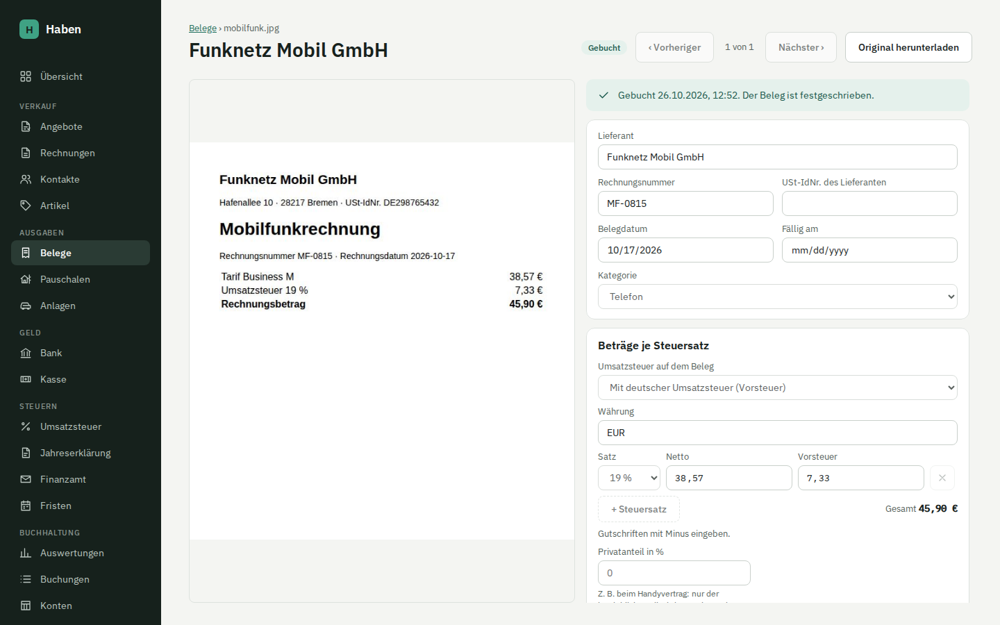

# Belege und Eingangsrechnungen

Unter **Belege** legst du Eingangsrechnungen und Quittungen ab. E-Rechnungen liest Haben direkt aus, andere PDFs und Fotos auf Wunsch mit Claude. Du prüfst die Felder, wählst eine Kategorie und buchst den Beleg; danach ist er festgeschrieben.



## So gehst du vor

1. Beleg hochladen (siehe unten).
2. Den Beleg in der Liste öffnen. Ist er aus einer E-Rechnung oder von der KI vorbefüllt, steht dort „Vorbefüllt aus … Bitte prüfen und bestätigen.“
3. **Lieferant**, **Rechnungsnummer**, **USt-IdNr. des Lieferanten**, **Belegdatum**, **Fällig am** und **Kategorie** prüfen oder eintragen.
4. Unter **Beträge je Steuersatz** Netto und Vorsteuer je Satz prüfen. Mit **+ Steuersatz** kommt eine Zeile für einen weiteren Satz dazu (höchstens 19 %, 7 % und 0 % je einmal).
5. Unter **Bezahlung** wählen, ob der Beleg über das Geschäftskonto oder privat bezahlt wurde.
6. **Bestätigen und buchen**, dann **Jetzt buchen**. Ungespeicherte Änderungen werden dabei vorher gespeichert.

Mit **Speichern** sicherst du Zwischenstände, ohne zu buchen.

## Hochladen

Es gibt drei Wege, alle führen zum selben Ergebnis:

| Weg | Wie |
| --- | --- |
| Ziehen und Ablegen | Dateien auf die Fläche „Belege hierher ziehen“ ziehen. |
| Dateiauswahl | **Dateien auswählen**, auch mehrere auf einmal (bis 50 je Vorgang). |
| Kamera | Auf dem Handy **Foto aufnehmen**; öffnet direkt die Rückkamera. |
| Teilen-Menü | In der als App installierten Version (PWA) taucht Haben im Teilen-Menü des Telefons auf. Geteilte Dateien gehen an `/api/belege/teilen` (bis 20 je Vorgang). Bei genau einer Datei öffnet Haben danach gleich den Beleg, sonst die Liste. |

Erlaubt sind PDF, JPEG, PNG, WebP, HEIC und E-Rechnungs-XML bis 20 MB je Datei. Nach dem Hochladen meldet Haben je Datei „abgelegt“, „liegt schon in Haben, nicht doppelt abgelegt“ oder den Grund der Ablehnung.

### Was im Hintergrund passiert

1. **Dateityp erkennen.** Haben erkennt den Typ am Inhalt der Datei (den ersten Bytes), nicht an Dateiendung oder Browserangabe. XML wird auch mit vorangestelltem UTF-8-BOM erkannt.
2. **Ablegen unter dem SHA-256.** Die Datei wird unter ihrem SHA-256-Hash im Verzeichnis `DOCUMENTS_DIR` gespeichert (`<dir>/ab/abcdef…`), atomar über eine temporäre Datei. Beim Lesen prüft Haben den Hash erneut und meldet eine beschädigte Datei.
3. **Keine Dubletten.** Gibt es schon einen Beleg mit demselben Hash, entsteht kein zweiter; du landest beim vorhandenen.
4. **E-Rechnung lesen.** Bei PDF und XML versucht Haben zuerst, eine E-Rechnung zu lesen (siehe unten).
5. **KI-Auslesung.** Ist es keine E-Rechnung und ist ein Anthropic-API-Schlüssel eingerichtet, startet für PDF, JPEG, PNG und WebP die KI-Auslesung im Hintergrund. Der Beleg zeigt solange „Wird ausgelesen“, Liste und Detailseite aktualisieren sich selbst.

Ohne E-Rechnung und ohne KI füllst du die Felder von Hand aus.

## Belege per E-Mail

Viele Rechnungen kommen per Mail. Unter **Einstellungen › E-Mail › Belege per E-Mail** trägst du ein Postfach ein, aus dem Haben sie selbst abholt:

- **Zugang:** IMAP-Server, Port, Verschlüsselung, Benutzername, Passwort und Ordner. Für Gmail, GMX, web.de, Posteo und mailbox.org sind Server und Port vorbelegt; Gmail, GMX und web.de brauchen ein App-Passwort bzw. freigeschaltetes IMAP. Das Passwort liegt verschlüsselt in der Datenbank.
- **Was abgeholt wird:** jede ungelesene Mail im Ordner. Ihre Anhänge gehen wie beim Hochladen zu den Belegen. E-Rechnungen werden gelesen, sonst greift die KI-Auslesung, und Dubletten erkennt Haben am Inhalt.
- **Was übersprungen wird:** eingebettete Bilder wie Logos und Signaturen sowie Dateien, die kein Beleg sein können (Word, ZIP …). Der Grund steht im Abrufprotokoll.
- **Danach** ist die Mail im Postfach als gelesen markiert. Am Beleg steht als Notiz, von wem und mit welchem Betreff er kam.
- **Wann:** stündlich, solange „Stündlich abrufen“ an ist, oder sofort mit **Jetzt abrufen**. Je Lauf höchstens 50 Mails.

Am besten richtest du eine eigene Adresse oder einen Ordner mit Filterregel ein, etwa `belege@…` oder „Rechnungen“, und leitest Rechnungen dorthin weiter. Im Hauptpostfach würde Haben jede ungelesene Mail anfassen.

Jede abgeholte Mail steht mit ihrer Message-ID genau einmal im Abrufprotokoll (nur anhängen). Markierst du sie wieder als ungelesen, legt Haben sie kein zweites Mal ab. Schlägt der Abruf fehl, etwa wegen eines falschen Passworts, steht der Fehler in den Einstellungen und auf der Belegseite.

## E-Rechnungen

Haben liest diese Formate:

| Format | Erkennung | Quelle in der Liste |
| --- | --- | --- |
| ZUGFeRD 2.x / Factur-X | PDF mit eingebetteter XML-Datei | ZUGFeRD |
| ZUGFeRD 1.0 | PDF mit eingebetteter XML (`CrossIndustryDocument`) | ZUGFeRD |
| XRechnung als PDF-Anhang | PDF mit eingebetteter `xrechnung.xml` | ZUGFeRD |
| XRechnung CII | XML-Datei mit Wurzel `CrossIndustryInvoice` | XRechnung |
| XRechnung UBL | XML-Datei mit Wurzel `Invoice` oder `CreditNote` | XRechnung |

Im PDF sucht Haben zuerst nach den Anhängen `factur-x.xml`, `zugferd-invoice.xml` und `xrechnung.xml`, danach nach jedem anderen XML-Anhang.

Übernommen werden Lieferant, USt-IdNr. des Lieferanten, Rechnungsnummer, Rechnungsdatum, Fälligkeit, Währung und die Beträge je Steuersatz. Gutschriften (z. B. Typcode 381 oder UBL `CreditNote`) werden mit negativen Beträgen übernommen. Steuersätze außer 19, 7 und 0 % werden nicht übernommen, sondern als Hinweis am Beleg angezeigt. Bei einer Fremdwährung übernimmt Haben die Beträge als Originalbeträge und rechnet sie mit dem Umsatzsteuer-Umrechnungskurs des Monats um (siehe [Fremdwährung](#fremdwährung)).

Lässt sich eine hochgeladene XML-Datei nicht als E-Rechnung lesen, steht der Fehler am Beleg. Bei einem PDF, dessen eingebettetes XML nicht lesbar ist, geht Haben weiter zur KI-Auslesung.

Eine E-Rechnung bringt keine Kategorie mit. Haben schlägt die Kategorie des letzten gebuchten Belegs desselben Lieferanten vor; gibt es keinen, bleibt das Feld leer.

## KI-Auslesung mit Claude

Die KI-Auslesung ist optional und nur aktiv, wenn `ANTHROPIC_API_KEY` gesetzt ist (siehe [installation.md](installation.md)). Ohne Schlüssel funktioniert alles andere weiter, auch das Lesen von E-Rechnungen.

**Was gesendet wird:** die Belegdatei selbst (PDF als Dokument, JPEG, PNG oder WebP als Bild) zusammen mit einer festen Anweisung und der Liste der Ausgabenkategorien. Sonst nichts aus deiner Buchhaltung. HEIC-Fotos und XML-Dateien gehen nicht an die KI.

**Was zurückkommt:** ein festes Schema mit Lieferant, USt-IdNr., Rechnungsnummer, Belegdatum, Fälligkeit, Währung, Netto und Steuer je Steuersatz, Bruttobetrag, Kategorie, ob es eine Gutschrift ist, und einem Hinweis bei Unklarheiten. Die Anweisung verlangt, nur zu übernehmen, was auf dem Beleg steht, und nichts zu raten.

Haben prüft die Antwort und zeigt Auffälligkeiten als Hinweis am Beleg:

- Netto plus Steuer weicht vom Gesamtbetrag ab.
- Ein Betrag ist nicht lesbar.
- Die Währung ist nicht Euro und der Kurs des Monats ist noch nicht veröffentlicht: Die Beträge stehen dann als Originalbeträge am Beleg, der Kurs fehlt noch.
- Der Hinweis der KI zu unklaren Stellen.

Die KI bucht nie selbst. Jeder ausgelesene Beleg bleibt im Status „Zu prüfen“, bis du ihn mit **Bestätigen und buchen** bestätigst. Mit **Mit KI neu auslesen** kannst du die Auslesung wiederholen, solange der Beleg nicht gebucht ist; dabei werden die Felder überschrieben. Fehler (ungültiger Schlüssel, Auslastung, keine Verbindung, abgelehnte Auslesung) stehen am Beleg, der dann den Status „Prüfen“ trägt.

Bei der Kategorie hat der letzte gebuchte Beleg desselben Lieferanten Vorrang vor dem Vorschlag der KI. Erkannt wird der Lieferant an der USt-IdNr. oder am Namen (ohne Groß- und Kleinschreibung).

## Kategorien

Die Kategorie bestimmt das Aufwandskonto. Die Zuordnung steht in `packages/core/src/posting.ts`.

| Kategorie | SKR03 | SKR04 |
| --- | --- | --- |
| Software und Lizenzen | 4964 | 6837 |
| Hosting und IT-Dienste | 4806 | 6495 |
| Hardware (GWG bis 800 € netto) | 0480 | 0670 |
| Telefon | 4920 | 6805 |
| Internet | 4925 | 6810 |
| Bürobedarf | 4930 | 6815 |
| Fachliteratur | 4940 | 6820 |
| Fortbildung | 4945 | 6821 |
| Reisekosten: Fahrten | 4673 | 6673 |
| Reisekosten: Übernachtung | 4676 | 6680 |
| Porto | 4910 | 6800 |
| Werbung | 4600 | 6600 |
| Bewirtung von Geschäftspartnern (70 % abziehbar) | 4650 | 6640 |
| Geschenke an Geschäftspartner (bis 50 € je Empfänger und Jahr) | 4630 | 6610 |
| Rechts- und Beratungskosten | 4950 | 6825 |
| Buchführung und Steuerberatung | 4955 | 6830 |
| Fremdleistungen | 3100 | 5900 |
| Kontoführung und Gebühren | 4970 | 6855 |
| Versicherungen | 4360 | 6400 |
| Beiträge | 4380 | 6420 |
| Sonstiger Aufwand | 4900 | 6300 |
| Kfz: Laden, Tanken, Wartung | 4530 | 6530 |
| Kfz: Versicherung | 4520 | 6520 |
| Kfz: Steuer | 4510 | 7685 |
| Kfz: Reparaturen | 4540 | 6540 |
| Kfz: Leasing | 4570 | 6560 |
| Anlagegut (wird abgeschrieben) | Anlagekonto je Art | Anlagekonto je Art |

**Bewirtung** von Geschäftspartnern zählt zu 70 % als Betriebsausgabe, die Vorsteuer voll; die Aufteilung macht die EÜR. **Geschenke** an Geschäftspartner sind nur bis 50 € netto je Empfänger und Jahr abziehbar (bis 2023: 35 €). Teurere Geschenke sind keine Betriebsausgabe, auch die Vorsteuer nicht: Buche sie mit Privatanteil 100 %.

Mit **Anlagegut** wird der Beleg nicht zum Aufwand, sondern legt beim Buchen eine Anlage im Verzeichnis an, die über die Nutzungsdauer abgeschrieben wird. Das Formular fragt dann nach Bezeichnung, Art, Abschreibung und Nutzungsdauer. Mehr unter [Anlagen und AfA](anlagen.md).

> [!IMPORTANT]
> Kategorien und Konten sind ein Vorschlag für typische Freiberufler-Ausgaben. Gleiche sie vor dem Echtbetrieb mit deiner Steuerberatung ab, besonders Hardware (GWG-Grenze) und Reisekosten.

## Beträge

Du gibst je Steuersatz Netto und Vorsteuer ein. Solange du die Vorsteuer nicht selbst geändert hast, rechnet Haben sie aus dem Netto vor. Beim Buchen übernimmt Haben die Vorsteuer genau so, wie sie im Formular steht, und rechnet nicht nach: maßgeblich ist der Betrag auf der Rechnung.

Gutschriften gibst du mit Minus ein.

## Privatanteil

Wird etwas auch privat genutzt, etwa der Handy- oder Internetvertrag, trägst du unter den Beträgen den **Privatanteil in %** ein. Nur der betriebliche Teil wird Ausgabe und Vorsteuer, der private Teil ist eine Entnahme:

```
4920 Telefon             32,00
1576 Vorsteuer 19 %       6,08
1800 Privatentnahmen      9,52   an  1600 Verbindlichkeiten   47,60
```

Vorgaben je Kategorie stellst du in den [Einstellungen](einrichtung.md#privatanteile) ein (Telefon, Internet). Sie werden beim Wählen der Kategorie und beim Auslesen übernommen. Bei Anlagegütern gibt es keinen Privatanteil; für Firmenwagen gilt die [Listenpreismethode](anlagen.md#private-nutzung-von-firmenwagen).

## Reverse Charge als Leistungsempfänger (§ 13b)

Viele Anbieter von Software und Cloud-Diensten aus dem EU-Ausland (Google, Microsoft, AWS, JetBrains, Adobe aus Irland oder den Niederlanden) stellen Unternehmern Rechnungen ohne Umsatzsteuer mit dem Hinweis „Reverse Charge“. Die Steuer schuldest dann du (§ 13b UStG) und ziehst sie im selben Zug als Vorsteuer wieder ab.

Unter **Umsatzsteuer auf dem Beleg** wählst du:

| Auswahl | Wann | Kennzahlen |
| --- | --- | --- |
| § 13b: Leistung eines Unternehmers aus dem EU-Ausland | sonstige Leistung eines Unternehmers mit Sitz in einem anderen EU-Land | Kz 46 (netto) und 47 (Steuer) |
| § 13b: Leistung eines Unternehmers aus dem Drittland | Leistung eines Unternehmers ohne Sitz in der EU, z. B. aus den USA, ohne deutsche Umsatzsteuer | Kz 84 (netto) und 85 (Steuer) |

Du trägst nur das Netto aus der Rechnung ein; Haben rechnet die Steuer zum gewählten Satz aus (änderbar). Bezahlt wird der Nettobetrag, der Bankabgleich erwartet also netto. Hat der Lieferant eine USt-IdNr. aus einem anderen EU-Land und steht keine Steuer auf dem Beleg, weist Haben darauf hin.

Gebucht wird (SKR03, SKR04 in Klammern):

- Aufwand netto an Verbindlichkeiten bzw. Privateinlage,
- Vorsteuer nach § 13b auf 1577 (1407) an Umsatzsteuer nach § 13b auf 1787 (3837).

In der [Voranmeldung](umsatzsteuer.md#-13b-als-leistungsempfänger) heben sich Steuer und Vorsteuer auf. Als Kleinunternehmer schuldest du die Steuer trotzdem, ziehst aber nichts ab: Sie wird Teil des Aufwands und ist mit der Voranmeldung zu zahlen. Mit Privatanteil ist die Steuer voll geschuldet, abziehbar nur der betriebliche Teil. In der EÜR zählt der gezahlte Nettobetrag; die Steuer an das Finanzamt erscheint dort, wenn sie gezahlt wird.

## Bezahlung

| Auswahl | Gegenkonto | Folge |
| --- | --- | --- |
| Über das Geschäftskonto (Zuordnung beim Bankabgleich) | Verbindlichkeiten | Der Beleg wird nach dem Buchen im [Bankabgleich](bank.md) als offener Posten angeboten. |
| Privat bezahlt (Privateinlage) | Privateinlagen | Der Beleg ist damit erledigt und taucht im Bankabgleich nicht auf. |
| Bar aus der Kasse (Zeile im Kassenbuch) | Kasse | Beim Buchen entsteht eine Zeile im [Kassenbuch](kasse.md). Reicht der Kassenbestand am Belegdatum nicht, lehnt Haben das Buchen ab. |

## Buchen

Vor dem Buchen müssen Lieferant, Belegdatum und Kategorie gesetzt sein und mindestens ein Betrag eingetragen sein; bei einer Fremdwährung auch der Umrechnungskurs. Fehlt etwas, steht oberhalb der Knöpfe „Vor dem Buchen: …“.

Beim Buchen legt Haben einen Buchungssatz mit dem Belegdatum an, schreibt ihn fest und sperrt den Beleg. Ab dann lehnen Datenbank-Trigger jede Änderung am Beleg und an seinen Beträgen ab.

Beispiel: Softwarelizenz über 100,00 € netto zu 19 %, über das Geschäftskonto bezahlt:

| Konto SKR03 | Konto SKR04 | Soll | Haben |
| --- | --- | ---: | ---: |
| 4964 Software und Lizenzen | 6837 Software und Lizenzen | 100,00 | |
| 1576 Vorsteuer 19 % | 1406 Vorsteuer 19 % | 19,00 | |
| 1600 Verbindlichkeiten | 3300 Verbindlichkeiten | | 119,00 |

Bei privater Zahlung steht statt Verbindlichkeiten das Konto Privateinlagen (SKR03 1890, SKR04 2180) im Haben. Vorsteuer zu 7 % geht auf 1571 bzw. 1401. Bei Gutschriften tauschen Soll und Haben die Seiten.

Die Zahlung selbst buchst du im Bankabgleich: Verbindlichkeiten an Bank (siehe [bank.md](bank.md)).

### Als Kleinunternehmer

Bist du in den Einstellungen als Kleinunternehmer nach § 19 UStG eingetragen, ziehst du keine Vorsteuer ab. Haben bucht dann den Bruttobetrag auf das Aufwandskonto, ohne Vorsteuerzeile und mit dem Steuerschlüssel `keineVSt`. Im Beispiel oben stünden 119,00 € auf 4964 bzw. 6837. Ob ein Beleg mit oder ohne Vorsteuerabzug gebucht wurde, hält Haben beim Buchen am Beleg fest. Spätere Auswertungen bleiben so richtig, auch wenn sich die Einstellung ändert.

## Belege nacheinander prüfen

Nach einem Import liegen oft viele Belege auf „Zu prüfen“. Damit du sie ohne Umweg über die Liste abarbeitest, steht oben in der Detailansicht **‹ Vorheriger**, die Position („3 von 17“) und **Nächster ›**. Die Reihenfolge ist die der Liste: offene zuerst, dann nach Belegdatum.

- **Nach dem Buchen** springt die Ansicht zum nächsten Beleg „Zu prüfen“; am Ende der Liste geht es vorn weiter. Ist keiner mehr offen, bleibt der gebuchte Beleg stehen, darüber steht „Alle Belege geprüft“ mit einem Link zur Liste.
- **Hierbleiben:** Entfernst du den Haken **Nach dem Buchen zum nächsten offenen Beleg** unter den Knöpfen, bleibt die Ansicht nach dem Buchen beim gebuchten Beleg, etwa um ihn danach im Bankabgleich zuzuordnen. Haben merkt sich die Wahl in diesem Browser.
- **Nach dem Löschen** geht es zum nächsten offenen Beleg, sonst zurück zur Liste.
- **Ungespeicherte Änderungen:** Beim Wechsel fragt Haben einmal nach; der zweite Klick wechselt ohne zu speichern.

| Taste | Wirkung |
| --- | --- |
| `J` oder `→` | Nächster Beleg (nicht in Eingabefeldern) |
| `K` oder `←` | Vorheriger Beleg |
| `Strg+Enter` (Mac: `Cmd+Enter`) | Wie ein Klick auf **Bestätigen und buchen**, auch aus einem Eingabefeld. Gebucht wird wie mit der Maus erst beim zweiten Mal. |
| `Esc` | Bricht die Rückfrage zum Buchen oder Löschen ab, sonst zurück zur Liste (nicht in Eingabefeldern) |

Auf dem Handy wischst du nach links zum nächsten und nach rechts zum vorigen Beleg.

Im [Bankabgleich](bank.md#zuordnen) geht es genauso: Nach dem vollständigen Zuordnen springt die Auswahl zum nächsten offenen Umsatz.

## Fremdwährung

Rechnungen in US-Dollar, Pfund oder einer anderen Währung (Software-Abos, Hosting, Werbung) buchst du so:

1. Unter **Beträge je Steuersatz** bei **Währung** den Code eintragen, z. B. `USD`. Bei E-Rechnungen und der KI-Auslesung steht er schon da.
2. Die Beträge so eintragen, wie sie auf dem Beleg stehen, also in der Fremdwährung.
3. **Kurs: 1 EUR = …** leer lassen. Für die Umsatzsteuer gilt der Umsatzsteuer-Umrechnungskurs, den das Bundesministerium der Finanzen (BMF) für jeden Monat veröffentlicht (§ 16 Abs. 6 UStG). Haben nimmt den Kurs für den Monat des Belegdatums aus den [abgerufenen Kursen](einrichtung.md#fremdwährung) und zeigt ihn mit Herkunft an, z. B. „1 EUR = 1,0812 USD (USt-Umrechnungskurs 09/2026)“.

Einen eigenen Kurs trägst du ein, wenn das Finanzamt dir den Tageskurs gestattet hat (Einstellung **Tageskurs** in den Firmendaten, dann mit **Kursdatum**) oder wenn du einen Kurs aus der Bankabrechnung nehmen willst. Ein eigener Kurs bleibt; ein übernommener USt-Kurs wechselt mit, wenn du das Belegdatum in einen anderen Monat änderst. Jede Änderung steht im Audit-Log des Belegs.

Haben rechnet jede Zeile durch den Kurs in Euro um und rundet kaufmännisch auf den Cent. Unter dem Gesamtbetrag stehen der Betrag in Euro und die Euro-Beträge je Steuersatz. Gebucht, in die Voranmeldung übernommen und im Bankabgleich zugeordnet wird nur der Euro-Betrag. Währung, Kurs und Originalbeträge bleiben am Beleg gespeichert und stehen im Jahresexport in `belege.csv`.

Bei § 13b steht keine Steuer auf der Rechnung. Haben rechnet dann das Netto in Euro um und berechnet die Steuer aus diesem Euro-Betrag.

Beispiel: 100,00 USD netto zu 19 % bei 1 EUR = 1,0812 USD ergibt 92,49 € netto und 17,57 € Vorsteuer (19,00 USD / 1,0812).

Das BMF veröffentlicht die Kurse eines Monats am ersten Arbeitstag des Folgemonats. Bis dahin lässt sich der Beleg speichern, aber nicht buchen („Kurs für 10/2026 noch nicht veröffentlicht“). Sobald Haben die Kurse abgerufen hat, rechnet es wartende Belege von selbst um; du kannst auch einen Kurs von Hand eintragen. Einen gebuchten Beleg ändert ein später abgerufener oder geänderter Kurs nicht.

Belastet die Bank einen anderen Euro-Betrag als den umgerechneten, gleichst du die Differenz im Bankabgleich als [Kursdifferenz](bank.md#kursdifferenz-bei-fremdwährung) aus.

## Vorsteuer in der Voranmeldung

Die Vorsteuer eines gebuchten Belegs zählt in der Umsatzsteuer-Voranmeldung für den Monat seines **Belegdatums**, unabhängig davon, wann er bezahlt wird, und auch bei Ist-Versteuerung. Ungebuchte Belege zählen nicht; die Voranmeldung weist vor dem Senden darauf hin. Belege, die ohne Vorsteuerabzug gebucht wurden, zählen nicht. Siehe [umsatzsteuer.md](umsatzsteuer.md).

## Löschen

**Löschen** gibt es nur für Belege, die noch nicht gebucht sind. Haben fragt einmal nach: Der Knopf heißt dann **Endgültig löschen**, darüber steht ein Warnhinweis. Erst der zweite Klick löscht den Beleg, die Datei wird aus der Ablage entfernt. Nutzt das Archiv oder der Lexoffice-Umzug dieselbe Datei (gleicher Inhalt, gleicher SHA-256), bleibt sie liegen. Einen gebuchten Beleg kannst du nicht löschen und nicht ändern.

## Liste und Status

Die Liste zeigt Datum, Lieferant mit Rechnungsnummer und Quelle (ZUGFeRD, XRechnung, KI oder Hand), Kategorie, Bruttobetrag und Status. Ungebuchte Belege stehen oben; die Zahl „… zu prüfen“ in der Kopfzeile zählt sie.

| Status | Bedeutung |
| --- | --- |
| Wird ausgelesen | Die KI liest den Beleg gerade. Das Formular ist solange gesperrt. Wurde der Server während der Auslesung neu gestartet, zeigt der Beleg beim nächsten Öffnen einen Fehler, und du liest ihn erneut aus oder füllst ihn von Hand aus. |
| Zu prüfen | Bereit zur Prüfung, noch nicht gebucht. |
| Prüfen | Die Auslesung ist fehlgeschlagen; der Grund steht am Beleg. |
| Gebucht | Festgeschrieben. |

Mit **Original herunterladen** bekommst du die Datei so zurück, wie du sie hochgeladen hast. Für XML und HEIC zeigt Haben keine Vorschau, sondern einen Link zum Öffnen der Datei.

## Grenzen

- Fremdwährung: Für den Monat gilt das Belegdatum; ein abweichendes Leistungsdatum hat der Beleg nicht.
- Nur die Steuersätze 19 %, 7 % und 0 %, je Satz eine Zeile.
- § 13b nur für sonstige Leistungen ausländischer Unternehmer (Kz 46/47 und 84/85), nicht für Bauleistungen, Gebäudereinigung, Gold oder Mobilfunkgeräte, und nicht bei Anlagegütern. Keine innergemeinschaftlichen Erwerbe von Waren.
- Keine Abschreibung über mehrere Jahre; die Kategorie Hardware ist für geringwertige Wirtschaftsgüter gedacht.
- HEIC-Fotos werden abgelegt, aber weder in der Vorschau angezeigt noch von der KI gelesen.
