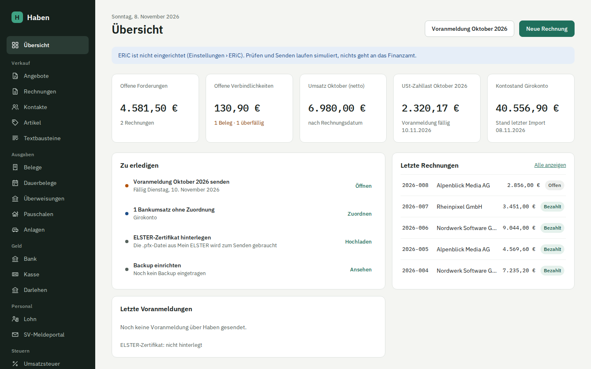
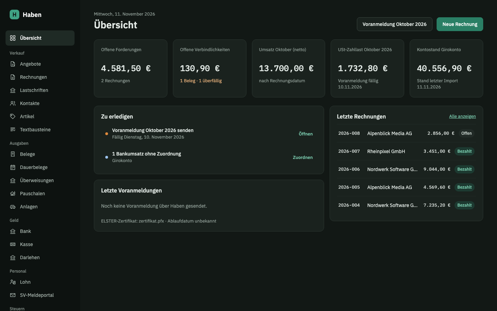

<!-- Die Seite für Erstbesucher: wenig Text, große Bilder. Jede Kachel und jede Funktion verlinkt die Seite mit
     den Details; die Bilder entstehen mit bun run docs:screenshots (entwicklung.md). -->

# Buchhaltung für Freiberufler, auf deinem eigenen Server

Rechnungen mit E-Rechnung, Belege, Bankabgleich, EÜR oder Bilanz und die Steuern direkt
an ELSTER. Für Freiberufler, Selbstständige und kleine GmbHs, ohne Abo.

[Installieren](installation.md){ .md-button .md-button--primary } [Rundgang ansehen](#rundgang){ .md-button }

{ width="1440" height="900" }
{ width="1440" height="900" }

### [Kein Abo](installation.md)

Open Source unter AGPL-3.0. Du zahlst nur den Server, etwa einen VPS ab rund 5 € im Monat.

### [Mit Docker installiert](installation.md#docker-compose)

Zwei Dateien laden, Domain und Schlüssel eintragen, mit `docker compose up -d` starten.

### [Deine Daten bei dir](architektur.md#sicherheit)

Alles liegt auf deinem Server, Zugänge verschlüsselt. Kein fremder Dienst sieht deine Rechnungen.

### [Für die GoBD gebaut](buchhaltung.md)

Festschreibung in der Datenbank, Änderungsprotokoll, Korrekturen nur per Storno.

### [Direkt ans Finanzamt](elster-abgabe.md)

Voranmeldung, Zusammenfassende Meldung und Jahreserklärungen über ELSTER.

### [Umzug aus Lexware Office](lexoffice.md)

Rechnungen, Belege, Buchungen und Kontakte kommen mit, aus [sevDesk](sevdesk.md) ebenso.

### [Auch für GmbH und UG](gmbh.md)

Bilanz und GuV, E-Bilanz, Körperschaft- und Gewerbesteuer, Gewinnausschüttung.

### [Lohn inklusive](lohn.md)

Abrechnung nach dem Programmablaufplan des BMF, Lohnsteuer-Anmeldung über ELSTER.

## Das PDF entsteht, während du tippst

Links die Positionen, rechts die fertige Rechnung. Beim Festschreiben wird sie zur E-Rechnung nach ZUGFeRD oder
XRechnung.

[Rechnungen und E-Rechnung](rechnungen.md)

{ width="1440" height="900" loading="lazy" }
{ width="1440" height="900" loading="lazy" }

## Belege per Drag-and-drop, Kamera oder E-Mail

E-Rechnungen liest Haben direkt, andere Belege auf Wunsch per KI. Du prüfst, wählst die Kategorie und buchst.

[Belege](belege.md)

{ width="1440" height="900" loading="lazy" }
{ width="1440" height="900" loading="lazy" }

## Enter, und die Zahlung ist zugeordnet

Die Umsätze kommen per PSD2 oder als Datei deiner Bank. Haben schlägt die passende Rechnung oder den Beleg vor
und sagt, warum.

[Bankimport und Abgleich](bank.md)

{ width="1440" height="900" loading="lazy" }
{ width="1440" height="900" loading="lazy" }

## Die Voranmeldung rechnet sich selbst

Jede Kennzahl kommt aus den Buchungen. Gesendet wird per ERiC an ELSTER oder, ohne Hersteller-ID, über Mein
ELSTER.

[Umsatzsteuer-Voranmeldung](umsatzsteuer.md)

{ width="1440" height="900" loading="lazy" }
{ width="1440" height="900" loading="lazy" }

## Umzug ohne Datenverlust

Rechnungen, Belege, Buchungen und Kontakte kommen aus Lexware Office oder sevDesk mit. Ein Abgleich je Jahr
zeigt, dass alles da ist, bevor du kündigst.

[Umzug aus Lexoffice](lexoffice.md), [Umzug aus sevDesk](sevdesk.md)

{ width="1440" height="2918" loading="lazy" }
{ width="1440" height="2918" loading="lazy" }

## Wie läuft das Jahr?

Einnahmen, Ausgaben und Gewinn nach Monaten, dazu die Anlage EÜR. Zum Jahresende das ganze Jahr als ZIP mit
Prüfsummen.

[Auswertungen und Jahresexport](auswertungen.md)

{ width="1440" height="900" loading="lazy" }
{ width="1440" height="900" loading="lazy" }

## Hell, dunkel oder wie dein System

Sechs Themes, zwei davon dunkel. Zieh am H, um beide zu vergleichen.

[Theme wählen](einrichtung.md#einstellungen-und-darstellung)

  
  
  

  
H

## Am Handy wie eine App

Haben lässt sich aus dem Browser als App installieren, ohne App Store. Belege fotografierst oder teilst du direkt
hinein.

[Als App installieren](einrichtung.md#als-app-installieren)

{ width="390" height="844" loading="lazy" }
{ width="390" height="844" loading="lazy" }

## Selbst ausprobieren

Haben läuft mit Docker oder Podman auf deinem Linux-Server. Es ist noch in der Beta,
mach vor jedem Update ein Backup.

[Installieren](installation.md){ .md-button .md-button--primary } [Alle Funktionen](ueberblick.md){ .md-button }

