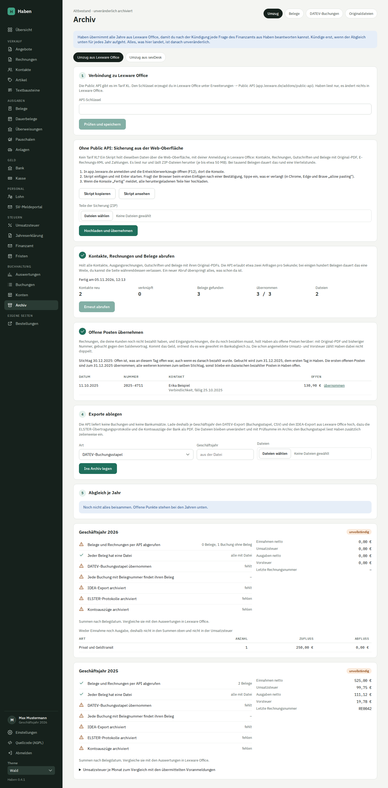

# Umzug aus Lexoffice / Lexware Office

Haben übernimmt deinen Bestand aus Lexware Office (früher Lexoffice), damit du das Abo kündigen kannst, ohne Daten zu verlieren. Der Umzug läuft auf der Seite **Archiv** unter „Umzug“, je nach Tarif auf einem von [drei Wegen](#drei-wege). Kommst du von sevDesk, lies [Umzug aus sevDesk](sevdesk.md).

## Worum es geht

Nach der Kündigung kommst du nicht mehr an deine Rechnungen, Belege und Buchungen in Lexware Office. Das Finanzamt kann aber noch Jahre später danach fragen. Haben holt deshalb alles, was die Schnittstelle hergibt, legt die Exporte unverändert daneben und zeigt dir je Geschäftsjahr, ob etwas fehlt. Was einmal im Archiv ist, lässt sich nicht mehr ändern oder löschen.

Der Altbestand bleibt von deiner laufenden Buchhaltung getrennt: Er fließt nicht in Bankabgleich, Voranmeldung und Auswertungen von Haben ein. Die einzige Ausnahme sind offene Posten, die du in Schritt 3 ausdrücklich übernimmst.

> [!NOTE]
> Der Abruf über die API ist gegen die öffentliche Dokumentation von Lexware Office gebaut und mit nachgestellten Antworten getestet. Ein Lauf gegen ein echtes Konto steht noch aus. Rechne damit, dass beim ersten echten Abruf Fehler auftauchen können, und kündige erst, wenn der Abgleich für jedes Jahr aufgeht.

## Drei Wege

Wie die Belege zu Haben kommen, hängt von deinem Tarif ab. Buchungen, Bankumsätze und ELSTER-Protokolle liefert keiner der Wege; die legst du immer als Exporte ab ([Schritt 4](#schritt-4-exporte-ablegen)).

| | [Public API](#schritt-1-verbindung-zu-lexware-office) | [Sicherung aus der Web-Oberfläche](#sicherung-aus-der-web-oberfläche) | [Nur über die Exporte](#nur-über-die-exporte) |
| --- | --- | --- | --- |
| Tarif | XL | jeder, auch S, M und L | jeder |
| So geht es | API-Schlüssel in Haben eintragen, **Alles abrufen** | Skript aus Haben in der Browser-Konsole von `app.lexware.de` starten, die ZIP-Dateien in Haben hochladen | DATEV-Buchungsstapel und Belegexport aus Lexware Office hochladen |
| Schritte | 1 bis 5 | 2 bis 5 | 4 und 5 |
| Kontakte | ✓ | ✓ | – |
| Rechnungen und Belege mit Positionen, Zahlungen und Steuerart | ✓ | ✓, Steuer je Position nachgerechnet | – |
| Original-PDF und E-Rechnungs-XML je Beleg | ✓ | ✓ | nur als ZIP im Archiv, ohne Suche nach Nummer |
| Offene Posten übernehmen ([Schritt 3](#schritt-3-offene-posten-übernehmen)) | ✓ | ✓ | von Hand anlegen |
| Umsatzsteuer je Monat im Abgleich | ✓ | ✓ | – (Summen je Jahr näherungsweise aus dem DATEV-Stapel) |
| Jahr im Abgleich „vollständig“ | ✓ | ✓ | nie |
| Wie verlässlich | dokumentierte Schnittstelle; gegen ein echtes Konto noch nicht gelaufen | nicht dokumentierte Adressen der Web-Oberfläche, Stand November 2026; ändert Lexware sie, kann das Skript scheitern | Standardformat (DATEV EXTF) |

Hast du Tarif XL, nimm die Public API. Sonst ist die Sicherung aus der Web-Oberfläche der Weg, der dieselben Daten bringt. Nur über die Exporte bleibt, wenn das Skript scheitert; dann fehlen Kontakte, Belege als Datensätze und offene Posten.

Bei jedem Weg gilt: Anlagen trägst du mit dem Restbuchwert ein ([Anlagen](anlagen.md#übernahme-aus-lexoffice)), Angebote, Aufträge, Lieferscheine und Mahnungen übernimmt Haben nicht.

## Voraussetzungen

- Für den Abruf über die API in Schritt 1 und 2 brauchst du die Public API von Lexware Office, und die gibt es nur im **Tarif XL**. Hast du einen kleineren Tarif, holst du dieselben Daten mit einem Skript über die Web-Oberfläche (siehe [Umzug ohne Public API](#umzug-ohne-public-api-tarife-s-m-und-l)).
- Den API-Schlüssel erzeugst du in Lexware Office unter **Erweiterungen → Public API** (`app.lexware.de/addons/public-api`).
- In Haben sollten Firmendaten, Kontenrahmen und Versteuerungsart (Ist oder Soll) eingerichtet sein ([Einrichtung](einrichtung.md)). Die Versteuerungsart bestimmt, wie offene Posten gebucht und wie die Umsatzsteuer im Abgleich gerechnet wird. Sie sollte dieselbe sein wie in Lexware Office.
- Der Server braucht Zugriff auf `https://api.lexware.io`.

## Wann umziehen: am besten zum Jahreswechsel

Am einfachsten ist der Wechsel zum **1. Januar**. Das Jahr davor schließt du in Lexware Office ab (EÜR und Voranmeldungen kommen dann vollständig aus einem System), und in Haben beginnt das neue Jahr ohne Altlasten:

- **Bank:** Ein neu verbundenes Konto ruft Haben ab dem 1. Januar des laufenden Jahres ab (siehe [Bank](bank.md#welche-umsätze-abgerufen-werden)). Verbindest du im Januar, beginnen die Umsätze genau am Jahresanfang, ohne Kontoauszug als Datei und ohne Überschneidung mit Lexware Office.
- **Offene Posten** übernimmst du zum 31. Dezember (Schritt 3), **Anlagen** mit dem Restbuchwert zum 1. Januar ([Anlagen](anlagen.md#übernahme-aus-lexoffice)).
- **Lexware Office** brauchst du danach nur noch für den Jahresabschluss des alten Jahres; kündigen kannst du, sobald der Abgleich aufgeht.

Ein Wechsel **unter dem Jahr** geht auch, ist aber aufwendiger: Für das laufende Jahr stehen die Monate vor dem Wechsel in Lexware Office, die danach in Haben, und für die EÜR muss beides zusammengeführt werden. Beim Verbinden der Bank trägst du unter **Umsätze abrufen ab** den Tag ein, an dem die Buchhaltung in Haben beginnt; die Monate davor holt Haben dann nicht (siehe [Bank](bank.md#automatischer-abruf)). Ältere Umsätze, die du doch in Haben brauchst, kommen per Kontoauszug als Datei; Haben ruft danach keine Tage mehr ab, die eine Datei schon abdeckt. Willst du Haben vorher ausprobieren, nimm dafür eine eigene Instanz und starte die echte Buchhaltung zum Jahreswechsel neu: Importierte Bankumsätze und Buchungen lassen sich nicht löschen.

## Umzug ohne Public API (Tarife S, M und L)

Ohne Tarif XL gibt es keinen API-Schlüssel. Dieselben Daten holst du dann über die Web-Oberfläche, die du ohnehin bezahlst: Ein Skript läuft in deinem angemeldeten Lexware Office, liest Kontakte, Rechnungen, Gutschriften und Belege mit Zahlungen, Original-PDF und E-Rechnungs-XML sowie die [Buchungen ohne Beleg](#buchungen-ohne-beleg) und lädt sie als ZIP-Dateien herunter. Haben übernimmt diese Sicherung genauso wie einen Abruf über die API; Schritt 2 bis 5 laufen danach unverändert.

### Sicherung aus der Web-Oberfläche

1. In Haben unter **Archiv › Umzug** im Kasten „Ohne Public API: Sicherung aus der Web-Oberfläche“ auf **Skript kopieren** klicken. Das Skript liegt auch unter `/lexware-sicherung.js` deiner Haben-Instanz; „Skript ansehen“ zeigt es vorher.
2. In `app.lexware.de` anmelden, die Entwicklerwerkzeuge öffnen (F12) und dort die **Konsole**. Skript einfügen und mit Enter starten. Chrome, Edge und Brave verlangen beim ersten Einfügen, dass du „allow pasting“ eintippst.
3. Warten, bis die Konsole „Fertig“ meldet. Das Skript holt etwa einen Beleg pro Sekunde; bei tausend Belegen dauert es eine Viertelstunde bis zwanzig Minuten. Danach geht es die Bankumsätze durch, um die Buchungen ohne Beleg zu finden; das dauert bei tausend Umsätzen etwa eine halbe Minute. Den Tab offen lassen und darin nicht weiterklicken.
4. Die heruntergeladenen Dateien `lexware-sicherung-<Datum>-teil-01.zip`, `…-teil-02.zip` usw. (je bis etwa 50 MB) in Haben im selben Kasten auswählen und **Hochladen und übernehmen**. Haben übernimmt einen Teil nach dem anderen; den Fortschritt zeigt Schritt 2.

Das Skript ändert nichts in Lexware Office. Es ruft nur die Adressen auf, die die Web-Oberfläche beim Anzeigen selbst abfragt, mit kurzen Pausen dazwischen, und schickt nichts an Haben oder sonst wohin: Die Daten landen nur als Download in deinem Browser.

Belege, die das Skript nicht laden konnte, stehen in der ZIP-Datei und nach dem Hochladen in Schritt 2 unter „nicht übernommen“. Lässt du das Skript später noch einmal laufen und lädst die neue Sicherung hoch, überspringt Haben alles, was schon da ist, und holt die fehlenden nach.

Buchungen, Bankumsätze, Voranmeldungen und Anlagen holst du wie beim Abruf über die API aus den Exporten (Schritt 4).

### Was die Web-Oberfläche anders liefert

Die Endpunkte der Web-Oberfläche sind nicht dokumentiert. Haben liest sie so, wie Lexware Office sie im November 2026 lieferte, und rechnet sie in die Form der Public API um:

| Daten | Adresse in `app.lexware.de` |
| --- | --- |
| Kontakte | `POST /desmos-rest/contacts/v1/search` (archiviert und nicht archiviert) |
| Belegliste | `GET /grld-rest/voucherservice/1/v200/vouchers` (mit und ohne `archived=true`) |
| Zahlungen, Positionen von Belegen | `GET /grld-rest/voucherservice/1/v100/voucherDetails/{Art}/{id}` |
| Rechnungen, Gutschriften, Abschläge | `GET /papyrus-rest/vouchers/sales-voucher/{id}` (abgeschlossene mit Status 423) |
| PDF des Rechnungsmoduls | `GET /salesdocgen/salesdocgen-rest/document/v100/salesVoucherPdf/{id}` |
| Belege der Buchhaltung | `GET /capsa/capsa-rest/vouchers/v1/vouchers/{id}` |
| Originaldatei eines Belegs | `GET /grld-rest/printservice/1/v100/printSimpleVoucherPdf/{id}/` |
| E-Rechnungs-XML eines Belegs | `GET /capsa/capsa-rest/v1/vouchers/{id}/einvoice` |
| Bankumsätze | `GET /fis/finance-rest/financialtransactionservice/v3/financialTransactions` (ohne ignorierte) |
| Zuordnungen eines Bankumsatzes | `GET /fis/finance-rest/voucherpaymentintegrationservice/v100/voucherPayments/financialTransaction/{id}` |
| Buchung ohne Beleg | `GET /grld-rest/financialvoucherservice/v100/financialVoucher/{id}` |

Unterschiede zur Public API:

- **Steuer je Position:** Die Belegansicht nennt je Position nur Betrag und Steuersatz. Haben rechnet die Steuer daraus (aus dem Bruttobetrag herausgerechnet bzw. auf den Nettobetrag aufgeschlagen, kaufmännisch gerundet). Bei mehreren Positionen kann das im Cent von Lexware Office abweichen; maßgeblich bleibt der Bruttobetrag des Belegs.
- **Schlussrechnungen:** Haben nimmt den geforderten Betrag (`claimed…`), in dem die Abschläge schon abgezogen sind.
- **Zahlungsarten:** „Sonstige Zahlung“ (`partPaymentOther`) zählt wie `manualPayment` der Public API als Entgelt.
- **Angebote, Aufträge, Lieferscheine und Entwürfe** lädt das Skript nicht.
- **Buchungen ohne Beleg** kommen nur über das Skript, siehe unten.
- Die Originalantworten liegen im übernommenen Beleg unter `web`, zum Nachweis.

Ändert Lexware die Web-Oberfläche, kann das Skript scheitern oder Felder nicht mehr finden. Prüfe deshalb nach dem Hochladen den Abgleich je Jahr (Schritt 5) besonders gründlich.

### Buchungen ohne Beleg

In Lexware Office kannst du einen Bankumsatz direkt einer Kategorie zuordnen, ohne einen Beleg hochzuladen, etwa Kontoführungsgebühren, Privatentnahmen oder eine Zahlung, deren Rechnung fehlt. Solche Buchungen stehen nicht in der Belegliste, und die Public API liefert sie gar nicht. Sie gehen aber mit ihrer Vorsteuer in die Voranmeldung ein. Fehlen sie, weicht die Umsatzsteuer je Monat in Haben von der übermittelten Voranmeldung ab.

Das Skript findet sie über die Bankumsätze: Hat ein Umsatz mehr Zuordnungen, als Belege aus der Belegliste auf ihn verweisen, fragt es die Zuordnungen ab und lädt jede Buchung ohne Beleg mit Kategorie, Steuersatz und Betrag. Haben übernimmt sie so:

- Als Einnahme- bzw. Ausgabebeleg ohne Nummer und ohne Datei. Als Kontakt steht der Name aus dem Bankumsatz da, als Notiz „Buchung ohne Beleg“ und der Verwendungszweck.
- Die Steuer rechnet Haben aus Betrag und Satz wie bei den übrigen Belegen; Lexware Office rechnet die Vorsteuer aus dem Bruttobetrag heraus (250,00 € zu 19 % → 39,92 €).
- Bezahlt ist die Buchung am Buchungstag des Bankumsatzes; bei Ist-Versteuerung zählen Einnahmen in diesem Monat.
- Im Abgleich je Jahr zählt die Prüfung „Jeder Beleg hat eine Datei“ sie nicht mit, die erste Prüfung nennt ihre Zahl.
- **Privat und Geldtransit:** Buchungen, deren Kategorien alle „privat“, „Geldtransit“, „Einkommensteuer“, „Kirchensteuer“ oder „Solidaritätszuschlag“ im Namen tragen, sind archiviert, zählen aber weder in den Einnahmen und Ausgaben noch in der Umsatzsteuer je Monat. Der Abgleich je Jahr weist sie getrennt aus. Lexware Office kennzeichnet private Kategorien nicht, Haben erkennt sie nur am Namen. Bei GmbH und UG ordnet Haben anders ein, siehe [Einordnung bei GmbH und UG](#einordnung-bei-gmbh-und-ug).

Hast du per API umgezogen, fehlen diese Buchungen. Lass dann zusätzlich das Skript laufen und lade die Sicherung hoch: Haben überspringt die Belege, die schon da sind, und übernimmt nur die Buchungen ohne Beleg.

Buchungen ohne Beleg im Kassenbuch sucht das Skript nicht; es geht nur die Bankumsätze durch.

### Nur über die Exporte

Ohne Skript und ohne API bleibt der Umzug über die Exporte aus Schritt 4:

1. In Lexware Office unter **Einstellungen › Export** je Geschäftsjahr die DATEV-konformen Dateien exportieren und den Buchungsstapel (`EXTF_Buchungsstapel_….csv`) als **DATEV-Buchungsstapel** hochladen.
2. Den IDEA-Export, die ELSTER-Protokolle und die Kontoauszüge wie in Schritt 4 ablegen.
3. Die Belegdateien selbst sichern: Der DATEV-Export „ohne Belegbilder“ enthält keine PDFs. Laut Lexware-Hilfe gibt es unter **Einstellungen › Export** auch einen Belegexport als ZIP mit je einem PDF und XML pro Beleg; ob er in deinem Tarif angeboten wird, siehst du dort. Lege die ZIP-Datei je Jahr als **Sonstiges** ab.

Was dabei fehlt:

- **Rechnungen und Belege als Datensätze.** Haben kennt nur die Buchungen aus dem DATEV-Stapel, nicht die einzelnen Belege mit Positionen, Zahlungsstatus und Steuerart. Die Belegdateien liegen nur als ZIP im Archiv, ohne Suche nach Nummer.
- **Kontakte.** Kunden und Lieferanten legst du in Haben neu an.
- **Offene Posten (Schritt 3).** Unbezahlte Rechnungen und Eingangsrechnungen trägst du in Haben selbst ein.
- **Umsatzsteuer je Monat** im Abgleich. Einnahmen, Ausgaben und die Steuer je Jahr rechnet Haben näherungsweise aus dem Buchungsstapel (siehe [Schritt 5](#schritt-5-abgleich-je-jahr)).
- **Der Status „vollständig“.** Die Prüfungen „Belege und Rechnungen per API abgerufen“ und „Jeder Beleg hat eine Datei“ bleiben offen, das Jahr wird im Abgleich nie als vollständig angezeigt. Ob alles da ist, entscheidest du selbst.

## Schritt 1: Verbindung zu Lexware Office

Füge den API-Schlüssel ein und klicke „Prüfen und speichern“. Haben fragt damit das Profil ab; klappt das, steht der Firmenname aus Lexware Office da. Der Schlüssel wird mit AES-256-GCM verschlüsselt in der Datenbank gespeichert (mit `HABEN_ENCRYPTION_KEY`, wie das ELSTER-Zertifikat) und taucht weder im Änderungsprotokoll noch im Jahresexport auf.

Haben liest nur. Es legt in Lexware Office nichts an und ändert nichts. Nach dem Umzug kannst du den Schlüssel mit „Schlüssel entfernen“ löschen und ihn in Lexware Office widerrufen.

## Schritt 2: Kontakte, Rechnungen und Belege abrufen

„Alles abrufen“ startet den Abruf im Hintergrund. Du kannst die Seite verlassen; der Fortschritt aktualisiert sich alle zwei Sekunden. Der Abruf läuft in drei Phasen:

1. **Kontakte:** alle Kontakte mit Name, Rolle (Kunde, Lieferant oder beides; ohne Rolle als Kunde), Kunden- und Lieferantennummer, Rechnungsadresse (sonst Lieferadresse), erster E-Mail-Adresse und USt-IdNr. Archivierte Kontakte werden in Haben archiviert angelegt.
2. **Belegliste:** alle Ausgangsrechnungen, Gutschriften und Abschlagsrechnungen aus dem Rechnungsmodul sowie alle Einnahme- und Ausgabebelege samt Gutschriften aus der Buchhaltung, archiviert und nicht archiviert. Entwürfe bleiben draußen.
3. **Belege und Dateien:** je Beleg die Details, der Zahlungsstatus mit den einzelnen Zahlungen, das Original-PDF, bei E-Rechnungen das XML und bei Buchhaltungsbelegen alle angehängten Dateien. Die Kategorien aus Lexware Office kommen mit ihrem Namen dazu.

Die Antwort der API wird je Beleg vollständig gespeichert, zum Nachweis. Beträge rechnet Haben in Cent um; maßgeblich sind Brutto und Steuer des Belegs, Netto ergibt sich daraus. Bei Schlussrechnungen rechnet Haben die verrechneten Abschläge je Steuersatz heraus, die Beträge entsprechen also dem geforderten Restbetrag. Die Abschlagsrechnungen sind eigene Belege; so zählen ihre Umsätze und Steuern im Abgleich und bei den offenen Posten nicht doppelt. Das gilt für Belege, die mit dieser Version abgerufen werden; schon gespeicherte Belege bleiben unverändert.

### Kontakte verknüpfen

Gibt es in Haben schon einen Kontakt mit demselben Namen (Groß- und Kleinschreibung egal) und ohne Lexoffice-Herkunft, verknüpft Haben ihn statt einen zweiten anzulegen. Der Fortschritt zeigt das unter „verknüpft“. Kontakte, die schon aus einem früheren Abruf stammen, überspringt Haben.

### Rate-Limit, Abbruch und Fortsetzen

Die API erlaubt etwa zwei Anfragen pro Sekunde. Haben hält zwischen zwei Anfragen mindestens 600 ms Abstand und wiederholt bei Rate-Limit (429) oder Serverfehlern (502, 503, 504) und Netzwerkfehlern bis zu fünfmal, mit wachsender Wartezeit bzw. so lange, wie die API mit `Retry-After` verlangt. Bei einigen hundert Belegen dauert der Abruf deshalb eine Weile.

- **Abbrechen** beendet den Lauf. Ein neuer Abruf überspringt alles, was schon da ist, und setzt dort fort.
- Wird der Server während des Abrufs neu gestartet, markiert Haben den Lauf nach drei Minuten ohne Fortschritt als abgebrochen. Auch dann setzt „Erneut abrufen“ fort.
- Ist der Schlüssel ungültig oder fehlt die Berechtigung (Tarif gewechselt), bricht der Lauf mit Fehlermeldung ab.
- Schlägt ein einzelner Beleg fehl, läuft der Abruf weiter. Die fehlgeschlagenen Belege stehen mit Nummer und Fehlermeldung in einer aufklappbaren Liste; der nächste Abruf versucht sie erneut.

Der Schritt ist erledigt, wenn ein Lauf fertig ist und die Liste der fehlgeschlagenen Belege leer ist.

### Was die API nicht liefert

- **Keine Buchungen.** Kontierung, Umbuchungen und Kontensalden gibt es nur im DATEV-Export (Schritt 4).
- **Keine Bankumsätze.** Die Kontoauszüge holst du bei deiner Bank.
- **Keine Buchungen ohne Beleg**, also Bankumsätze, die du in Lexware Office direkt einer Kategorie zugeordnet hast. Die holt das [Skript über die Web-Oberfläche](#buchungen-ohne-beleg).
- **Keine übermittelten Voranmeldungen** und keine ELSTER-Protokolle.
- **Kein Anlagenverzeichnis.** Anlagen wie ein Firmenwagen trägst du unter **Anlagen › Anlage übernehmen** mit dem Restbuchwert zum Stichtag ein, siehe [Anlagen und AfA](anlagen.md#übernahme-aus-lexoffice).
- Angebote, Auftragsbestätigungen, Lieferscheine und Mahnungen ruft Haben nicht ab.

## Schritt 3: Offene Posten übernehmen

Rechnungen, die deine Kunden noch nicht bezahlt haben, und Eingangsrechnungen, die du noch zahlen musst, sollen nach dem Umzug in Haben bezahlt werden. Dieser Schritt listet sie auf, sobald der Abruf gelaufen ist. Mit „Übernehmen“ (oder „Alle … übernehmen“) holst du sie herüber:

- Eine offene **Ausgangsrechnung** wird zu einer festgeschriebenen Rechnung in Haben, mit dem Original-PDF und der Rechnungsnummer aus Lexware Office (ohne Nummer `LX-` plus Kurz-ID). Je Steuersatz entsteht eine Position. Der Kunde ist der verknüpfte Kontakt; fehlt er, legt Haben ihn aus der Rechnungsadresse an.
- Ein offener **Ausgabebeleg** wird zu einem gebuchten Beleg mit Zahlung „Bank“, mit Datei, Lieferant, Nummer, Belegdatum, Fälligkeit und Beträgen je Steuersatz. Die Kategorie leitet Haben grob aus den Kategorienamen in Lexware Office ab; sie zählt nur für die Aufteilung in der EÜR.

Danach ordnest du den Zahlungseingang bzw. die Zahlung wie gewohnt im [Bankabgleich](bank.md) zu.

### Wie gebucht wird

Die Erlöse und Aufwände stehen schon in den Büchern von Lexware Office. Haben bucht deshalb nicht noch einmal Erlös oder Aufwand, sondern gegen den Saldenvortrag (Konto 9000), mit dem Datum der Übernahme. Die genauen Buchungssätze stehen in [Buchhaltung in Haben](buchhaltung.md#eröffnungsbuchungen-für-offene-posten-aus-lexoffice).

| Fall | Buchung | Umsatz- bzw. Vorsteuer |
| --- | --- | --- |
| Rechnung, Ist-Versteuerung | Forderung an Umsatzsteuer nicht fällig und Saldenvortrag | Noch nicht angemeldet; wird mit dem Zahlungseingang in Haben fällig und landet in der Voranmeldung des Zahlungsmonats |
| Rechnung, Soll-Versteuerung | Forderung an Saldenvortrag | Schon in Lexware Office angemeldet; Haben zählt sie nicht noch einmal |
| Eingangsbeleg | Saldenvortrag an Verbindlichkeiten | Vorsteuer schon in Lexware Office angemeldet; Haben zählt sie nicht noch einmal |

So wird keine Steuer doppelt angemeldet. In der EÜR von Haben zählt die Zahlung, wenn sie in Haben eingeht oder abfließt, wie jede andere Zahlung.

### Was nicht übernommen wird

Übernehmen lassen sich nur Rechnungen aus dem Rechnungsmodul und Ausgabebelege, die laut Lexware Office offen sind. Statt des Knopfs steht der Grund da, wenn einer dieser Punkte zutrifft:

| Hinweis | Was du tun kannst |
| --- | --- |
| Fremdwährung | Von Hand in Haben erfassen |
| teilweise bezahlt | Den Rest in Lexware Office ausgleichen oder die Zahlung in Haben ohne Rechnung buchen |
| Steuersatz, den Haben nicht kennt | Haben kennt 19 %, 7 % und 0 % |
| Betrag nicht positiv | Gutschriften werden nicht übernommen |
| keine Datei aus Lexoffice | Erst die Datei in Lexware Office anhängen und erneut abrufen |

Außerdem lehnt Haben die Übernahme ab, wenn die Rechnungsnummer in Haben schon vergeben ist, wenn sich die Steuer aus den Positionen nicht centgenau nachbilden lässt (weder mit Netto- noch mit Bruttopreisen, siehe [Rechnungen](rechnungen.md#nettopreise-oder-bruttopreise)) oder wenn die Datei eines Belegs schon als Beleg in Haben liegt (dann bezahlst du dort).

## Schritt 4: Exporte ablegen

Was die API nicht liefert, lädst du als Datei hoch. Wähle die Art, das Geschäftsjahr (beim DATEV-Stapel optional) und eine oder mehrere Dateien (bis zu 50 auf einmal, je höchstens 100 MB):

| Art | Woher | Was Haben damit macht |
| --- | --- | --- |
| DATEV-Buchungsstapel | Lexware Office, DATEV-Export, je Geschäftsjahr die CSV mit den Buchungen | Ablegen und zeilenweise einlesen |
| IDEA-Export | Lexware Office, Export für die Betriebsprüfung | Ablegen |
| ELSTER-Protokoll | Übertragungsprotokolle der Voranmeldungen | Ablegen |
| Kontoauszug | Bank, als PDF | Ablegen |
| Sonstiges | alles andere, was du aufheben willst | Ablegen |

Jede Datei bleibt byte-genau erhalten und liegt unter ihrem SHA-256. Dieselbe Datei zweimal hochzuladen lehnt Haben ab.

> [!IMPORTANT]
> Bei IDEA-Export, ELSTER-Protokollen und Kontoauszügen ist das **Geschäftsjahr** Pflicht; danach richten sich Abgleich und Jahresexport.

### DATEV-Buchungsstapel

Haben erkennt einen Buchungsstapel am Inhalt, auch wenn du eine andere Art gewählt hast. Erwartet wird das DATEV-Format EXTF (oder DTVF), Formatkategorie 21 „Buchungsstapel“, Version 7xx. Andere DATEV-Exporte, etwa Kontenbeschriftungen oder Debitoren/Kreditoren, werden mit Namen abgelehnt.

- **Kodierung:** UTF-8 (mit oder ohne BOM), UTF-16 mit BOM; alles andere liest Haben als Windows-1252.
- **Spalten:** Haben sucht die Spalten über ihren Namen, nicht ihre Position. Pflicht sind Umsatz, Soll/Haben-Kennzeichen, Konto, Gegenkonto und Belegdatum. Beim Vergleich der Namen zählen Groß- und Kleinschreibung, Leerzeichen und Bindestriche nicht, und „ae“, „oe“, „ue“, „ss“ gelten wie „ä“, „ö“, „ü“, „ß“. So passen auch die vereinfachten Namen aus Lexware Office wie „Umsatz“, „Gegenkonto“, „BU-Schluessel“ oder „Basisumsatz“. Übernommen werden außerdem Währung, BU-Schlüssel, Belegfeld 1 und 2, Buchungstext und Beleglink; alle anderen nicht leeren Spalten bleiben je Zeile unverändert gespeichert.
- **Belegdatum:** DATEV schreibt meist nur Tag und Monat (`TTMM`). Das Jahr ergibt sich aus dem Wirtschaftsjahresbeginn in der Kopfzeile; Monate vor dem Beginnmonat gehören ins Folgejahr. Liegt das Datum außerhalb des Zeitraums aus der Kopfzeile, nimmt Haben das andere Kalenderjahr des Zeitraums, sonst gibt es eine Warnung. `TTMMJJJJ` wird direkt gelesen.
- **Geschäftsjahr:** Lässt du das Feld leer, nimmt Haben das Jahr des Wirtschaftsjahresbeginns.
- **Fehler:** Negative Umsätze, ein Soll/Haben-Kennzeichen außer S oder H, fehlende Konten oder ein unmögliches Datum führen zur Ablehnung der ganzen Datei mit Zeilennummer. Hinweise wie „Umsatz ist 0,00“ werden angezeigt, die Datei wird trotzdem übernommen.
- **Überschneidung:** Ein Zeitraum darf nur einmal übernommen werden. Liegt eine schon eingelesene Buchung zwischen dem ersten und dem letzten Datum des neuen Stapels, lehnt Haben die Datei ab und nennt die vorhandene.

Ein [KI-Assistent](ki-assistenten.md#voranmeldungen-aus-lexware-office-vergleichen) liest die Salden je Konto und Monat und die einzelnen Buchungen über die Werkzeuge `lexoffice_konten` und `lexoffice_buchungen`.

Unter **DATEV-Buchungen** siehst du die Zeilen je Jahr, durchsuchbar nach Text, Belegfeld und Konto, und darunter die Umsätze je Konto. Dort, wo eine Steuerautomatik greift, sind die Beträge brutto; die Steuer ist nicht auf ein Steuerkonto aufgeteilt.

### Abschluss aus dem DATEV-Stapel (GmbH und UG)

Bei GmbH und UG rechnet Haben unter **DATEV-Buchungen** aus dem Stapel eines Jahres auch Bilanz, GuV, Körperschaft- und Gewerbesteuer, mit denselben Funktionen wie den [Jahresabschluss](buchhaltung.md#jahresabschluss-gmbh-und-ug) aus dem eigenen Journal. So lässt sich ein Jahr der alten Buchhaltung mit dem Abschluss der Steuerberatung vergleichen, bevor die Buchhaltung in Haben beginnt. Gebucht wird dabei nichts: Die Zahlen fließen weder ins Journal noch in Voranmeldung oder Saldenvortrag.

Aus den Buchungen werden Salden je Sachkonto, so wie Haben sie selbst gebucht hätte:

- **Steuer:** Wo eine Steuerautomatik oder ein BU-Schlüssel (2, 3, 8, 9) greift, ist der Betrag brutto. Der Steueranteil geht auf das Umsatz- bzw. Vorsteuerkonto zu 19 % oder 7 % (SKR03 1776, 1771, 1576, 1571; SKR04 3806, 3801, 1406, 1401), das Erlös- oder Aufwandskonto behält den Nettobetrag. BU-Schlüssel 40 hebt die Automatik auf. Es sind dieselben Regeln wie für die Jahressummen im [Abgleich](#schritt-5-abgleich-je-jahr), mit denselben Grenzen bei Sonderfällen wie § 13b.
- **Personenkonten:** Debitoren (erste Ziffer 1 bis 6) stehen auf Forderungen aus Lieferungen und Leistungen (SKR03 1400, SKR04 1200), Kreditoren (7 bis 9) auf Verbindlichkeiten (SKR03 1600, SKR04 3300). So vergibt DATEV die Nummern: 10000 bis 69999 Debitoren, 70000 bis 99999 Kreditoren bei vierstelligen Sachkonten ([Kontenrahmen SKR 03](https://www.datev.de/content/dam/markenassets/themen-und-produktgruppen/zielgruppen/mandant/unternehmer/branche/bau/11174%20SKR03%20BilrUg.pdf) und [SKR 04](https://www.datev.de/content/dam/markenassets/themen-und-produktgruppen/zielgruppen/mandant/unternehmer/branche/bau/11175%20SKR04%20BilrUg.pdf), gültig für 2026). Bei längeren Sachkonten (Sachkontenlänge 5 bis 8 in der Kopfzeile) hat ein Personenkonto genau eine Stelle mehr ([DATEV-Format, Buchungsstapel](https://developer.datev.de/de/file-format/details/datev-format/format-description/booking-batch)); die erste Ziffer entscheidet weiter.
- **Bestände zum Jahresbeginn:** Enthält der Stapel Buchungen auf die Saldenvortragskonten 9000 bis 9009, bringt er seine Eröffnungsbilanz selbst mit. Sonst trägt Haben die Bestandskonten aus den Stapeln der Vorjahre vor, das Ergebnis der Vorjahre als Gewinn- oder Verlustvortrag, wie beim [Saldenvortrag](buchhaltung.md#saldenvortrag-und-eröffnung-gmbh-und-ug) im Journal. Gibt es weder das eine noch das andere, fehlen die Bestände und die Bilanz ist unvollständig; GuV und Steuern stimmen trotzdem.
- **Kontenrahmen:** Gerechnet wird im Kontenrahmen der Firmendaten. Steht im Kopf eines Stapels ein anderer, nennt Haben das als Fehler, denn die Posten stimmen dann nicht.

Für die Steuern braucht Haben Hebesatz und Verlustvorträge des Jahres; du trägst sie unter **Buchhaltung › Jahresabschluss** für dieses Jahr ein. Konten ohne Posten in Bilanz oder GuV und nicht ausgeglichene Vortragskonten stehen als Hinweis über der Bilanz.

### Eröffnung aus dem DATEV-Stapel (GmbH und UG)

Für das erste Jahr in Haben schlägt Haben die Eröffnungsbuchung aus der Schlussbilanz des letzten archivierten Stapeljahres vor, statt dass du sie von Hand abtippst. Du findest den Vorschlag unter **Buchungen › Buchung erfassen**, wenn du **Eröffnungsbuchung** wählst, unter dem Formular: alle Bestandskonten mit Saldo gegen 9000 Saldenvorträge am 1. Januar, das Ergebnis des letzten Stapeljahres als Gewinn- bzw. Verlustvortrag (SKR03 0860/0868, SKR04 2970/2978). Du prüfst die Zeilen, vergleichst die Bilanzsumme mit der Bilanz der Steuerberatung und bestätigst mit **Eröffnung buchen** und **Jetzt buchen**. Erst dann bucht Haben. Danach ist 9000 ausgeglichen, und die Bilanz zum 1. Januar ist die Schlussbilanz des Stapels. Das verlangt der Grundsatz der Bilanzidentität ([§ 252 Abs. 1 Nr. 1 HGB](https://www.gesetze-im-internet.de/hgb/__252.html)): Die Eröffnungsbilanz eines Jahres stimmt mit der Schlussbilanz des Vorjahres überein.

Gebucht wird genau, was du gesehen hast: Haben rechnet den Vorschlag beim Buchen neu und vergleicht ihn über eine Prüfsumme mit dem angezeigten. Hat sich etwas geändert (ein weiterer Stapel, eine Übernahme dazwischen), lehnt es ab und du lädst die Seite neu. Die Zeilen lassen sich nicht bearbeiten; passt etwas nicht, korrigierst du es nach der Eröffnung mit einer Umbuchung oder storniert die Eröffnung. Die Buchung hat die Herkunft „Eröffnung“ und verweist als Beleg auf die archivierte Stapel-Datei.

**Vorbedingungen.** Statt des Knopfs steht der Grund da, wenn

- die Rechtsform keine GmbH oder UG ist (dann gibt es den Vorschlag gar nicht),
- das Jahr nach dem Stapel noch nicht begonnen hat,
- ein Stapel einen anderen Kontenrahmen hat als die Firmendaten,
- die Schlussbilanz nicht aufgeht: ein Konto ohne Posten in der Bilanz, ein anderes Konto der Klasse 9 mit Saldo, Saldenvortragskonten, die zusammen nicht null ergeben, oder Aktiva ungleich Passiva,
- es vor dem 1. Januar schon Buchungen in Haben gibt (dann trägt Haben die Salden selbst vor) oder die Bücher erst später mit einer Eröffnung beginnen,
- schon eine Eröffnung von Hand gebucht ist (zuerst stornieren) oder die Eröffnung aus dem Stapel schon gebucht ist,
- offene Posten oder Anlagen erst nach dem Eröffnungsjahr gegen 9000 übernommen wurden,
- die Kasse in der Schlussbilanz einen negativen Bestand hat (ein Kassenbuch beginnt nicht im Minus).

Bringt der letzte Stapel keine Eröffnungsbuchungen mit und gibt es keinen Stapel davor, zeigt Haben einen Hinweis, bucht aber: Das ist der Fall im Gründungsjahr. Sonst fehlen die Bestände des Stapeljahres, und du legst zuerst den Stapel des Vorjahres ins Archiv.

**Saldenvortragskonten.** DATEV trägt Sachkonten über 9000 (und 9001 bis 9007), offene Posten der Debitoren über 9008 und der Kreditoren über 9009 vor (Kontenrahmen SKR 03 und SKR 04 2026, Klasse 9 „Vortragskonten“). Das Summenvortragskonto 9090 ist kein Saldenvortrag. Ausgeglichen ist der Vortrag, wenn die drei zusammen null ergeben. Haben prüft deshalb die Summe von 9000 bis 9009, nicht jedes Konto einzeln; in der Eröffnung von Haben steht nur 9000.

**Mehr als 20 Zeilen.** Die manuelle Buchung hat höchstens 20 Zeilen, weil man sie eintippt. Eine Schlussbilanz hat oft mehr Konten; der Vorschlag darf bis zu 500 Zeilen haben.

**Nebenbücher.** Anders als die Eröffnung von Hand bucht der Vorschlag auch Bank, Kasse, Forderungen, Verbindlichkeiten, Umsatz- und Vorsteuer und Anlagen. Das geht, weil die Beträge aus dem Stapel gerechnet und nicht eingetippt werden, und weil die Nebenbücher den Eröffnungsbestand kennen:

| Bereich | Wie Haben die Eröffnung berücksichtigt |
| --- | --- |
| Offene Posten | Schon übernommene Rechnungen und Belege (Forderung bzw. Verbindlichkeit gegen 9000) rechnet der Vorschlag heraus: Er bucht nur den Rest bis zum Saldo der Schlussbilanz und auf 9000 das Gegenteil der Übernahmen. Wer einen Posten nach der Eröffnung übernimmt, dessen Belegdatum davor liegt, bekommt Rechnung bzw. Beleg für den Bankabgleich, aber keine zweite Buchung gegen 9000; der Posten steckt schon im Saldo. |
| Anlagen | Ebenso: Die Eröffnung einer übernommenen Anlage, die schon gebucht ist, rechnet der Vorschlag heraus; wird die AfA erst danach gebucht, verweist die Anlage auf die Eröffnung aus dem Stapel statt noch einmal gegen 9000 zu buchen. |
| Umsatzsteuer | Umsatzsteuer, Vorsteuer, nicht fällige Umsatzsteuer und Vorauszahlungen werden mit ihrem Saldo vorgetragen, wie beim Saldenvortrag in Haben. Die Voranmeldung rechnet aus Rechnungen und Belegen, nicht aus diesen Konten; der vorgetragene Saldo gehört zu Voranmeldungen des Vorjahres und zählt nicht noch einmal: Die Vorauszahlung gilt je Voranmeldungszeitraum ([§ 18 Abs. 1 UStG](https://www.gesetze-im-internet.de/ustg_1980/__18.html)), Besteuerungszeitraum ist das Kalenderjahr ([§ 16 Abs. 1 Satz 2 UStG](https://www.gesetze-im-internet.de/ustg_1980/__16.html)). Der Abgleich zwischen Journal und Voranmeldung lässt Eröffnungen deshalb außen vor. Zahlst du im Januar die Zahllast für Dezember, ordnest du die Abbuchung im Bankabgleich als **USt-Vorauszahlung** zu; sie läuft auf SKR03 1780 bzw. SKR04 3820 gegen den vorgetragenen Saldo, die Steuerkonten gleichen sich danach zusammen aus. |
| Kasse | Das Kassenbuch zählt den Kassenbestand der Eröffnung zum Anfangsbestand des Jahres, ohne eigene Zeile und ohne zweite Buchung (siehe [Kassenbuch](kasse.md)). |

**Storno.** Die Eröffnung aus dem Stapel stornierst du wie jede manuelle Buchung in den aufgeklappten Buchungszeilen. Haben lehnt den Storno ab, solange etwas ohne eigene Buchung auf ihr aufbaut: offene Posten, die nach der Eröffnung übernommen wurden und nur in ihrem Saldo stehen, und Anlagen, die auf sie verweisen. Ein Storno nähme deren Bestände mit, und eine Eröffnung von Hand brächte sie nicht zurück. Ebenso, wenn das Kassenbuch am Eröffnungsbestand hängt und ohne ihn negativ würde. Passt an der Eröffnung etwas nicht, korrigierst du es dann mit einer Umbuchung. Ohne solche Abhängigkeiten lässt sich die Eröffnung nach dem Storno neu vorschlagen und buchen.

## Schritt 5: Abgleich je Jahr

Für jedes Geschäftsjahr, aus dem Belege, Buchungen oder Dateien vorliegen, zeigt Haben eine Karte mit Prüfungen. Ein Jahr ist „vollständig“, wenn alle erfüllt sind:

| Prüfung | Erfüllt, wenn |
| --- | --- |
| Belege und Rechnungen per API abgerufen | mindestens ein Beleg mit Datum in diesem Jahr vorliegt; Buchungen ohne Beleg werden extra gezählt |
| Jeder Beleg hat eine Datei | kein Beleg des Jahres ohne Datei ist, Buchungen ohne Beleg ausgenommen; „Belege ohne Datei ansehen“ zeigt die Liste |
| DATEV-Buchungsstapel übernommen | Buchungen mit Datum in diesem Jahr eingelesen sind |
| Jede Buchung mit Belegnummer findet ihren Beleg | für jede Buchung mit Belegfeld 1 ein Lexoffice-Beleg mit derselben Nummer existiert (Leerzeichen und Groß-/Kleinschreibung egal); Buchungen ohne Belegnummer, etwa Umbuchungen, werden nur gezählt |
| IDEA-Export archiviert | eine Datei der Art IDEA mit diesem Jahr vorliegt |
| ELSTER-Protokolle archiviert | mindestens ein ELSTER-Protokoll mit diesem Jahr vorliegt |
| Kontoauszüge archiviert | mindestens ein Kontoauszug mit diesem Jahr vorliegt |

Daneben stehen Einnahmen netto, Umsatzsteuer, Ausgaben netto und Vorsteuer, jeweils nach Belegdatum, und die letzte Rechnungsnummer des Jahres. Vergleiche die Summen mit den Auswertungen in Lexware Office.

Was weder Einnahme noch Ausgabe ist, fehlt in diesen Summen und in der Umsatzsteuer je Monat, steht aber in einer eigenen Tabelle **Weder Einnahme noch Ausgabe**: je Art die Zahl der Belege und Buchungen, Zufluss und Abfluss brutto; Gutschriften mindern sie. Im Einzelunternehmen ist das „Privat und Geldtransit“ (siehe [Buchungen ohne Beleg](#buchungen-ohne-beleg)), bei GmbH und UG gilt die folgende Einordnung. Weicht eine Summe von Lexware Office ab, steckt der Unterschied oft hier.

### Einordnung bei GmbH und UG

Eine GmbH oder UG hat keine Privatsphäre: Was im Einzelunternehmen Privatentnahme oder -einlage hieße, läuft über das Gesellschafter-Verrechnungskonto. Stammkapital, Gesellschafterdarlehen und deren Tilgung sind Kapital- und Finanzierungsvorgänge. Körperschaftsteuer, Solidaritätszuschlag und Gewerbesteuer samt Zinsen und Säumniszuschlägen darauf mindern das Einkommen nicht (§ 10 Nr. 2 KStG, § 4 Abs. 5b EStG). Haben ordnet deshalb bei GmbH und UG nach dem Namen der Kategorie in Lexware Office ein:

| Art | Kategorien mit … im Namen |
| --- | --- |
| Gesellschafter (Verrechnungskonto, Einlagen, Entnahmen, Ausschüttungen) | „Gesellschafter“, „Verrechnungskonto“, „privat“, „Einlage“, „Entnahme“, „Ausschüttung“, „Kapitalertragsteuer“, „Einkommensteuer“, „Kirchensteuer“ |
| Stammkapital und Darlehen | „Stammkapital“, „Gezeichnetes Kapital“, „Kapitalerhöhung“, „Kapitalrücklage“, „Kapitaleinlage“, „Darlehen“, „Tilgung“ |
| Körperschaft- und Gewerbesteuer | „Körperschaftsteuer“, „Gewerbesteuer“, „Solidaritätszuschlag“ |
| Geldtransit | „Geldtransit“ |

Nennt eine Kategorie außer Gesellschafter oder Darlehen auch Zinsen, Gehalt, Lohn, Geschäftsführer, Vergütung, Miete, Pacht, Gebühr, Provision oder Beratung, bleibt sie Einnahme bzw. Ausgabe: Zinsen für ein Gesellschafterdarlehen und das Gehalt des Gesellschafter-Geschäftsführers sind Aufwand. Lohnsteuer bleibt Ausgabe, auch mit Solidaritätszuschlag oder Kirchensteuer im Namen. Ein Beleg mit Umsatzsteuer ist Leistungsaustausch und bleibt immer Einnahme bzw. Ausgabe, etwa die private Kfz-Nutzung oder eine Rechnung an den Gesellschafter; Verrechnung, Kapital und Steuern vom Einkommen tragen keine Umsatzsteuer. Neutral ist ein Beleg nur, wenn jede seiner Kategorien es ist. Das gilt für Belege und Buchungen ohne Beleg; ein Steuerbescheid als Beleg braucht trotzdem seine Datei.

Eingeordnet wird beim Anzeigen aus den archivierten Kategorien, die abgerufenen Daten bleiben unverändert. Ändert sich die Rechtsform in den Firmendaten, ändert sich die Einordnung mit. Im Einzelunternehmen bleibt es bei der Erkennung beim Abruf. Die KI-Werkzeuge `lexoffice_abgleich` und `lexoffice_belege` ordnen genauso ein.

Gibt es für ein Jahr keine Belege per API (etwa im Tarif ohne Public API), rechnet Haben die Summen aus dem DATEV-Buchungsstapel: Erlöse und Aufwand nach den Kontenklassen des Kontenrahmens (SKR03: 8 sowie 3 und 4; SKR04: 4 sowie 5 und 6), die Steuer aus Automatikkonten und den BU-Schlüsseln 2, 3, 8 und 9 oder aus Buchungen auf den Umsatz- und Vorsteuerkonten. Personenkonten (Debitoren und Kreditoren, länger als die Sachkontenlänge aus der Kopfzeile) zählen nicht mit; fünfstellige Sachkonten wie 84000 liest Haben wie 8400. Das ist eine Näherung; Sonderfälle wie § 13b stehen nur über die Steuerkonten drin.

### Umsatzsteuer je Monat

Aufgeklappt zeigt jede Karte eine Tabelle je Monat, berechnet aus den abgerufenen Belegen:

| Spalte | Inhalt |
| --- | --- |
| Kz 81 | Bemessungsgrundlage (netto) der Umsätze zu 19 % |
| Kz 86 | Bemessungsgrundlage (netto) der Umsätze zu 7 % |
| Kz 66 | Vorsteuer aus Ausgabebelegen und Buchungen ohne Beleg nach Belegdatum |
| Kz 21, 41, 43, 45, 60, 87 | Sonderfälle nach der Steuerart der Rechnung in Lexware Office (siehe unten); die Spalte erscheint nur, wenn im Jahr etwas drinsteht |
| Steuerfrei | Rechnungen mit Steuerart „steuerfrei“: Kz 48, wenn sie nach § 4 Nr. 8–28 UStG steuerfrei sind, bei Kleinunternehmern gar nicht gemeldet |
| OSS | Fernverkäufe und elektronische Dienstleistungen ins EU-Ausland über das OSS-Verfahren; gehören nicht in die Voranmeldung |
| Andere Sätze | Umsätze zu 0 % und Altsätzen (16 %, 5 %) sowie unbekannte Steuerarten, nur zur Information |

Die Steuerart liest Haben aus der gespeicherten Antwort der API (`taxConditions.taxType`), auch für schon abgerufene Belege:

| Steuerart in Lexware Office | Kennzahl |
| --- | --- |
| Netto, Brutto | Kz 81 (19 %), Kz 86 (7 %), sonst „Andere Sätze“ |
| Innergemeinschaftliche Lieferung (`intraCommunitySupply`) | Kz 41 |
| Fremdleistung § 13b EU (`externalService13b`) | Kz 21 |
| Bauleistung § 13b (`constructionService13b`) | Kz 60 |
| Dienstleistung Drittland (`thirdPartyCountryService`) | Kz 45 |
| Ausfuhrlieferung Drittland (`thirdPartyCountryDelivery`) | Kz 43 |
| Photovoltaik 0 % (`photovoltaicEquipment`) | Kz 87 |
| Steuerfrei (`vatfree`) | Steuerfrei |
| mit Unterart Fernverkauf oder elektronische Dienstleistung | OSS |

Kz 21, 41 und 60 zählen auch bei Ist-Versteuerung im Monat des Belegdatums, die übrigen wie die regulären Umsätze. Die Eingangsseite von § 13b (Kz 46, 47, 84, 85, 67) rechnet Haben nicht nach: Buchhaltungsbelege tragen in der API keine eigene Steuerart dafür.

Bei Soll-Versteuerung zählen Einnahmen nach Belegdatum. Bei Ist-Versteuerung zählen sie anteilig nach Datum der einzelnen Zahlungen aus dem Zahlungsstatus; Skonto, Mahnkosten, Kursdifferenzen und Forderungsausfälle zählen dabei nicht. Gutschriften mindern die Umsätze.

Lege die übermittelten Voranmeldungen (ELSTER-Protokolle) daneben und vergleiche Monat für Monat. Mit einem [KI-Assistenten](ki-assistenten.md#voranmeldungen-aus-lexware-office-vergleichen) geht das auch im Gespräch, bis auf den einzelnen Beleg. Bemessungsgrundlagen meldet ELSTER in vollen Euro, kleine Abweichungen im Centbereich sind also normal. Größere Abweichungen entstehen, wenn in Lexware Office nachträglich etwas korrigiert, eine Voranmeldung von Hand angepasst oder eine Rechnung storniert wurde, oder wenn [Buchungen ohne Beleg](#buchungen-ohne-beleg) fehlen, weil der Umzug nur über die API lief. Kläre sie vor der Kündigung.

### Rechnungsnummern weiterzählen

Im laufenden Jahr erinnert die Karte daran, die nächste Rechnungsnummer in den [Einstellungen](einrichtung.md) auf die Nummer nach der letzten aus Lexware Office zu setzen, damit der Nummernkreis lückenlos weiterläuft.

## Unveränderlich archiviert

Abgerufene Belege, ihre Dateien, archivierte Exporte und DATEV-Buchungen kann niemand mehr ändern oder löschen, auch nicht direkt in der Datenbank: Postgres-Trigger lehnen `UPDATE` und `DELETE` ab. Das Ablegen jeder Datei und jeder Abruf stehen im Änderungsprotokoll. Ändern dürfen sich nur der gespeicherte Schlüssel und der Fortschritt eines laufenden Abrufs.

Unter **Belege** findest du den Altbestand je Jahr, filterbar nach Einnahmen und Ausgaben, nach Nummer, Kontakt oder Notiz durchsuchbar und mit dem Filter „ohne Datei“. Jeder Beleg zeigt die Beträge je Steuersatz, die Kategorien, den Zahlungsstatus und seine Dateien. Unter **Originaldateien** liegen die hochgeladenen Exporte zum Herunterladen.

Im [Jahresexport](auswertungen.md#jahresexport) steht der Altbestand jedes Jahres unter `lexoffice/`: Belege mit Originaldateien, `belege.csv`, `datev-buchungen.csv` und die Originalexporte unter `originale/`.

## Andere API-Adresse

Haben spricht standardmäßig mit `https://api.lexware.io/v1`. Mit der Umgebungsvariable `LEXOFFICE_API_URL` setzt du eine andere Basis-URL, etwa zum Testen gegen einen nachgestellten Server oder falls Lexware die Adresse ändert. Die ältere Adresse `https://api.lexoffice.io/v1` sollte ebenfalls funktionieren.

## Umzug einer GmbH oder UG

Für eine GmbH oder UG läuft der Umzug genauso. Weil sie bilanziert, kommen zu den offenen Posten die übrigen Bestände zum Stichtag dazu. Liegt der DATEV-Stapel des Vorjahres im Archiv, schlägt Haben die ganze [Eröffnung aus dem DATEV-Stapel](#eröffnung-aus-dem-datev-stapel-gmbh-und-ug) vor, samt Bank, Kasse, offenen Posten und Umsatzsteuer; schon übernommene offene Posten rechnet sie heraus. Ohne Stapel erfasst du Bank, Stammkapital, Gewinnvortrag und Gesellschafter-Verrechnungskonto als [Eröffnungsbuchung](buchhaltung.md#saldenvortrag-und-eröffnung-gmbh-und-ug) von Hand gegen 9000, Anlagen über das [Anlagenverzeichnis](anlagen.md). Die Werte stehen in der Schlussbilanz des Vorjahres von der Steuerberatung. Sind alle Bestände übernommen, ist 9000 ausgeglichen. Den ganzen Ablauf zeigt [GmbH und UG](gmbh.md).

## Grenzen

- Der Client ist noch nicht gegen ein echtes Lexware-Konto gelaufen (siehe Hinweis oben).
- Buchungen kommen nur aus dem DATEV-Stapel und werden archiviert, nicht in das Journal von Haben übernommen. Bei GmbH und UG wird die Schlussbilanz des letzten Stapeljahres auf deine Bestätigung als [Eröffnung](#eröffnung-aus-dem-datev-stapel-gmbh-und-ug) gebucht; im Einzelunternehmen hältst du Salden für den Jahreswechsel selbst bzw. mit deiner Steuerberatung fest.
- Der Abgleich prüft Vollständigkeit und Nummern, keine Kontierung. Summen und Umsatzsteuer vergleichst du selbst mit Lexware Office.
- Die Umsatzsteuer je Monat kennt keine Eingangsseite von § 13b (Kz 46, 47, 84, 85, 67), keine Berichtigungen nach § 17 und keine von Hand geänderten Voranmeldungen.
- Teilweise bezahlte Posten, Gutschriften, Fremdwährung und andere Steuersätze als 19, 7 und 0 % werden nicht als offene Posten übernommen.
- Bei ungeprüften Belegen ohne Belegdatum nimmt Haben das Anlagedatum; solche Belege haben oft keine Beträge.

## Vor der Kündigung

- [ ] Abruf ist fertig, die Liste der fehlgeschlagenen Belege ist leer
- [ ] Für jedes Geschäftsjahr: DATEV-Buchungsstapel, IDEA-Export, ELSTER-Protokolle und Kontoauszüge abgelegt, jeweils mit Jahr
- [ ] Jedes Jahr zeigt „vollständig“
- [ ] Einnahmen, Ausgaben, Umsatz- und Vorsteuer je Jahr mit Lexware Office verglichen
- [ ] Umsatzsteuer je Monat mit den übermittelten Voranmeldungen verglichen
- [ ] Offene Posten übernommen oder die Gründe geklärt
- [ ] Nächste Rechnungsnummer in Haben gesetzt
- [ ] Jahresexport für jedes übernommene Jahr heruntergeladen und die Prüfsummen geprüft
- [ ] Backup von Datenbank und Belegdateien läuft ([Installation](installation.md))
- [ ] API-Schlüssel in Haben entfernt und in Lexware Office widerrufen

> [!NOTE]
> Stimme den Umzug mit deiner Steuerberatung ab, besonders die Saldenvorträge zum Jahreswechsel und die Frage, welche Unterlagen du in welcher Form aufbewahren musst.
