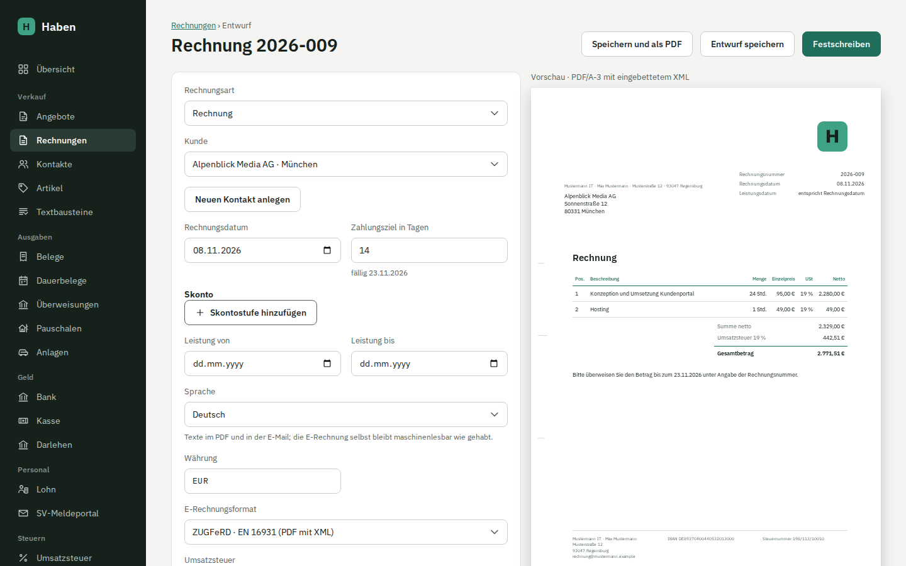

# Rechnungen und E-Rechnung

Haben schreibt Ausgangsrechnungen als E-Rechnung: ZUGFeRD (PDF/A-3 mit eingebettetem XML, Profil EN 16931) oder XRechnung 3.0 in CII- oder UBL-Syntax. Eine Rechnung ist zuerst ein Entwurf, den du beliebig ändern kannst. Mit dem Festschreiben bekommt sie ihre Nummer, PDF und XML werden erzeugt, sie wird gebucht und ist danach unveränderlich.

## Voraussetzungen

Bevor du die erste Rechnung festschreibst, brauchst du:

- **Firmendaten** unter Einstellungen: Firmenname, Anschrift, E-Mail-Adresse, IBAN und Steuernummer oder USt-IdNr. Fehlt etwas, zeigt der Editor oben „Vor dem Festschreiben: …“ mit einem Link „Firmendaten ergänzen“. Siehe [einrichtung.md](einrichtung.md).
- **Einen Kontakt** für den Kunden (siehe [Kontakte](kontakte.md)).
- Für XRechnung zusätzlich eine **Telefonnummer** in den Firmendaten und beim Kunden eine **E-Mail-Adresse oder Leitweg-ID**.

## So gehst du vor

1. Unter **Rechnungen** auf **Neue Rechnung** klicken.
2. **Kunde** wählen: Das Feld sucht beim Tippen nach Name, Kundennummer und Ort (Serienrechnungen haben dieselbe Auswahl; bei Textbausteinen bedeutet ein leeres Feld „für alle Kunden“); Pfeiltasten und Enter wählen einen Treffer, Escape schließt die Liste. Ohne Auswahl bleibt der bisherige Kunde, ein geleertes Feld nimmt ihn weg. Hat der Kontakt ein Standardformat, wird es übernommen; hat er eine Leitweg-ID und kein Standardformat, stellt Haben auf XRechnung 3.0 (CII) um. Fehlt der Kunde noch, legst du ihn über den letzten Eintrag der Trefferliste an: **Neuen Kontakt anlegen**, oder nach dem Tippen **„…“ als neuen Kunden anlegen** mit dem getippten Namen. Beides geht, ohne den Entwurf zu verlassen: Im Dialog ist die Rolle **Kunde** angehakt, nach dem Speichern ist er gewählt, und die Eingaben im Entwurf bleiben stehen, auch wenn du abbrichst. Gibt es schon einen Kontakt mit derselben USt-IdNr., weist der Dialog darauf hin: Ist er ein Kunde und nicht archiviert, kannst du ihn wählen, statt eine Dublette anzulegen; sonst verweist der Hinweis auf den Kontakt, um dort die Rolle zu ergänzen oder ihn wiederherzustellen. Das gilt ebenso im Angebot.
3. **Rechnungsdatum** und **Zahlungsziel in Tagen** (0 bis 120) eintragen. Darunter steht das errechnete Fälligkeitsdatum (siehe [Fälligkeit](rechnungen-zahlung.md#fälligkeit)). Vorgabe für das Zahlungsziel ist der Wert aus den Firmendaten.
   Optional **Skonto**: je Stufe Satz und Frist in Tagen, vorbelegt vom Kunden oder aus den Firmendaten (siehe [Skonto](rechnungen-zahlung.md#skonto)).
4. Optional **Leistung von** und **Leistung bis**. Ohne Angabe gilt das Rechnungsdatum als Leistungsdatum; ist nur ein Tag angegeben oder sind beide gleich, erscheint auf der Rechnung „Leistungsdatum“, sonst „Leistungszeitraum“. Bei einem Zeitraum übernimmt Haben im XML die Kundenanschrift als Lieferanschrift mit Lieferland. Eine abweichende Lieferanschrift kennt Haben nicht.
   Optional **Bestellnummer**, **Eigene Auftragsnummer** und **Lieferscheinnummer** (siehe [Bestellnummer, Auftrag und Lieferschein](#bestellnummer-auftrag-und-lieferschein)).
5. **E-Rechnungsformat** prüfen.
6. Unter **Umsatzsteuer** die steuerliche Behandlung wählen, im Normalfall „Regulär“ (siehe [Umsatzsteuer auf der Rechnung](#umsatzsteuer-auf-der-rechnung)).
7. Unter **Preise** wählen, ob die Einzelpreise netto oder brutto inklusive Umsatzsteuer gelten (siehe [Netto- oder Bruttopreise](#nettopreise-oder-bruttopreise)). Vorgabe ist netto.
8. Optional eine **Einleitung über den Positionen** eintragen (Kopftext, bis 2000 Zeichen), etwa Rahmenvertrag oder Anrede; Bestell-, Auftrags- und Lieferscheinnummer haben eigene Felder. Vorbelegt ist sie mit der Standard-Einleitung für Rechnungen aus den [Firmendaten](einrichtung.md). **Textbaustein einfügen** übernimmt einen gespeicherten Kopftext (siehe [Textbausteine](#textbausteine)).
9. **Positionen** erfassen: Beschreibung, Menge, Einheit, Einzelpreis und Steuersatz. Mit **+ Position hinzufügen** kommt eine weitere Zeile dazu; sie übernimmt Einheit und Steuersatz der letzten Zeile.
10. Optional einen **Hinweis auf der Rechnung** eintragen (Fußtext unter den Summen, bis 2000 Zeichen), auch aus einem Textbaustein. Für private Grundstücksleistungen darunter den [Aufbewahrungshinweis](#aufbewahrungshinweis-bei-grundstücksleistungen) einschalten.
11. **Entwurf speichern** oder direkt **Festschreiben**. Das Festschreiben fragt in einem Dialog nach und nennt Nummer, Kunde und Betrag; erst **Festschreiben** dort führt es aus.

Die [Vorschau](#vorschau) zeigt die Rechnung, während du tippst. Die Überschrift im Editor nennt die Nummer, die die Rechnung voraussichtlich bekommt; vergeben wird sie erst beim Festschreiben.

Einen Entwurf, den du nicht mehr brauchst, entfernst du mit **Entwurf löschen**. Das geht nur, solange er nicht festgeschrieben ist.

### Vorschau

**Vorschau** im Kopf des Editors zeigt die Rechnung so, wie sie gerade im Formular steht: Sie fährt von rechts über das Formular herein, am Handy von unten. **Schließen**, Esc oder ein Klick daneben bringt dich an dieselbe Stelle im Formular zurück; Eingaben und Scrollposition bleiben.

Das Blatt kommt aus derselben Vorlage wie das PDF, Umbrüche, Seiten und Schrift stimmen also. Das ist das Layout, das der Belegart zugeordnet ist, eingebaut oder [eigenes](belegvorlagen.md#hochladen-und-zuordnen). Kurz nachdem du aufgehört hast zu tippen, setzt Haben es neu. Braucht das auf deinem Server länger als zwei Sekunden, erscheint **Aktualisieren**, und das Blatt wird nur noch auf Klick neu gesetzt. Bewusst anders als im PDF: Statt des GiroCodes steht ein Platzhalter, damit niemand eine Vorschau bezahlt, und bei Fremdwährung fehlt die Umsatzsteuer in Euro, bis der Kurs feststeht.

Ist das Fenster breit genug für Formular und Vorschau nebeneinander, öffnet der Pfeil neben **Vorschau** ein Menü:

- **Neben Formular anheften** fährt die Vorschau von rechts neben das Formular. Sie bleibt beim Scrollen stehen und scrollt selbst, wenn die Rechnung länger ist als das Fenster. **Vergrößern** lässt sie breiter über das Formular fahren, **Ausblenden** gibt dem Formular wieder die volle Breite.
- **Vorschau abheften** macht dasselbe wie **Ausblenden**.

Haben merkt sich die Wahl in diesem Browser, für Rechnungen, Angebote und Mahnungen gemeinsam; auf einem anderen Gerät gilt sie nicht. Ohne Wahl ist die Vorschau auf einem großen Bildschirm angeheftet, auf dem Laptop fährt sie über das Formular. Am Handy und in schmalen Fenstern fährt sie immer über das Formular; eine angeheftete Vorschau kommt zurück, sobald das Fenster wieder breit genug ist.

**Gestaltung** (Zahnrad) öffnet neben dem Blatt eine Spalte mit Farbe, Schrift, Logo samt Größe und Seite, Falz- und Lochmarken, GiroCode, Kundennummer, Artikelnummer und der Spalte USt. Am Handy steht sie unter dem Blatt. Das Blatt zeigt jede Änderung sofort, gespeichert wird sie erst mit **Für alle Belege speichern**; nur das Logo wird beim Hochladen sofort gespeichert. Sie gilt dann für alles, was ab jetzt erzeugt wird, auch für offene Entwürfe; festgeschriebene PDFs bleiben unverändert. Schließt du die Vorschau vorher, gehen die Änderungen verloren. Dasselbe stellst du unter [Einstellungen › Beleggestaltung](einrichtung.md#logo-und-blatt) ein. Ein eigenes Layout zeigt nur die Einstellungen, deren Felder es verwendet ([Eigene Belegvorlagen](belegvorlagen.md#einstellungen-der-gestaltung)).

### Entwurf als PDF

**Entwurf als PDF** lädt den Entwurf als echtes PDF herunter, etwa zur Prüfung durch die Steuerberatung. Es entsteht aus derselben Vorlage wie das PDF beim Festschreiben, mit Umbruch, Fußzeile und Logo, und zeigt so auch, wie eine mehrseitige Rechnung aussieht. Das geht für Rechnungen, Abschlags-, Schluss- und Korrekturrechnungen, sobald ein Kunde gewählt ist; was für das Festschreiben noch fehlt, darf fehlen.

- Auf jeder Seite steht groß und schräg **ENTWURF** (auf englischen Rechnungen **DRAFT**). Der Vermerk liegt als eigene Ebene über Inhalt und Hintergrund, keine Gestaltung kann ihn verdecken; der Inhalt bleibt lesbar.
- Statt der Rechnungsnummer steht „ENTWURF“ im Kopf. Statt des [GiroCodes](rechnungen-zahlung.md#girocode) steht ein gestrichelter Platzhalter gleicher Größe: Der Umbruch ist wie im endgültigen PDF, aber niemand kann einen Entwurf per Scan bezahlen.
- Der Dateiname nennt Belegart, „Entwurf“ und Rechnungsdatum, etwa `Rechnung-Entwurf-2026-10-02.pdf` oder `Invoice-Draft-2026-10-02.pdf`.
- Hast du seit dem letzten Speichern etwas geändert, heißt der Knopf **Speichern und als PDF**: Er speichert zuerst, damit das PDF zeigt, was im Formular steht. Jeder weitere Download zeigt den neuen Stand.
- Der Download vergibt keine Nummer, bucht nichts, versendet nichts und bettet kein XML ein. Das endgültige PDF beim Festschreiben hat keinen Vermerk.

Das Entwurfs-PDF lädt nur der Inhaber; die [Steuerberatung](steuerberatung.md) sieht Entwürfe nicht und bekommt das PDF von dir. Auftragsbestätigung und Lieferschein haben keinen Entwurf: Sie entstehen aus festgeschriebenen Angeboten und Rechnungen.

### Bestellnummer, Auftrag und Lieferschein

Viele Auftraggeber verlangen ihre Bestellnummer auf jeder Rechnung und weisen Rechnungen ohne sie zurück; ihre Software sucht sie in der E-Rechnung in einem eigenen Feld, nicht im Freitext. Dafür hat die Rechnung drei Felder, jedes optional und bis 100 Zeichen:

| Feld | Im PDF (Kopfblock) | In der E-Rechnung | UBL | CII |
| --- | --- | --- | --- | --- |
| Bestellnummer | Ihre Bestellung | BT-13 Bestellreferenz | `cac:OrderReference/cbc:ID` | `ram:BuyerOrderReferencedDocument` |
| Eigene Auftragsnummer | Unser Auftrag | BT-14 Auftragsreferenz | `cac:OrderReference/cbc:SalesOrderID` | `ram:SellerOrderReferencedDocument` |
| Lieferscheinnummer | Lieferschein | BT-16 Lieferavisreferenz | `cac:DespatchDocumentReference/cbc:ID` | `ram:DespatchAdviceReferencedDocument` |

- Trag die Nummern hier ein und nicht mehr in die Einleitung: Der Kopftext landet im XML nur als Freitext (BT-22), den keine Software auswertet.
- Im PDF stehen die Nummern im Kopfblock unter der Kundennummer; auf Englisch „Your order“, „Our order“, „Delivery note“.
- Die Leitweg-ID bzw. Kundennummer in der Käuferreferenz (BT-10) bleibt, wie sie ist.
- UBL verlangt in `cac:OrderReference` immer eine Bestellnummer. Gibt es nur die Auftragsnummer, steht dort `NA`, wie PEPPOL es vorsieht; im CII entfällt die Bestellnummer dann.
- ZUGFeRD (Profil EN 16931) erlaubt alle drei Felder, ebenso XRechnung in CII und UBL.
- Storno und Rechnungskorrektur übernehmen die Nummern der ursprünglichen Rechnung. Eine Rechnung aus einem Angebot übernimmt Bestell- und Lieferscheinnummer des Angebots; als eigene Auftragsnummer die des Angebots oder, wenn dort keine steht, die Angebotsnummer. Das gilt auch für Abschlags- und Schlussrechnungen zum Angebot.
- Der [Lieferschein](angebote.md#auftragsbestätigung-und-lieferschein) zur Rechnung zeigt Bestell- und Auftragsnummer.
- Nach dem Festschreiben sind die Nummern Teil der Rechnung, gesperrt und versiegelt.
- Eine Vorgabe der Bestellnummer am Kontakt und Felder in wiederkehrenden Rechnungen gibt es noch nicht; ebenso keine Vertrags- (BT-12) und Projektnummer (BT-11).

### Positionen

| Feld | Werte |
| --- | --- |
| Beschreibung | Bezeichnung der Position, eine Zeile, z. B. `Beratung Softwarearchitektur`. Pflicht. Steht im XML als Artikelname (BT-153). |
| Text zu Position | Optional, mehrzeilig, bis 2000 Zeichen, z. B. Leistungsumfang oder Bestellbezug. Steht im PDF in kleinerer Schrift unter der Bezeichnung, die dann halbfett ist, und im XML als Artikelbeschreibung (BT-154). Storno und Rechnungskorrektur übernehmen ihn, ebenso Rechnungen aus einem Angebot oder einer Vorlage und der Lieferschein. Angebote und wiederkehrende Rechnungen haben dasselbe Feld. |
| Art.-Nr. | Optional, bis 50 Zeichen, z. B. `ET-1042`. Kommt beim Einfügen aus dem [Artikelkatalog](#artikelkatalog) mit und lässt sich in der Position ändern. Im PDF als Spalte „Art.-Nr.“ hinter der Position, nur wenn mindestens eine Position eine Nummer hat. Der Schalter **Artikelnummer** unter [Gestaltung](einrichtung.md#logo-und-blatt) blendet die Spalte aus, im XML bleibt die Nummer. Im XML als Artikelnummer des Verkäufers (BT-155: UBL `cac:SellersItemIdentification`, CII `ram:SellerAssignedID`), im ZUGFeRD (Profil EN 16931) ebenso. Storno, Rechnungskorrektur, Rechnung aus einem Angebot, Serienrechnung und Lieferschein übernehmen sie. Die Position merkt sich die Nummer, nicht den Artikel: Ändert sich die Nummer im Katalog, bleibt die Rechnung, wie sie ist. Angebote und wiederkehrende Rechnungen haben dasselbe Feld. |
| Menge | Bis zu drei Nachkommastellen, z. B. `0,5` oder `152`. Muss größer als null sein. |
| Einheit | `Std.`, `Tag`, `Monat`, `Stk.`, `Psch.`, `km` |
| Einzelpreis | In Euro, z. B. `95,00`. Negative Preise sind möglich, für einen Nachlass aber besser der [Rabatt](#rabatte). |
| Rabatt | Optional, als Prozent (`10 %`) oder Betrag (`50,00`), siehe [Rabatte](#rabatte). |
| Steuersatz | 19 %, 7 % oder 0 % |

Der Zeilenbetrag ist Menge mal Einzelpreis, kaufmännisch auf Cent gerundet. Bei Nettopreisen rechnet Haben die Umsatzsteuer nach EN 16931 je Steuersatz auf die Summe der Zeilennetto, nicht als Summe der Steuer je Zeile. Bei mehreren Steuersätzen weist das PDF die Steuer je Satz mit ihrer Bemessungsgrundlage aus.

Die Einheiten gehen mit ihren UN/ECE-Codes ins XML (`HUR`, `DAY`, `MON`, `H87`, `LS`, `KMT`).

### Nettopreise oder Bruttopreise

Zwischen Unternehmen sind Nettopreise üblich, das ist die Vorgabe. Wer an Verbraucher verkauft, nennt Endpreise inklusive Umsatzsteuer, z. B. 9,80 € für einen Fotoabzug. Netto lässt sich so ein Preis oft nicht centgenau treffen: 8,23 € netto ergeben 9,79 €, 8,24 € netto 9,81 €. Mit **Preise: Brutto, inklusive Umsatzsteuer** gibst du die Endpreise direkt ein.

| | Netto (Vorgabe) | Brutto |
| --- | --- | --- |
| Einzelpreis | ohne Umsatzsteuer | mit Umsatzsteuer |
| Berechnung | Summe netto je Steuersatz, Umsatzsteuer darauf | Summe brutto je Steuersatz, Umsatzsteuer daraus herausgerechnet (bei 19 % brutto × 19/119), Netto ist die Differenz |
| Letzte Spalte in Vorschau und PDF | Netto | Brutto |
| Summenblock | Summe netto, Umsatzsteuer je Satz, Gesamtbetrag | Gesamtbetrag (inkl. USt), darunter „darin enthalten“ Netto und Umsatzsteuer je Satz |

Der Gesamtbetrag stimmt damit auf den Cent mit den Endpreisen überein. Weil die Steuer aus der Summe je Satz herausgerechnet wird und nicht je Zeile, kann sie einen Cent von der Summe der einzelnen Zeilen abweichen; so verlangt es auch EN 16931.

- Bruttopreise gibt es nur bei „Regulär“. Ohne Steuerausweis (Kleinunternehmer, Reverse Charge, steuerfrei, Nicht-EU-Ausland) sind netto und brutto gleich; Haben speichert die Rechnung dann als netto.
- Stornorechnung und Rechnungskorrektur rechnen immer wie die ursprüngliche Rechnung. Die Stornorechnung hebt sie auf den Cent genau auf.
- Eine Schlussrechnung mit Bruttopreisen zieht die Abschlagsrechnungen brutto ab, also mit Netto und Umsatzsteuer der Abschlagsrechnung zusammen. Legst du sie aus einer Abschlagsrechnung an, übernimmt sie deren Preismodus.
- Angebote und wiederkehrende Rechnungen haben dieselbe Auswahl. Eine Rechnung aus einem Angebot oder einer Vorlage übernimmt den Preismodus.
- Den Preismodus zu wechseln rechnet die eingegebenen Preise nicht um. Die eingetragenen Beträge gelten ab dann als netto bzw. brutto.

**In der E-Rechnung** stehen immer Nettobeträge, so verlangt es EN 16931. Haben verteilt das Netto je Steuersatz so auf die Positionen, dass ihre Summe genau die Bemessungsgrundlage ergibt; einen Rundungsrest von höchstens einigen Cent trägt die Position mit dem größten Betrag. Den Netto-Einzelpreis (BT-146) schreibt Haben mit so vielen Nachkommastellen wie nötig, damit Menge × Preis wieder das Zeilennetto ergibt (PEPPOL-EN16931-R120), z. B. 8,236 € für 7 Abzüge zu je 9,80 € brutto. Die Steuer je Satz (1,56 € auf 8,24 €) kann um einen Cent von Netto × Satz (1,57 €) abweichen; EN 16931 lässt das zu (BR-CO-17). Der KoSIT-Validator nimmt diese Rechnungen in allen drei Formaten an.

### Artikelkatalog

Unter **Artikel** (Seitenleiste, Bereich Verkauf) legst du Positionen an, die du oft brauchst: Stundensatz, Tagessatz, Wartungspauschale.

- Jeder Artikel hat eine Bezeichnung (eine Zeile), eine Einheit, einen Preis und einen Steuersatz, dazu optional einen **Text zur Position** (mehrzeilig, bis 2000 Zeichen), eine Artikelnummer und eine interne Notiz. Unter **Preis ist** legst du fest, ob der Preis netto oder brutto inklusive Umsatzsteuer gilt; in der Liste steht bei Bruttopreisen „brutto“.
- Passt der Preis nicht zum Preismodus der Rechnung, rechnet Haben ihn beim Einfügen um, kaufmännisch auf Cent gerundet: Ein Artikel zu 9,80 € brutto steht in einer Netto-Rechnung mit 8,24 €, ein Artikel zu 100,00 € netto in einer Brutto-Rechnung mit 119,00 €. Ohne Steuerausweis übernimmt Haben den Preis unverändert.
- Im Editor für Rechnungen und Angebote sucht **Aus dem Katalog einfügen** nach Bezeichnung und Artikelnummer und fügt den Artikel als Position mit Menge 1 ein, mit Bezeichnung, Text und Artikelnummer. Ist die einzige Zeile noch leer, ersetzt er sie.
- Ein Klick in die Beschreibung einer Position zeigt den Katalog, beim Tippen passende Artikel, jeweils mit Nummer, Preis (netto oder brutto) und Einheit; gesucht wird nach Bezeichnung und Artikelnummer, die Liste zeigt höchstens 50 Treffer. Wählst du einen Treffer mit Tastatur oder Maus, übernimmt die Position dessen Text, Artikelnummer, Einheit, Preis und Steuersatz; die Menge bleibt, bei einem Artikel ohne Text auch ein schon eingegebener Text der Position. Danach kannst du alles von Hand ändern.
- Die Beschreibung bleibt freier Text: Ohne Auswahl übernimmt die Position nichts aus dem Katalog, auch wenn der Text genau wie ein Artikel heißt.
- Der letzte Eintrag der Liste legt einen Artikel in einem Dialog an: **Neuen Artikel anlegen**, oder nach dem Tippen **„…“ als neuen Artikel anlegen**, vorgefüllt mit dem getippten Text und den Angaben der Position, ohne den Entwurf zu verlassen. Die Position übernimmt ihn gleich.
- **CSV importieren** übernimmt Artikel aus einer Datei, etwa aus „Produkte und Services“ von Lexware Office ([CSV-Import](csv-import.md#artikel)).
- Das Lesezeichen-Symbol neben einer Position speichert sie als Artikel: Beschreibung, Text, Artikelnummer, Einheit, Preis und Steuersatz der Position, bei einer Brutto-Rechnung als Bruttopreis. Steht genau diese Position schon im Katalog, ist der Knopf ausgegraut.
- Ohne Steuerausweis (Kleinunternehmer, Reverse Charge, steuerfrei) setzt Haben den Steuersatz der Position auf 0 %.
- Änderungen am Katalog wirken nur auf neue Positionen. Festgeschriebene Rechnungen bleiben, wie sie sind.
- Nicht mehr gebrauchte Artikel archivierst du; sie lassen sich wiederherstellen. Jede Änderung steht im Änderungsprotokoll.

Wiederkehrende Rechnungen haben ihre Positionen in der Vorlage und nutzen den Katalog nicht; die Artikelnummer trägst du dort je Position selbst ein.

### Fett, kursiv und unterstrichen

In der Einleitung, im mehrzeiligen Text zu einer Position und im Hinweis stehen drei einfache Auszeichnungen zur Verfügung:

| Eingabe | Darstellung |
| --- | --- |
| `*Text*` oder `**Text**` | **Text** |
| `_Text_` | *Text* |
| `__Text__` | unterstrichen |
| `___Text___` | kursiv und unterstrichen |

Du musst die Zeichen nicht tippen: Sobald du Text markierst, erscheinen direkt darüber die Knöpfe **F**, **K** und **U**, am Handy rechts über dem Feld. Oder nimm <kbd>Strg</kbd>/<kbd>⌘</kbd>+<kbd>B</kbd>, <kbd>I</kbd> oder <kbd>U</kbd>; ohne Markierung gilt das Kürzel für das Wort unter dem Cursor. Ein zweiter Klick nimmt die Auszeichnung zurück. Die Knöpfe zeichnen immer ganze Wörter aus, auch wenn nur ein Teil markiert ist. <kbd>Esc</kbd> blendet die Knöpfe aus. Du findest sie auch bei Artikeln, Textbausteinen, den Standard-Einleitungen und in Einleitung und Schluss einer [Mahnung](rechnungen-zahlung.md#mahnwesen).

Die Vorschau und das PDF zeigen dieselbe Formatierung. Kombinationen wie `*_fett und kursiv_*` sind möglich.
Leerzeilen bleiben Absätze. Die Zeichen müssen den Text direkt umschließen; `* Text *` bleibt wörtlich.
Dateinamen und Pfade wie `backup_2026_final.zip` bleiben unverändert. Mit `\*` bzw. `\_` lässt sich ein Zeichen wörtlich schreiben; innerhalb von Pfaden ist das nicht nötig, dort bleibt auch der Backslash stehen.
HTML, Links und sonstige Markdown- oder Typst-Befehle werden nicht ausgeführt.

Die Formatierung gilt auch im Angebot, in eingefügten Textbausteinen und in der [Mahnung](rechnungen-zahlung.md#mahnwesen). Im E-Rechnungs-XML steht der lesbare Klartext ohne Auszeichnungszeichen.
Die Zeichen zählen bei der Grenze von 2000 Zeichen mit. Bereits festgeschriebene PDFs und XML-Dateien werden nicht neu erzeugt.

### Textbausteine

Unter **Textbausteine** (Seitenleiste, Bereich Verkauf) legst du Kopf- und Fußtexte an, die du immer wieder brauchst: Pflichtangaben eines Kunden wie Bestellnummer oder Rahmenvertrag, eine Einleitung je Projekt, einen Dank zum Schluss.

- Jeder Baustein hat eine **Bezeichnung** (nur für die Auswahl), eine **Art** und den **Text**. Ein **Kopftext** steht als Einleitung über den Positionen, ein **Fußtext** als Hinweis unter den Summen.
- Optional ordnest du einen Baustein einem **Kunden** zu. Bei Belegen an diesen Kunden steht er in der Auswahl oben unter „Für diesen Kunden“, danach folgen die Bausteine für alle Kunden und die anderer Kunden. So lassen sich auch mehrere Bausteine je Kunde für verschiedene Projekte anlegen.
- In Rechnung, Angebot und wiederkehrender Rechnung fügt **Textbaustein einfügen** den Text in die Einleitung bzw. den Hinweis ein. Ist das Feld leer, steht danach genau der Baustein darin, sonst kommt er als neuer Absatz dazu.
- Eingefügt wird eine **Kopie**: Du kannst sie im Beleg noch anpassen, und spätere Änderungen am Baustein ändern keine geschriebene Rechnung. Einleitung und Hinweis gehören zur festgeschriebenen Rechnung und stehen mit im Siegel.
- Im XML stehen Einleitung und Hinweis als Freitext zur Rechnung (BT-22), die Einleitung zuerst.
- In wiederkehrenden Rechnungen gelten in der Einleitung dieselben Platzhalter wie in Beschreibung und Hinweis.
- Aus einem Angebot übernimmt die Rechnung die Einleitung des Angebots.
- Nicht mehr gebrauchte Bausteine archivierst du; sie lassen sich wiederherstellen. Jede Änderung steht im Änderungsprotokoll.

### Umsatzsteuer auf der Rechnung

Das Feld **Umsatzsteuer** legt fest, wie die Rechnung umsatzsteuerlich behandelt wird. Gespeichert wird die Auswahl an der Rechnung; sie bestimmt Erlöskonto, Kennzahl der [Voranmeldung](umsatzsteuer.md), Steuerkategorie im XML und den Pflichthinweis.

| Auswahl | Wann | Hinweis auf der Rechnung (Standard) | Steuerkategorie im XML |
| --- | --- | --- | --- |
| Regulär (19 %, 7 % oder 0 %) | Normalfall | – | S, bei 0 % Z |
| Reverse Charge: Leistung an Unternehmen im EU-Ausland | Sonstige Leistung an ein Unternehmen mit USt-IdNr. in einem anderen EU-Land | Steuerschuldnerschaft des Leistungsempfängers (Reverse Charge, Art. 196 MwStSystRL). | AE, Grund `VATEX-EU-AE` |
| Leistung ins Nicht-EU-Ausland | Sonstige Leistung (Dienstleistung) mit Leistungsort im Drittland, im Inland nicht steuerbar | Im Inland nicht steuerbare Leistung (Leistungsort im Drittland). | O, Grund `VATEX-EU-O` |
| Innergemeinschaftliche Lieferung | Ware, die zu einem Unternehmen mit USt-IdNr. in einem anderen EU-Land gelangt (§ 4 Nr. 1 Buchst. b, § 6a UStG) | Steuerfreie innergemeinschaftliche Lieferung (§ 4 Nr. 1 Buchst. b, § 6a UStG). | K, Grund `VATEX-EU-IC` |
| Ausfuhrlieferung ins Drittland | Ware, die ins Drittland gelangt, etwa in die Schweiz oder die USA (§ 4 Nr. 1 Buchst. a, § 6 UStG) | Steuerfreie Ausfuhrlieferung (§ 4 Nr. 1 Buchst. a, § 6 UStG). | G, Grund `VATEX-EU-G` |
| Steuerfrei nach § 4 UStG | Steuerfreie Leistung, etwa nach § 4 Nr. 14 UStG | die Befreiungsvorschrift, die du einträgst | E |
| Kleinunternehmer nach § 19 UStG | Nur wählbar, wenn du in den Einstellungen als Kleinunternehmer eingetragen bist | Gemäß § 19 UStG wird keine Umsatzsteuer berechnet. | E |

Außer bei „Regulär“ gilt:

- Alle Positionen stehen auf 0 %, der Steuersatz lässt sich nicht ändern. In der Vorschau und im PDF steht in der Spalte für den Steuersatz „–“, und die Zeile „Umsatzsteuer 0 %“ entfällt.
- Der Hinweis steht fett über dem Satz zur Zahlung. Im Feld **Hinweis zur Umsatzsteuer** kannst du einen eigenen Text eintragen, der den Standardtext ersetzt. Bei „Steuerfrei nach § 4 UStG“ heißt das Feld **Befreiungsvorschrift** und ist Pflicht, z. B. „Steuerfrei nach § 4 Nr. 14 UStG“.
- Im XML steht der Hinweis als Befreiungsgrund in der Steueraufschlüsselung.

Bei Reverse Charge erinnert der Editor daran, dass die Leistung zusätzlich in die Zusammenfassende Meldung (ZM) an das Bundeszentralamt für Steuern gehört. Die ZM sendet Haben über ERiC ([Umsatzsteuer](umsatzsteuer.md#zusammenfassende-meldung)). Bei „Leistung ins Nicht-EU-Ausland“ lässt Haben im XML die USt-IdNr. von dir und vom Kunden weg (BR-O-02); als Kennung des Verkäufers dient dann die Steuernummer bzw. USt-IdNr. (BT-29). Den Steuersatz lässt Haben in den Positionen des XML weg; in der Steueraufschlüsselung steht 0, weil XRechnung ihn dort verlangt (BR-DE-14).

**Lieferung oder Leistung?** „Leistung ins Nicht-EU-Ausland“ ist für Dienstleistungen, deren Leistungsort im Drittland liegt; sie sind in Deutschland nicht steuerbar (Kz 45). Verkaufst du Ware, die ins Drittland gelangt, ist es eine steuerbare, aber steuerfreie **Ausfuhrlieferung** (Kz 43); die Vorsteuer aus dem Einkauf bleibt abziehbar. Ebenso ist Ware an ein Unternehmen im EU-Ausland keine Reverse-Charge-Leistung, sondern eine **innergemeinschaftliche Lieferung** (Kz 41).

Zur innergemeinschaftlichen Lieferung:

- Auf der Rechnung stehen deine USt-IdNr. und die des Kunden und der Hinweis auf die Steuerfreiheit (§ 14a Abs. 3 UStG). Ohne beide Nummern, mit einer deutschen oder einer formal falschen USt-IdNr. des Kunden oder bei einem Kunden außerhalb der EU lässt sich die Rechnung nicht festschreiben. Ob die Nummer erteilt ist, klärst du vorher mit der Bestätigungsabfrage beim BZSt.
- Im XML steht die Anschrift des Kunden als Lieferanschrift mit Lieferland (BT-80, Pflicht nach BR-IC-12).
- Haben meldet die Lieferung in Kz 41 der Voranmeldung im Monat des Rechnungsdatums, auch bei Ist-Versteuerung, und in der [Zusammenfassenden Meldung](umsatzsteuer.md#zusammenfassende-meldung) mit Umsatzart L.
- Steuerfrei ist sie nur mit Nachweis, dass die Ware ins andere EU-Land gelangt ist (§ 6a Abs. 3 UStG, § 17a UStDV), etwa mit der Gelangensbestätigung oder einem Versandbeleg. Den Nachweis bewahrst du selbst auf, zum Beispiel als [Anhang](#zusätzliche-anhänge) der Rechnung.

Zur Ausfuhrlieferung: Der Kunde sitzt außerhalb der EU, und die Rechnung braucht deine USt-IdNr. (EN 16931 BR-G-02). Steuerfrei ist sie nur mit Ausfuhrnachweis (§ 6 Abs. 4 UStG, §§ 8 bis 11 UStDV), in der Regel dem Ausgangsvermerk aus dem ATLAS-Verfahren des Zolls. Bei Ist-Versteuerung zählt sie wie Kz 81 mit dem Zahlungseingang.

Bist du in den Einstellungen als Kleinunternehmer eingetragen, bekommen neue Rechnungen automatisch „Kleinunternehmer nach § 19 UStG“, und die Auswahl ist gesperrt. Siehe [Erste Schritte](einrichtung.md#kleinunternehmer).

### Format wählen

| Auswahl im Editor | Was entsteht |
| --- | --- |
| ZUGFeRD · EN 16931 (PDF mit XML) | PDF/A-3 mit eingebetteter `factur-x.xml` (CII, Profil EN 16931). Das XML steht zusätzlich einzeln zum Download bereit. |
| XRechnung 3.0 (CII) | XRechnung als CII-XML; das PDF ist eine Sichtkopie. |
| XRechnung 3.0 (UBL) | XRechnung als UBL-XML; das PDF ist eine Sichtkopie. |

Die Reihenfolge, nach der Haben das Format vorschlägt: Standardformat des Kontakts, sonst XRechnung (CII) bei vorhandener Leitweg-ID, sonst das Standardformat aus den Einstellungen. Du kannst es im Entwurf jederzeit ändern.

### Was vor dem Festschreiben geprüft wird

Der Editor listet alles auf, was noch fehlt. Geprüft werden:

- Firmendaten: Name, Anschrift, E-Mail-Adresse, IBAN, Steuernummer oder USt-IdNr.
- Kunde gewählt, mindestens eine Position, keine Position mit Betrag 0.
- Umsatzsteuer: Außer bei „Regulär“ müssen alle Positionen 0 % haben. Reverse Charge braucht deine USt-IdNr. in den Firmendaten und die USt-IdNr. des Kunden, und der Kunde darf nicht in Deutschland sitzen. Die innergemeinschaftliche Lieferung braucht deine USt-IdNr., eine USt-IdNr. des Kunden aus einem anderen EU-Land und einen Kunden in einem anderen EU-Land. Die Ausfuhrlieferung braucht deine USt-IdNr. und einen Kunden außerhalb der EU. Bei „Leistung ins Nicht-EU-Ausland“ darf der Kunde nicht in Deutschland sitzen. „Steuerfrei nach § 4 UStG“ braucht die Befreiungsvorschrift.
- Kleinunternehmer: Bist du in den Einstellungen als Kleinunternehmer eingetragen, lässt sich nur eine Kleinunternehmer-Rechnung festschreiben; bist du es nicht, keine.
- Eine Rechnung muss einen positiven Gesamtbetrag haben, eine Rechnungskorrektur einen negativen.
- GmbH und UG: Fehlen Pflichtangaben nach § 35a GmbHG (Registergericht, Registernummer, Geschäftsführer), zeigt der Editor einen Hinweis. Festschreiben geht trotzdem, siehe [Pflichtangaben einer GmbH oder UG](#pflichtangaben-einer-gmbh-oder-ug).
- Pflichtangaben je Format:

| Angabe | ZUGFeRD | XRechnung |
| --- | --- | --- |
| Name und vollständige Anschrift des Rechnungsstellers | Pflicht | Pflicht |
| E-Mail-Adresse des Rechnungsstellers | Pflicht | Pflicht |
| Steuernummer oder USt-IdNr. | Pflicht | Pflicht |
| Telefonnummer des Rechnungsstellers | – | Pflicht |
| IBAN (bei Rechnungen mit positivem Betrag) | Pflicht | Pflicht |
| Name und vollständige Anschrift des Kunden | Pflicht | Pflicht |
| E-Mail-Adresse oder Leitweg-ID des Kunden | – | Pflicht |
| Bezug zur ursprünglichen Rechnung (Storno, Korrektur) | Pflicht | Pflicht |

## Aufbewahrungshinweis bei Grundstücksleistungen

Bei steuerpflichtigen Werklieferungen oder sonstigen Leistungen im Zusammenhang mit einem Grundstück für den privaten Bereich, etwa Gartenpflege oder Handwerk, ist der Hinweis auf die Aufbewahrungspflicht eine Pflichtangabe ([§ 14 Abs. 4 Satz 1 Nr. 9 UStG](https://www.gesetze-im-internet.de/ustg_1980/__14.html)). Der Empfänger muss die Rechnung, einen Zahlungsbeleg oder eine andere beweiskräftige Unterlage zwei Jahre aufbewahren; die Frist beginnt mit dem Schluss des Ausstellungsjahres ([§ 14b Abs. 1 Satz 5 mit Satz 3 UStG](https://www.gesetze-im-internet.de/ustg_1980/__14b.html)). Eine Rechnung vom November 2026 ist damit bis Ende 2028 aufzubewahren.

- Im Rechnungseditor **Leistung an einem Grundstück für einen Privatkunden (§ 14 Abs. 4 Nr. 9 UStG)** anhaken. Haben erkennt den privaten Leistungsbezug nicht selbst; ohne Haken erscheint kein zusätzlicher Text.
- Der feste, nicht bearbeitbare Hinweis steht unter den Summen im PDF, auch in eigenen Layouts über das Pflichtfeld `taxNote`, und als BT-22 in ZUGFeRD und XRechnung. Der freie Fußtext und Hinweise zur Umsatzsteuer bleiben erhalten. Auf Englisch erscheint auch der feste Hinweis auf Englisch.
- Wiederkehrende Rechnungen haben denselben Haken; jede daraus erzeugte Rechnung übernimmt ihn. Die REST-API verwendet `propertyRetention` ([API](api.md)).
- Nach dem Festschreiben ist die Auswahl gesperrt. Storno und Rechnungskorrektur übernehmen sie unveränderlich aus der ursprünglichen Rechnung. Bestehende Belegdateien ändern sich nicht.
- Für Kleinunternehmer bleibt die Auswahl freiwillig verfügbar. [§ 34a UStDV](https://www.gesetze-im-internet.de/ustdv_1980/__34a.html) nennt den Hinweis nicht unter den Mindestangaben einer Kleinunternehmerrechnung; Haben setzt ihn dort nicht automatisch.

## Was beim Festschreiben passiert

Alles läuft in einer einzigen Datenbanktransaktion. Schlägt ein Schritt fehl, bleibt der Entwurf ohne Nummer zurück und im Nummernkreis entsteht keine Lücke. PDF und XML entstehen, bevor Haben etwas speichert; andere Vorgänge, etwa ein gleichzeitig gebuchter Beleg, warten so nicht auf das Erzeugen der Dateien.

1. **Nummer ziehen.** Der Zähler je Jahr des Rechnungsdatums wird um eins erhöht. Das Format ist ab Werk `JJJJ-NNN`, also `2026-034`; ändern lässt es sich unter **Einstellungen › Rechnungen › Nummernformat** (siehe [Nummernformat](einrichtung.md#nummernformat)). Ein Datenbank-Trigger verhindert, dass der Zähler zurückgesetzt wird.
2. **Anschriften einfrieren.** Absender (aus den Firmendaten) und Empfänger (aus dem Kontakt) werden mit der Rechnung gespeichert, dazu die Version des Kontakts. Spätere Änderungen am Kontakt ändern die Rechnung nicht.
3. **PDF erzeugen.** Die sichtbare Rechnung entsteht mit Typst als PDF/A-3b, aus dem Layout, das der Rechnung zugeordnet ist ([Eigene Belegvorlagen](belegvorlagen.md)). Als Erstellungszeit steht das Rechnungsdatum im PDF.
4. **XML erzeugen.** Haben schreibt je nach Format Factur-X EN 16931 (und bettet es ins PDF ein), XRechnung CII oder XRechnung UBL. Unbekannte Länder- oder Währungscodes lehnt Haben vorher mit einer Meldung ab.
5. **Prüfsummen.** Von PDF und XML wird je ein SHA-256 gespeichert. Die ersten Zeichen des PDF-Hashes stehen auf der Detailseite.
6. **Buchen.** Haben legt den Buchungssatz an (siehe unten) und schreibt ihn fest.
7. **Sperren.** Die Rechnung bekommt einen Festschreibungszeitpunkt. Ab dann lehnen Datenbank-Trigger jede Änderung oder Löschung der Rechnung, ihrer Positionen und ihrer [zusätzlichen Anhänge](#zusätzliche-anhänge) ab. Das Siegel der Rechnung schließt die Anhänge ein.

## Pflichtangaben einer GmbH oder UG

Auf allen Geschäftsbriefen einer GmbH oder UG an einen bestimmten Empfänger, gleich in welcher Form, müssen stehen ([§ 35a Abs. 1 GmbHG](https://www.gesetze-im-internet.de/gmbhg/__35a.html)): die Rechtsform und der Sitz der Gesellschaft, das Registergericht des Sitzes und die Nummer, unter der die Gesellschaft ins Handelsregister eingetragen ist, alle Geschäftsführer und, wenn die Gesellschaft einen Aufsichtsrat mit Vorsitzendem hat, dessen Vorsitzender, jeweils mit Familiennamen und mindestens einem ausgeschriebenen Vornamen. Angaben zum Kapital sind nicht Pflicht; wer welche macht, muss das Stammkapital und, wenn nicht alle Geldeinlagen eingezahlt sind, die ausstehenden Einlagen nennen (§ 35a Abs. 1 Satz 2 GmbHG). Haben macht keine Angaben zum Kapital.

Haben nimmt die Angaben aus den [Firmendaten](einrichtung.md#firmendaten) und setzt sie

- als eigene Zeile unter die drei Spalten des Fußes von Rechnung, Storno, Korrektur, Angebot, Auftragsbestätigung, Lieferschein, Mahnung und Steuerbescheinigung, auch in der Vorschau im Editor: „Sitz der Gesellschaft: Bremen · Registergericht: Amtsgericht Bremen, HRB 12345 HB · Geschäftsführung: Erika Mustermann“. Die Rechtsform steht davor („Rechtsform: GmbH“) nur, wenn der Firmenname sie nicht schon nennt, etwa „GmbH“ oder „UG (haftungsbeschränkt)“ (§ 4, § 5a Abs. 1 GmbHG). Auf englischen Belegen sind die Beschriftungen englisch („Registered office“, „Register court“, „Managing directors“).
- in die E-Rechnung: die Registernummer als Kennung aus einem amtlichen Register (BT-30, in CII `SpecifiedLegalOrganization/ID`, in UBL `PartyLegalEntity/CompanyID`) und die ganze Zeile als „Seller additional legal information“ (BT-33, in CII `Description` des Verkäufers, in UBL `CompanyLegalForm`) nach dem semantischen Modell der EN 16931-1 (Gruppe BG-4).
- als Signatur unter E-Mails mit Rechnung, Angebot oder Mahnung, siehe [Per E-Mail versenden](#per-e-mail-versenden).

**Hinweis, keine Sperre:** Fehlt etwas, zeigen Firmendaten und Editor einen Hinweis, das Festschreiben bleibt möglich; der Fuß nennt dann nur, was eingetragen ist. Die Rechnung bleibt umsatzsteuerlich gültig, denn § 14 Abs. 4 UStG verlangt die Angaben nicht; fehlende Angaben kann das Registergericht mit Zwangsgeld durchsetzen ([§ 79 Abs. 1 GmbHG](https://www.gesetze-im-internet.de/gmbhg/__79.html)). Eine Gesellschaft in Gründung hat vor der Eintragung noch keine Registernummer, schreibt aber schon Rechnungen, und Storno und Korrektur müssen immer möglich sein.

**Festgeschriebene Rechnungen bleiben, wie sie sind:** Der Absender ist mit der Rechnung gespeichert, PDF und XML sind gesperrt. Mahnung, Auftragsbestätigung und Lieferschein entstehen dagegen neu und tragen die Angaben aus den aktuellen Firmendaten, auch zu einer älteren Rechnung. Beim Einzelunternehmen ändert sich nichts.

## Buchungen

Beispiel: Rechnung über 1.000,00 € netto zu 19 %.

**Soll-Versteuerung** (nach vereinbarten Entgelten):

| Konto SKR03 | Konto SKR04 | Soll | Haben |
| --- | --- | ---: | ---: |
| 1400 Forderungen | 1200 Forderungen | 1.190,00 | |
| 8400 Erlöse 19 % | 4400 Erlöse 19 % | | 1.000,00 |
| 1776 Umsatzsteuer 19 % | 3806 Umsatzsteuer 19 % | | 190,00 |

**Ist-Versteuerung** (nach vereinnahmten Entgelten): Die Steuer landet zunächst auf „Umsatzsteuer nicht fällig“ und wird erst mit dem Zahlungseingang fällig (siehe [bank.md](bank.md)).

| Konto SKR03 | Konto SKR04 | Soll | Haben |
| --- | --- | ---: | ---: |
| 1400 Forderungen | 1200 Forderungen | 1.190,00 | |
| 8400 Erlöse 19 % | 4400 Erlöse 19 % | | 1.000,00 |
| 1766 USt nicht fällig 19 % | 3816 USt nicht fällig 19 % | | 190,00 |

Für 7 % gelten die Konten 8300/1771/1761 (SKR03) bzw. 4300/3801/3811 (SKR04), für regulär besteuerte Umsätze zu 0 % das Erlöskonto 8200 bzw. 4200 ohne Steuerzeile. Storno und Rechnungskorrektur haben negative Beträge; dabei tauschen Soll und Haben die Seiten.

Rechnungen ohne Steuerausweis gehen ohne Steuerzeile auf eigene Erlöskonten:

| Umsatzsteuer | Konto SKR03 | Konto SKR04 | Steuerschlüssel |
| --- | --- | --- | --- |
| Reverse Charge | 8336 | 4336 | `RC` (Kz 21) |
| Leistung ins Nicht-EU-Ausland | 8338 | 4338 | `Drittland` (Kz 45) |
| Innergemeinschaftliche Lieferung | 8125 | 4125 | `IGL` (Kz 41) |
| Ausfuhrlieferung ins Drittland | 8120 | 4120 | `Ausfuhr` (Kz 43) |
| Steuerfrei nach § 4 UStG | 8100 | 4100 | `Steuerfrei` (Kz 48) |
| Kleinunternehmer nach § 19 UStG | 8195 | 4185 | `KU` (keine Kennzahl) |

> [!IMPORTANT]
> Die Kontenzuordnung stammt aus `packages/core/src/posting.ts`. Gleiche sie vor dem Echtbetrieb mit deiner Steuerberatung ab.

## Zahlung und Mahnung

Fälligkeit, Skonto, GiroCode, Lastschrift und Mahnwesen stehen unter [Zahlung und Mahnung](rechnungen-zahlung.md).

## Rabatte

Einen Nachlass gibst du als **Positionsrabatt** auf einzelne Positionen oder als **Gesamtrabatt** auf alles, wie in Lexware Office. Beides gibt es in Rechnung, Angebot und Auftragsbestätigung.

- **Positionsrabatt:** In der Spalte **Rabatt** der Position (zwischen Einzelpreis und USt) `10 %` oder einen Betrag wie `50,00` eintragen. Der Zeilenbetrag ist danach Menge × Einzelpreis abzüglich Rabatt; Prozent rundet Haben kaufmännisch auf Cent. Ein Betrag darf die Position nicht übersteigen. Anders als Lexware Office kennt Haben auch beim Positionsrabatt einen festen Betrag.
- **Gesamtrabatt:** Unter den Positionen im Feld **Gesamtrabatt** ebenso Prozent oder Betrag. Er gilt für die Summe der Positionen nach ihren Rabatten: erst der Positionsrabatt, dann der Gesamtrabatt.
- **Netto oder brutto:** Ein Betrag gilt im Preismodus der Rechnung, bei Bruttopreisen also brutto.
- **Mehrere Steuersätze:** Der Gesamtrabatt teilt sich je Steuersatz auf. Prozent gilt für jeden Satz gleich, ein Betrag im Verhältnis der Summen je Satz; den Rundungsrest trägt der größte Satz. Die Umsatzsteuer rechnet Haben je Satz auf den Betrag nach Rabatt (§ 10 Abs. 1 UStG: Bemessungsgrundlage ist das, was der Kunde aufwendet).
- **Schlussrechnung:** Der Gesamtrabatt gilt nur für die Leistung, nicht für die Abzüge der Abschlagsrechnungen. Storno und Rechnungskorrektur einer Schlussrechnung übernehmen die Abzüge als solche, ebenfalls ohne Rabatt; in der Korrektur stehen sie fest unter den Positionen.
- **Skonto** bleibt davon getrennt: Er gilt für den Betrag nach Rabatt und nur bei früher Zahlung (siehe [Skonto](rechnungen-zahlung.md#skonto)).

Im **PDF** steht der Positionsrabatt unter der Bezeichnung („abzüglich 10 % Rabatt (95,00 €)“), der Zeilenbetrag nach Rabatt. Mit Gesamtrabatt stehen über der Summe netto die **Zwischensumme** und der **Gesamtrabatt**; bei Bruttopreisen über dem Gesamtbetrag.

In der **E-Rechnung** nach EN 16931:

| Rabatt | Im XML |
| --- | --- |
| Positionsrabatt | Abzug auf Positionsebene (BG-27): Betrag netto (BT-136), Grund „Rabatt“ mit Code 95 (BT-139, BT-140); bei Prozent und Nettopreisen auch Grundlage (BT-137) und Prozent (BT-138). Das Zeilennetto (BT-131) ist nach Rabatt. |
| Gesamtrabatt | Je Steuersatz ein Abzug auf Belegebene (BG-20) mit Betrag netto (BT-92), Steuerkategorie und Satz (BT-95, BT-96) und Grund (BT-97, BT-98); bei Prozent und Nettopreisen auch Grundlage (BT-93) und Prozent (BT-94). In den Summen steht er als Summe der Abzüge (BT-107); Summe der Positionen (BT-106) minus Abzüge ergibt das Netto (BT-109). |

Bei Bruttopreisen stehen im XML die Netto-Beträge der Abzüge; Prozent und Grundlage fehlen dort, weil der Abzug netto nicht genau Grundlage × Prozent ist. Der KoSIT-Validator nimmt Rechnungen mit Rabatten in allen drei Formaten an, auch Storno, Schlussrechnung, Reverse Charge und Kleinunternehmer.

**Gebucht** wird das Netto nach Rabatt auf das Erlöskonto, die Umsatzsteuer darauf; ein eigenes Konto für Rabatte gibt es nicht, denn der Rabatt mindert das Entgelt schon auf der Rechnung. Storno und Rechnungskorrektur übernehmen die Rabatte, ein fester Betrag mit umgekehrtem Vorzeichen, sodass das Storno die Rechnung auf den Cent aufhebt. Wiederkehrende Rechnungen und die REST-API kennen keine Rabatte; ein Entwurf mit Rabatten behält sie, wenn die API andere Felder ändert.

## Rechnungen in Fremdwährung

Für Kunden im Ausland stellst du die Rechnung in deren Währung aus: im Editor bei **Währung** den Code eintragen, z. B. `USD`, und die Preise in dieser Währung. PDF und E-Rechnung zeigen alle Beträge in dieser Währung. Die Umsatzsteuer steht zusätzlich in Euro auf der Rechnung, wie es § 14 Abs. 4 Nr. 8 UStG mit Abschn. 14.5 UStAE verlangt, etwa „Umsatzsteuer in Euro, 1 EUR = 1,0812 USD (USt-Umrechnungskurs 09/2026): Umsatzsteuer 19 % 166,94 €“. Im XML ist Euro die Steuerwährung (BT-6) mit der Steuer in Euro (BT-111).

Gebucht wird in Euro. **Kurs** leer lassen: Haben nimmt den Umsatzsteuer-Umrechnungskurs des Monats der Leistung (Ende des Leistungszeitraums, sonst Rechnungsdatum). Ist er noch nicht veröffentlicht, bleibt die Rechnung ein Entwurf („Umrechnungskurs für 10/2026 noch nicht veröffentlicht“), bis Haben die Kurse abgerufen hat oder du einen Kurs einträgst. Mit gestattetem Tageskurs trägst du Kurs und Kursdatum selbst ein. Storno und Korrektur übernehmen den Kurs der ursprünglichen Rechnung, damit sie genau dieselben Euro-Beträge zurücknehmen.

Offene Posten, Bankabgleich und Auswertungen rechnen mit dem Euro-Betrag. Zahlt der Kunde umgerechnet etwas anderes, gleichst du die Differenz im Bankabgleich als [Kursdifferenz](bank.md#kursdifferenz-bei-fremdwährung) aus. Die E-Mail zur Rechnung nennt den Betrag in der Währung der Rechnung.

Bei **Ist-Versteuerung** gehen Rechnungen in Fremdwährung nur ohne deutsche Umsatzsteuer, also an Unternehmen im Ausland (Reverse Charge in der EU, nicht steuerbare Leistung in Drittländern wie der Schweiz oder den USA). Mit deutscher Umsatzsteuer, etwa an Privatkunden im Ausland, wäre das Entgelt mit dem Kurs des Monats umzurechnen, in dem es eingeht (Abschn. 16.4 UStAE); Haben rechnet aber mit dem Kurs der Rechnung. Solche Rechnungen stellst du bei Ist-Versteuerung in Euro aus.

In Fremdwährung gibt es keinen GiroCode (SEPA kennt nur Euro), keine Abschlags- und Schlussrechnungen, keine wiederkehrenden Rechnungen und keine Mahnungen aus Haben.

## Abschlags- und Schlussrechnung

Bei größeren Aufträgen rechnest du in Teilen ab: zuerst Abschlagsrechnungen, am Ende eine Schlussrechnung über alles.

1. **Abschlagsrechnung:** Neue Rechnung, unter **Rechnungsart** „Abschlagsrechnung“ wählen und den Teilbetrag als Position eintragen, z. B. „1. Abschlag 30 % gemäß Angebot AN-2026-004“. Sie wird festgeschrieben, kann bezahlt und gemahnt werden. Für reine Anforderungen von GmbH und UG gilt die [Bilanzierung vor Leistung](buchhaltung.md#anzahlungen-vor-leistung). Im XML trägt sie den Typ 326 (Teilrechnung). Gibt es ein Angebot zum Auftrag, wählst du es unter **Angebot** aus, oder du legst den Abschlag gleich im Angebot mit **Abschlagsrechnung erstellen** an (siehe [angebote.md](angebote.md#in-abschlägen-abrechnen)). Hat das Angebot einen [Zahlungsplan](angebote.md#zahlungsplan), rechnet Haben den Betrag je Zeile selbst aus, anteilig je Steuersatz.
2. **Schlussrechnung:** In der festgeschriebenen Abschlagsrechnung bzw. im Angebot auf **Schlussrechnung erstellen** klicken oder bei einer neuen Rechnung „Schlussrechnung“ wählen. Gehört die Schlussrechnung zu einem Angebot, schlägt Haben dessen offene Abschlagsrechnungen zum Abzug vor, sonst alle offenen Abschlagsrechnungen des Kunden. Per Häkchen wählst du sie ab oder wieder an, auch die anderer Aufträge. Unter **Positionen** steht die gesamte Leistung.

Die Abzüge setzt Haben selbst als eigene Positionen darunter, je Abschlagsrechnung und Steuersatz eine, mit Netto und Umsatzsteuer der Abschlagsrechnung, z. B. „Abzüglich Abschlagsrechnung 2026-031 vom 15.09.2026 (netto 3.000,00 €, USt 570,00 €)“. Die Schlussrechnung weist den Restbetrag aus und verweist im XML auf jede abgezogene Abschlagsrechnung. Noch offene Abschläge bleiben eigene Posten.

Ein neuer Abschlag ist vorbelegt eine **Anzahlung vor Leistung**. Bei regulärer Besteuerung entsteht seine Umsatzsteuer mit dem tatsächlichen Zahlungseingang, bei Teilzahlungen anteilig; bei Soll-Versteuerung spätestens mit der Schlussleistung. Für eine schon erbrachte Teilleistung setzt du **Teilleistung bereits erbracht** und trägst den Leistungstag unter **Leistung von** ein; bei einem Zeitraum zählt **Leistung bis**. Bei Soll entsteht die Steuer dann mit der Teilleistung. Das Datum darf nicht nach dem Rechnungsdatum liegen. Grundlage sind [§ 13 Abs. 1 Nr. 1 Buchst. a UStG](https://www.gesetze-im-internet.de/ustg_1980/__13.html) und [Abschnitt 13.5 UStAE](https://ao.bundesfinanzministerium.de/usth/2023/A-Umsatzsteuergesetz/IV-Steuer-und-Vorsteuer/Paragraf-13/ae-13-5.html).

Mit der Schlussleistung wird bei Soll auch die Steuer auf noch unbezahlte neue Anzahlungsrechnungen fällig; spätere Zahlungen versteuern sie nicht nochmals. Für eine solche Schlussrechnung zählt der eingetragene Leistungstag, sonst ihr Rechnungsdatum. Bei der Übernahme aus einem Angebot schlägt der Entwurf dafür den heutigen Tag vor; geplante Leistungsdaten des Angebots gelten nicht automatisch als tatsächlich erbrachte Schlussleistung. Prüfe das Datum und passe es vor der Festschreibung an den tatsächlichen Leistungstag beziehungsweise das Ende des Leistungszeitraums an. Ist-Versteuerung bleibt zahlungsbezogen. Bei neuen erbrachten Teil- und Schlussleistungen bleibt nach einem Verfahrenswechsel das Verfahren des Leistungsjahres maßgeblich ([UStAE 13.6 Abs. 3](https://ao.bundesfinanzministerium.de/usth/2023/A-Umsatzsteuergesetz/IV-Steuer-und-Vorsteuer/Paragraf-13/ae-13-6.html)). Für EU-Leistungen mit Reverse Charge gelten unabhängig von Ist/Soll die [Meldezeitpunkte nach Leistung](umsatzsteuer.md#umsätze-ohne-steuer-kz-21-41-43-45-und-48). Die übrigen Auslands-Meldezeitpunkte bleiben erhalten. Vor diesem Update festgeschriebene Abschläge und ihre Korrekturen behalten ihre bisherige Versteuerung. Die Buchung und den Umgang mit später zugeordneten Zahlungen beschreibt [Buchhaltung](buchhaltung.md#anzahlungen-vor-leistung).

**Schlussrechnung bei GmbH und UG ersetzen:** Im neuen Bilanzverfahren bleibt die bereits erbrachte Schlussleistung beim bloßen Rechnungsstorno bestehen. Für einen Ersatz nach diesem Storno müssen dieselben Abschläge, derselbe Kunde, dieselbe Steuerbehandlung, derselbe Leistungstag und dieselben Netto-/Steuerbeträge je Satz vorliegen. Haben verbindet den Ersatz mit dem eindeutigen Vorgänger; bisherige Zahlungen zählen auf den offenen Rest, ihre Zuordnungen bleiben am ursprünglichen Beleg. Das Papierstorno eröffnet keine Erstattung. Eine echte Rückzahlung nach Storno einer Anforderung vor Leistung bleibt möglich ([bestätigter Ablauf in #750](https://github.com/firsttris/haben/issues/750#issuecomment-6837873675)).

Abweichende Beträge oder Abzüge, eine mehrdeutige Vorgängerkette und bereits vorhandene Entgeltkorrekturen werden beim Ersatz abgelehnt. Eine echte Entgeltminderung braucht eine eigene datierte Korrektur im Zeitraum der Änderung; das Datum des Ersatzbelegs weist diesen Zeitpunkt nicht nach ([§ 17 Abs. 1 Satz 8 UStG](https://www.gesetze-im-internet.de/ustg_1980/__17.html)). Für den Ausfall einer noch unbilanzierten Anforderung gilt die Grenze unter [Anzahlungen vor Leistung](buchhaltung.md#anzahlungen-vor-leistung).

Bei neuen Bilanz-Schlussketten von GmbH und UG lässt sich eine Bank- oder Barzahlung vor dem tatsächlichen Leistungstag beziehungsweise Leistungsende nicht zuordnen. Verwende dafür eine Abschlagsrechnung. Zahlungen am Leistungstag bleiben möglich; unmarkierte Altbelege und die EÜR behalten ihre bisherigen Zahlungswege. Der allgemeine Vorauszahlungsfall auf normalen Rechnungen ist als [#853](https://github.com/firsttris/haben/issues/853) abgegrenzt.

Regeln:

- Abziehen lassen sich nur festgeschriebene, nicht stornierte Abschlagsrechnungen desselben Kunden mit derselben Umsatzsteuer-Behandlung, jede nur in einer Schlussrechnung.
- Das Angebot einer Rechnung muss festgeschrieben sein, zum selben Kunden gehören und darf nicht abgelehnt sein; sonst lässt sich die Rechnung nicht festschreiben. Der Bezug wird mit der Rechnung festgeschrieben.
- Eine Schlussrechnung zu einem Angebot muss alle festgeschriebenen Abschläge dieses Angebots abziehen, auch solche, die erst nach dem Anlegen des Entwurfs festgeschrieben wurden; beim Öffnen des Entwurfs schlägt Haben sie mit vor.
- Ist ein Angebot mit einer Schlussrechnung oder einer Rechnung über alles abgerechnet, lässt sich keine weitere Rechnung und kein weiterer Abschlag dazu festschreiben. Wird diese Rechnung storniert, ist das Angebot wieder offen.
- Die Abschläge dürfen die Gesamtleistung nicht übersteigen; ein Restbetrag von 0 € ist erlaubt.
- Eine abgezogene Abschlagsrechnung lässt sich erst stornieren, wenn die Schlussrechnung storniert ist. Danach ist sie wieder frei.

## Rechnungen auf Englisch

Für Kunden im Ausland stellst du im Kontakt **Sprache von Rechnungen und Angeboten** auf Englisch. Neue Rechnungen und Angebote für diesen Kunden übernehmen die Sprache; im Editor lässt sie sich je Beleg unter **Sprache** ändern.

Auf Englisch erscheinen:

- im PDF Titel („Invoice“, „Cancellation invoice“, „Corrective invoice“, „Quote“), Beschriftungen, Einheiten, Datumsangaben („10 Sept 2026“), Beträge („€1,190.00“), Zahlungsaufforderung, Hinweise zur Umsatzsteuer und Fußzeile,
- Betreff und Text der E-Mail, aus der englischen Vorlage (siehe [Vorlagen](#per-e-mail-versenden)),
- der Hinweis „As per our quote …“, wenn aus einem englischen Angebot eine Rechnung wird.

Das englische Monatskürzel für September ist auf allen Plattformen einheitlich „Sept“, sowohl im PDF als auch in E-Mails.

Stornorechnung und Rechnungskorrektur übernehmen die Sprache der ursprünglichen Rechnung, wiederkehrende Rechnungen die Sprache des Kontakts. Das XML-Format bleibt sprachunabhängig; der feste Aufbewahrungshinweis (BT-22) folgt der Belegsprache. Mahnungen bleiben deutsch. Ein selbst eingetragener Hinweis zur Steuerbefreiung erscheint so, wie du ihn schreibst.

## Wiederkehrende Rechnungen

Für Monatspauschalen, Wartungsverträge oder Hosting legst du unter **Rechnungen › Wiederkehrend › Neue Vorlage** eine Vorlage an. Haben erzeugt daraus zu jedem Termin eine Rechnung.

| Feld | Bedeutung |
|---|---|
| Bezeichnung | Name der Vorlage für die Liste, Pflicht |
| Intervall | monatlich, vierteljährlich, halbjährlich oder jährlich |
| Nächste Rechnung am | Rechnungsdatum des nächsten Termins. Die folgenden Termine liegen am selben Tag im Monat; der 31. wird in kürzeren Monaten zum Monatsende und springt danach zurück. |
| Endet nach dem | optional. Danach wird die Vorlage inaktiv. |
| Leistungszeitraum | **Laufend:** die Monate ab dem Rechnungsmonat (Vorauszahlung). **Vergangen:** die Monate davor (Abrechnung). **Keiner:** ohne Leistungszeitraum, dann gilt das Rechnungsdatum. |
| Was am Termin passiert | **Entwurf anlegen:** du prüfst und schreibst selbst fest. **Direkt festschreiben:** Nummer, PDF, XML und Buchung wie beim Festschreiben von Hand; auf Wunsch **und per E-Mail an den Kunden schicken** (Vorlage und Adresse wie beim [Versand von Hand](#per-e-mail-versenden)). |
| Aktiv | Ohne Häkchen erzeugt die Vorlage keine Rechnungen. |
| Kunde, Einleitung, Positionen mit Text zur Position, Zahlungsziel, Format, Umsatzsteuer, Preise (netto oder brutto), Hinweis, Aufbewahrungshinweis | wie im Rechnungseditor |
| Zahlungsart | Überweisung oder SEPA-Lastschrift; bei Lastschrift wählt jeder Lauf das Mandat selbst, siehe [Lastschrift](rechnungen-zahlung.md#lastschrift) |

In Einleitung, Beschreibungen, Texten zur Position und Hinweis ersetzt Haben Platzhalter:

| Platzhalter | Beispiel |
|---|---|
| `{monat}` | November |
| `{jahr}` | 2026 |
| `{quartal}` | Q4 |
| `{zeitraum}` | November 2026, bei mehreren Monaten Oktober – Dezember 2026 |

Bezug ist der Leistungszeitraum, ohne Leistungszeitraum das Rechnungsdatum. „Wartung {monat} {jahr}“ wird so zu „Wartung November 2026“. Die Vorschau unter dem Formular zeigt die nächste Rechnung.

**Wann die Rechnungen entstehen:** Der Server prüft kurz nach dem Start und danach stündlich, welche Termine fällig sind. War Haben aus, werden verpasste Termine mit ihrem eigenen Datum nachgeholt. Je Termin entsteht höchstens eine Rechnung, auch bei mehreren gleichzeitigen Läufen. Mit **… fällige jetzt anlegen** in der Liste startest du den Lauf sofort.

Scheitert das Festschreiben, etwa weil in den Firmendaten die IBAN fehlt, bleibt die Rechnung als Entwurf stehen. Scheitert nur der E-Mail-Versand (kein E-Mail-Zugang, keine Adresse beim Kunden, Server nicht erreichbar), ist die Rechnung festgeschrieben und du schickst sie auf ihrer Seite von Hand. Die Vorlage zeigt den Fehler, bis du sie das nächste Mal speicherst.

Die Seite einer Vorlage listet alle daraus erzeugten Rechnungen. Löschen lässt sich eine Vorlage nur, solange daraus keine Rechnung entstanden ist; sonst deaktivierst du sie.

## Rechnungsliste und Status

Die Liste unter **Rechnungen** zeigt Nummer, Kunde, Datum, Bruttobetrag und einen Status. Der Status wird bei jedem Aufruf aus den Zuordnungen im Bankabgleich und den Bareinnahmen im Kassenbuch abgeleitet; gespeichert ist nur „Entwurf“ oder „festgeschrieben“.

Die Liste ist nach Rechnungsdatum sortiert, neueste zuerst, bei gleichem Datum nach Rechnungsnummer absteigend. In derselben Reihenfolge zeigt die Übersicht unter **Letzte Rechnungen** die fünf jüngsten festgeschriebenen Rechnungen.

Unter dem Status steht in Grau, was er für diese Rechnung gerade heißt. Überfällige Rechnungen sind farbig hinterlegt, auch die Zeile darunter, damit sie in der Liste auffallen; ein Entwurf hat einen leeren Ring statt eines Punkts.

| Status | Bedeutung | Darunter |
| --- | --- | --- |
| Entwurf | Noch nicht festgeschrieben, ohne Nummer. | – |
| Offen | Festgeschrieben, nicht fällig, noch keine Zahlung zugeordnet. | fällig am |
| Teilbezahlt | Ein Teil ist bezahlt, die Fälligkeit ist noch nicht überschritten. | gezahlt von brutto |
| Bezahlt | Der volle Betrag ist im Bankabgleich zugeordnet oder bar im Kassenbuch eingenommen, gegebenenfalls abzüglich eines ausgebuchten Skontos. | Tag der letzten Zahlung |
| Ausgebucht | Erledigt, mit einem Forderungsausfall (siehe [Ausbuchen](#ausbuchen)). | als Forderungsausfall |
| Überfällig | Fälligkeit überschritten und noch etwas offen, auch bei Teilzahlung. | seit wie vielen Tagen, bei Teilzahlung mit dem offenen Rest |
| Storniert | Zu dieser Rechnung gibt es eine festgeschriebene Stornorechnung. | Nummer der Stornorechnung |
| Storno | Die Stornorechnung selbst. | Nummer der stornierten Rechnung |
| Korrektur | Eine Rechnungskorrektur. | Nummer der korrigierten Rechnung |

## Festgeschriebene Rechnung

Die Detailseite zeigt das PDF, die Eckdaten (Kunde, Rechnungsdatum, Fälligkeit, Netto, Umsatzsteuer, Brutto, Format, Zeitpunkt der Festschreibung, bei Rechnungen ohne Steuerausweis die Umsatzsteuer-Behandlung) und den Anfang des SHA-256 des PDFs.

- **PDF herunterladen** liefert `Rechnung-<Nummer>.pdf`.
- **XML herunterladen** liefert `Rechnung-<Nummer>-cii.xml` bzw. `-ubl.xml`. Bei ZUGFeRD ist das dasselbe XML, das im PDF steckt.
- **Lieferschein** erzeugt einen Lieferschein mit den Positionen und Mengen der Rechnung, ohne Preise (siehe [Angebote](angebote.md#auftragsbestätigung-und-lieferschein)).

Beide Dateien werden aus der Datenbank ausgeliefert, so wie sie beim Festschreiben entstanden sind. Sie werden nie neu erzeugt.

Unter **Zahlungen** stehen die Zahlungen auf die Rechnung mit Datum und Betrag: „Bank“ für eine Zuordnung im [Bankabgleich](bank.md), „bar“ mit der Nummer im [Kassenbuch](kasse.md#rechnung-bar-bezahlt) für eine Bareinnahme. Aufgehobene und stornierte Zahlungen sind durchgestrichen. Solange die Rechnung offen ist, führt **Barzahlung in der Kasse erfassen** ins Kassenbuch, mit der Rechnung und dem offenen Betrag vorbelegt.

## Zusätzliche Anhänge

Manche Kunden wollen mit der Rechnung weitere Unterlagen: Stundenzettel, Leistungsnachweise, Abnahmeprotokolle. Solche PDF-Dateien hängst du im Entwurf an die Rechnung; beim Versand per E-Mail wählst du, welche mitgehen.

1. Den Entwurf einmal speichern. Danach steht im Editor unter den Positionen der Abschnitt **Anhänge**.
2. **PDF anhängen** öffnet die Dateiauswahl; mehrere Dateien auf einmal gehen. Jede Datei steht danach mit Name und Größe in der Liste, ein Klick auf den Namen öffnet sie, **Herunterladen** lädt sie herunter.
3. **Entfernen** nimmt einen Anhang nach einer Rückfrage wieder von der Rechnung, solange sie ein Entwurf ist. Nutzt sonst nichts die Datei, ist sie danach aus Haben gelöscht; hast du sie nur hier, lade sie vorher herunter.

Erlaubt sind nur PDF-Dateien bis 20 MB, höchstens zehn je Rechnung. Den Typ erkennt Haben am Inhalt, nicht an der Endung: Ein umbenanntes Foto wird abgelehnt. Dieselbe Datei hängt nur einmal an derselben Rechnung. Die Dateien liegen wie Belege unter ihrem SHA-256 im Belegverzeichnis (siehe [Architektur](architektur.md#dateiablage)).

Mit dem Festschreiben sind die Anhänge zusammen mit der Rechnung gesperrt: Die Datenbank lehnt Hinzufügen, Ändern und Entfernen ab, das Siegel der Rechnung schließt Dateiname, Größe und SHA-256 jedes Anhangs ein. Auf der Seite der festgeschriebenen Rechnung stehen sie weiter unter **Anhänge** zum Ansehen und Herunterladen, im [Jahresarchiv](auswertungen.md#jahresexport) unter `rechnungen/anhaenge/` mit `anhaenge.csv`.

PDF, XML und E-Rechnung bleiben, wie sie sind: Die Anhänge stecken weder im ZUGFeRD-PDF noch in der XRechnung (keine BG-24 „Rechnungsbegründende Unterlagen“), sie gehen nur als eigene Dateien in der E-Mail mit.

Dieselben Anhänge gibt es auch am [Angebot](angebote.md#anhänge), etwa für AGB oder eine Leistungsbeschreibung.

## Ausbuchen

Ist eine festgeschriebene Rechnung noch offen, steht auf ihrer Seite der Abschnitt **Ausbuchen**. Dort buchst du einen Rest aus, den du nicht mehr bekommst: **Forderungsausfall** (uneinbringlich, etwa bei Insolvenz) oder **Skonto gewährt**, jeweils mit Datum und Betrag (vorbelegt: der ganze offene Betrag). Haben mindert Erlöse und Umsatzsteuer anteilig je Steuersatz (§ 17 UStG) und bucht

| Konto SKR03 | Konto SKR04 | Soll | Haben |
| --- | --- | ---: | ---: |
| 8730 Gewährte Skonti bzw. 2400 Forderungsverluste | 4730 bzw. 6930 | netto | |
| Umsatzsteuer (bei Ist: nicht fällig) | | Steuer | |
| 1400 Forderungen | 1200 Forderungen | | brutto |

Bei Soll-Versteuerung mindert die Ausbuchung die Voranmeldung des Monats, in dem du ausbuchst; bei Ist zählt ohnehin nur, was bezahlt wurde. Ausbuchungen stehen mit Datum und Betrag in der Liste darüber und lassen sich dort aufheben (Gegenbuchung; nach einem Wechsel des Kontenrahmens mit den Konten des neuen Rahmens). Wurde der Rest zusammen mit einer Zahlung im Bankabgleich ausgebucht (Rest als Skonto), hebst du ihn dort mit der Zuordnung auf; zusammen mit einer Bareinnahme mit deren Storno im Kassenbuch. Stornorechnungen lassen sich nicht ausbuchen.

Zahlt der Kunde später doch, hebst du die Ausbuchung nach einer Rückfrage mit Art und Betrag auf und ordnest die Zahlung zu. Die Aufhebung bucht Haben am Tag, an dem du sie vornimmst: Bei Soll-Versteuerung ist die Umsatzsteuer dann im Monat des Zahlungseingangs erneut zu berichtigen (§ 17 Abs. 2 Nr. 1 Satz 2 UStG), die schon gesendete Voranmeldung des Ausbuchungsmonats bleibt richtig. Hebe die Ausbuchung deshalb im Monat der Zahlung auf.

Eine ausgebuchte Rechnung lässt sich erst stornieren, wenn die Ausbuchung aufgehoben ist; sonst minderte das Storno die Umsatzsteuer ein zweites Mal.

## Per E-Mail versenden

Mit einem E-Mail-Zugang ([Einstellungen › E-Mail › E-Mail-Versand](einrichtung-email.md)) verschickt Haben festgeschriebene Rechnungen, Stornos, Korrekturen und Mahnungen. Auf der Seite der Rechnung unter **Per E-Mail**:

1. **Rechnung senden** (die Schaltfläche nennt die Art, etwa „Stornorechnung senden“; nach einem erfolgreichen Versand heißt sie **Erneut senden**) öffnet das Formular. Vorbelegt sind alle E-Mail-Adressen aus dem Kontakt (etwa Rechnungseingang und Freigeber), sonst die Adresse auf der Rechnung, dazu Betreff und Text aus der Vorlage. Alles lässt sich vor dem Senden ändern; mehrere Empfänger trennst du mit Komma (höchstens fünf).
2. Hat die Rechnung [zusätzliche Anhänge](#zusätzliche-anhänge), stehen sie unter **Zusätzliche Anhänge mitsenden**, alle angehakt. Was nicht mitgehen soll, hakst du ab.
3. **Blindkopie an mich** schickt eine Kopie an den Absender aus den Einstellungen.
4. **Jetzt senden** verschickt die Mail sofort.

Bei GmbH und UG hängt Haben beim Senden die [Pflichtangaben](#pflichtangaben-einer-gmbh-oder-ug) als Signatur unter den Text (Firmenname, Sitz, Registergericht und -nummer, Geschäftsführung); das Formular zeigt sie unter dem Textfeld. Sie steht nicht im bearbeitbaren Text, damit sie beim Ändern nicht verloren geht.

| Format | Anhang |
| --- | --- |
| ZUGFeRD | `Rechnung-<Nummer>.pdf` mit eingebettetem XML |
| XRechnung | `Rechnung-<Nummer>.pdf` zur Ansicht und `Rechnung-<Nummer>-cii.xml` bzw. `-ubl.xml` als E-Rechnung |
| Mahnung | das PDF der Mahnung, z. B. `Zahlungserinnerung-<Nummer>.pdf` |

Ausgewählte zusätzliche Anhänge kommen bei Rechnungen nach PDF und XML dazu, mit ihrem Dateinamen.

Jeder Versand steht mit Zeitpunkt, Empfänger und den Dateinamen der tatsächlich versandten Anhänge unter **Per E-Mail**, auch fehlgeschlagene mit der Meldung des Servers. In der Rechnungsliste markiert ✉ per E-Mail versendete Rechnungen. Das Protokoll ist unveränderlich.

**Vorlagen:** Betreff und Text stellst du unter Einstellungen › E-Mail › E-Mail-Versand › Vorlagen ein, je Sprache (Deutsch, Englisch) und Art:

| Vorlage | gilt für | leer |
| --- | --- | --- |
| Rechnung (allgemein) | alle Rechnungen ohne eigene Vorlage ihrer Art | Standardtext |
| Abschlagsrechnung, Schlussrechnung, Stornorechnung, Rechnungskorrektur | diese Art | Vorlage Rechnung, sonst Standardtext |
| Angebot | Angebote | Standardtext |
| Mahnung (allgemein) | alle Mahnstufen ohne eigene Vorlage | Standardtext |
| Zahlungserinnerung, 1. Mahnung, Letzte Mahnung | diese Stufe | Vorlage Mahnung, sonst Standardtext |

Es gilt die Sprache der Rechnung bzw. des Angebots. Mahnungen sind immer deutsch, auch zu einer englischen Rechnung, weil das PDF der Mahnung deutsch ist. Betreff und Text fallen einzeln zurück: Trägst du nur einen Betreff ein, bleibt der Text der allgemeinen Vorlage bzw. der Standardtext. Unter dem Feld steht, was gilt, wenn es leer bleibt. Platzhalter:

| Platzhalter | Inhalt |
| --- | --- |
| `{art}` | Rechnung, Abschlagsrechnung, Schlussrechnung, Stornorechnung oder Rechnungskorrektur (auf Englisch „Invoice“ …) |
| `{nummer}`, `{datum}` | Rechnungsnummer und -datum |
| `{betrag}` | Bruttobetrag, bei Mahnungen der offene Gesamtbetrag mit Gebühren und Zinsen |
| `{faellig}` | Fälligkeit der Rechnung |
| `{zahlbar}` | „, zahlbar bis zum …“ bei Rechnungen mit Betrag, sonst leer |
| `{kunde}`, `{firma}` | Name des Kunden und deiner Firma |
| `{stufe}`, `{frist}` | nur Mahnungen: Zahlungserinnerung, 1. Mahnung oder Letzte Mahnung und die neue Zahlungsfrist |
| `{gueltig}` | nur Angebote: gültig bis |

Öffentliche Auftraggeber verlangen XRechnungen oft über ihr eigenes Portal (ZRE, OZG-RE oder Peppol) statt per E-Mail; das kann Haben nicht.

## Storno und Rechnungskorrektur

Eine festgeschriebene Rechnung änderst du nicht, du stellst eine neue aus. Auf der Detailseite einer Rechnung gibt es dafür den Abschnitt **Korrigieren**.

| | Stornieren | Rechnungskorrektur anlegen |
| --- | --- | --- |
| Zweck | Hebt die Rechnung vollständig auf. | Mindert den Betrag teilweise. |
| Ergebnis | Stornorechnung mit allen Positionen negativ, sofort festgeschrieben und gebucht. | Entwurf mit allen Positionen negativ, den du anpasst. |
| Bestätigung | Im Dialog **Stornieren**. | Festschreiben wie bei einer Rechnung. |
| Bedingung | – | Gesamtbetrag muss negativ bleiben. |

Für beide gilt:

- Sie bekommen eine eigene Nummer aus demselben Nummernkreis und das heutige Datum.
- Sie gehen an die Anschrift, die auf der ursprünglichen Rechnung steht; der Kunde ist im Editor nicht wählbar.
- Sie übernehmen die Umsatzsteuer-Behandlung und den Hinweis der ursprünglichen Rechnung, dazu [Bestell-, Auftrags- und Lieferscheinnummer](#bestellnummer-auftrag-und-lieferschein).
- PDF und XML verweisen auf die ursprüngliche Rechnung („zur Rechnung 2026-034 vom …“, im XML als BillingReference).
- Im XML erscheinen sie als Gutschrift (Typcode 381) mit positiven Beträgen; der Zahlungsweg ist offen gelassen.
- Eine bereits stornierte Rechnung lässt sich nicht noch einmal stornieren oder korrigieren. Storno und Korrektur selbst lassen sich nicht weiter korrigieren.
- War die Rechnung schon (teilweise) bezahlt, ist die Stornorechnung im Bankabgleich mit dem gezahlten Betrag offen. Die Rückzahlung an den Kunden ordnest du dort der Stornorechnung zu; bei Ist-Versteuerung mindert sie im Monat der Rückzahlung die Umsatzsteuer.

Auf neuen Stornobelegen steht „Die ursprüngliche Rechnung wird storniert.“ Das gilt unabhängig von Zahlungen und Erstattungen, auch für das positive Storno einer Rechnungskorrektur. Der Hinweis nennt keinen Kundensaldo und sagt keine Auszahlung zu. Eine Rechnungskorrektur beschreibt die Minderung der ursprünglichen Rechnung. PDF und E-Rechnung verwenden denselben Inhalt, das englische PDF entsprechend übersetzt. Bereits gespeicherte Belege behalten ihren bisherigen Text.

Die ursprüngliche Rechnung zeigt unter **Korrekturen** alle Stornos und Korrekturen, die sich auf sie beziehen, eine stornierte Rechnung zusätzlich einen roten Hinweis mit Link zur Stornorechnung.

Im Bankabgleich ist eine stornierte Rechnung nicht mehr offen. Eine Rechnungskorrektur erscheint dort als offener Posten mit negativem Betrag, dem du eine Rückzahlung zuordnen kannst.

## Kontakte

Kunden und Lieferanten, Ansprechpartner und SEPA-Lastschriftmandate stehen unter [Kontakte](kontakte.md).

## Entwürfe aus der REST-API

Eigene Werkzeuge, etwa für Bestellungen aus Etsy oder eBay, legen über die [REST-API](api.md) Kontakte und Rechnungsentwürfe an. Diese Entwürfe stehen in der Rechnungsliste wie jeder andere; du prüfst sie im Editor und schreibst sie fest, die API selbst schreibt nichts fest und bucht nichts. Ein Entwurf kann die Plattform und die Bestellnummer tragen (externe Referenz): Kommt dieselbe Bestellung noch einmal, entsteht kein zweiter Entwurf. Die Referenz wird mit der Rechnung festgeschrieben.

## Übernommene Rechnungen

Offene Rechnungen, die du beim Umzug aus Lexware Office, sevDesk, BuchhaltungsButler, Accountable oder über den [JSON-Eingang](belegimport.md) als offene Posten übernimmst ([Schritt 3](lexoffice.md#schritt-3-offene-posten-übernehmen)), erscheinen als festgeschriebene Rechnungen mit ihrer bisherigen Nummer. Unter **Format** steht die gespeicherte Herkunft, etwa „Original aus sevDesk“. Beim JSON-Eingang steht dort das im Paket genannte Quellprogramm, ohne dessen Namen „JSON-Import“. Die Rechnungsnummer entscheidet nicht über die Herkunft. Das PDF ist das Original aus dem alten Programm, ein XML gibt es nur, wenn das Programm eines geliefert hat. Haben bildet je Steuersatz eine Pauschalposition nach, damit Zahlungen im Bankabgleich zugeordnet werden können.

Gebucht werden diese Rechnungen nicht als Erlös, sondern gegen den Saldenvortrag (9000), weil der Erlös schon in den alten Büchern steht. Bei Ist-Versteuerung kommt die noch nicht angemeldete Umsatzsteuer auf „Umsatzsteuer nicht fällig“ und wird mit dem Zahlungseingang fällig. Stornierst oder korrigierst du eine solche Rechnung, bucht Haben ebenfalls gegen den Saldenvortrag statt gegen die Erlöse; bei Soll-Versteuerung mindert das Storno die im alten Programm angemeldete Umsatzsteuer.

## Prüfung gegen den KoSIT-Validator

Die CI prüft bei jedem Push auf `main` und in jedem Pull Request die erzeugten E-Rechnungen mit dem offiziellen KoSIT-Validator und der XRechnung-Konfiguration; welche Versionen, steht in `.github/workflows/ci.yml` unter `KOSIT_VALIDATOR` und `KOSIT_XRECHNUNG` (Renovate hebt sie). Geprüft werden Beispielrechnungen in den drei Formaten, darunter einfache Rechnung zu 19 %, gemischte Steuersätze, Storno, Rechnungskorrektur, Leitweg-ID, einzelnes Leistungsdatum, Absender nur mit Steuernummer, eine Rechnung zum Nullsatz, je eine Rechnung mit Reverse Charge, ins Drittland, als innergemeinschaftliche Lieferung (mit Leistungszeitraum und mit Lieferdatum, dazu ein Storno), als Ausfuhrlieferung, steuerfrei nach § 4 UStG und als Kleinunternehmer sowie Rechnungen mit Bruttopreisen (gemischte Sätze, Storno, 9,80 € zu 19 %, Schlussrechnung, große Mengen), Rechnungen mit Skonto (zwei Stufen, mit Leitweg-ID), Abschlags- und Schlussrechnung, Rechnungen in Fremdwährung (USD, CHF), ein Absender als GmbH mit Registerangaben, Rechnungen mit Positions- und Gesamtrabatt Rechnungen mit Bestell-, Auftrags- und Lieferscheinnummer (mit Lieferdatum, ohne Bestellnummer und als Storno) und Rechnungen mit Artikelnummer (BT-155), auch als Storno. Die Prüfberichte liegen als Artefakt am CI-Lauf. Wie du die Prüfung lokal startest, steht in [entwicklung.md](entwicklung.md).

## Grenzen

- Nur die Steuersätze 19 %, 7 % und 0 %. Fremdwährung mit den Einschränkungen unter [Rechnungen in Fremdwährung](#rechnungen-in-fremdwährung); Angebote nur in Euro.
- Innergemeinschaftliche Lieferungen nur an Unternehmer mit USt-IdNr. Nicht unterstützt: Lieferungen an Abnehmer ohne USt-IdNr. und neue Fahrzeuge (Kz 44, 49), Dreiecksgeschäfte (§ 25b UStG), Lieferungen in ein Konsignationslager (§ 6b UStG), das innergemeinschaftliche Verbringen eigener Ware und Versandhandel an Privatkunden im EU-Ausland (One-Stop-Shop).
- Ausfuhrlieferungen nur an Kunden mit Anschrift außerhalb der EU; den Ausfuhrnachweis führt Haben nicht.
- Skonto nur vom ganzen Rechnungsbetrag (kein Basisbetrag nach BR-DE-18), höchstens drei Stufen, nur in Euro. Keine Zuschläge auf Belegebene; Abschläge auf Belegebene nur als [Gesamtrabatt](#rabatte).
- Höchstens 200 Positionen je Rechnung.
- Rechnungen gehen per E-Mail über deinen SMTP-Zugang oder über [Microsoft 365](einrichtung-email.md#e-mail-über-microsoft-365), nicht über Peppol oder die Portale öffentlicher Auftraggeber. Über Microsoft 365 gehen Anhänge nur bis 2,5 MB zusammen.
- Zusätzliche Anhänge nur als PDF, bis 20 MB je Datei und zehn je Rechnung. Viele Mailserver nehmen Mails ab etwa 25 MB nicht mehr an; das Versandprotokoll zeigt dann die Meldung des Servers. Anhänge lassen sich nur in Haben hochladen, nicht über die [REST-API](api.md); [wiederkehrende Rechnungen](#wiederkehrende-rechnungen) haben keine Anhänge und versenden ohne sie. Mahnungen gehen ohne die Anhänge der Rechnung.
