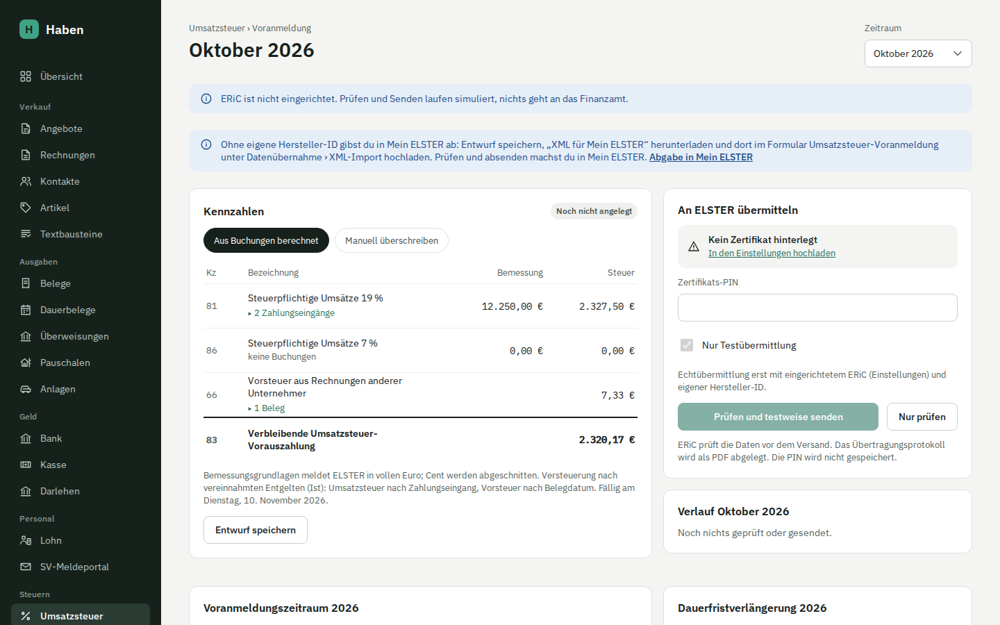

# Umsatzsteuer-Voranmeldung

Haben berechnet die Umsatzsteuer-Voranmeldung für den Monat oder das Quartal aus deinen Buchungen und übermittelt sie über ERiC an ELSTER. Du siehst, welche Zahlungen, Rechnungen und Belege hinter jeder Kennzahl stehen, kannst die Werte mit Begründung überschreiben und vor dem Senden prüfen oder testweise übermitteln.

## Voraussetzungen

- **Firmendaten** mit Name, Anschrift, Bundesland und einer Steuernummer, die zum Bundesland passt. Fehlt etwas, zeigt die Seite „Firmendaten unvollständig: …“ und Prüfen und Senden bleiben gesperrt. Siehe [einrichtung.md](einrichtung.md).
- **Versteuerungsart** (Ist oder Soll) in den Firmendaten.
- Zum Übermitteln ein **ELSTER-Zertifikat** (.pfx aus einem ELSTER-Konto mit Anmeldeart Zertifikatsdatei; ELSTER Secure geht nicht), hochgeladen unter Einstellungen, und dessen PIN. Siehe [Zertifikatsdatei statt ELSTER Secure](einrichtung.md#zertifikatsdatei-statt-elster-secure).
- Mit ERiC einmal die bestätigten **Datenschutzhinweise der Finanzverwaltung** (Einstellungen › ELSTER › ERiC).
- Für echte Übermittlungen ein eingerichtetes **ERiC** (von Haben unter Einstellungen › ELSTER › ERiC heruntergeladen oder von Hand über `ERIC_HOME` eingebunden) und eine eigene **Hersteller-ID** (`ELSTER_HERSTELLER_ID`). Siehe [installation.md](installation.md).

Ob du monatlich, vierteljährlich oder gar keine Voranmeldung abgibst, stellst du unter [Voranmeldungszeitraum](#voranmeldungszeitraum) ein. Ohne Einstellung bleibt es monatlich. Die [Dauerfristverlängerung](#dauerfristverlängerung) mit Sondervorauszahlung beantragst du auf derselben Seite.

Bist du in den Einstellungen als Kleinunternehmer eingetragen, zeigt die Seite oben einen Hinweis: Als Kleinunternehmer gibst du in der Regel keine Voranmeldung ab. Nötig ist sie nur, wenn du selbst Steuer schuldest, etwa für Leistungen ausländischer Unternehmer an dich (Reverse Charge). Für solche Kleinunternehmerzeiträume blendet die Übersicht reguläre Voranmeldungsaufgaben, Zahllast/Fälligkeit, ELSTER-Einrichtungshinweise und die leere Karte „Letzte Voranmeldungen“ aus. Vorhandene Anmeldungen, offene Steuerposten und tatsächlich berechnete Steuerbeträge bleiben sichtbar.

## So gehst du vor

1. **Umsatzsteuer** öffnen. Haben springt zum zuletzt abgelaufenen Zeitraum, also dem, der gerade abzugeben ist: bei monatlicher Abgabe der Vormonat, bei vierteljährlicher das letzte volle Quartal. Über **Zeitraum** wählst du den laufenden oder einen der Zeiträume der letzten zwölf Monate.
2. Die Hinweise oben abarbeiten (siehe [Vorprüfung](#vorprüfung)).
3. Kennzahlen prüfen, bei Bedarf die Quellen aufklappen.
4. **Nur prüfen**: ERiC prüft die Daten, ohne etwas zu senden.
5. **Prüfen und testweise senden** mit gesetztem Haken **Nur Testübermittlung**: Übermittlung an den Testserver, nichts geht an dein Finanzamt.
6. Haken entfernen, **Prüfen und senden**, dann im Dialog **Verbindlich senden**.

Vor jedem Prüfen oder Senden speichert Haben den Entwurf, falls er neu oder geändert ist. Mit **Entwurf speichern** geht das auch ohne Prüfung.

## Voranmeldungszeitraum

Der Voranmeldungszeitraum ist nach § 18 Abs. 2 UStG das Kalendervierteljahr. Monatlich gibst du ab, wenn die Steuer des Vorjahres mehr als 9.000 € betrug. Bei höchstens 2.000 € kann dich das Finanzamt von den Voranmeldungen befreien; dann gibst du nur die Jahreserklärung ab. Festgelegt wird der Zeitraum vom Finanzamt, meist mit der Steuernummer oder nach der Jahreserklärung. Haben übernimmt, was du einträgst, und schlägt nur vor.

Auf der Seite **Umsatzsteuer** steht dafür der Bereich **Voranmeldungszeitraum &lt;Jahr&gt;** für das Jahr des angezeigten Zeitraums:

| Feld | Bedeutung |
| --- | --- |
| Zeitraum | monatlich, vierteljährlich oder keine Voranmeldung (befreit) |
| Gilt ab | Januar für das ganze Jahr; April, Juli oder Oktober für einen Wechsel im Jahr |

Darüber steht, was eingestellt ist, und ein Vorschlag aus der Steuer des Vorjahres, gerechnet aus den Buchungen (Summe der Zahllast der vier Quartale, wie Kz 83):

| Steuer des Vorjahres | Vorschlag | Vorschrift |
| --- | --- | --- |
| mehr als 9.000 € | monatlich | § 18 Abs. 2 Satz 2 UStG |
| mehr als 2.000 € bis 9.000 € | vierteljährlich | § 18 Abs. 2 Satz 1 UStG |
| höchstens 2.000 € | Befreiung möglich, sonst vierteljährlich | § 18 Abs. 2 Satz 3 UStG |
| Überschuss über 9.000 € | vierteljährlich, monatlich wählbar | § 18 Abs. 2a UStG |

Die Grenzen gelten ab 2025 (Viertes Bürokratieentlastungsgesetz). Für Jahre bis 2024 rechnet der Vorschlag mit den damaligen Grenzen 7.500 € und 1.000 €.

Für Neugründungen gilt: Ab 2027 ist im Jahr der Gründung und im Folgejahr der Monat der Voranmeldungszeitraum (§ 18 Abs. 2 Satz 4 UStG), Haben schlägt dann monatlich vor. Für 2021 bis 2026 ist das ausgesetzt (§ 18 Abs. 2 Satz 6 UStG): War der Betrieb nur einen Teil des Vorjahres tätig, rechnet Haben die Steuer auf ein Jahr hoch (angefangene Monate voll); im Gründungsjahr zählt die voraussichtliche Steuer, die Haben nicht kennt, deshalb gibt es dann keinen Vorschlag. Als Beginn der Tätigkeit nimmt Haben die erste Buchung. Gibt es eine Eröffnungsbuchung, war der Betrieb schon vorher tätig: Dann gilt keine Neugründung, und Haben schlägt nach der Steuer des Vorjahres vor.

Ein Jahr ohne eigene Einstellung übernimmt die des Vorjahres; ganz ohne Einstellung gilt monatlich, wie in Haben vor dieser Einstellung.

### Was die Einstellung ändert

- **Seite und Auswahl:** Die Auswahl **Zeitraum** zeigt Monate oder Quartale, je nach Einstellung. Ein Quartal hat die Adresse `/umsatzsteuer/2026-Q3`.
- **Kennzahlen:** Ein Quartal umfasst die Buchungen seiner drei Monate. Die Bemessungsgrundlagen schneidet Haben einmal für das Quartal auf volle Euro ab, nicht je Monat.
- **ELSTER:** Im Feld Zeitraum steht der Schlüssel aus dem ERiC-Schema, `01` bis `12` für die Monate, `41` bis `44` für die Quartale.
- **Fälligkeit und Fristen:** der 10. nach Ablauf des Zeitraums (§ 18 Abs. 1 UStG), beim Quartal also der 10. April, Juli, Oktober und Januar.
- **Befreit:** Es gibt keine Voranmeldung und keine Frist dafür; die Übersicht zeigt keine Aufgabe zur Voranmeldung, und in der Umsatzsteuererklärung fehlen keine Monate.

### Wechsel des Zeitraums

Normalerweise wechselt der Zeitraum zum Jahreswechsel: Du stellst das neue Jahr ein, die Voranmeldung für Dezember bzw. das 4. Quartal des Vorjahres bleibt, wie sie war. Mitten im Jahr wechselst du nur, wenn das Finanzamt es festlegt, und nur zu Beginn eines Quartals (**Gilt ab** April, Juli oder Oktober); ein Quartal lässt sich nicht teilen.

Gesendete Voranmeldungen bleiben, wie sie sind. Passt eine gesendete Voranmeldung nicht zum neuen Zeitraum, lehnt Haben die Einstellung ab und nennt die Zeiträume; wähle den Wechsel dann ab einem späteren Quartal. Eine berichtigte Anmeldung zu einer gesendeten geht immer, im Zeitraum der gesendeten. Entwürfe, die nicht mehr zum Zeitraum passen, bleiben mit ihrem Prüfverlauf stehen, lassen sich aber nicht mehr senden; die Seite zeigt dann „Für … passt die Voranmeldung nicht zum eingestellten Zeitraum“.

Jede Änderung der Einstellung steht im Änderungsprotokoll.

## Dauerfristverlängerung

Mit der Dauerfristverlängerung gibst du jede Voranmeldung einen Monat später ab und zahlst auch einen Monat später (§ 46 UStDV): die für Oktober am 10. Dezember statt am 10. November, die für das 3. Quartal am 10. November statt am 10. Oktober. Das Finanzamt muss sie auf Antrag gewähren, außer der Steueranspruch erscheint gefährdet.

| Abgabe | Antrag | Sondervorauszahlung |
| --- | --- | --- |
| monatlich | jedes Jahr bis zum 10. Februar, zugleich Anmeldung der Sondervorauszahlung (§ 48 Abs. 1 und 2 UStDV) | ein Elftel der Vorauszahlungen des Vorjahres (§ 47 UStDV), abgezogen in der Voranmeldung für Dezember (Kz 39) |
| vierteljährlich | einmal, gilt bis zur Rücknahme oder zum Widerruf | keine |
| befreit | nicht nötig | keine |

Auf der Seite **Umsatzsteuer** steht dafür unter dem Voranmeldungszeitraum der Bereich **Dauerfristverlängerung &lt;Jahr&gt;**.

Ist die Sondervorauszahlung eines Jahres schon aus Haben übermittelt oder gezahlt (gebucht auf „Umsatzsteuer-Vorauszahlungen 1/11“), lässt sich die Verlängerung für dieses Jahr erst ab dem Folgejahr beenden; einen nur von Hand eingetragenen Stand nimmst du jederzeit zurück: Die Sondervorauszahlung wird in der letzten Voranmeldung angerechnet, für die die Verlängerung gilt (§ 48 Abs. 4 UStDV), und ein Ende im Lauf des Jahres bildet Haben nicht ab. Endet sie doch unterjährig, klärst du die Anrechnung mit dem Finanzamt.

### Sondervorauszahlung berechnen

Haben schlägt die Sondervorauszahlung aus den gesendeten Voranmeldungen des Vorjahres vor (je Zeitraum die zuletzt gesendete, bei Berichtigungen die berichtigte):

- Summe der Vorauszahlungen (Kz 83) **zuzüglich** der im Vorjahr abgezogenen Sondervorauszahlung (Kz 39), denn um sie war die Vorauszahlung für Dezember gemindert,
- davon ein Elftel, abgeschnitten auf volle Euro (ELSTER nimmt in Kz 38 nur volle Euro),
- warst du nur einen Teil des Vorjahres tätig, rechnet Haben die Summe auf ein Jahr hoch; angefangene Monate zählen voll (§ 47 Abs. 2 UStDV). Als Beginn gilt die erste Buchung,
- ein Überschuss ergibt 0 €.

Beispiel: 39.000 € Vorauszahlungen und 5.000 € im Dezember abgezogen ergeben 44.000 €, davon ein Elftel 4.000 €.

Unter dem Feld steht, aus wie vielen gesendeten Voranmeldungen die Summe stammt. Fehlen welche, etwa weil du sie außerhalb von Haben abgegeben hast, trägst du den Betrag selbst ein. Im ersten Jahr der Tätigkeit zählen die zu erwartenden Vorauszahlungen dieses Jahres (§ 47 Abs. 3 UStDV); die kennt Haben nicht, dann gibt es keinen Vorschlag.

### Antrag senden

Den Antrag schickst du wie die Voranmeldung über ERiC: **Nur prüfen**, **Prüfen und testweise senden**, **Prüfen und senden**. Bei monatlicher Abgabe geht er als Anmeldung der Sondervorauszahlung (Kz 38), bei vierteljährlicher ohne Betrag. Nach einer erfolgreichen Echtübermittlung trägt Haben die Verlängerung für das Jahr ein, mit der Sondervorauszahlung. Eine geänderte Sondervorauszahlung sendest du mit dem Haken **Berichtigte Anmeldung (Kz 10)**. Jeder Versuch steht im Verlauf darunter, mit Protokoll-PDF; diese Einträge lassen sich nur ergänzen.

Hast du die Verlängerung außerhalb von Haben beantragt, setzt du unter **Außerhalb von Haben** den Haken **Dauerfristverlängerung besteht für &lt;Jahr&gt;** und, bei monatlicher Abgabe, die angemeldete Sondervorauszahlung im Feld darüber. Nimmst du den Antrag zurück oder widerruft ihn das Finanzamt, entfernst du den Haken für das Jahr, ab dem sie nicht mehr gilt. Ein Jahr ohne eigenen Eintrag übernimmt den Stand des Vorjahres. Jede Änderung steht im Änderungsprotokoll.

Ändert der neue Stand die Zuordnung einer Vorauszahlung zum EÜR-Jahr und ist eine betroffene EÜR oder Einkommensteuererklärung schon übermittelt, nennt Haben sie nach **Stand speichern** oder einer erfolgreichen Echtübermittlung in einem Hinweis. Speichern bleibt möglich; die übermittelten Erklärungen bleiben unverändert. Ob eine Berichtigung nötig ist, klärst du mit der Steuerberatung. Das gilt auch für Folgejahre, die den geänderten Stand übernehmen.

Maßgeblich ist dieselbe [Zehn-Tage-Regel wie in der EÜR](auswertungen.md#umsatzsteuer-vorauszahlung-um-den-jahreswechsel): etwa Dezember ohne Dauerfrist oder November mit Dauerfrist, wenn die Zahlung vom 1. bis 10. Januar abfließt und in dieser Zeit fällig ist ([§ 18 Abs. 1 UStG](https://www.gesetze-im-internet.de/ustg_1980/__18.html), [§ 46 UStDV](https://www.gesetze-im-internet.de/ustdv_1980/__46.html)). Eine Erstattung, eine aufgehobene Zuordnung oder ein unverändert gespeicherter Stand löst keinen Hinweis aus.

### Was sich ändert

- **Fälligkeit und Fristen:** einen Monat später, auf der Seite der Voranmeldung, in der Übersicht und unter [Fristen](fristen.md). Bei monatlicher Abgabe steht ab dem zweiten Jahr die **Sondervorauszahlung** als Frist am 10. Februar, bis sie für das Jahr eingetragen ist.
- **Kz 39:** In der letzten Voranmeldung des Jahres (Dezember, bei einem Wechsel im Jahr der letzte Zeitraum) zieht Haben die für das Jahr angemeldete Sondervorauszahlung ab. Kz 83 sinkt um den Betrag und kann negativ werden. Gesendete Voranmeldungen bleiben, wie sie sind; trägst du die Sondervorauszahlung erst danach ein, legst du eine berichtigte Anmeldung an.
- **Umsatzsteuererklärung:** Das Vorauszahlungssoll enthält die Sondervorauszahlung.

### Buchen

Die Zahlung der Sondervorauszahlung ordnest du im [Bankabgleich](bank.md) als **Sondervorauszahlung (Dauerfristverlängerung)** zu. Haben bucht sie auf das Konto „Umsatzsteuer-Vorauszahlungen 1/11“:

| Kontenrahmen | Buchung |
| --- | --- |
| SKR03 | 1781 an 1200 (Bank) |
| SKR04 | 3830 an 1800 (Bank) |

In der EÜR zählt sie wie jede Umsatzsteuer-Vorauszahlung als gezahlte Umsatzsteuer, im Jahr der Zahlung. Mit der Voranmeldung für Dezember sinkt die Zahlung an das Finanzamt um die Sondervorauszahlung; einen Ausgleich zwischen 1781 und 1780 (SKR04 3830 und 3820) bucht Haben nicht gesondert, beide zählen zu den Umsatzsteuerkonten.

## Zusammenfassende Meldung

Leistungen an Unternehmer im EU-Ausland mit Reverse Charge (Kz 21) und innergemeinschaftliche Lieferungen (Kz 41) meldest du zusätzlich dem Bundeszentralamt für Steuern (BZSt), je USt-IdNr. des Kunden und Umsatzart die Summe der Bemessungsgrundlagen eines Kalendervierteljahres, bis zum 25. Tag nach Quartalsende (§ 18a Abs. 1, 2 und 7 UStG). Eine Dauerfristverlängerung gilt dafür nicht. Kleinunternehmer melden nichts (§ 18a Abs. 4 UStG).

Die Seite **Umsatzsteuer › Zusammenfassende Meldung** (`/umsatzsteuer/zm/<Jahr>-Q<Quartal>`) erreichst du über den Hinweis auf der Voranmeldung, sobald es im Zeitraum Kz 21 oder 41 gibt, und über die Frist unter [Fristen](fristen.md). Quartale ohne solche Umsätze tauchen nirgends auf, auch nicht, wenn sie sich im Quartal aufheben (etwa durch ein Storno); eine Nullmeldung gibt es nicht.

### Woher die Zeilen kommen

| Umsatz | Quartal |
| --- | --- |
| Rechnung mit **Reverse Charge: Leistung an Unternehmen im EU-Ausland**, Umsatzart S (sonstige Leistung) | Bei neuen ausdrücklich erbrachten Teilleistungen Leistungsdatum, sonst Rechnungsdatum als Näherung, wie Kz 21 |
| Rechnung mit **Innergemeinschaftliche Lieferung**, Umsatzart L (Lieferung) | Rechnungsdatum, auch bei Ist-Versteuerung, wie Kz 41 |
| Storno und Rechnungskorrektur (Gutschrift) dazu | ihr eigenes Datum: Sie mindern das Quartal, in dem sie ausgestellt sind (§ 18a Abs. 7 Satz 2 mit § 17 UStG); überwiegen sie, steht die Zeile negativ |
| Skonto und Forderungsausfall dazu | Datum der Ausbuchung |

Haben fasst alles je USt-IdNr. des Kunden und Umsatzart zusammen (in Großbuchstaben, ohne Leerzeichen; griechische Nummern mit EL statt GR) und meldet volle Euro, die Cent fallen wie in der Voranmeldung weg. Unter **Rechnungen dazu** steht jede Rechnung mit ihrem Betrag. Aus Lexoffice übernommene Rechnungen zählen nicht mit, ihre Meldung lief dort.

### Vorprüfung

| Prüfung | Folge |
| --- | --- |
| Eigene USt-IdNr. fehlt oder hat eine falsche Prüfziffer | Senden gesperrt; in den Firmendaten eintragen. Die ZM geht nur mit USt-IdNr., nicht mit der Steuernummer |
| Anschrift unvollständig (Straße, fünfstellige PLZ, Ort) | Senden gesperrt |
| USt-IdNr. eines Kunden fehlt, ist deutsch, britisch (seit dem Brexit; für Nordirland XI) oder hat kein Länderkennzeichen eines anderen Mitgliedstaats, oder nach dem Kennzeichen nicht 5 bis 12 Buchstaben, Ziffern, + oder * | Senden gesperrt, mit Rechnung und Kunde. Nordirische Nummern (XI) gelten nur für Lieferungen |
| Voranmeldungen des Quartals noch nicht alle gesendet | Hinweis; der Abgleich mit Kz 21 folgt danach |
| Summe der Meldung weicht von Kz 21 der gesendeten Voranmeldungen ab, bei Lieferungen von Kz 41 | Warnung. Bis zu einem Euro je Zeile und Voranmeldung ist Rundung. Eine größere Abweichung heißt: Die Voranmeldung oder die Meldung braucht eine Berichtigung |
| Mehr als 50.000 € Lieferungen im Quartal | Senden gesperrt: Die Meldung ist dann monatlich abzugeben (§ 18a Abs. 1 Satz 2 UStG), das kann Haben nicht; gib sie im BZStOnline-Portal ab |
| Lieferungen im Quartal | Hinweis: Lagen sie in einem der vier vorangegangenen Quartale über 50.000 €, ist ebenfalls monatlich zu melden; und für jede Lieferung gehört der Gelangensnachweis (§ 17a UStDV) zu den Unterlagen |

Die Prüfungen sind die des ERiC-Plugins `checkZMDO`; ob eine USt-IdNr. tatsächlich erteilt ist, prüft das nicht. Das klärst du vor der ersten Rechnung mit der Bestätigungsabfrage beim BZSt.

### Senden

Wie die Voranmeldung über ERiC: **Nur prüfen**, **Prüfen und testweise senden**, **Prüfen und senden**. Es braucht dasselbe ELSTER-Zertifikat und eine eigene Hersteller-ID. Jeder Versuch steht im **Verlauf** mit Zeilenzahl, Transfer-Ticket und Protokoll-PDF; die Einträge lassen sich nur ergänzen, eine echt übermittelte Meldung ändert niemand mehr. Die Frist ist erledigt, sobald die Meldung echt übermittelt ist.

### Berichtigung

Nach der Echtübermittlung vergleicht Haben die Zeilen aus den Rechnungen mit dem Stand beim BZSt (Erstmeldung und alle Berichtigungen danach). Ändert sich eine Zeile, etwa weil eine Rechnung mit Datum im Quartal erst später festgeschrieben wird, zeigt der Bereich **Übermittelt** die Zeilen, die eine Berichtigung senden würde: nur die geänderten mit dem richtigen Betrag, eine entfallene mit 0 €. Die Berichtigung geht innerhalb eines Monats, nachdem du den Fehler erkannt hast (§ 18a Abs. 10 UStG). Stimmt der Stand, gibt es nichts zu senden.

Ein Storno oder eine Gutschrift in einem späteren Quartal ist keine Berichtigung: Sie mindert das Quartal, in dem sie ausgestellt ist.

### Was im Hintergrund passiert

Haben erzeugt die Datenart `ZMDO` (Verfahren `ElsterExtern`, Empfänger `BF` für das BZSt) nach dem Schema `zm_000005.xsd`: eigene USt-IdNr., Teilnehmernummer `N`/`1111111` (so verlangt das Schema es bei Übermittlung mit ERiC), Anschrift mit Staat DE, Meldezeitraum als Quartal 1 bis 4 mit Jahr, `meldeart` 10 für die Erstmeldung und 11 für die Berichtigung, Währung Euro und je Zeile USt-IdNr., Umsatzart `S` (sonstige Leistung) oder `L` (innergemeinschaftliche Lieferung) und Betrag in vollen Euro. Die Anzeige der monatlichen Abgabe stellt Haben nicht. ERiC prüft den Datensatz vor dem Senden; ein Quartal nimmt es erst ab dem ersten Tag seines zweiten Monats an, Zeiträume in der Zukunft gar nicht.

### Grenzen

- Sonstige Leistungen (§ 3a Abs. 2 UStG, Umsatzart S) und innergemeinschaftliche Lieferungen (Umsatzart L). Keine Dreiecksgeschäfte (Umsatzart D, § 25b UStG): Die Rechnungen von Haben kennen sie nicht.
- Keine Monatsmeldung: Liegen die Lieferungen im Quartal oder in einem der vier vorangegangenen über 50.000 €, ist monatlich zu melden (§ 18a Abs. 1 Satz 2 UStG). Über 50.000 € im Quartal sperrt Haben das Senden; die vorangegangenen Quartale prüft es nicht.
- Maßgeblich ist der Zeitraum, in dem die Leistung ausgeführt ist bzw. die Rechnung für die Lieferung ausgestellt, spätestens der Folgemonat (§ 18a Abs. 8 UStG). Haben nimmt dafür bei neuen ausdrücklich erbrachten EU-Teilleistungen das Leistungsdatum, sonst das Rechnungsdatum, wie bei Kz 21 und 41.
- Die Meldung geht nur für ganze Quartale, nicht monatlich nach § 18a Abs. 3 UStG.

## Wie die Kennzahlen entstehen

Die Werte kommen aus den gebuchten Daten, nicht aus einer eigenen Eingabe.

**Ab dem Stichjahr aus dem Journal.** Ab einem Stichjahr rechnet Haben die Kennzahlen wie DATEV aus Konto und Steuerschlüssel der Buchungen im Zeitraum ([Steuerschlüssel und Kennzahlen](buchhaltung.md#steuerschlüssel-und-kennzahlen)); bei Ist-Versteuerung zählt ein Verkauf auf Ziel mit der Zahlung, die die Bemessungsgrundlage trägt. Die Privatnutzung von Fahrzeugen kommt weiter je Monat aus dem Anlagenverzeichnis. Die Abschnitte unten beschreiben, was die Rechnungen, Belege und Zahlungen dazu beitragen; sie bleiben die Gegenprobe im [Abgleich](buchhaltung.md#abgleich-von-journal-umsatzsteuer-und-eür). Das Stichjahr ist das Jahr der ersten Buchung; bei Instanzen, die schon vor diesem Update gebucht haben, das Jahr nach dem Update. Unter **Einstellungen › Firma** steht es in der Karte „Voranmeldung und EÜR aus dem Journal“. Dort lässt es sich auf das laufende Jahr vorziehen, solange für das Jahr keine Voranmeldung gesendet ist, der [Abgleich](buchhaltung.md#abgleich-von-journal-umsatzsteuer-und-eür) des Jahres keine Abweichung zeigt und jede Voranmeldung des Jahres sowie die EÜR aus dem Journal genauso herauskommen wie aus Rechnungen, Belegen und Zahlungen; dann ändert der Umstieg keine Zahl. Ältere Buchungen ohne Bemessungsgrundlage oder Steuerschlüssel, die der Abgleich bewusst auslässt, verhindern das Vorziehen deshalb. Zurück geht es nicht. Davor rechnet Haben aus den Rechnungen, Belegen und Zahlungen; gesendete Voranmeldungen ändern sich nicht. Storniert ihr im Stichjahr eine Bareinnahme oder einen Beleg aus der Zeit davor, bucht Haben die Gegenbuchung mit den Steuerangaben von heute, damit sie in der Voranmeldung voll zählt. Hintergrund: [Entwurfsentscheidungen](architektur.md#entwurfsentscheidungen).

### Umsatzsteuer (Kz 81 und 86)

| Versteuerung | Maßgeblich | Quelle |
| --- | --- | --- |
| Ist (vereinnahmte Entgelte) | Buchungsdatum des Zahlungseingangs | Zuordnungen im [Bankabgleich](bank.md). Bei Teilzahlungen zählt der Anteil der Zahlung, bei mehreren Steuersätzen anteilig je Satz. Aufgehobene Zuordnungen heben sich mit ihrer Gegenzeile auf. |
| Soll (vereinbarte Entgelte) | Rechnungsdatum; Ausnahme: [neue Abschläge und erbrachte Teilleistungen](rechnungen.md#abschlags--und-schlussrechnung) | Festgeschriebene Rechnungen, Stornos und Korrekturen des Monats mit ihren Beträgen je Steuersatz. |

Bankumsätze, die im Bankabgleich [direkt auf eine Einnahmekategorie](bank.md#auf-eine-kategorie-buchen) gebucht sind, zählen ohne Rechnung bei Ist und Soll am Buchungstag des Umsatzes, mit Netto und Steuer aus dem Betrag und dem gewählten Steuersatz. In den Quellen stehen sie als „Direktbuchung“.

Ausbuchungen (§ 17 UStG, gewährtes Skonto und Forderungsausfall, siehe [Bank](bank.md#rest-ausbuchen-skonto-und-forderungsausfall)) mindern bei Soll Kz 81 bzw. 86 und die Steuer im Monat der Ausbuchung, anteilig je Steuersatz. Bei Ist zählt nur, was bezahlt wurde; ausgebuchte Reste kamen nie in die Anmeldung. In den Quellen stehen sie als „Ausbuchung“.

Kz 81 ist die Bemessungsgrundlage zu 19 %, Kz 86 die zu 7 %. Dazu zählen regulär besteuerte Rechnungen, Direktbuchungen, Bareinnahmen ohne Rechnung im [Kassenbuch](kasse.md), ab dem Stichjahr [freie Buchungen mit Steuerschlüssel](buchhaltung.md#manuelle-und-freie-buchungen) einschließlich der Sachentnahme und, in Kz 81, die private Nutzung von Firmenwagen im Monat der Nutzung ([Anlagen und AfA](anlagen.md#private-nutzung-von-firmenwagen)). Belege mit Privatanteil zählen in Kz 66 nur mit dem betrieblichen Teil. Regulär besteuerte Umsätze zu 0 % meldet Haben nicht; die Vorprüfung weist darauf hin.

### Umsätze ohne Steuer (Kz 21, 41, 43, 45 und 48)

Rechnungen ohne Steuerausweis (siehe [Rechnungen](rechnungen.md#umsatzsteuer-auf-der-rechnung)) meldet Haben mit ihrer Bemessungsgrundlage, ohne Steuer. Sie ändern Kz 83 nicht.

| Kennzahl | Umsatzsteuer an der Rechnung | Maßgeblich |
| --- | --- | --- |
| 21 | Reverse Charge: Leistung an Unternehmen im EU-Ausland | bei neuen ausdrücklich erbrachten Teilleistungen Leistungsdatum, sonst Rechnungsdatum als Näherung; unabhängig von Ist/Soll |
| 41 | Innergemeinschaftliche Lieferung (steuerfrei, § 4 Nr. 1 Buchst. b UStG) | immer das Rechnungsdatum, auch bei Ist-Versteuerung (§ 18b Satz 1 Nr. 1 und Satz 2 UStG) |
| 43 | Ausfuhrlieferung ins Drittland (steuerfrei, § 4 Nr. 1 Buchst. a UStG) | wie Kz 81: Ist nach Zahlungseingang, Soll nach Rechnungsdatum |
| 45 | Leistung ins Nicht-EU-Ausland (nicht steuerbar) | immer das Rechnungsdatum, auch bei Ist-Versteuerung |
| 48 | Steuerfrei nach § 4 UStG (ohne Vorsteuerabzug) | wie Kz 81: Ist nach Zahlungseingang, Soll nach Rechnungsdatum |

Bei Reverse Charge ist der Monat der Leistung maßgeblich, nicht die Zahlung. Bei neuen ausdrücklich erbrachten Teilleistungen nimmt Haben das Leistungsdatum, sonst weiterhin das Rechnungsdatum als Näherung dafür ([§ 18b Satz 3 UStG](https://www.gesetze-im-internet.de/ustg_1980/__18b.html)). Innergemeinschaftliche Lieferungen gehören in den Voranmeldungszeitraum, in dem die Rechnung ausgestellt ist, spätestens in den Monat nach der Lieferung (§ 18b UStG); Haben nimmt das Rechnungsdatum. Nicht steuerbare Leistungen ins Drittland meldet Haben wie DATEV mit der Rechnung: Bei Ist-Versteuerung weist DATEV nur steuerpflichtige und steuerfreie inländische Umsätze erst mit der Zahlung aus, andere Steuersachverhalte wie nicht steuerbare Umsätze im Drittland schon mit der Rechnung ([DATEV-Dok. 1080673](https://help-center.apps.datev.de/documents/1080673)). Bis Version 0.6.6 zählte Kz 45 bei Ist-Versteuerung im Monat der Zahlung. Gesendete Voranmeldungen bleiben, wie sie gesendet wurden; die Steuer (Kz 83) war darin richtig, nur die Bemessungsgrundlage in Kz 45 steht im Monat der Zahlung statt der Rechnung. Kz 41 und 43 sind steuerfreie Umsätze **mit** Vorsteuerabzug: Die Vorsteuer aus den Einkäufen dafür bleibt abziehbar. Kleinunternehmer-Rechnungen erscheinen in keiner Kennzahl.

In der Tabelle der Kennzahlen stehen Kz 21, 41, 43, 45 und 48 nur, wenn sie nicht null sind oder du die Werte von Hand überschreibst.

### Vorsteuer (Kz 66)

Die Vorsteuer kommt aus gebuchten [Belegen](belege.md), zugeordnet nach ihrem **Belegdatum**, bei Ist- wie bei Soll-Versteuerung. Ob und wann der Beleg bezahlt wurde, spielt keine Rolle. Ein erhaltenes Skonto mindert die Vorsteuer anteilig im Monat der Ausbuchung (§ 17 Abs. 1 UStG).

### § 13b als Leistungsempfänger

Aus [Belegen mit § 13b](belege.md#reverse-charge-als-leistungsempfänger--13b) nach Belegdatum:

| Kz | Inhalt |
| --- | --- |
| 46 / 47 | Sonstige Leistungen eines Unternehmers aus dem EU-Ausland (§ 13b Abs. 1): Netto in vollen Euro, Steuer centgenau |
| 84 / 85 | Andere Leistungen nach § 13b Abs. 2, hier Leistungen von Unternehmern aus dem Drittland: Netto in vollen Euro, Steuer centgenau |
| 67 | Vorsteuer aus diesen Leistungen, bei Privatanteil nur der betriebliche Teil; bei Kleinunternehmern 0 |

Die Zeilen erscheinen nur, wenn es solche Belege gibt oder du die Werte von Hand überschreibst. Ein [auf mehrere Kategorien aufgeteilter Beleg](belege.md#auf-mehrere-kategorien-aufteilen) zählt mit seinen Beträgen je Satz, genau wie ohne Aufteilung.

### Innergemeinschaftlicher Erwerb

Aus [Belegen mit innergemeinschaftlichem Erwerb](belege.md#innergemeinschaftlicher-erwerb--1a-ustg) nach **Belegdatum**, bei Ist- wie bei Soll-Versteuerung: Die Erwerbsteuer entsteht mit der Ausstellung der Rechnung, spätestens mit Ablauf des Monats nach dem Erwerb (§ 13 Abs. 1 Nr. 6 UStG), nicht mit der Zahlung.

| Kz | Inhalt |
| --- | --- |
| 89 | Steuerpflichtige innergemeinschaftliche Erwerbe zu 19 %: Netto in vollen Euro, die Steuer rechnet das Formular daraus wie bei Kz 81 |
| 93 | Steuerpflichtige innergemeinschaftliche Erwerbe zu 7 %: ebenso |
| 61 | Vorsteuer aus dem innergemeinschaftlichen Erwerb (§ 15 Abs. 1 Satz 1 Nr. 3 UStG), centgenau; bei Privatanteil nur der betriebliche Teil |

Bei vollem Vorsteuerabzug heben sich Erwerbsteuer und Kz 61 auf, bis auf die Rundung der Bemessungsgrundlage auf volle Euro. Die Zeilen erscheinen nur, wenn es solche Belege gibt oder du die Werte von Hand überschreibst.

### Übernahmen aus Lexoffice

Bei der [Migration aus Lexoffice](lexoffice.md) übernommene offene Posten sind schon in Lexoffice gemeldet und werden nicht doppelt gezählt:

- Übernommene Belege zählen nie für Kz 66.
- Übernommene Rechnungen zählen bei Soll-Versteuerung nicht.
- Bei Ist-Versteuerung zählt der Zahlungseingang auf eine übernommene Rechnung mit, denn die Steuer war in Lexoffice noch nicht fällig.

### Rundung und Kz 83

ELSTER erwartet die Bemessungsgrundlagen in vollen Euro. Haben schneidet die Cent ab (`toWholeEuros` in `packages/core/src/ustva.ts`) und rechnet die Steuer aus dem abgeschnittenen Betrag:

| Kennzahl | Inhalt | Rundung |
| --- | --- | --- |
| 81 | Steuerpflichtige Umsätze 19 % | volle Euro, Cent abgeschnitten; Steuer = 19 % davon, auf Cent gerundet |
| 86 | Steuerpflichtige Umsätze 7 % | volle Euro, Cent abgeschnitten; Steuer = 7 % davon, auf Cent gerundet |
| 21, 41, 43, 45, 48 | Umsätze ohne Steuer | volle Euro, Cent abgeschnitten |
| 89, 93 | Innergemeinschaftliche Erwerbe 19 % und 7 % | volle Euro, Cent abgeschnitten; Steuer = 19 % bzw. 7 % davon, auf Cent gerundet |
| 66 | Vorsteuer aus Rechnungen anderer Unternehmer | centgenau |
| 46, 84 | Leistungen nach § 13b | volle Euro, Cent abgeschnitten |
| 47, 85, 67 | Steuer und Vorsteuer nach § 13b | centgenau |
| 61, 62 | Vorsteuer aus innergemeinschaftlichem Erwerb, Einfuhrumsatzsteuer | centgenau |
| 39 | Abzug der Sondervorauszahlung (nur letzte Voranmeldung des Jahres, siehe [Dauerfristverlängerung](#dauerfristverlängerung)) | centgenau |
| 83 | Verbleibende Umsatzsteuer-Vorauszahlung | Steuer 81 + Steuer 86 + Steuer 89 + Steuer 93 + Kz 47 + Kz 85 − Kz 66 − Kz 67 − Kz 61 − Kz 62 − Kz 39 |

Ist Kz 83 negativ, heißt die Zeile „Verbleibender Überschuss (Erstattung)“.

Beispiel: Zahlungseingänge zu 19 % mit 2.345,67 € netto ergeben Kz 81 = 2.345 € und eine Steuer von 445,55 €.

### Quellen aufklappen

Unter jeder Kennzahl steht, wie viele Zahlungseingänge, Rechnungen oder Belege dahinterstehen. Ein Klick klappt die Liste auf: Datum, Rechnungs- oder Belegnummer mit Kunde bzw. Lieferant, Netto und Steuer, jeweils mit Link zur Rechnung oder zum Beleg; direkt gebuchte Bankumsätze (Direktbuchungen) verlinken auf den Umsatz im Bankabgleich. Die Beträge dort sind centgenau, also vor dem Abschneiden. [Freie Buchungen](buchhaltung.md#manuelle-und-freie-buchungen) stehen nicht in den Quellen, denn sie haben kein Nebenbuch; sie zählen ab dem Stichjahr trotzdem in den Kennzahlen und stehen im Journal unter der Herkunft „Manuell“.

## Manuell überschreiben

Mit **Manuell überschreiben** gibst du Kz 81, 86, 21, 41, 43, 45, 48, 89, 93, 66, 61, 46/47, 84/85 und 67 selbst ein, Kz 62 und 39, wenn sie einen Wert haben. Dann ist eine **Begründung der Abweichung** Pflicht (mindestens 10 Zeichen). Darunter stehen die berechneten Werte zum Vergleich. Gespeichert werden die eingegebenen Werte, die Begründung und die berechneten Werte zum Zeitpunkt des Speicherns. Nach dem Senden zeigt die Seite „Manuell überschrieben: …“ mit der Begründung.

Manuelle Werte dürfen auch negativ sein, etwa wenn im Monat Gutschriften überwiegen. Mit **Aus Buchungen berechnet** kehrst du zu den berechneten Werten zurück.

## Veralteter Entwurf

Ein gespeicherter berechneter Entwurf friert die Zahlen nicht ein. Ändern sich danach Buchungen im Monat, zeigt die Seite: „Die Buchungen haben sich seit dem Speichern geändert; angezeigt sind die aktuellen Werte. Beim Senden werden sie übernommen.“ Haben rechnet einen berechneten Entwurf vor jedem Prüfen oder Senden neu. Manuelle Entwürfe bleiben, wie sie sind.

## Vorprüfung

Solange die Anmeldung nicht gesendet ist, prüft Haben, was im Monat noch fehlt und die Zahlen verfälschen könnte. Jeder Hinweis verlinkt auf die passende Seite.

| Hinweis | Gewicht | Prüfung |
| --- | --- | --- |
| … Ausgaben im Zeitraum ohne Beleg oder Zuordnung | Warnung | Bankausgänge mit Buchungsdatum im Monat, die nicht voll zugeordnet sind. Ohne Beleg wird keine Vorsteuer angesetzt. |
| … Zahlungseingänge im Zeitraum noch nicht zugeordnet | Warnung bei Ist, Hinweis bei Soll | Bankeingänge im Monat ohne volle Zuordnung. Bei Ist fehlt sonst Umsatzsteuer. |
| … Belege sind noch nicht gebucht | Warnung | Ungebuchte Belege mit Belegdatum im Monat oder ganz ohne Belegdatum. |
| … Rechnungsentwürfe mit Datum im Zeitraum | Hinweis | Nicht festgeschriebene Rechnungen mit Rechnungsdatum im Monat. |
| Regulär besteuerte Umsätze zu 0 % | Warnung | Im Monat gibt es regulär besteuerte Umsätze zu 0 %, die Haben nicht meldet. Ist es Reverse Charge, eine Leistung ins Drittland oder steuerfrei, stellst du das an der Rechnung ein. |
| Buchungen und Voranmeldung weichen ab | Warnung | Die Steuerkonten im Journal passen nicht zu den Kennzahlen aus Rechnungen, Belegen und Zahlungen, mit beiden Beträgen. Was verglichen wird, steht unter [Abgleich von Journal, Umsatzsteuer und EÜR](buchhaltung.md#abgleich-von-journal-umsatzsteuer-und-eür). Der Link führt zu den Konten. |

Die Hinweise blockieren nichts.

## Fälligkeit

Die Voranmeldung ist am 10. nach Ablauf des Zeitraums fällig (§ 18 Abs. 1 UStG): bei einem Monat am 10. des Folgemonats, bei einem Quartal am 10. des Monats nach Quartalsende. Mit [Dauerfristverlängerung](#dauerfristverlängerung) einen Monat später. Fällt der 10. auf einen Samstag, Sonntag oder gesetzlichen Feiertag im Bundesland aus deinen Firmendaten, rechnet Haben mit dem nächsten Werktag (`dueDate` in `packages/core/src/period.ts`). Feiertage einzelner Gemeinden zählen nicht, ohne Bundesland nur die bundesweiten. Das Datum steht unter den Kennzahlen; die Übersicht zeigt die offene Voranmeldung als Aufgabe und hebt sie drei Tage vor der Frist hervor.

## Übermitteln an ELSTER

Rechts steht der Bereich **An ELSTER übermitteln** mit dem hinterlegten Zertifikat, dem Feld **Zertifikats-PIN** und dem Haken **Nur Testübermittlung**.

| Aktion | Braucht | Was passiert |
| --- | --- | --- |
| **Nur prüfen** | vollständige Firmendaten | ERiC prüft das XML gegen die Regeln, ohne zu senden. |
| **Prüfen und testweise senden** | Zertifikat, PIN, `ELSTER_HERSTELLER_ID` | Prüfung und Übermittlung mit Testmerker `700000004` und deiner Hersteller-ID (ERiC 43 sperrt die frühere Test-ID `74931`). Der Server nimmt die Daten an, leitet sie aber nicht ans Finanzamt weiter. |
| **Prüfen und senden** | Zertifikat, PIN, `ELSTER_HERSTELLER_ID` | Echte Übermittlung nach der Rückfrage im Dialog („Verbindlich senden“). |

Ohne eigene Hersteller-ID ist der Haken **Nur Testübermittlung** fest gesetzt. Mit echtem ERiC scheitern dann auch Prüfen und Test mit der Meldung, die eigene Hersteller-ID auch für Testfälle zu verwenden. Bis die Hersteller-ID da ist, gibst du in Mein ELSTER ab, am einfachsten über den XML-Import (siehe unten).

### Ohne Hersteller-ID: XML-Import in Mein ELSTER

Mein ELSTER kann eine Voranmeldung aus einer XML-Datei übernehmen. Haben schreibt diese Datei, eine eigene Hersteller-ID braucht es dafür nicht:

1. Entwurf speichern und **XML für Mein ELSTER** klicken. Die Datei heißt `UStVA_<Jahr>-<Monat>.xml`, für ein Quartal `UStVA_<Jahr>-Q<Quartal>.xml`, bei einer berichtigten Anmeldung mit `_berichtigt` am Ende.
2. In Mein ELSTER **Formulare und Leistungen › Umsatzsteuer-Voranmeldung** öffnen, das Jahr wählen, **Weiter**.
3. Auf der Seite **Datenübernahme** den Reiter **XML-Import** wählen, die Datei auswählen und **XML-Daten hochladen**.
4. Mein ELSTER füllt das Formular. Zeitraum, Steuernummer und Kennzahlen gegen Haben prüfen, in Mein ELSTER **Prüfen** und selbst **Absenden**.
5. Das Übermittlungsprotokoll aus Mein ELSTER herunterladen und die Abgabe in Haben vermerken (siehe unten).

Die Datei enthält nur die Nutzdaten (`<Anmeldungssteuern>`), im Zeichensatz ISO-8859-15, wie es die Benutzeranleitung zum Hochladen von Formulardaten in Mein ELSTER verlangt. Sie entsprechen Zeichen für Zeichen dem, was Haben über ERiC senden würde. Kz 09 (Hersteller-ID) übernimmt Mein ELSTER laut Anleitung nicht; im Feld steht deshalb die Test-ID `74931`. Der Import gibt es für die Jahre, die Mein ELSTER anbietet (laufendes und die drei vorherigen), und nur für die Voranmeldung, nicht für die Jahreserklärungen.

Haben erfährt nicht von selbst, dass du sie in Mein ELSTER gesendet hast. Das trägst du unter [Abgabe außerhalb von Haben vermerken](#abgabe-außerhalb-von-haben-vermerken) ein.

Schlägt der Import fehl oder willst du lieber Seite für Seite sehen, was eingetragen wird: Neben dem Senden-Kasten kopiert **Werte für Mein ELSTER kopieren** dieselben Werte für die Erweiterung [Haben für Mein ELSTER](elster-mit-erweiterung.md#umsatzsteuer-voranmeldung).

### Abgabe außerhalb von Haben vermerken

Hast du die Voranmeldung außerhalb von Haben abgegeben, per XML-Import in Mein ELSTER, mit der [Erweiterung](elster-mit-erweiterung.md) oder einem [KI-Assistenten](elster-mit-assistent.md), hältst du das im Bereich **Außerhalb von Haben abgegeben** neben dem gespeicherten Entwurf fest:

| Feld | Aus dem Übermittlungsprotokoll |
| --- | --- |
| Tag der Abgabe | Datum der Übermittlung; nicht in der Zukunft und nicht vor Beginn des Zeitraums |
| Transferticket | das Ticket aus Mein ELSTER; jedes Ticket nur einmal |
| Kz 83 laut Protokoll | die verbleibende Vorauszahlung bzw. der Überschuss, wie gemeldet |
| Übermittlungsprotokoll (PDF) | das Protokoll aus Mein ELSTER |

**Abgabe vermerken** fragt in einem Dialog nach, der Tag, Transferticket und Kz 83 noch einmal zeigt, und schreibt die Anmeldung dann fest wie eine Übermittlung über ERiC: Status „Abgegeben … (vermerkt)“, die [Frist](fristen.md) ist erledigt, eine Berichtigung geht wie nach dem Senden über **Berichtigte Anmeldung anlegen**, und die Zahllast wird ein [offener Posten](#zahlung-an-das-finanzamt). Ein berechneter Entwurf wird vorher auf den Stand der Buchungen gebracht, wie vor dem Senden.

Weicht Kz 83 laut Protokoll von der Anmeldung in Haben ab, lehnt Haben den Vermerk ab: Dann ist beim Finanzamt etwas anderes angekommen, als Haben gespeichert hat, etwa weil sich Buchungen nach dem Herunterladen des XML geändert haben oder du in Mein ELSTER Werte geändert hast. Prüfe die Abweichung; stimmen die Werte des Finanzamts, überschreibst du die Kennzahlen von Hand mit Begründung und vermerkst dann. Verglichen wird nur Kz 83, weil sie über Zahllast und Zahlung entscheidet; die übrigen Kennzahlen stehen im Protokoll.

Der Vermerk lässt sich nur ergänzen, nicht ändern oder löschen, steht im Änderungsprotokoll und gehört zum Siegel der Voranmeldung: Ändert jemand Tag, Ticket oder Protokoll an Haben vorbei, meldet das die [Integritätsprüfung](buchhaltung.md#manipulationserkennung-hash-kette-und-siegel). Nachträglich, etwa zu einer schon über ERiC gesendeten Anmeldung, lässt er sich nicht anlegen. Das Protokoll-PDF liegt wie Belege unter seinem SHA-256 im Dokumentenspeicher; im Verlauf öffnet **Protokoll** es, im Jahresarchiv liegt es bei der Voranmeldung (siehe [Verlauf und Protokoll](#verlauf-und-protokoll)).

### Was im Hintergrund passiert

1. Haben erzeugt das ElsterXML der Datenart `UStVA_<Jahr>` mit 13-stelliger Steuernummer, Empfänger-Finanzamt aus der Steuernummer, Datenlieferant aus den Firmendaten und den Kennzahlen. Die Kennzahlen stehen in aufsteigender Reihenfolge (10, 21, 39, 41, 43, 45, 46, 47, 48, 61, 62, 66, 67, 81, 83, 84, 85, 86, 89, 93). Alle außer Kz 83 erscheinen nur, wenn sie nicht null sind; Kz 83 steht immer drin.
2. Jeder ERiC-Aufruf läuft in einem eigenen, kurzlebigen Kindprozess mit 120 Sekunden Zeitlimit.
3. Zum Senden wird das Zertifikat entschlüsselt und nur für die Dauer des Aufrufs in ein privates temporäres Verzeichnis geschrieben, danach gelöscht. Die PIN wird weder gespeichert noch geloggt.
4. Beim Senden prüft ERiC, übermittelt und erzeugt das Übertragungsprotokoll als PDF.
5. Jeder Versuch, auch ein fehlgeschlagener, landet im Verlauf: Art, Ergebnis, ERiC-Rückgabecode, Meldung, Transfer-Ticket, gesendetes XML, Antworten von ERiC und Server und das Protokoll-PDF. Diese Einträge lassen sich nur ergänzen, nicht ändern oder löschen.
6. Nach einer erfolgreichen echten Übermittlung wird die Anmeldung mit Transfer-Ticket und Zeitpunkt gespeichert und festgeschrieben. Ein Datenbank-Trigger verhindert danach jede Änderung.

### Verlauf und Protokoll

Der Bereich **Verlauf** listet für den Zeitraum jede Prüfung, Testübermittlung und Übermittlung mit „OK“ oder „Fehler <Code>“, Zeitpunkt, Transfer-Ticket und Fehlermeldung, dazu jeden Abgabevermerk mit Tag der Abgabe, Ticket und Kz 83. Wo es ein Protokoll gibt, öffnet **Protokoll** das PDF. Darunter stehen die zuletzt gesendeten oder vermerkten Voranmeldungen aller Zeiträume mit ihrer Zahllast.

Schlägt ein Vorgang mit einem Fehler des ELSTER-Annahmeservers fehl, steht in der Fehlermeldung hinter dem allgemeinen Text von ERiC, was der Server bemängelt: „Antwort des ELSTER-Servers: Transferheader <Code> – <Text>“, bei Fehlern in den Nutzdaten „Nutzdatenheader“, bei mehreren Rückmeldungen alle nacheinander. Haben liest Code und Text aus der Serverantwort, die unter den Antworten von ERiC und Server steht. Das gilt für alle Verfahren, nicht nur für die Voranmeldung. Einträge, die vor dieser Änderung entstanden sind, behalten ihre Meldung; ihre Serverantwort steht weiter ungekürzt im Verlauf. Gab es keine Antwort des Servers, etwa weil ERiC schon vor dem Senden abgelehnt hat, bleibt die Meldung von ERiC allein.

Im Jahresarchiv (`umsatzsteuer/<JJJJ-MM>/`) liegen das ERiC-Protokoll jeder Übermittlung und das Protokoll aus Mein ELSTER jedes Vermerks (`<Tag>_vermerk_…_protokoll.pdf`); `übermittlungen.csv` nennt beide, den Vermerk mit Kz 83 und SHA-256 der Datei.

## Zahlung an das Finanzamt

Jede abgegebene Voranmeldung, über ERiC gesendet oder vermerkt, ist ein offener Posten über ihre Zahllast (Kz 83): eine Lastschrift, die das Finanzamt einzieht, bzw. bei einem Überschuss eine Erstattung. Der Bereich **Zahlung an das Finanzamt** auf der Seite der Voranmeldung zeigt Betrag, Fälligkeit, die zugeordneten Zahlungen und was offen ist. Offene Posten stehen außerdem unter [Auswertungen](auswertungen.md) in **Umsatzsteuer gegenüber dem Finanzamt** und in der Übersicht beim Steuerkonto; eine überfällige Zahllast erscheint dort als Aufgabe.

**Gilt ab dem Update:** Offene Posten entstehen für Voranmeldungen, die ab dem Update auf diese Version von Haben gesendet oder vermerkt werden (Zeitpunkt der Datenbank-Migration; bei einer neuen Installation also für alle). Früher über ERiC gesendete Voranmeldungen bekommen keinen Posten, keine Aufgabe „nicht bezahlt“ und zählen nicht zur offenen Zahllast, denn ob sie bezahlt sind, weiß Haben nicht, wenn die Zahlung nicht über ein Konto in Haben lief (etwa vor dem ersten Kontoimport oder mit anderen Steuern verrechnet). Ordnest du einer solchen Voranmeldung ausdrücklich eine Zahlung mit Bezug zu, zeigt sie Stand und Rest wie eine neue. Eine Berichtigung, die du ab dem Update abgibst, ist ein Posten über die Differenz, auch wenn die berichtigte Anmeldung älter ist.

| Fall | Posten | Fällig |
| --- | --- | --- |
| Zahllast (Kz 83 positiv) | Ausgang über Kz 83 | am 10. nach Ablauf des Zeitraums (§ 18 Abs. 1 Satz 4 UStG), mit [Dauerfristverlängerung](#dauerfristverlängerung) einen Monat später (§ 46 UStDV), am nächsten Werktag; nicht vor dem Tag der Abgabe, denn vorher tritt keine Säumnis ein (§ 240 Abs. 1 Satz 3 AO) |
| Überschuss (Kz 83 negativ) | Eingang über den Betrag | Die Erstattung kommt erst mit der Zustimmung des Finanzamts (§ 168 Satz 2 AO); angezeigt wird der früheste Tag wie oben |
| Berichtigte Anmeldung | eigener Posten über die Differenz zur berichtigten | wie oben, frühestens am Tag der Berichtigung |
| Dezember mit Sondervorauszahlung | Kz 83 nach Abzug von Kz 39, oft ein Überschuss | mit Dauerfristverlängerung am 10. Februar |

Die Sondervorauszahlung selbst ist kein Posten der Voranmeldung; sie wird als **Sondervorauszahlung (Dauerfristverlängerung)** gebucht (siehe [Buchen](#buchen)).

### Zuordnen im Bankabgleich

Bei einer Lastschrift oder Erstattung des Finanzamts schlägt der [Bankabgleich](bank.md#vorschläge) die passende Voranmeldung vor, etwa „Voranmeldung USt 10/2026“, mit den Gründen Betrag, Zeitraum im Verwendungszweck („USt 10/26“, „10.2026“, „Okt. 2026“, für Quartale „Q3/26“, „3. VJ 2026“, „III/26“) und Finanzamt als Gegenpartei. Unter **Andere Rechnung** steht sie in der Auswahl **Rechnung, Beleg oder Voranmeldung**.

Gebucht wird „Umsatzsteuer an das Finanzamt“ (SKR03 1780, SKR04 3820, gegen die Bank); in der EÜR zählt die Zahlung als gezahlte bzw. erstattete Umsatzsteuer. Neu ist nur der Bezug auf die Voranmeldung, mit dem Haben den Posten ausgleicht. Mehr als offen ist, lässt sich nicht zuordnen, und nur in der Richtung des Postens.

- **Teilzahlung:** Ordnest du weniger zu, bleibt der Rest offen, bis die nächste Zahlung kommt.
- **Säumniszuschlag:** Zieht das Finanzamt nach der Fälligkeit mehr ein, erkennt Haben einen Säumniszuschlag nach § 240 AO (je angefangenem Monat 1 % der auf 50 € abgerundeten Zahllast, gezählt ab der Fälligkeit; keiner bei Zahlung in der Schonfrist von drei Tagen, § 240 Abs. 3 AO, die an einem Samstag, Sonntag oder Feiertag im Bundesland der Firma erst am nächsten Werktag endet, § 108 Abs. 3 AO) und schlägt nur die Zahllast vor. Der Zuschlag ist keine Umsatzsteuer, sondern eine steuerliche Nebenleistung und Betriebsausgabe: Den Rest ordnest du einem Beleg zu, etwa dem Schreiben des Finanzamts.
- **Berichtigung nach unten:** Ist die erste Zahllast noch nicht bezahlt, verrechnet Haben die Minderung damit; offen bleibt nur der berichtigte Betrag. War sie schon bezahlt, ist die Minderung eine Erstattung.
- **Zahlung ohne Bezug:** Zuordnungen „Umsatzsteuer an das Finanzamt“ ohne Bezug, etwa aus früheren Versionen, gleichen einen Posten nur aus, wenn sie ihn genau treffen: noch ganz offen, gleicher Betrag, gebucht nach Ende des Zeitraums. Sonst bleibt der Posten offen; hebst du die Zuordnung auf und ordnest sie der Voranmeldung zu, stimmt er wieder.
- **Aufheben** einer Zuordnung öffnet den Posten wieder.

Eine Zuordnung mit Bezug geht nur zu einer abgegebenen Voranmeldung; das prüft auch die Datenbank.

## Berichtigte Anmeldung

Eine gesendete Anmeldung ist gesperrt. Stellst du danach einen Fehler fest, legst du mit **Berichtigte Anmeldung anlegen** einen neuen Entwurf an. Er übernimmt die Werte der zuletzt gesendeten Anmeldung und trägt im XML Kz 10 = 1. War die ursprüngliche Anmeldung aus den Buchungen berechnet, rechnet Haben die berichtigte vor dem Senden neu; korrigierst du also erst die Buchungen, landen die richtigen Werte automatisch darin. Status und Verlauf zeigen „berichtigte Anmeldung“ bzw. „(berichtigt)“.

## Zertifikat

Das Zertifikat lädst du unter Einstellungen hoch. Es wird mit `HABEN_ENCRYPTION_KEY` verschlüsselt gespeichert. Trägst du dort **Gültig bis** ein, erinnert die Übersicht 30 Tage vor Ablauf („ELSTER-Zertifikat läuft bald ab“) und nach Ablauf („ELSTER-Zertifikat abgelaufen“). Ohne Datum gibt es keine Erinnerung.

## Simulierter Modus

Ist weder `ERIC_HOME` gesetzt noch ERiC unter Einstellungen › ELSTER › ERiC heruntergeladen, zeigt die Seite „ERiC ist nicht eingerichtet. Prüfen und Senden laufen simuliert, nichts geht an das Finanzamt.“ Ein Ersatz-Client prüft dann nur, ob das XML wohlgeformt ist und Kz 83 enthält. Übermittlungen bekommen ein erfundenes Ticket (`fake-…`) und ein Protokoll-PDF mit dem Text „Testprotokoll – keine echte Übermittlung“.

Eine Echtübermittlung ist im simulierten Modus nicht möglich: Der Haken **Nur Testübermittlung** bleibt gesetzt, und Haben lehnt eine Echtübermittlung ab, solange kein ERiC eingerichtet ist. So wird keine Anmeldung als gesendet festgeschrieben, die nie beim Finanzamt war.

## Fremdwährung

Belege und Rechnungen in Fremdwährung zählen mit ihren Euro-Beträgen, umgerechnet mit dem Umsatzsteuer-Umrechnungskurs des BMF für den Monat (§ 16 Abs. 6 UStG) oder dem eingetragenen Kurs. Das gilt auch für § 13b: Haben rechnet das Netto um und die Steuer daraus. Kursdifferenzen beim Bezahlen ändern die Umsatzsteuer nicht.

## Grenzen

- Ist-Versteuerung bei Fremdwährung: Mit deutscher Umsatzsteuer wäre das Entgelt mit dem Kurs des Monats umzurechnen, in dem es eingeht (Abschn. 16.4 UStAE). Das kann Haben nicht, deshalb lassen sich solche Rechnungen bei Ist-Versteuerung nicht festschreiben. Rechnungen in Fremdwährung ohne deutsche Steuer an Unternehmen im Ausland gehen (siehe [rechnungen.md](rechnungen.md#rechnungen-in-fremdwährung)).
- Nur die Kennzahlen 81, 86, 21, 39, 41, 43, 45, 46, 47, 48, 61, 62, 66, 67, 83, 84, 85, 89, 93 und 10. Nicht unterstützt: innergemeinschaftliche Lieferungen an Abnehmer ohne USt-IdNr. und neue Fahrzeuge (Kz 44, 49), steuerfreie Erwerbe (Kz 91), Erwerbe zu anderen Sätzen (Kz 95/98) und Dreiecksgeschäfte (Kz 42, § 25b UStG). Die Einfuhrumsatzsteuer (Kz 62) kommt aus Belegen der Kategorie „Einfuhrumsatzsteuer“ ([Belege](belege.md#einfuhrumsatzsteuer)).
- Wann Haben die Umsatzsteuer-Jahreserklärung nicht übermittelt, steht unter [Jahreserklärungen › Umsatzsteuererklärung](jahreserklaerung.md#umsatzsteuererklärung).
- Festgeschrieben wird die Anmeldung, nicht der Monat. Buchungen im Monat sind danach weiter möglich, etwa wenn du eine Zuordnung aufhebst. Ergeben sich daraus andere Kennzahlen als gesendet, zeigt die Seite des Monats einen Hinweis mit den neuen Werten; prüfe dann, ob du eine berichtigte Anmeldung brauchst.
